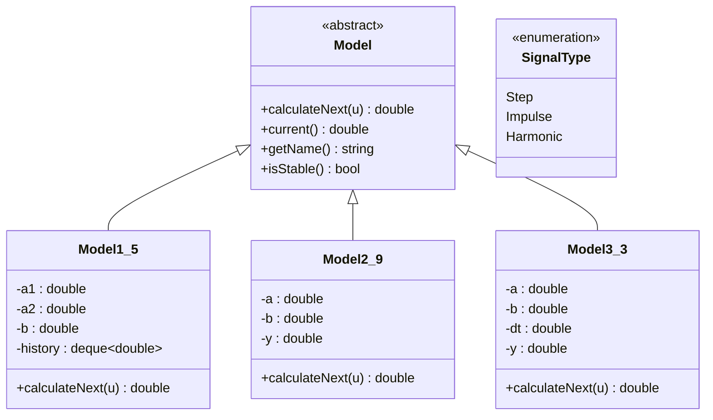
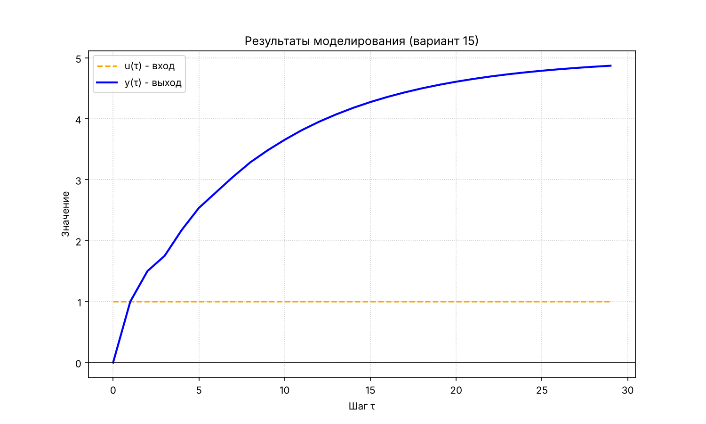
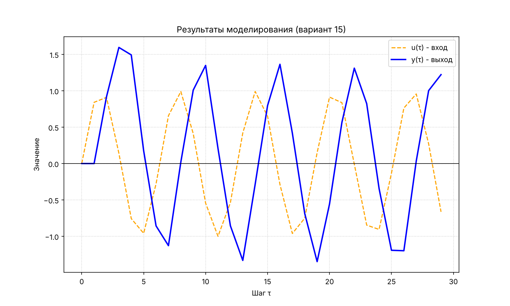
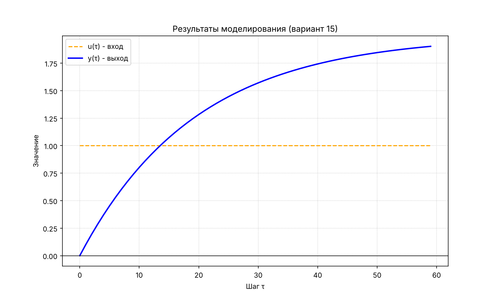

<p align="center">Министерство образования Республики Беларусь</p>
<p align="center">Учреждение образования</p>
<p align="center">«Брестский государственный технический университет»</p>
<p align="center">Кафедра ИИТ</p>
<br><br><br>
<p align="center">Лабораторная работа №1</p>
<p align="center">По дисциплине «Общая теория интеллектуальных систем»</p>
<p align="center">Тема: «Моделирование температуры объекта»</p>
<br><br><br>
<p align="right">Выполнила:</p>
<p align="right">Студентка 2 курса</p>
<p align="right">Группы ИИ-29</p>
<p align="right">Малютюк А. С.</p>
<p align="right">Проверил:</p>
<p align="right">Дворанинович Д. А.</p>
<br><br>
<p align="center">Брест 2026</p>

---

## Цель работы

Изучить методы математического моделирования управляемых объектов и реализовать на C++ программу, которая моделирует поведение трёх систем (вариант 15):

- линейная модель: Model 1.5;
- нелинейная модель: Model 2.9;
- дифференциальное уравнение: Model 3.3.

## Описание моделей

### Model 1.5 — система с запаздыванием состояния

$$y_{\tau+1} = a_1 y_\tau + a_2 y_{\tau-k} + b\,u_\tau$$

Здесь $a_1, a_2, b$ — постоянные коэффициенты, $k \ge 1$ — задержка в шагах. Значение выхода зависит не только от текущего состояния, но и от состояния, которое было $k$ шагов назад. Прошлые значения хранятся в очереди (`std::deque`), в которой всегда лежат $y_{\tau-k}, \dots, y_\tau$.

### Model 2.9 — корень с сохранением знака

$$y_{\tau+1} = a\,y_\tau + b\sqrt{|u_\tau|}\cdot \mathrm{sign}(u_\tau)$$

Нелинейное звено: вход сначала проходит через корень с сохранением знака (как расход через клапан), а затем попадает в линейную цепочку. Большие значения входа «сжимаются», малые усиливаются.

### Model 3.3 — стандартный процесс первого порядка

$$\frac{dy}{dt} = -a\,y + b\,u$$

Решается методом Эйлера с шагом $\Delta t$:

$$y_{\tau+1} = y_\tau + \Delta t\,(-a\,y_\tau + b\,u_\tau)$$

## Входные воздействия

1. Ступенчатое: $u_\tau = A$.
2. Импульсное: $u_0 = A$, $u_\tau = 0$ при $\tau > 0$.
3. Гармоническое: $u_\tau = A \sin(\tau)$.

## Устойчивость (дополнительное задание)

Перед симуляцией программа проверяет коэффициенты и выводит предупреждение, если устойчивость не гарантируется.

- **Model 1.5.** Характеристическое уравнение: $z^{k+1} - a_1 z^k - a_2 = 0$. Система устойчива, если все корни лежат внутри единичного круга $|z|<1$. Достаточное условие: $|a_1| + |a_2| < 1$. Оно и проверяется в программе.
- **Model 2.9.** Для ограниченного входа выход ограничен, если $|a| < 1$.
- **Model 3.3.** После дискретизации Эйлера $y_{\tau+1} = (1 - a\Delta t)\,y_\tau + b\Delta t\,u_\tau$, корень $z = 1 - a\Delta t$, условие устойчивости $|1 - a\Delta t| < 1$.

## Архитектура программы (ООП)

Базовый абстрактный класс `Model` содержит чисто виртуальный метод `calculateNext(u)`, который считает следующий шаг. От него наследуются три класса, каждый из которых реализует своё уравнение: `Model1_5`, `Model2_9`, `Model3_3`. Входные сигналы описаны в `Signals.h`, ввод данных и вывод таблицы — в `main.cpp`.



## Возможности программы

- выбор модели (1.5, 2.9 или 3.3);
- ввод коэффициентов (пустой ввод — значение по умолчанию);
- выбор входного сигнала и амплитуды;
- настройка количества шагов $n$;
- вывод результата в виде таблицы в консоль и в файл `result.csv`;
- предупреждение о возможной неустойчивости;
- построение графика (Python, matplotlib): `python plot.py result.csv`.

## Сборка и запуск

Сборка выполняется через CMake. Нужны CMake, компилятор C++ и Python с matplotlib (`pip install matplotlib`).

1. `src\build.bat` — конфигурация и сборка, результат: `build\bin\lab01.exe`.
2. `src\run.bat` — запуск программы. После расчёта график строится командой `python plot.py result.csv`.

## Результаты

Model 1.5, ступенчатый вход, $a_1 = 0.5$, $a_2 = 0.3$, $b = 1$, $k = 2$:

```
   tau             u             y
     0       1.00000       0.00000
     1       1.00000       1.00000
     2       1.00000       1.50000
     3       1.00000       1.75000
     4       1.00000       2.17500
     5       1.00000       2.53750
```

Графики:







## Выводы

Реализованы три модели на основе принципов ООП: общий абстрактный класс и три наследника. Программа позволяет задавать коэффициенты, входной сигнал и число шагов, выводит таблицу, строит график и предупреждает о неустойчивости. Сборка выполняется через CMake.
