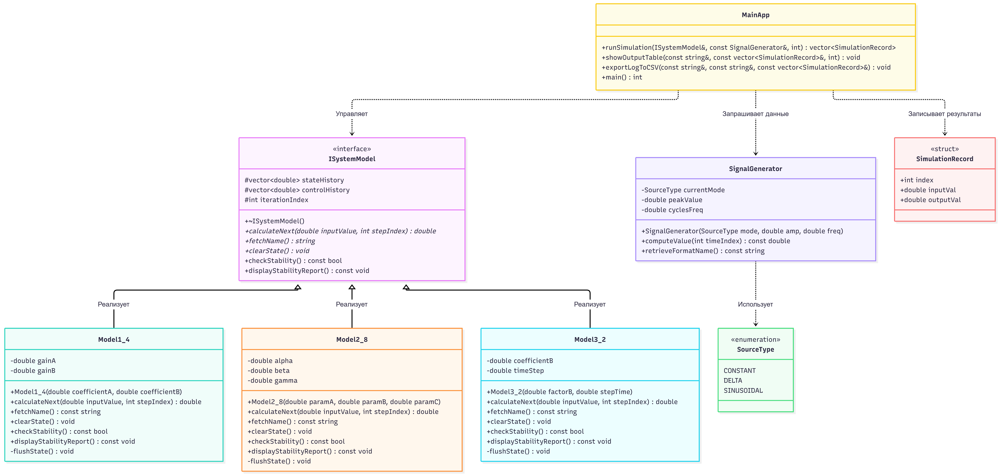
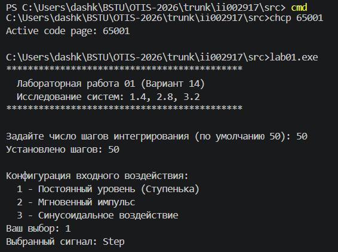
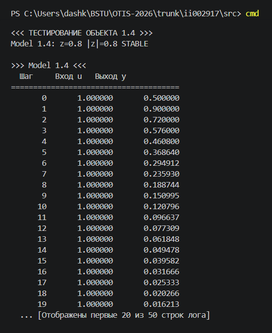
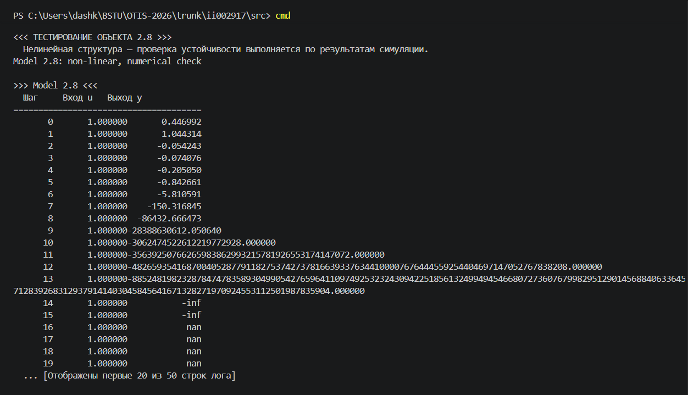
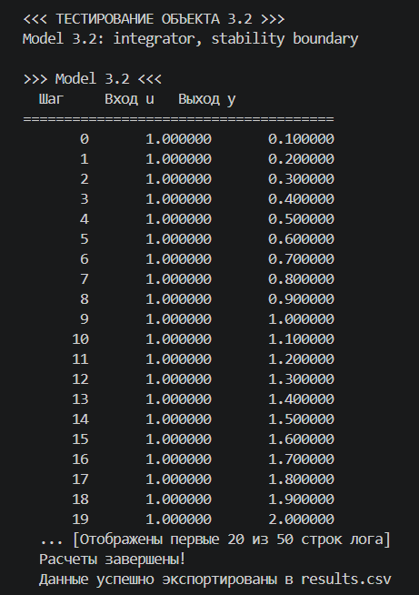
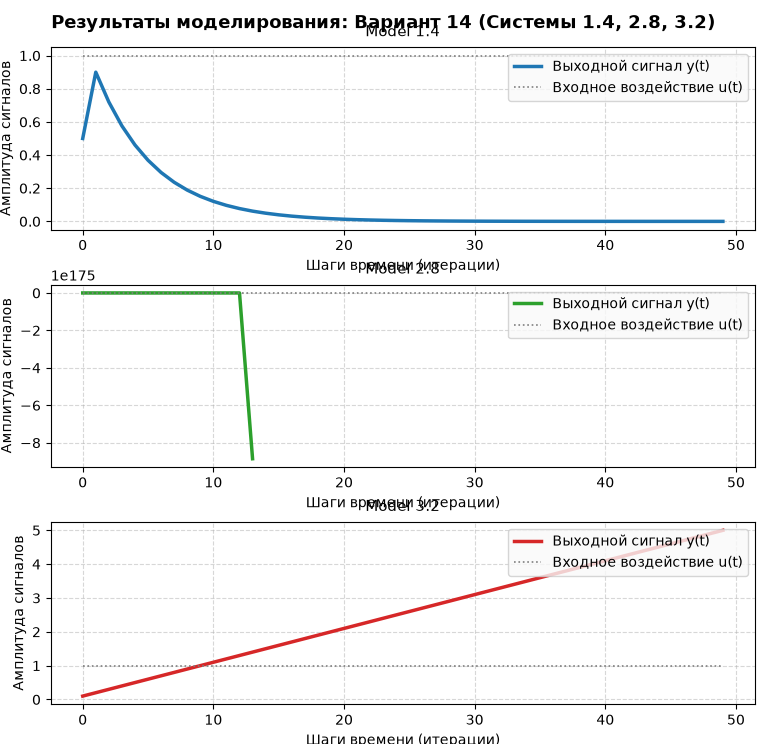
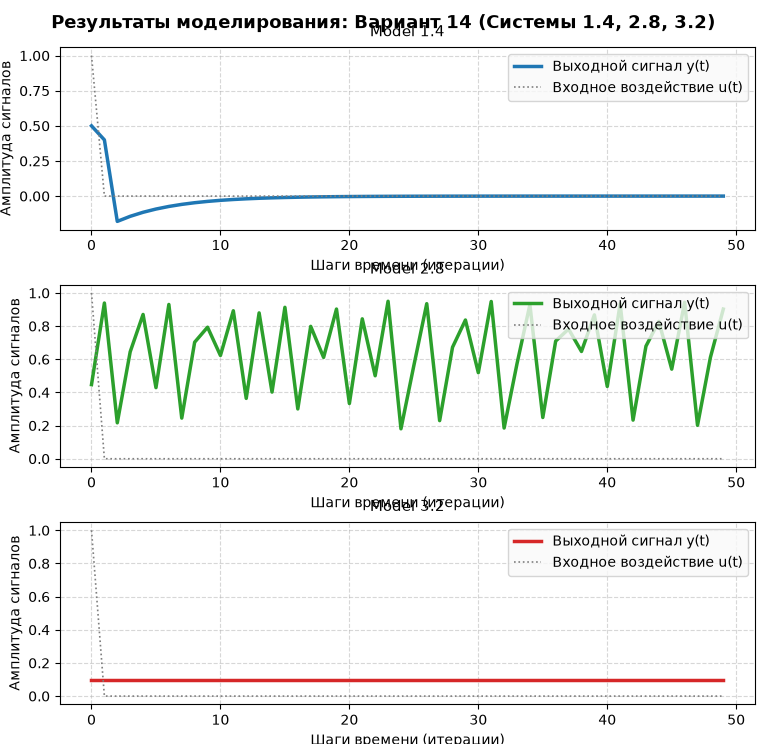
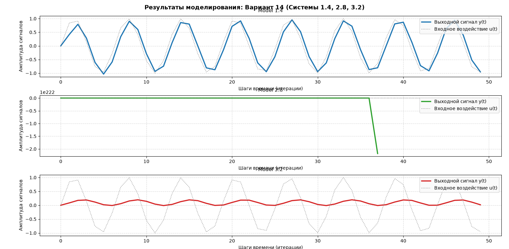

<p align="center"> Министерство образования Республики Беларусь</p>
<p align="center">Учреждение образования</p>
<p align="center">"Брестский Государственный технический университет"</p>
<p align="center">Кафедра ИИТ</p>
<br><br><br><br><br><br><br>
<p align="center">Лабораторная работа №1</p>
<p align="center">По дисциплине "Общая теория интеллектуальных систем"</p>
<p align="center">Тема: "Моделирование температуры объекта"</p>
<br><br><br><br><br>
<p align="right">Выполнил:</p>
<p align="right">Студент 2 курса</p>
<p align="right">Группы ИИ-29</p>
<p align="right">Овсянникова Д.В.</p>
<p align="right">Проверил:</p>
<p align="right">Дворанинович Д. А.</p>
<br><br><br><br><br>
<p align="center">Брест 2026</p>

---

## Вариант 14

- Линейная модель: **Model 1.4**
- Нелинейная модель: **Model 2.8**
- Дифференциальное уравнение: **Model 3.2**

## Реализованные модели

### Model 1.4 (Дискретный интегратор с потерями)

`y(t+1) = a * y(t) + b * (u(t) - u(t-1))`

Где `a`, `b` — постоянные коэффициенты.

**Анализ устойчивости (Задание 12):**

Характеристическое уравнение (при `u = 0`):

`y(t+1) - a * y(t) = 0`

Подстановка `y(t) = z^t`:

`z - a = 0  =>  z = a`

Критерий устойчивости на Z-плоскости: все корни должны лежать внутри единичного круга (`|z| < 1`).

- При `a = 0.8`: корень `z = 0.8`, `|z| = 0.8 < 1` → **система устойчива**
- При `|a| >= 1`: система неустойчива, процесс расходится

В программе реализована проверка: если коэффициенты приводят к неустойчивости, выводится предупреждение:

### Model 2.8 (Хаотическое возмущение логистического отображения)

`y(t+1) = a * y(t) * (1 - y(t)) + b * u(t) + c * sin(y(t-1) * u(t))`

Где `a`, `b`, `c` — параметры системы.

<<<<<<< HEAD
=======
# Результат
Программа:

- позволяет задать количество шагов `n`;
- позволяет выбрать входное воздействие;
- выводит анализ устойчивости для каждой модели;
- выводит предупреждение при неустойчивых коэффициентах;
- выводит результаты в табличном виде;
- сохраняет результаты в `results.csv`;
- позволяет построить график через Python/Matplotlib.


### Model 2.8 (Хаотическое возмущение логистического отображения)

`y(t+1) = a * y(t) * (1 - y(t)) + b * u(t) + c * sin(y(t-1) * u(t))`

Где `a`, `b`, `c` — параметры системы.

>>>>>>> 5d05ca070b955d21b15fff9d46ed7023ecf3011e
**Анализ устойчивости:**

Для нелинейной модели аналитический критерий неприменим. Используется численная проверка: если `|y|` растёт безгранично за последние 10 шагов моделирования → система неустойчива.

### Model 3.2 (Чистое интегрирование входного сигнала)

`dy/dt = b * u`

Для численного решения используется метод Эйлера с шагом `dt`:

`y(t+1) = y(t) + dt * b * u(t)`

**Анализ устойчивости:**

Передаточная функция: `W(s) = b / s`

Полюс `s = 0` (на мнимой оси) → система-интегратор находится **на границе устойчивости**.

При постоянном `u`: `y` растёт линейно (неограниченно), но не экспоненциально.

## Входные воздействия

1. Ступенчатое: `u(t) = A`
2. Импульсное: `u(0) = A`, `u(t > 0) = 0`
3. Гармоническое: `u(t) = A * sin(t)`

## ООП

Создан абстрактный базовый класс `ISystemModel` с виртуальным методом `calculateNext()`.

От него наследуются:

- `Model1_4`
- `Model2_8`
- `Model3_2`

Также реализован класс `SignalGenerator` для генерации входных воздействий трёх типов (`SourceType::CONSTANT`, `SourceType::DELTA`, `SourceType::SINUSOIDAL`).

<<<<<<< HEAD
=======
## UML Схема структуры классов приложения



>>>>>>> 5d05ca070b955d21b15fff9d46ed7023ecf3011e
## Результат

Программа:

- позволяет задать количество шагов `n`;
- позволяет выбрать входное воздействие;
- выводит анализ устойчивости для каждой модели;
- выводит предупреждение при неустойчивых коэффициентах;
- выводит результаты в табличном виде;
- сохраняет результаты в `results.csv`;
- позволяет построить график через Python/Matplotlib.
<<<<<<< HEAD
=======


## Сборка

На Windows через `build.bat`:

```bat
@echo off
setlocal

if not exist "%~dp0CMakeLists.txt" (
    echo ERROR CMakeLists not found in this folder
    pause
    exit /b 1
)

cd /d "%~dp0"

echo STARTING BUILD PROCESS

echo STAGE 1 Configuration
cmake -S . -B build
if errorlevel 1 goto error

echo STAGE 2 Compilation
cmake --build build --config Release
if errorlevel 1 goto error

echo SUCCESS Build completed successfully
echo Executable files are in build Release folder
pause
goto end

:error
echo ERROR Build failed
pause
exit /b 1

:end
endlocal
```

### Демонстрация исполняемого файла otis_task_01.exe:






При запуске исполняемого файла мы получаем результат файл.csv, после чего автоматически запускается plot.py для визуализации ответа:

## Демострация ступенчатого воздействия

## Демострация импульсного воздействия

## Демострация гармонического воздействия


>>>>>>> 5d05ca070b955d21b15fff9d46ed7023ecf3011e


### Model 2.8 (Хаотическое возмущение логистического отображения)

`y(t+1) = a * y(t) * (1 - y(t)) + b * u(t) + c * sin(y(t-1) * u(t))`

Где `a`, `b`, `c` — параметры системы.

**Анализ устойчивости:**

Для нелинейной модели аналитический критерий неприменим. Используется численная проверка: если `|y|` растёт безгранично за последние 10 шагов моделирования → система неустойчива.

### Model 3.2 (Чистое интегрирование входного сигнала)

`dy/dt = b * u`

Для численного решения используется метод Эйлера с шагом `dt`:

`y(t+1) = y(t) + dt * b * u(t)`

**Анализ устойчивости:**

Передаточная функция: `W(s) = b / s`

Полюс `s = 0` (на мнимой оси) → система-интегратор находится **на границе устойчивости**.

При постоянном `u`: `y` растёт линейно (неограниченно), но не экспоненциально.

## Входные воздействия

1. Ступенчатое: `u(t) = A`
2. Импульсное: `u(0) = A`, `u(t > 0) = 0`
3. Гармоническое: `u(t) = A * sin(t)`

## ООП

Создан абстрактный базовый класс `ISystemModel` с виртуальным методом `calculateNext()`.

От него наследуются:

- `Model1_4`
- `Model2_8`
- `Model3_2`

Также реализован класс `SignalGenerator` для генерации входных воздействий трёх типов (`SourceType::CONSTANT`, `SourceType::DELTA`, `SourceType::SINUSOIDAL`).

## Результат

Программа:

- позволяет задать количество шагов `n`;
- позволяет выбрать входное воздействие;
- выводит анализ устойчивости для каждой модели;
- выводит предупреждение при неустойчивых коэффициентах;
- выводит результаты в табличном виде;
- сохраняет результаты в `results.csv`;
- позволяет построить график через Python/Matplotlib.

## Сборка

На Windows через `build.bat`:

```bat
@echo off
setlocal

if not exist "%~dp0CMakeLists.txt" (
    echo ERROR CMakeLists not found in this folder
    pause
    exit /b 1
)

cd /d "%~dp0"

echo STARTING BUILD PROCESS

echo STAGE 1 Configuration
cmake -S . -B build
if errorlevel 1 goto error

echo STAGE 2 Compilation
cmake --build build --config Release
if errorlevel 1 goto error

echo SUCCESS Build completed successfully
echo Executable files are in build Release folder
pause
goto end

:error
echo ERROR Build failed
pause
exit /b 1

:end
endlocal
### Демонстрация исполняемого файла otis_task_01.exe:


При запуске исполняемого файла мы получаем результат файл.csv, после чего автоматически запускается plot.py для визуализации ответа:

## Демострация ступенчатого воздействия

## Демострация импульсного воздействия

## Демострация гармонического воздействия

## Демострация UML
