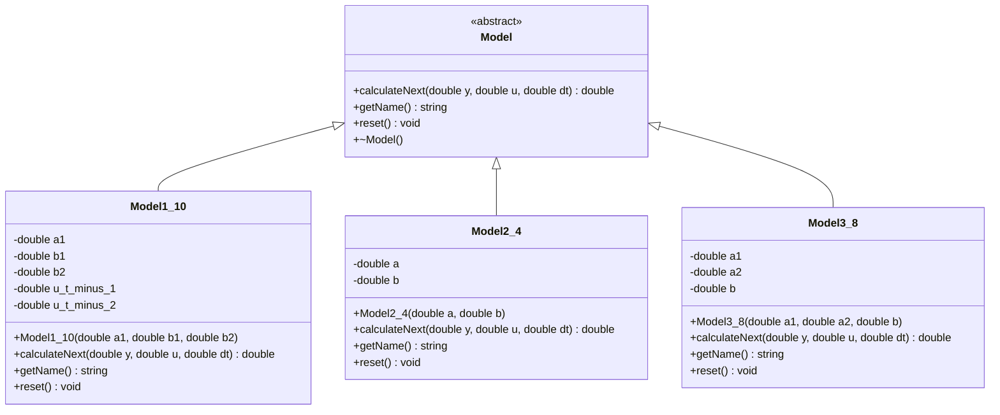
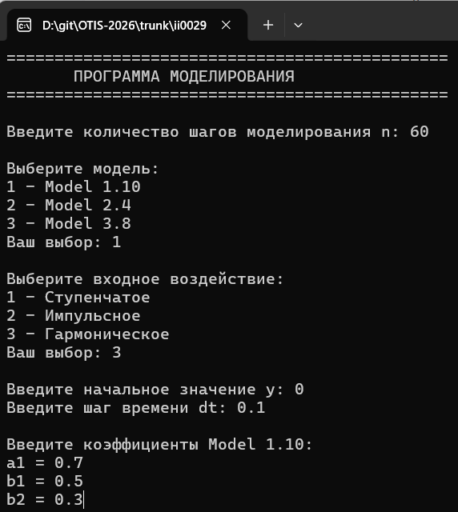
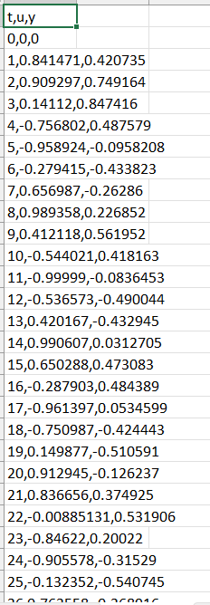
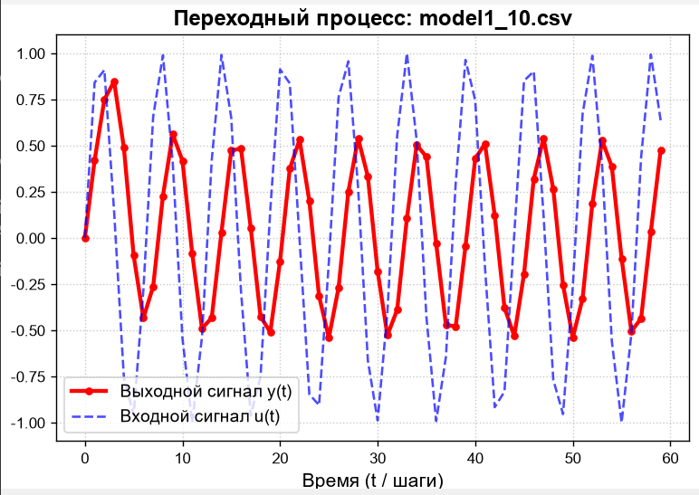
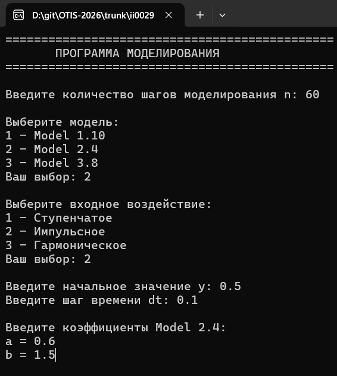
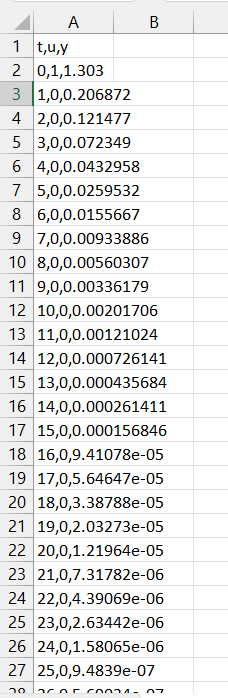
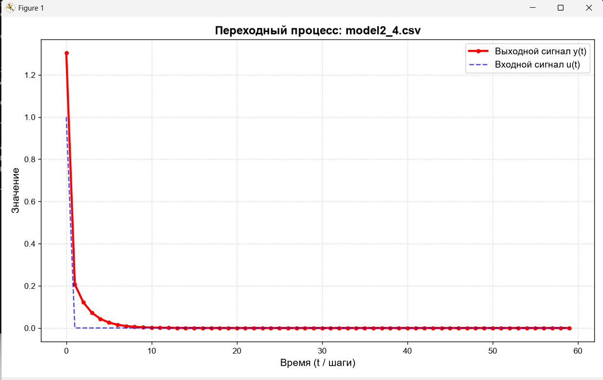
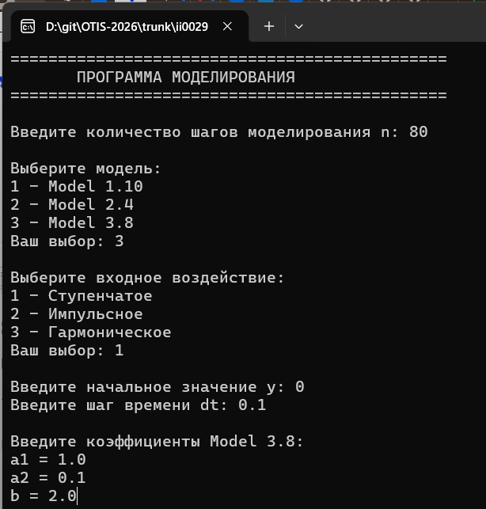
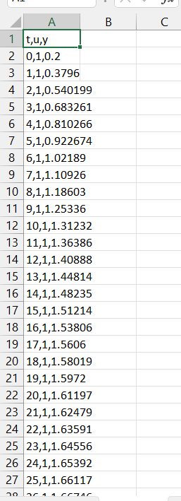
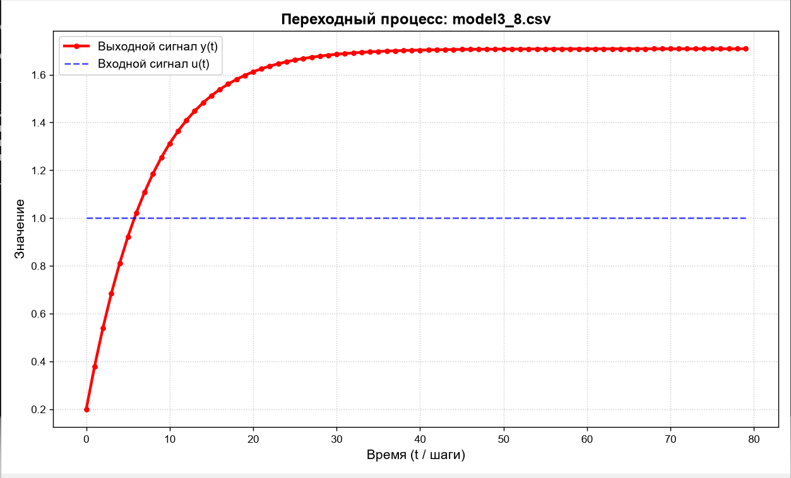

<p align="center"> Министерство образования Республики Беларусь</p>
<p align="center">Учреждение образования</p>
<p align="center">“Брестский государственный технический университет”</p>
<p align="center">Кафедра ИИТ</p>
<br><br><br><br><br><br><br>
<p align="center"><strong>Лабораторная работа №1</strong></p>
<p align="center">"По дисциплине: “Общая теория интеллектуальных систем”</p>
<p align="center"><strong>Тема:</strong> “Моделирования динамических систем”</p>
<br><br><br><br><br>

<p align="right">
Выполнила:<br>
Студентка 2 курса<br>
Группы ИИ-29<br>
Савило А. А.<br>
<br>
Проверил:<br>
Дворанинович Д. А.
</p>
<br><br><br><br>
<p align="center">Брест 2026</p>
<br><br><br><br><br>

## 1. Цель работы

Закрепить навыки разработки программ на C++, изучить функции и методы
классов, наследование, виртуальные функции, обработку пользовательского
ввода и запись результатов в файл.

## 2. Постановка задачи

Разработать консольную программу, которая моделирует одну из трёх
математических моделей. Пользователь задаёт количество шагов, выбирает
модель и входное воздействие, вводит начальное состояние, шаг времени и
коэффициенты. Результаты каждого шага выводятся в консоль и сохраняются
в CSV-файл.

### Реализованы: 
`Model 1.10` : Distributed Control Window Model - дискретная модель с задержанным входным воздействием.

`Model 2.4` : Logarithmic Multi-Variable Interaction - нелинейная модель с косинусом состояния и логарифмом модуля входа.

`Model 3.8` : Combined Linear-Quadratic Decay - модель на основе дифференциального уравнения с линейным и квадратичным членами.

Виды входного сигнала: ступенчатый, импульсный и гармонический.

## UML Диаграмма классов




<br>


## 3. Используемые средства

Программа написана на C++ и использует стандартные библиотеки:


`iostream` - Ввод с клавиатуры и вывод в консоль

 `fstream` - Запись результатов в файл

`cmath` - Математические функции cos, log, fabs, sin

`string` - Работа со строками

`clocale` - Настройка локали консоли 

Результаты сохраняются в CSV-файлы с разделителями-запятыми.

## 4. Структура программы

### 4.1. Абстрактный класс Model

Model задаёт единый интерфейс для всех моделей. Он содержит три чисто виртуальных метода:
 - `calculateNext(double y, double u, double dt)` -
вычисляет следующее значение состояния;

 - `getName() const` - возвращает название модели;
 
  - `reset()` - сбрасывает внутреннее состояние перед моделированием.

Виртуальный деструктор позволяет корректно удалять производный объект
через указатель на базовый класс.

### 4.2. Класс Model1_10

Хранит коэффициенты `a1`, `b1`, `b2` и два предыдущих значения входа
`u_t_minus_1`, `u_t_minus_2`.

Формула модели:

$$
y_{t+1} = a_1 y_t + b_1 u_t + b_2 u_{t-2}
$$

После расчёта история входного сигнала обновляется. Reset() обнуляет оба сохранённых значения. Параметр dt этой моделью не используется.

### 4.3. Класс Model2_4

Хранит коэффициенты `a` и `b`. Следующее значение вычисляется по формуле:

$$
 y\_{t+1}=a y_t\cos{=tex}(y_t)+b\ln{=tex}(1+\|u_t\|)
$$


Для вычислений применяются `cos()`, `log()` и `fabs()` из `cmath`.

Параметр `dt` не используется, а `reset()` не выполняет действий, поскольку история входного сигнала не сохраняется.

### 4.4. Класс Model3_8

Хранит коэффициенты `a1`, `a2` и `b`. Сначала рассчитывается
производная:

$$
 \frac{dy}{dt}{=tex}=-a_1y_t-a_2y_t\^2+bu_t. 
$$

Затем используется явный метод Эйлера:

$$
y_{t+1} = y_t + \Delta t \cdot \frac{dy}{dt}
$$

В отличие от первых двух моделей, здесь параметр `dt` участвует в
вычислении.

## 5. Описание функций и методов

### calculateNext(double y, double u, double dt)

Вычисляет следующее значение модели. 
- В Model1_10 учитывается
задержанное входное воздействие;
- B Model2_4 применяется нелинейное
выражение;
- B Model3_8 рассчитывается производная и выполняется шаг
метода Эйлера. Метод виртуальный и переопределён в каждом производном
классе.

### getName() const

Возвращает название выбранной модели. Функция `simulate()` использует
его при выводе заголовка в консоль.

### reset()

Подготавливает модель к новому запуску. В `Model1_10` сбрасывает историю
входного сигнала. В остальных моделях дополнительных действий не
требуется.

### getInput(int type, int t)

Формирует входной сигнал по типу и номеру шага:

| Type |    Воздействие    |            Результат            |
| :--: | :---------------- | :------------------------------ |
|  1   |    Ступенчатое    |            Всегда 1.0           |
|  2   |    Импульсное     | 1.0 при t == 0, иначе 0.0       |
|  3   |   Гармоническое   |              sin(t)             |

Для неизвестного типа возвращается `0.0`. В `main()` предусмотрена
проверка диапазона от 1 до 3.

### simulate(Model& model, int inputType, int n, double y0, double dt, const string& fileName)

Выполняет моделирование. Функция выводит название модели, вызывает
`reset()`, устанавливает начальное состояние `y0`, открывает CSV-файл и
записывает заголовок `t,u,y`. Затем цикл выполняется `n` раз:
определяется вход `u`, рассчитывается `nextY`, результат выводится в
консоль и записывается в файл, после чего `y` обновляется.

Если файл открыть не удалось, выводится сообщение об ошибке и функция
завершает работу. В столбце `t` сохраняется номер шага, а не физическое
время `t * dt`.

### main()

Организует работу программы: 

1. Настраивает локаль консоли. 

2. Запрашивает количество шагов и проверяет, что оно положительное. 

3. Предлагает выбрать модель и тип входного воздействия. 

4. Запрашивает
`y0` и `dt`, проверяет `dt > 0`. 

5. Запрашивает коэффициенты выбранной
модели, создаёт её объект и задаёт имя CSV-файла.

6. Вызывает
`simulate()`, удаляет объект через `delete` и выводит сообщение о
завершении.

При недопустимых значениях программа выводит сообщение и возвращает код
`1`.

## 6. Инструкция по работе с программой

### 6.1. Запуск

1.  Создать консольный проект C++ в используемой среде разработки.
2.  Сохранить код в файл с расширением .cpp.
3.  Собрать и запустить проект.

При наличии компилятора g++ можно использовать:

``` bash
g++ main.cpp -o model_simulation
```

В Windows запустить программу можно командой:

``` powershell
.\model_simulation.exe
```

### 6.2. Ввод данных

Программа последовательно запросит: 

1. **Количество шагов n** -
целое число больше нуля, например 10.   

2. **Номер модели** - 1, 2
или 3. 

3. **Тип воздействия** - 1 для ступенчатого, 2 для
импульсного, 3 для гармонического.

 4. **Начальное состояние y0** -
например, 0. 

5. **Шаг времени dt** - положительное число, например
0.1. 

6. **Коэффициенты модели** - значения, перечисленные в запросах
программы.

Пример выбора модели 3.8 и ступенчатого воздействия:

``` text
Введите количество шагов моделирования n: 10
Ваш выбор: 3
Ваш выбор: 1
Введите начальное значение y: 0
Введите шаг времени dt: 0.1
a1 = 0.5
a2 = 0.1
b = 1
```

Это пример формата ввода; конкретные значения результатов зависят от
введённых параметров.

### 6.3. Результаты

В консоли отображается таблица с колонками t, u и y:

 t -
номер шага; u - входное воздействие; y - вычисленное
значение состояния на текущем шаге.

Результаты сохраняются в рабочем каталоге.

CSV-файл содержит заголовок `t,u,y`. При повторном запуске с тем же
именем файл открывается заново и предыдущие данные перезаписываются.

### 6.4. Возможные ошибки и ограничения

  -----------------------------------------------------------------------
  Ситуация.                            Реакция программы
  ----------------------------------- -----------------------------------
  `n <= 0`.                            Сообщение об ошибке и завершение

  Тип воздействия не в диапазоне.      Сообщение о неверном типе
  `1–3`                               

  `dt <= 0`    .                       Сообщение об ошибке шага времени

  Неверный номер модели  .             Сообщение об ошибке

  CSV-файл не открывается .            Сообщение об ошибке, моделирование
                                      прекращается
  -----------------------------------------------------------------------

Программа не проверяет все возможные ошибки ввода. Если вместо числа
ввести текст, поток `cin` может перейти в состояние ошибки. Также не
предусмотрена защита от чрезмерно больших значений состояния при
неподходящих коэффициентах.
<br><br>

## Пример работы программы

### Сборка и запуск

Сборка осуществляется с помощью файла `build.bat`:
```bat
@echo off
chcp 65001 >nul

echo ========================================
echo          СБОРКА ПРОЕКТА
echo ========================================

if not exist build (
    mkdir build
)

cd build

echo.
echo [1/2] Конфигурация проекта (CMake)...
cmake ..

if errorlevel 1 (
    echo.
    echo ОШИБКА: CMake не смог настроить проект.
    pause
    exit /b 1
)

echo.
echo [2/2] Компиляция кода...
cmake --build . --config Debug

if errorlevel 1 (
    echo.
    echo ОШИБКА: в коде есть ошибки, смотри текст выше.
    pause
    exit /b 1
)

echo.
echo ========================================
echo СБОРКА УСПЕШНО ЗАВЕРШЕНА!
echo ========================================
echo Программа: build\Debug\SimulationModels.exe

pause
```

### Демонстрация модели 1.10 с гармоническим воздействием:







### Демонстрация модели 2.4 с импульсивным воздействием:







### Демонстрация модели 3.8 cо ступенчатым воздействием:







## 7. Особенности реализации

-   **Абстракция:** базовый класс `Model` задаёт общий интерфейс.
-   **Наследование:** три класса реализуют отдельные математические
    модели.
-   **Полиморфизм:** функция `simulate()` работает со ссылкой на
    `Model`, не завися от конкретного производного класса.
-   **Разделение обязанностей:** `getInput()` формирует сигнал,
    `simulate()` выполняет расчёты и сохранение, `main()` отвечает за
    диалог с пользователем.
-   **Файловый вывод:** `ofstream` используется для записи CSV.
-   **Управление памятью:** объект создаётся через `new` и освобождается
    через `delete`.

В модели 1.10 история входа изначально равна нулю, а формула использует
`u_{t-2}`. В моделях 2.4 и 3.8 история входа не хранится.

## 8. Результат работы

Разработана консольная программа, позволяющая выбрать одну из трёх
математических моделей, задать входное воздействие и параметры,
выполнить пошаговое моделирование и сохранить результаты в CSV-файл.

## 9. Заключение

В ходе лабораторной работы были закреплены навыки разработки функций и
методов C++, использования абстрактного класса, наследования и
виртуальных функций. Также были применены математические операции,
условные конструкции, циклы, динамическое создание объекта и файловый
ввод-вывод. Поставленная задача выполнена: программа поддерживает три
модели, три вида входного воздействия и сохранение результатов
моделирования.
