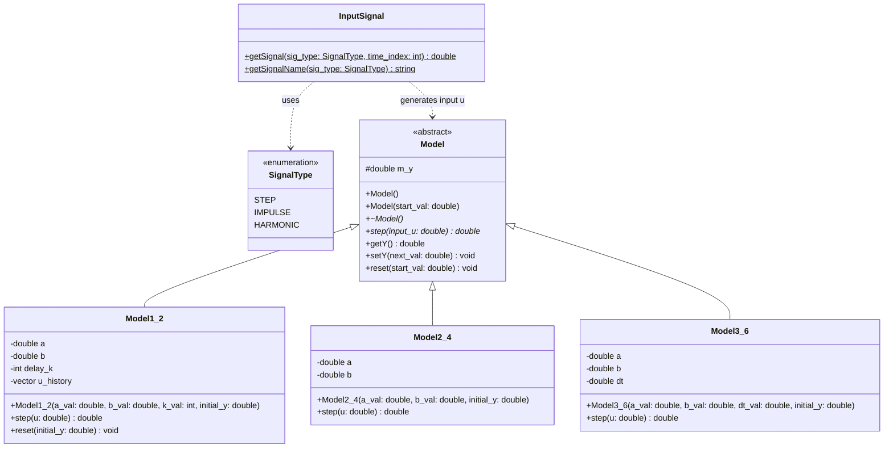
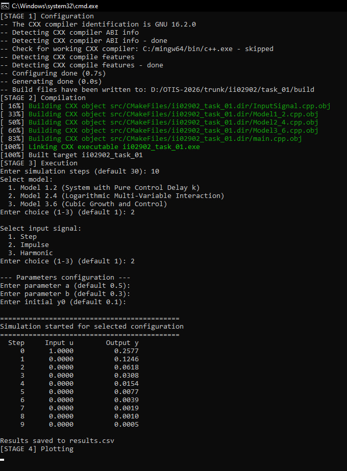
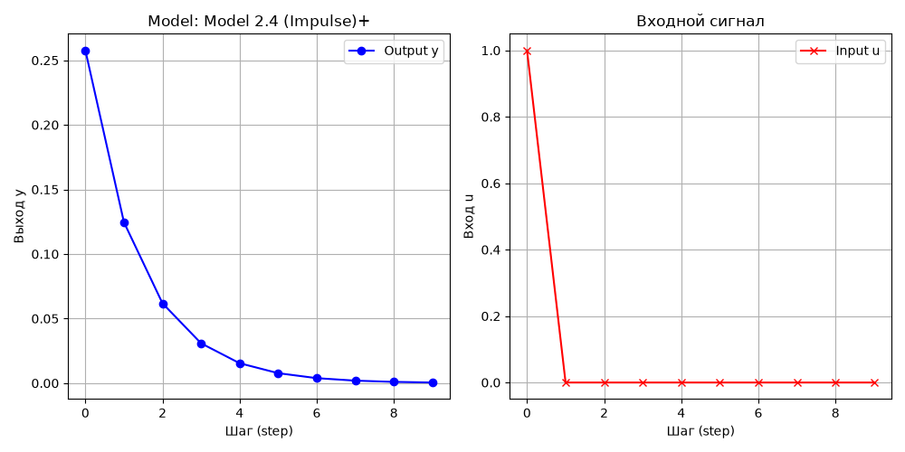

<p align="center">Министерство образования Республики Беларусь</p>
<p align="center">Учреждение образования</p>
<p align="center">«Брестский государственный технический университет»</p>
<p align="center">Кафедра ИИТ</p>
<br><br><br><br><br>
<p align="center"><b>Лабораторная работа №1</b></p>
<p align="center"><b>По дисциплине: «Общая теория интеллектуальных систем»</b></p>
<p align="center"><b>Тема: «Моделирование динамических систем»</b></p>
<br><br><br><br>
<p align="right">Выполнил:</p>
<p align="right">Студент 2 курса</p>
<p align="right">Группы ИИ-29</p>
<p align="right">Барсуков Д. В.</p>
<p align="right">Проверил:</p>
<p align="right">Дворанинович Д. А.</p>
<br><br><br><br>
<p align="center">Брест 2026</p>

---

## Вариант 2

- Линейная модель: **Model 1.2**
- Нелинейная модель: **Model 2.4**
- Дифференциальное уравнение: **Model 3.6**

## Реализованные модели

| Блок | Модель | Тип | Название | Уравнение |
|:--:|:--:|:--:|---|---|
| 1 | 1.2 | Линейная дискретная | System with Pure Control Delay $k$ | $y_{\tau+1} = a y_\tau + b u_{\tau-k}$ |
| 2 | 2.4 | Нелинейная дискретная | Logarithmic Multi-Variable Interaction | $y_{\tau+1} = a y_\tau \cdot \cos(y_\tau) + b \ln(1 + \|u_\tau\|)$ |
| 3 | 3.6 | Дифференциальное уравнение | Cubic Growth and Control | $\frac{dy}{dt} = a y^3 + b u$ (метод Эйлера) |

## Входные воздействия

1. Ступенчатое: $u(\tau) = A$
2. Импульсное: $u(0) = A, \quad u(\tau > 0) = 0$
3. Гармоническое: $u(\tau) = A \cdot \sin(0.4 \tau)$

## ООП Архитектура

Создан базовый полиморфный класс `Model` с виртуальным методом перехода `step(double u)`.

От него наследуются конкретные классы моделей:
- `Model1_2` — линейная система с буферизацией истории входов для реализации чистого запаздывания $k$;
- `Model2_4` — нелинейная рекуррентная модель с тригонометрическими и логарифмическими нелинейностями;
- `Model3_6` — нелинейный процесс с кубической правой частью, интегрируемый методом Эйлера.

## UML Диаграмма классов


## Пример работы программы

### Сборка и запуск

Сборка осуществляется с помощью файла `build.bat`:

```
@echo off
setlocal
chcp 65001 >nul

if not exist "%~dp0CMakeLists.txt" (
    echo ERROR: CMakeLists.txt not found in this folder
    pause
    exit /b 1
)

cd /d "%~dp0"

echo STARTING BUILD PROCESS

echo [STAGE 1] Configuration
cmake -S . -B build -G "MinGW Makefiles"
if errorlevel 1 goto error

echo [STAGE 2] Compilation
cmake --build build
if errorlevel 1 goto error

echo [STAGE 3] Execution
if exist "build\src\ii02902_task_01.exe" (
    "build\src\ii02902_task_01.exe"
) else if exist "build\task_01.exe" (
    "build\task_01.exe"
) else (
    echo WARNING: Executable not found in standard paths
)
if errorlevel 1 goto error

echo [STAGE 4] Plotting
D:\python.exe src\plot.py
if errorlevel 1 goto error

echo SUCCESS: Build completed successfully
pause
goto end

:error
echo ERROR: Build failed
pause
exit /b 1

:end
endlocal
```
После сборки исполняемый файл запускается автоматически либо вручную из каталога `build/src`.

### Демонстрация исполняемого файла task_01.exe:



При запуске исполняемого файла мы получаем результат `results.csv`, после чего автоматически запускается `src/plot.py` для визуализации ответа:

### Пример графика переходных процессов


## Вывод

Программа:
- моделирует все три системы варианта;
- симулирует отклик на все три типа входных воздействий (ступенчатое, импульсное, гармоническое);
- позволяет задать количество шагов `n`;
- выводит результаты в табличном виде;
- сохраняет результаты в `results.csv`;
- визуализирует графики через Python/Matplotlib.