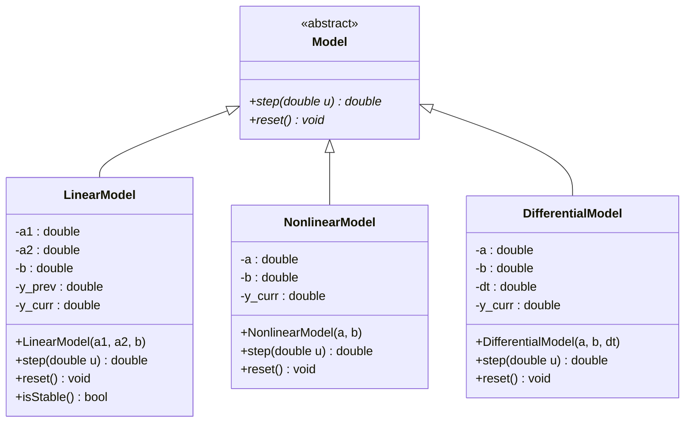

# UML-диаграмма классов

## Описание

- **Model** — абстрактный базовый класс с чисто виртуальными методами `step` и `reset`.
- **LinearModel** — реализация линейной модели 1.3 + проверка устойчивости.
- **NonlinearModel** — реализация нелинейной модели 2.5.
- **DifferentialModel** — реализация дифференциальной модели 3.7 методом Эйлера.
