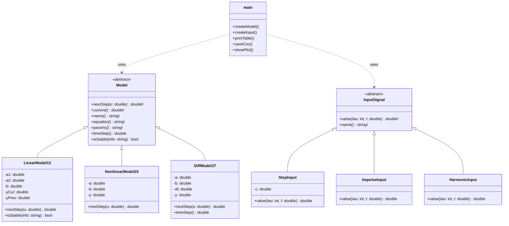

# Лабораторная работа №1. Моделирование управляемого объекта

**Студент:** Белозерова Анна Александровна, группа 29, номер 03 (ii02903)  
**Вариант:** 3  
**Модели:** Model 1.3 (линейная), Model 2.5 (нелинейная), Model 3.7 (дифференциальное уравнение)

## 1\. Цель работы

Реализовать на C++ три модели объекта управления (линейную, нелинейную и дифференциальное уравнение, решаемое методом Эйлера), промоделировать их при трёх типах входного воздействия, вывести результаты в виде таблицы и графика.

## 2\. Математические модели (вариант 3)

|Блок|Модель|Уравнение|
|-|-|-|
|Линейная|Model 1.3 — система второго порядка|$y\_{\\tau+1} = a\_1 y\_\\tau + a\_2 y\_{\\tau-1} + b,u\_\\tau$|
|Нелинейная|Model 2.5 — знаковое трение и экспонента|$y\_{\\tau+1} = a,y\_\\tau + b\\cdot \\mathrm{sign}(u\_\\tau)\\cdot(1 - e^{-\\lvert u\_\\tau\\rvert})$|
|Дифференциальное|Model 3.7 — экспоненциальное масштабирование|$\\dfrac{dy}{dt} = -e^{a y} + b,u$|

Для Model 3.7 используется метод Эйлера:

$$y\_{k+1} = y\_k + \\Delta t,\\bigl(-e^{a y\_k} + b,u\_k\\bigr)$$

Входные воздействия:

|Тип|Формула|
|-|-|
|Ступенчатое|$u\_\\tau = \\text{const}$|
|Импульсное|$u\_0 = 1,; u\_{\\tau>0} = 0$|
|Гармоническое|$u\_\\tau = \\sin(\\tau)$ (для ДУ: $\\sin(t)$, где $t = \\tau,\\Delta t$)|

Начальные условия: $y\_0$ вводится пользователем, $y\_{-1} = 0$ (для Model 1.3).

## 3\. Архитектура программы (ООП)

Базовый абстрактный класс `Model` содержит чисто виртуальный метод `nextStep(u)`, который считает следующий шаг симуляции. Конкретные уравнения реализованы в классах-наследниках `LinearModel13`, `NonlinearModel25`, `DiffModel37`. Входные сигналы устроены так же: абстрактный `InputSignal` и наследники `StepInput`, `ImpulseInput`, `HarmonicInput`.

### UML-диаграмма классов

Та же диаграмма вынесена в отдельный файл: [UML.md](UML.md).



### Структура каталога

```
trunk/ii02903/task\_01/
├── src/
│   ├── build.bat         # сборка через CMake
│   ├── run.bat           # запуск программы
│   ├── CMakeLists.txt
│   ├── main.cpp          # меню, ввод, расчёт, таблица, CSV
│   ├── models.h          # класс Model и наследники
│   ├── signals.h         # входные сигналы
│   └── plot.py           # график и таблица (Python / matplotlib)
└── doc/
    ├── readme.md         # этот отчёт
    ├── UML.md            # UML-диаграмма классов
    └── img/              # скриншоты
```

## 4\. Функционал программы

Программа:

* позволяет **выбрать одну модель** в меню (1 — Model 1.3, 2 — Model 2.5, 3 — Model 3.7);
* принимает коэффициенты модели ($a\_1, a\_2, b$ и т.д.) и начальное значение $y\_0$ с клавиатуры (Enter подставляет значение по умолчанию);
* позволяет **выбрать входное воздействие**: ступенчатое, импульсное или гармоническое;
* позволяет задать количество шагов симуляции $n$;
* для Model 1.3 перед расчётом проверяет устойчивость системы и выводит предупреждение, если процесс расходится (см. раздел 5);
* выводит результаты таблицей в консоль;
* сохраняет результаты каждого расчёта в отдельный CSV-файл формата `t,u,y`: `model13\_step.csv`, `model13\_impulse.csv`, `model13\_harmonic.csv`, `model25\_step.csv`, `model25\_impulse.csv`, `model25\_harmonic.csv`, `model37\_step.csv`, `model37\_impulse.csv`, `model37\_harmonic.csv`;
* **автоматически открывает окно** с графиками $u(\\tau)$, $y(\\tau)$ и таблицей значений (Python/Matplotlib, файл `plot.py`), искать картинку не нужно.

Порядок работы: запустить `src\\build.bat` (сборка), затем `src\\run.bat` → выбрать модель → ввести параметры → выбрать вход → ввести $n$ → смотреть таблицу в консоли и окно с графиком.

Сборка: `src\\build.bat`, запуск: `src\\run.bat` (нужны CMake, компилятор C++, Python и `pip install matplotlib`). Скрипт по шагам показывает конфигурацию и сборку, затем запускает программу.

## 5\. Анализ устойчивости (Advanced Level)

Для Model 1.3 применим Z-преобразование ($y\_{\\tau-1} \\to z^{-1}Y$):

$$z^2 - a\_1 z - a\_2 = 0 \\quad\\Rightarrow\\quad z\_{1,2} = \\frac{a\_1 \\pm \\sqrt{a\_1^2 + 4a\_2}}{2}$$

Система асимптотически устойчива, если оба корня лежат внутри единичной окружности: $\\lvert z\_{1,2}\\rvert < 1$. Эквивалентно (условия Джури):

$$\\lvert a\_2\\rvert < 1,\\qquad 1 - a\_1 - a\_2 > 0,\\qquad 1 + a\_1 - a\_2 > 0.$$

Если корни комплексные ($a\_1^2 + 4a\_2 < 0$), то $\\lvert z\\rvert = \\sqrt{-a\_2}$.

В программе корни вычисляются по этим формулам. Если $\\max\\lvert z\\rvert \\ge 1$, перед началом симуляции в консоль выводится предупреждение.

## 6\. Результаты работы (примеры запусков)

### 6.1. Model 1.3, ступенчатый вход, $a\_1 = 0.9,\\ a\_2 = -0.2,\\ b = 0.5,\\ u = 1$ (устойчивая система)

Файл результата: `model13\_step.csv`. Корни: $z\_1 = 0.5,\\ z\_2 = 0.4$, $\\max\\lvert z\\rvert = 0.5 < 1$. Установившееся значение $y\_\\infty = \\dfrac{b,u}{1 - a\_1 - a\_2} = \\dfrac{0.5}{0.3} \\approx 1.667$.

```
Stability analysis: characteristic roots: z1 = 0.5, z2 = 0.4, max|z| = 0.5
The system is stable (all |z| < 1).

   tau           t             u               y
------------------------------------------------
     0           0             1               0
     1           1             1             0.5
     2           2             1            0.95
     3           3             1           1.255
     4           4             1          1.4395
     5           5             1         1.54455
     6           6             1          1.6022
```

!\[Model 1.3, устойчивая](img/model13\_step\_stable.png)

### 6.2. Model 1.3, $a\_1 = 1.5,\\ a\_2 = 0.5$ (неустойчивая система)

Корни: $z\_1 \\approx 1.78,\\ z\_2 \\approx -0.28$. Условие $\\lvert z\\rvert < 1$ нарушено, программа выдаёт предупреждение:

```
Stability analysis: characteristic roots: z1 = 1.78078, z2 = -0.280776, max|z| = 1.78078
!!! WARNING: the system is NOT stable (|z| >= 1) - the process will diverge or oscillate without decay !!!
```

!\[Model 1.3, неустойчивая](img/model13\_step\_unstable.png)

### 6.3. Model 2.5, гармонический вход, $a = 0.8,\\ b = 1$

Выход ограничен, так как нелинейный член $b,\\mathrm{sign}(u)(1 - e^{-\\lvert u\\rvert})$ по модулю меньше $b$, а при $\\lvert a\\rvert < 1$ система «забывает» прошлое.

!\[Model 2.5, гармонический вход](img/model25\_harmonic.png)

### 6.4. Model 3.7, ступенчатый вход, $a = 0.5,\\ b = 2,\\ \\Delta t = 0.1,\\ u = 1$

Равновесие: $-e^{a y} + b u = 0 \\Rightarrow y^\* = \\dfrac{\\ln(b u)}{a} = \\dfrac{\\ln 2}{0.5} \\approx 1.386$. Решение выходит на это значение.

!\[Model 3.7, ступенчатый вход](img/model37\_step.png)

## 7\. Выводы

В ходе работы реализованы три модели варианта 3 на основе ООП: абстрактный класс `Model` и три наследника. Модели протестированы на ступенчатом, импульсном и гармоническом воздействиях. Для линейной модели аналитически получено условие устойчивости через корни характеристического уравнения на Z-плоскости, оно реализовано в программе в виде предупреждения. Результаты выводятся таблицей, сохраняются в CSV и автоматически визуализируются средствами Python/matplotlib.

