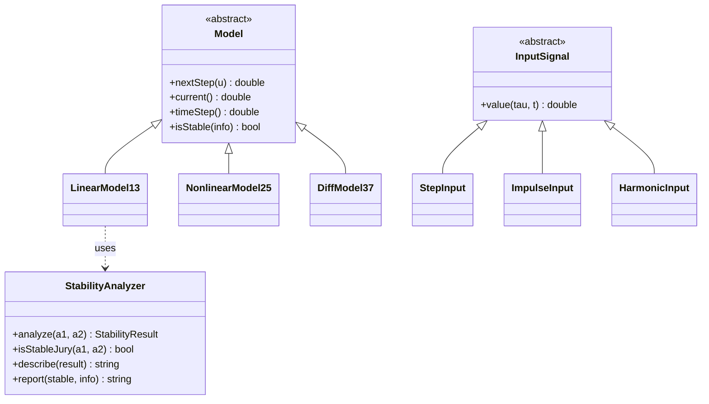
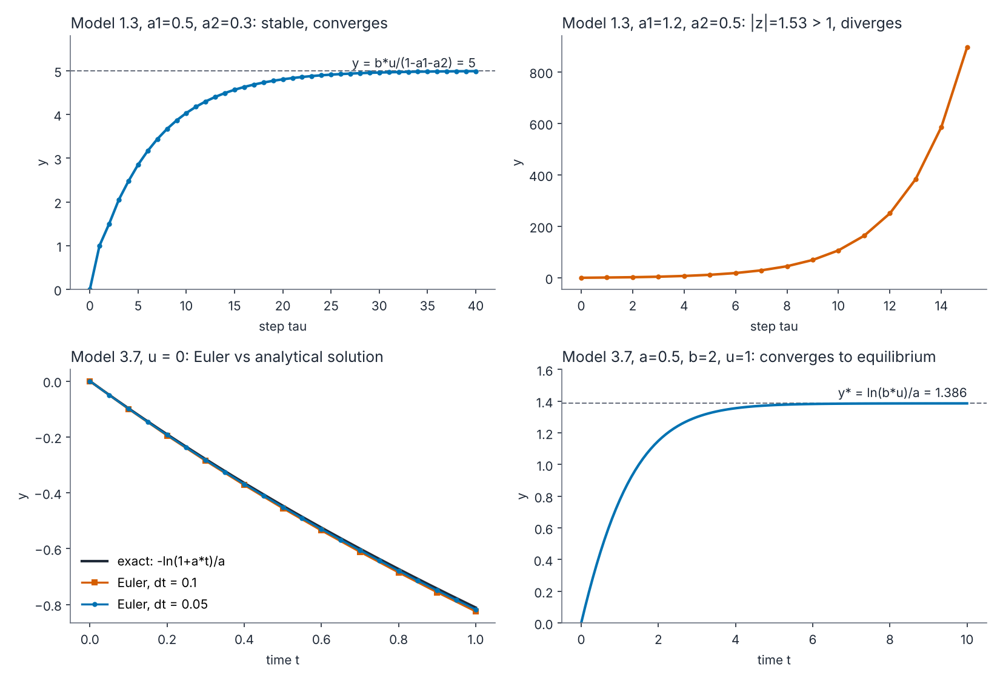

<p align="center">Министерство образования Республики Беларусь</p>
<p align="center">Учреждение образования</p>
<p align="center">«Брестский государственный технический университет»</p>
<p align="center">Кафедра интеллектуальных информационных технологий</p>
<br><br>
<p align="center"><b>Лабораторная работа № 2</b></p>
<p align="center">по дисциплине «Общая теория интеллектуальных систем»</p>
<p align="center">«Модульное тестирование и анализ устойчивости»</p>
<br><br>
<p align="right">Выполнила: студентка группы ИИ-29</p>
<p align="right">Белозерова</p>
<p align="right">Проверил: Дворанинович Д. А.</p>
<br><br>
<p align="center">Брест 2026</p>

# Лабораторная работа № 2

**Вариант:** 3 (модели 1.3, 2.5, 3.7 из лабораторной работы № 1).

## 1. Цель работы

Расширить программу из лабораторной работы № 1 модулем анализа устойчивости линейной модели и покрыть программу модульными тестами на Google Test. Показать количество тестов и процент покрытия кода.

## 2. Что сделано

1. Анализ устойчивости вынесен в отдельный модуль `StabilityAnalyzer` (`src/stability.h`, `src/stability.cpp`).
2. Код разделён на библиотеку (`models`, `simulation`, `stability`, `signals`) и программу (`main.cpp`). Программа и тесты используют один и тот же код.
3. Написаны модульные тесты Google Test, в том числе параметризованные (`TEST_P`) и с mock-объектами Google Mock.
4. Написан скрипт `run_tests.bat`: собирает проект, запускает тесты и строит отчёт о прохождении и покрытии.
5. Измерено покрытие кода инструментом gcovr.

## 3. Анализ устойчивости модели 1.3

Модель: `y(t+1) = a1*y(t) + a2*y(t-1) + b*u(t)`.

Для свободного движения (при `u = 0`) ищем решение в виде `y(t) = z^t`. Подстановка даёт характеристическое уравнение на Z-плоскости:

`z^2 - a1*z - a2 = 0`.

Корни:

`z1,2 = (a1 ± sqrt(a1^2 + 4*a2)) / 2`.

Процесс затухает, если оба корня лежат **строго внутри** единичной окружности: `|z1| < 1` и `|z2| < 1`. Если корень лежит на окружности (`|z| = 1`), колебания не затухают, такая система считается неустойчивой. Если подкоренное выражение отрицательно, корни комплексные: `z = a1/2 ± i*sqrt(-(a1^2 + 4*a2))/2`, и оба имеют модуль `sqrt(-a2)`.

Равносильное условие (критерий Джури), которое используется в тестах как независимая проверка:

`|a2| < 1`, `a1 + a2 < 1`, `a2 - a1 < 1`.

Примеры:

| a1 | a2 | Корни | max модуль | Вывод |
|---:|---:|---|---:|---|
| 0.5 | 0.3 | 0.852 и -0.352 | 0.852 | устойчива |
| 0.2 | -0.5 | 0.1 ± 0.7i | 0.707 | устойчива |
| 1.2 | 0.5 | 1.527 и -0.327 | 1.527 | неустойчива |
| 1.0 | 0.0 | 1 и 0 | 1 | граница, неустойчива |

Если коэффициенты, введённые пользователем, дают неустойчивую систему, программа выводит предупреждение **до начала расчёта**. Пример для `a1 = 1.2`, `a2 = 0.5`:

```
Stability analysis: characteristic roots: z1 = 1.52736, z2 = -0.327362, max|z| = 1.52736
!!! WARNING: the system is NOT stable (|z| >= 1) - the process will diverge or oscillate without decay !!!
```

Для моделей 2.5 и 3.7 такая проверка не определена (они нелинейные), поэтому для них базовый класс `Model` отвечает «проверять нечего».

## 4. Структура программы



```
task_02/
  CMakeLists.txt
  run_tests.bat
  run.bat
  src/
    models.h, models.cpp         модели 1.3, 2.5, 3.7
    signals.h                    входные сигналы
    stability.h, stability.cpp   модуль анализа устойчивости
    simulation.h, simulation.cpp функция simulate() и строка результата Row
    main.cpp                     меню, ввод, таблица, CSV
    plot.py                      график по CSV
    CMakeLists.txt
  test/
    mocks.h                      mock-объекты Google Mock
    test_signals.cpp
    test_linear_model13.cpp
    test_nonlinear_model25.cpp
    test_diff_model37.cpp
    test_stability.cpp
    test_simulation.cpp
    CMakeLists.txt
  doc/
    readme.md, img/
```

Расчёт одной модели вынесен из `main` в функцию `simulate(model, input, n)`: её можно проверять тестами без ввода с клавиатуры.

## 5. Что проверяют тесты

| Сценарий | Что проверяется | Где |
|---|---|---|
| Значения моделей | Выходы посчитаны вручную и сравниваются с моделью (ступенька, импульс, ненулевое `y(0)`) | `test_linear_model13`, `test_nonlinear_model25`, `test_diff_model37` |
| Устойчивость | Устойчивые и неустойчивые коэффициенты, комплексные корни, граница `\|z\| = 1`, совпадение с критерием Джури, текст предупреждения | `test_stability` |
| Граничные значения нелинейности (модель 2.5) | `u = 0`, очень малое `u`, очень большое `u` (насыщение до `b`), `u` и `-u` | `test_nonlinear_model25` |
| Инварианты | `u = 0` и `y = 0` для моделей 1.3 и 2.5 остаются в покое; линейность и суперпозиция модели 1.3; положение равновесия `y* = ln(b*u)/a` модели 3.7 | все файлы моделей |
| Шаг Эйлера | Сравнение с точным решением `y(t) = -ln(1 + a*t)/a` при `u = 0`; ошибка пропорциональна `dt` | `test_diff_model37` |
| Режимы управления | Ступенчатый, импульсный и гармонический сигналы; mock-сигнал и mock-модель | `test_signals`, `test_simulation` |

**Параметризованные тесты (`TEST_P`)** проверяют сходимость при разных наборах данных без дублирования кода: сходимость устойчивых систем к установившемуся значению `y = b*u/(1 - a1 - a2)`, расходимость неустойчивых, насыщение и нечётность модели 2.5, зависимость ошибки Эйлера от шага, совпадение двух методов проверки устойчивости на сетке `(a1, a2)`.

**Mock-объекты (Google Mock)** в `test/mocks.h`: `MockInputSignal` подменяет входной сигнал, `MockModel` подменяет модель. С их помощью проверяется, что `simulate()` спрашивает сигнал для каждого шага `tau = 0..n` со временем `t = tau*dt`, передаёт значения сигнала в `nextStep()` ровно `n` раз и в нужном порядке.

Замечание про модель 3.7. Для неё нулевой вход и нулевое состояние **не** положение покоя: при `u = 0` и `y = 0` получаем `dy/dt = -exp(0) = -1`. Поэтому для этой модели проверяется настоящее положение равновесия `y* = ln(b*u)/a`.

Проверка самих тестов: формулы в коде специально ломались (знак перед `a2`, пропуск `dt` в шаге Эйлера, граница `|z| = 1` считалась устойчивой, лишний вызов `nextStep`), и тесты после этого падали.

## 6. Сборка и запуск

Нужны CMake и компилятор C++ (Visual Studio или MinGW). Google Test скачивается CMake автоматически, поэтому **при первом запуске нужен интернет**.

1. Запустить `run_tests.bat`: скрипт сам определит компилятор, соберёт проект, запустит тесты и сохранит отчёт в `build\...\test_report.txt`.
2. Если установлены MinGW и gcovr (`pip install gcovr`), скрипт дополнительно измерит покрытие и сохранит `coverage.txt` и `coverage.html`.
3. Запустить саму программу: `run.bat`.

Команды, которые выполняет скрипт:

```
cmake -S . -B build\mingw -G "MinGW Makefiles" -DCMAKE_BUILD_TYPE=Debug -DENABLE_COVERAGE=ON
cmake --build build\mingw --config Debug
ctest -C Debug --output-on-failure
gcovr -r . --object-directory build\mingw --filter "src/" --exclude "src/main.cpp" --exclude-throw-branches --txt coverage.txt --html-details coverage.html
```

## 7. Тестовое покрытие и результаты

- Способ запуска тестов: локальный скрипт `run_tests.bat` (CMake, CTest).
- Покрытие измерено: gcovr 8.3, компилятор GCC 13.3, те же команды, что в скрипте.
- Всего модульных тестов: **147** (56 обычных `TEST` и 11 параметризованных `TEST_P`, которые разворачиваются в 91 набор данных).
- Успешно пройденных тестов: **147 / 147**.

| Файл с тестами | Тестов |
|---|---:|
| `test_signals.cpp` | 12 |
| `test_linear_model13.cpp` | 18 |
| `test_nonlinear_model25.cpp` | 26 |
| `test_diff_model37.cpp` | 19 |
| `test_stability.cpp` | 59 |
| `test_simulation.cpp` | 13 |
| **Всего** | **147** |

| Модуль / Класс | Покрытие строк (Line Coverage) | Покрытие функций (Func Coverage) | Статус |
|---|---:|---:|---|
| `models.cpp` (модели 1.3, 2.5, 3.7) | 100 % | 100 % | OK |
| `models.h` | 100 % | 100 % | OK |
| `signals.h` (сигналы) | 100 % | 100 % | OK |
| `stability.cpp` (StabilityAnalyzer) | 100 % | 100 % | OK |
| `simulation.cpp` | 91.7 % | 100 % | OK |
| **Итоговый результат** | **99.1 %** (111 из 112 строк) | **100 %** (44 из 44) | **Success** |

Покрытие ветвлений (без служебных веток исключений): 100 % (93 из 93).

В расчёт не включён `main.cpp`: это интерактивное меню с вводом с клавиатуры, оно проверяется запуском вручную. Непокрытая строка в `simulation.cpp` — закрывающая скобка функции, куда компилятор относит служебный код очистки при исключении.

## 8. Результаты



*Рисунок 1. Результаты работы программы, которые подтверждаются тестами. Слева вверху: устойчивая модель 1.3 сходится к `y = 5`. Справа вверху: неустойчивая модель 1.3 расходится. Слева внизу: метод Эйлера (модель 3.7, `u = 0`) приближается к точному решению при уменьшении шага. Справа внизу: модель 3.7 сходится к положению равновесия `y* = ln(2)/0.5 = 1.386`.*

## 9. Выводы

В работе добавлен модуль анализа устойчивости линейной модели 1.3: по корням характеристического уравнения `z^2 - a1*z - a2 = 0` определяется, затухает ли процесс, и до начала расчёта выводится предупреждение. Программа покрыта 147 модульными тестами Google Test (включая параметризованные и с mock-объектами), все тесты проходят, покрытие строк составляет 99.1 %, покрытие функций 100 %. Тесты подтверждают значения моделей, границу устойчивости, насыщение модели 2.5 и сходимость метода Эйлера к точному решению.
