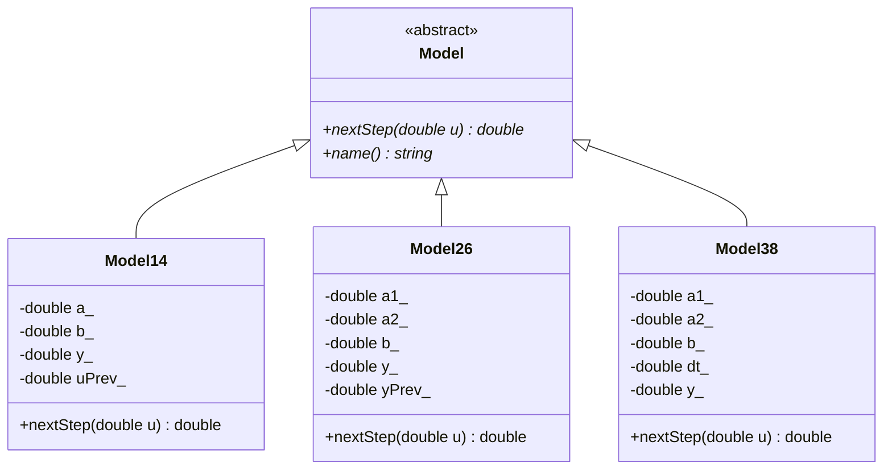
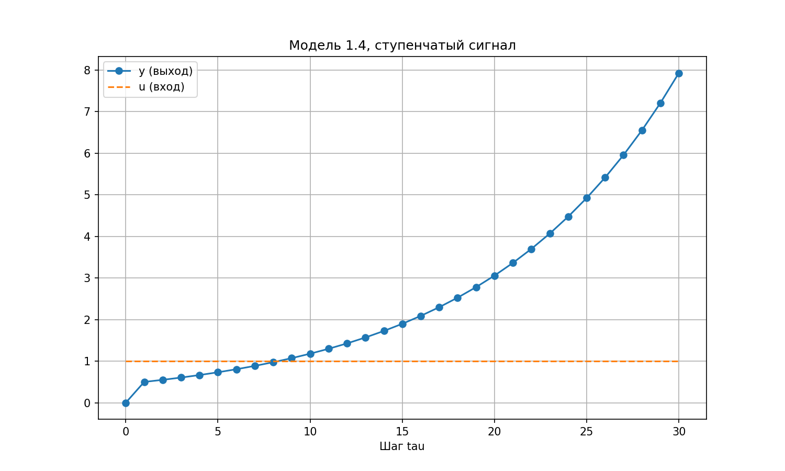
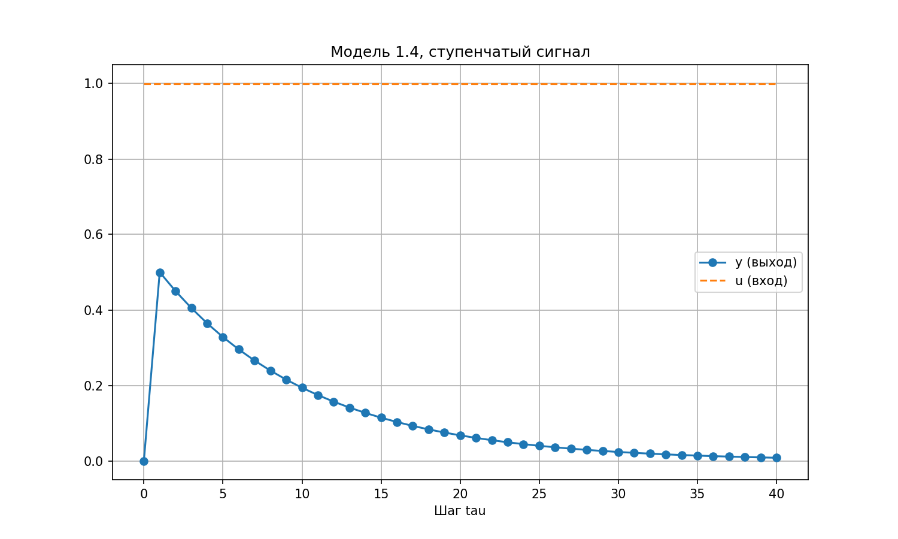
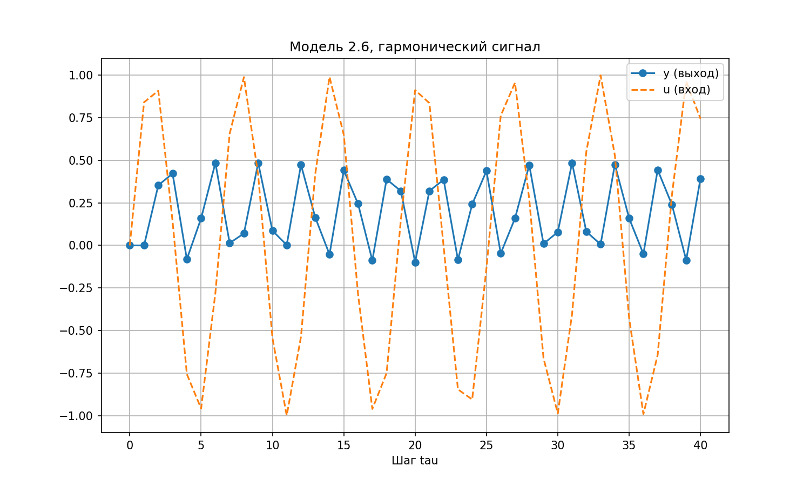
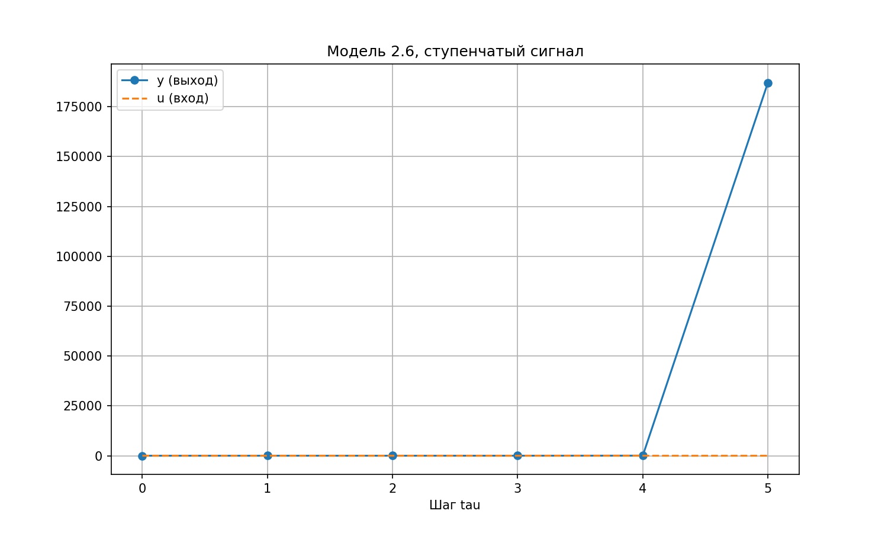
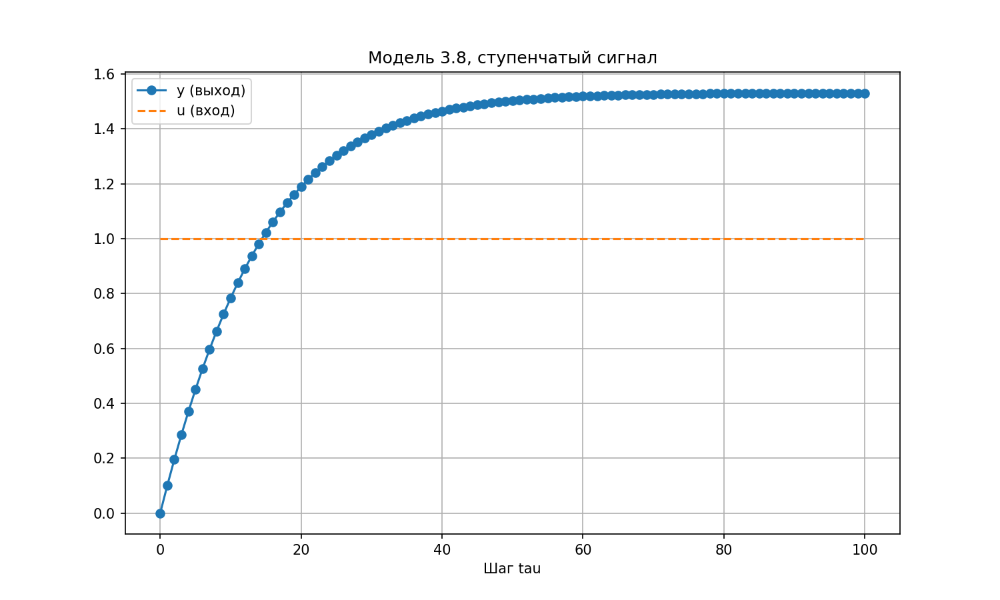
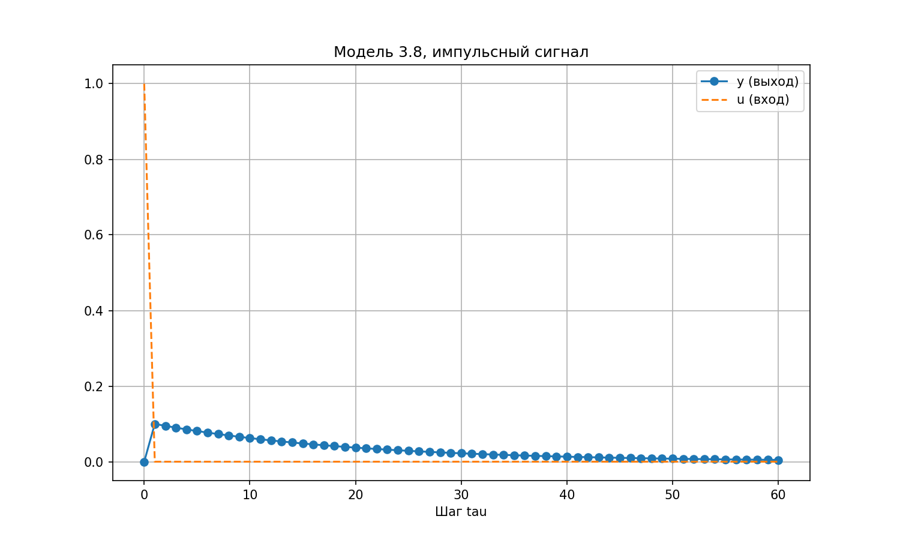

<p align="center">Министерство образования Республики Беларусь</p>
<p align="center">Учреждение образования</p>
<p align="center">«Брестский государственный технический университет»</p>
<p align="center">Кафедра ИИТ</p>
<br><br><br><br><br>
<p align="center"><b>Лабораторная работа №1</b></p>
<p align="center"><b>По дисциплине «Общая теория интеллектуальных систем»</b></p>
<p align="center"><b>Тема: «Моделирование управляемого объекта»</b></p>
<br><br><br><br>
<p align="right">Выполнил:</p>
<p align="right">Студент 2 курса</p>
<p align="right">Группы ИИ-29</p>
<p align="right">Годованный Ю.М.</p>
<p align="right">Проверил:</p>
<p align="right">Дворанинович Д.А.</p>
<br><br><br><br>
<p align="center">Брест 2026</p>

---

## 1. Цель работы

Написать на C++ программу, которая моделирует управляемый объект тремя способами (линейная модель, нелинейная модель, дифференциальное уравнение), подаёт на вход три вида сигналов, выводит таблицу результатов и строит график.

## 2. Вариант 4

| Блок | Модель | Уравнение |
|:---:|:---:|---|
| 1. Линейная | 1.4 | $y_{\tau+1} = a y_\tau + b (u_\tau - u_{\tau-1})$ |
| 2. Нелинейная | 2.6 | $y_{\tau+1} = a_1 y_\tau^3 - a_2 y_{\tau-1} + b u_\tau^2$ |
| 3. Дифференциальное | 3.8 | $\dfrac{dy}{dt} = -a_1 y - a_2 y^2 + b u$ |

Модель 3.8 решается методом Эйлера с шагом $\Delta t$:

$$y_{\tau+1} = y_\tau + \Delta t\,(-a_1 y_\tau - a_2 y_\tau^2 + b u_\tau)$$

Входные сигналы:

1. ступенчатый: $u_\tau = \text{const}$ (значение вводит пользователь);
2. импульсный: $u_0 = 1$, $u_{\tau>0} = 0$;
3. гармонический: $u_\tau = \sin(\tau)$.

Значения до начала расчёта ($y_{-1}$, $u_{-1}$) считаются нулевыми, начальное $y_0$ вводит пользователь.

## 3. Как устроена программа

Код разбит на три файла:

| Файл | Что внутри |
|---|---|
| `src/models.h` | базовый абстрактный класс `Model` и три класса-наследника: `Model14`, `Model26`, `Model38` |
| `src/main.cpp` | меню, ввод коэффициентов, входные сигналы, цикл расчёта, вывод таблицы и запись `results.csv` |
| `src/plot.py` | читает `results.csv`, сохраняет график в `doc/` под именем модели и сигнала (например, `model14_step.png`) и открывает его |

Остальное — сборка: `src/CMakeLists.txt`, `build.bat`, `run.bat`.

В классе `Model` объявлен чисто виртуальный метод `nextStep(u)`, который считает следующий шаг. Каждая модель переопределяет его по своей формуле и сама хранит нужные прошлые значения ($y_{\tau-1}$ или $u_{\tau-1}$).



*Рис. 1. UML-диаграмма классов.*

## 4. Порядок работы

Программа ничего не считает «по умолчанию», пользователь сам задаёт всё по шагам:

1. выбирает **одну** из моделей (1.4, 2.6 или 3.8);
2. вводит начальное значение $y_0$ и коэффициенты выбранной модели ($a, b$ или $a_1, a_2, b$, а для 3.8 ещё и шаг $\Delta t$);
3. выбирает входной сигнал (для ступеньки вводит значение $u$);
4. вводит число шагов $n$.

После этого программа выводит таблицу $\tau,\ u_\tau,\ y_\tau$ в консоль и записывает её в `results.csv`, а `plot.py` показывает график. Если расчёт расходится ($|y| > 10^{12}$), он останавливается с предупреждением.

## 5. Устойчивость модели 1.4 (дополнительное задание)

Для однородной части $y_{\tau+1} = a y_\tau$ характеристическое уравнение на $z$-плоскости:

$$z - a = 0 \;\Rightarrow\; z = a.$$

Процесс устойчив, если корень лежит внутри единичной окружности: $|a| < 1$. Если $|a| \ge 1$, программа до начала расчёта выводит предупреждение:

```
ПРЕДУПРЕЖДЕНИЕ: |a| >= 1, система неустойчива, y будет расти!
```



*Рис. 2. Неустойчивая модель 1.4 ($a = 1.1$, $b = 0.5$, ступенька $u = 1$).*

## 6. Сборка и запуск

Нужны компилятор C++17 (MinGW или MSVC), CMake и для графика Python с `matplotlib` (`pip install -r requirements.txt`).

- `build.bat` — собирает проект через CMake и показывает процесс сборки; получается `build\task_01.exe`;
- `run.bat` — собирает, запускает программу и автоматически открывает график; потом предлагает запустить ещё раз.

## 7. Результаты

### 7.1. Проверка вручную

- Модель 1.4 ($a = 0.9$, $b = 0.5$, $y_0 = 0$, $u = 1$): $y_1 = 0.9 \cdot 0 + 0.5 (1 - 0) = 0.5$, $y_2 = 0.9 \cdot 0.5 + 0.5 (1 - 1) = 0.45$, $y_3 = 0.405$ — совпадает с таблицей.
- Модель 2.6 ($a_1 = 0.2$, $a_2 = 0.3$, $b = 0.5$, $u = \sin\tau$, $y_0 = 0$): $y_1 = 0$, $y_2 = 0.5 \sin^2 1 \approx 0.35404$ — совпадает.
- Модель 3.8 ($a_1 = 0.5$, $a_2 = 0.1$, $b = 1$, $\Delta t = 0.1$, $u = 1$, $y_0 = 0$): $y_1 = 0.1$, $y_2 = 0.1 + 0.1 (-0.05 - 0.001 + 1) = 0.1949$ — совпадает.
- Установившееся значение модели 3.8 при $u = 1$: $y^2 + 5y - 10 = 0$, $y = \dfrac{-5 + \sqrt{65}}{2} \approx 1.531$. Расчёт приходит к $y_{100} \approx 1.5307$ (рис. 5).

### 7.2. Модель 1.4

Ввод: модель 1, $y_0 = 0$, $a = 0.9$, $b = 0.5$, ступенька $u = 1$, $n = 40$. Начало таблицы:

```
   tau               u               y
     0               1               0
     1               1             0.5
     2               1            0.45
     3               1           0.405
     4               1          0.3645
     5               1         0.32805
```



*Рис. 3. Модель 1.4, ступенчатый сигнал: один скачок, затем спад.*

### 7.3. Модель 2.6



*Рис. 4. Модель 2.6, $u = \sin\tau$, $a_1 = 0.2$, $a_2 = 0.3$, $b = 0.5$.*

При $a_1 = 3$ кубический член быстро раздувает $y$, и программа останавливает расчёт на шаге 6:



*Рис. 4а. Модель 2.6, $a_1 = 3$: расходимость.*

### 7.4. Модель 3.8



*Рис. 5. Модель 3.8 ($\Delta t = 0.1$), ступенька $u = 1$: выход стремится к $y \approx 1.531$.*



*Рис. 6. Модель 3.8, импульсный сигнал: выход затухает.*

## 8. Выводы

Написана программа с базовым классом `Model` и тремя моделями-наследниками. Пользователь сам выбирает модель, сигнал, вводит коэффициенты и число шагов; результат выводится таблицей и графиком. Для линейной модели 1.4 найден критерий устойчивости $|a| < 1$ и добавлено предупреждение. Результаты всех трёх моделей проверены вручную.
