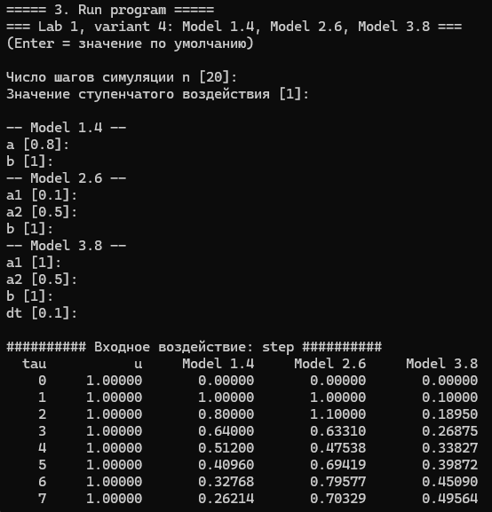
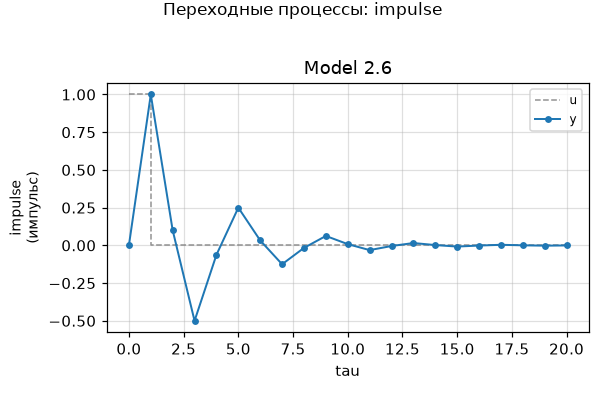
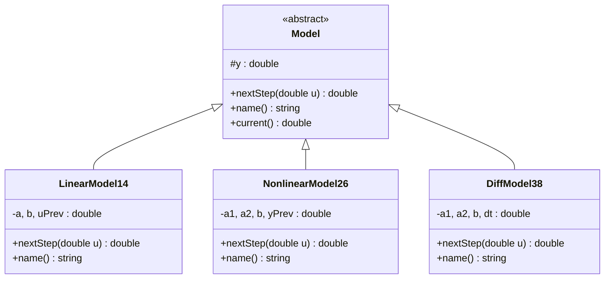

<p align="center"> Министерство образования Республики Беларусь</p>
<p align="center">Учреждение образования</p>
<p align="center">“Брестский Государственный технический университет”</p>
<p align="center">Кафедра ИИТ</p>
<br><br><br><br><br><br><br>
<p align="center">Лабораторная работа №1</p>
<p align="center">По дисциплине “Общая теория интеллектуальных систем”</p>
<p align="center">Тема: “Моделирование температуры объекта”</p>
<br><br><br><br><br>
<p align="right">Выполнил:</p>
<p align="right">Студент 2 курса</p>
<p align="right">Группы ИИ-ХХ</p>
<p align="right">Фамилия И. О.</p>
<p align="right">Проверил:</p>
<p align="right">Дворанинович Д. А.</p>
<br><br><br><br><br>
<p align="center">Брест 2026</p>

## Вариант 4

- Линейная модель: **Model 1.4**
- Нелинейная модель: **Model 2.6**
- Дифференциальное уравнение: **Model 3.8**

## Реализованные модели

### Model 1.4

`y(t+1) = a*y(t) + b*(u(t) - u(t-1))`

### Model 2.6

`y(t+1) = a1*y(t)^3 - a2*y(t-1) + b*u(t)^2`

### Model 3.8

`dy/dt = -a1*y - a2*y^2 + b*u`

Решается методом Эйлера: `y(t+1) = y(t) + dt*(-a1*y(t) - a2*y(t)^2 + b*u(t))`

## Входные воздействия

1. **Ступенчатое:** `u(t) = 1.0`
2. **Импульсное:** `u(0) = 1.0`, `u(t > 0) = 0.0`
3. **Гармоническое:** `u(t) = sin(t)`

## ООП

Создан абстрактный базовый класс `Model` с виртуальными методами `nextStep(double u)` и `name()`.

От него наследуются:
- `LinearModel14`
- `NonlinearModel26`
- `DiffModel38`

Входные воздействия описаны в файле `Input.hpp` (`Step`, `Impulse`, `Harmonic`).

## Результат

Программа:
- запрашивает количество шагов симуляции `n`;
- запрашивает коэффициенты для каждой модели (Enter — значение по умолчанию);
- прогоняет 3 модели на 3 входных воздействиях;
- выводит результаты в виде таблиц;
- сохраняет результаты в `.csv` (папка `doc`);
- строит график через Python/Matplotlib (файл `doc/plot.png`).

Значения по умолчанию:

| Модель | Параметры |
| :--- | :--- |
| 1.4 | a = 0.8, b = 1 |
| 2.6 | a1 = 0.1, a2 = 0.5, b = 1 |
| 3.8 | a1 = 1, a2 = 0.5, b = 1, dt = 0.1 |

## Пример работы программы:

### Сборка

На Windows build.bat:

```bat
@echo off
chcp 65001 >nul
cd /d "%~dp0"

rem ---------------------------------------------------------------
rem Python virtual environment.
rem If auto-detection fails, put the full path to your venv here, e.g.:
rem set "VENV_DIR=C:\path\to\project\.venv"
rem ---------------------------------------------------------------
set "VENV_DIR="

set "PYTHON=python"
if defined VENV_DIR (
    if exist "%VENV_DIR%\Scripts\python.exe" set "PYTHON=%VENV_DIR%\Scripts\python.exe"
) else (
    rem Auto-search: .venv / venv / env in this folder and up to 3 folders above
    for %%D in (".venv" "venv" "env") do (
        for %%P in ("%~dp0%%~D" "%~dp0..\%%~D" "%~dp0..\..\%%~D" "%~dp0..\..\..\%%~D") do (
            if exist "%%~P\Scripts\python.exe" set "PYTHON=%%~P\Scripts\python.exe"
        )
    )
)
echo Python: %PYTHON%

rem Results (csv, png) go to doc
set "OUT_DIR=%~dp0doc"
if not exist "%OUT_DIR%" mkdir "%OUT_DIR%"
echo Output folder: %OUT_DIR%
echo.

echo ===== 1. CMake configure =====
cmake -S src -B build
if errorlevel 1 goto error

echo.
echo ===== 2. Build =====
cmake --build build --config Release
if errorlevel 1 goto error

echo.
echo ===== 3. Run program =====
build\bin\ii02904_task_1.exe "%OUT_DIR%"
if errorlevel 1 goto error

echo.
echo ===== 4. Plot graphs =====
"%PYTHON%" src\plot.py "%OUT_DIR%"
if errorlevel 1 goto error

echo.
echo Done!
pause
exit /b 0

:error
echo.
echo ERROR: step failed.
pause
exit /b 1
```
### Демонстрация реализации:

### Демонстрация одного из графиков:

## UML-диаграмма

