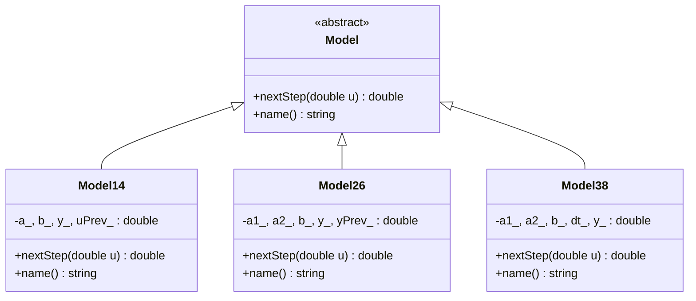

<p align="center">Министерство образования Республики Беларусь</p>
<p align="center">Учреждение образования</p>
<p align="center">“Брестский Государственный технический университет”</p>
<p align="center">Кафедра ИИТ</p>
<br><br><br><br><br><br><br>
<p align="center">Лабораторная работа №1</p>
<p align="center">По дисциплине “Общая теория интеллектуальных систем”</p>
<p align="center">Тема: “Моделирование управляемого объекта”</p>
<br><br><br><br><br>
<p align="right">Выполнил:</p>
<p align="right">Студент 2 курса</p>
<p align="right">Группы ИИ-29</p>
<p align="right">Годованный Ю. М.</p>
<p align="right">Проверил:</p>
<p align="right">Дворанинович Д. А.</p>
<br><br><br><br><br>
<p align="center">Брест 2026</p>

## Вариант 4

- Линейная модель: **Model 1.4**
- Нелинейная модель: **Model 2.6**
- Дифференциальное уравнение: **Model 3.8**

## Реализованные модели

### Model 1.4

`y(t+1) = a*y(t) + b*(u(t) - u(t-1))`

### Model 2.6

`y(t+1) = a1*y(t)^3 - a2*y(t-1) + b*u(t)^2`

### Model 3.8

`dy/dt = -a1*y - a2*y^2 + b*u`

Решается методом Эйлера: `y(t+1) = y(t) + dt*(-a1*y(t) - a2*y(t)^2 + b*u(t))`

## Входные воздействия

1. **Ступенчатое:** `u(t) = const` (значение вводит пользователь)
2. **Импульсное:** `u(0) = 1.0`, `u(t > 0) = 0.0`
3. **Гармоническое:** `u(t) = sin(t)`

## ООП

Создан абстрактный базовый класс `Model` с виртуальными методами `nextStep(double u)` и `name()`.

От него наследуются:
- `Model14`
- `Model26`
- `Model38`

Каждый класс хранит свои коэффициенты и прошлые значения (`y(t-1)` или `u(t-1)`) и реализует свою формулу в методе `nextStep`.

## Устойчивость (дополнительное задание)

Для модели 1.4 характеристическое уравнение `z - a = 0`, корень `z = a`. Система устойчива, если корень лежит внутри единичной окружности: `|a| < 1`. Если `|a| >= 1`, программа до начала расчёта выводит предупреждение:

```
ПРЕДУПРЕЖДЕНИЕ: |a| >= 1, система неустойчива, y будет расти!
```

## Результат

Программа:
- даёт выбрать одну из моделей (1.4, 2.6 или 3.8);
- запрашивает начальное значение `y(0)` и коэффициенты выбранной модели;
- даёт выбрать входной сигнал и запрашивает количество шагов симуляции `n`;
- выводит результаты в виде таблицы в консоль;
- сохраняет результаты в `results.csv`;
- останавливает расчёт, если процесс расходится (`|y| > 1e9`);
- строит график через Python/Matplotlib и сразу открывает его.

## Пример работы программы:

### Сборка

На Windows build.bat (собирает проект, создаёт виртуальное окружение `.venv` с matplotlib, запускает программу и показывает график):

```bat
@echo off
cd /d "%~dp0"
chcp 65001 >nul
rem Один файл на всё: сборка через CMake, настройка .venv, запуск программы и показ графика.

echo ===== 1. Настройка CMake =====
where cmake >nul 2>nul
if errorlevel 1 (
    echo CMake не найден в PATH. Установите CMake.
    goto error
)
where g++ >nul 2>nul
if errorlevel 1 (
    cmake -S src -B build
) else (
    cmake -S src -B build -G "MinGW Makefiles"
)
if errorlevel 1 goto error

echo.
echo ===== 2. Компиляция =====
cmake --build build --config Release
if errorlevel 1 goto error

rem Программа лежит в build или в build\Release, это зависит от компилятора
set "EXE=build\task_01.exe"
if not exist "%EXE%" set "EXE=build\Release\task_01.exe"
if not exist "%EXE%" (
    echo Не найден task_01.exe после сборки.
    goto error
)
echo Сборка прошла успешно: %EXE%

echo.
echo ===== 3. Виртуальное окружение Python =====
rem Если папки .venv нет, создаём её
if not exist ".venv\Scripts\python.exe" (
    set "SYS_PYTHON=python"
    where python >nul 2>nul
    if errorlevel 1 set "SYS_PYTHON=py"
    echo Создаю виртуальное окружение .venv
    %SYS_PYTHON% -m venv .venv
    if errorlevel 1 goto error
)
rem Если в .venv нет matplotlib, ставим его из requirements.txt
".venv\Scripts\python.exe" -c "import matplotlib" >nul 2>nul
if errorlevel 1 (
    echo Устанавливаю matplotlib в .venv
    ".venv\Scripts\python.exe" -m pip install -r requirements.txt
    if errorlevel 1 goto error
)
echo Окружение .venv готово

:again
echo.
echo ===== 4. Запуск программы =====
if exist results.csv del results.csv
"%EXE%"
if errorlevel 1 goto error

echo.
echo ===== 5. График =====
".venv\Scripts\python.exe" src\plot.py
if errorlevel 1 goto error

echo.
choice /c YN /m "Запустить программу ещё раз"
if errorlevel 2 goto end
goto again

:end
pause
exit /b 0

:error
echo.
echo ===== ОШИБКА, см. сообщения выше =====
pause
exit /b 1
```

### Демонстрация реализации:

Модель 1.4, `y(0) = 0`, `a = 0.9`, `b = 0.5`, ступенчатый сигнал `u = 1`, `n = 10`:

```
Лабораторная работа 1, вариант 4

Выберите модель:
  1 - Модель 1.4 (линейная)
  2 - Модель 2.6 (нелинейная)
  3 - Модель 3.8 (дифференциальное уравнение)
Ваш выбор: 1
Начальное значение y(0) = 0
a = 0.9
b = 0.5

Выберите входной сигнал:
  1 - ступенчатый (u = const)
  2 - импульсный (u(0) = 1, дальше 0)
  3 - гармонический (u = sin(t))
Ваш выбор: 1
Значение u = 1

Число шагов n (от 1 до 10000): 10

+--------+--------------------+--------------------+
|    tau |                  u |                  y |
+--------+--------------------+--------------------+
|      0 |           1.000000 |           0.000000 |
|      1 |           1.000000 |           0.500000 |
|      2 |           1.000000 |           0.450000 |
|      3 |           1.000000 |           0.405000 |
|      4 |           1.000000 |           0.364500 |
|      5 |           1.000000 |           0.328050 |
|      6 |           1.000000 |           0.295245 |
|      7 |           1.000000 |           0.265721 |
|      8 |           1.000000 |           0.239148 |
|      9 |           1.000000 |           0.215234 |
|     10 |           1.000000 |           0.193710 |
+--------+--------------------+--------------------+

Результаты сохранены в файл results.csv
```

### Демонстрация графиков:

Модель 1.4, ступенчатый сигнал:


Модель 1.4, `a = 1.1` (неустойчивая система):


Модель 2.6, гармонический сигнал:


Модель 2.6, `a1 = 3` (расчёт остановлен, процесс расходится):


Модель 3.8, ступенчатый сигнал:


Модель 3.8, импульсный сигнал:


## UML-диаграмма


