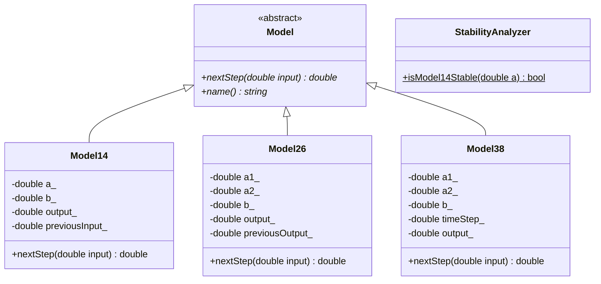

<p align="center">Министерство образования Республики Беларусь</p>
<p align="center">Учреждение образования</p>
<p align="center">«Брестский государственный технический университет»</p>
<p align="center">Кафедра ИИТ</p>

<br><br><br><br>

<p align="center"><b>Лабораторная работа №2</b></p>
<p align="center">по дисциплине «Общая теория интеллектуальных систем»</p>
<p align="center"><b>Тема: «Модульное тестирование и анализ устойчивости»</b></p>

<br><br><br>

<p align="right">Выполнил:</p>
<p align="right">студент 2 курса</p>
<p align="right">группы ИИ-29</p>
<p align="right">Годованный Ю. М.</p>

<p align="right">Проверил:</p>
<p align="right">Дворанинович Д. А.</p>

<br><br><br><br>

<p align="center">Брест 2026</p>

---

## 1. Цель работы

Освоить модульное тестирование программ на C++ с помощью Google Test, проверить корректность моделей из лабораторной работы №1, исследовать устойчивость линейной модели и измерить покрытие кода тестами.

## 2. Вариант и постановка задачи

Вариант 4 включает три модели:

| Блок | Модель | Уравнение |
|---|---|---|
| Линейная | 1.4 | $y_{\tau+1}=a y_\tau+b(u_\tau-u_{\tau-1})$ |
| Нелинейная | 2.6 | $y_{\tau+1}=a_1 y_\tau^3-a_2 y_{\tau-1}+b u_\tau^2$ |
| Дифференциальное уравнение | 3.8 | $\dot y=-a_1y-a_2y^2+bu$ |

Для модели 3.8 используется метод Эйлера:

$$y_{\tau+1}=y_\tau+\Delta t(-a_1y_\tau-a_2y_\tau^2+bu_\tau).$$

В программе доступны ступенчатый, импульсный и гармонический сигналы. Требовалось вынести расчёт моделей и анализ устойчивости в тестируемые модули, написать модульные и параметризованные тесты, настроить локальную сборку и запуск тестов.

## 3. Структура программы

| Файл | Назначение |
|---|---|
| `src/models.h`, `src/models.cpp` | Абстрактный интерфейс `Model` и реализации моделей 1.4, 2.6 и 3.8 |
| `src/stability_analyzer.h`, `src/stability_analyzer.cpp` | Анализ устойчивости модели 1.4 |
| `src/input_signal.h`, `src/input_signal.cpp` | Генерация ступенчатого, импульсного и гармонического сигналов |
| `src/main.cpp` | Ввод параметров, предупреждение о неустойчивости, симуляция и запись `results.csv` |
| `test/test_models.cpp` | Модульные и параметризованные тесты Google Test |
| `CMakeLists.txt` | Сборка приложения и тестов, подключение Google Test и CTest |
| `src/CMakeLists.txt` | Сборка приложения при обнаружении каталога `src` корневым CMake проекта |
| `run_tests.bat` | Локальная сборка, запуск тестов и генерация отчётов |

Диаграмма показывает основные классы программы:



## 4. Анализ устойчивости

Для модели 1.4 рассматривается однородное уравнение (при нулевом входе):

$$y_{\tau+1}=a y_\tau.$$

Подстановка решения $y_\tau=z^\tau$ даёт характеристическое уравнение:

$$z-a=0,\qquad z=a.$$

Система асимптотически устойчива, когда корень находится строго внутри единичной окружности:

$$|z|=|a|<1.$$

При $|a|\geq1$ система не является асимптотически устойчивой. Анализатор проверяет коэффициент `a`; если условие устойчивости не выполняется, программа выводит предупреждение до симуляции. Неконечное значение коэффициента отклоняется.

## 5. Тестовые сценарии

Расчёт шагов модели 1.4 проверяется параметризованным тестом `TEST_P` для трёх последовательностей входа: постоянной, импульсной и гармонической. Отдельный параметризованный тест проверяет генератор этих сигналов.

| Проверка | Сценарии |
|---|---|
| Модель 1.4 | Расчёт рекуррентных шагов при ступенчатом, импульсном и гармоническом сигналах |
| Модель 2.6 | Проверка кубической обратной связи, задержанного состояния и известного результата |
| Модель 3.8 | Проверка двух шагов метода Эйлера; отклонение неположительного и бесконечного шага |
| Сигналы | Значения ступенчатого, импульсного и гармонического сигналов; неизвестный тип сигнала |
| Общие свойства | Состояние покоя при нулевом входе и начальном состоянии; названия моделей |
| Анализатор устойчивости | Устойчивые коэффициенты, неустойчивые коэффициенты, границы $a=\pm1$, неконечные значения |

Эталонные значения сверяются с формулами моделей. Например, для модели 3.8 при $a_1=0.5$, $a_2=0.1$, $b=1$, $\Delta t=0.1$, $y_0=0$ и $u=1$:

$$y_1=0+0.1(1)=0.1,$$
$$y_2=0.1+0.1(-0.5\cdot0.1-0.1\cdot0.1^2+1)=0.1949.$$

Тесты подают фиксированные последовательности входных значений непосредственно в модели. Поэтому все три режима управления покрываются без мок-объектов.

## 6. Сборка и запуск

Требуются CMake 3.21 или новее, компилятор C++17 и Git. Google Test загружается CMake при первой конфигурации. Для отчёта покрытия под MinGW также требуется `gcovr`:

```powershell
python -m pip install gcovr
```

Запуск из каталога `trunk/ii02904/task_02`:

```bat
run_tests.bat
```

Скрипт собирает приложение и тесты, запускает CTest и сохраняет JUnit-отчёт `test-results.xml`. Если установлен `gcovr`, дополнительно создаются HTML- и XML-отчёты покрытия в каталоге сборки. Заголовок `src/CMakeLists.txt` позволяет корневому CMake проекта обнаруживать и собирать приложение отдельно от тестовой конфигурации.

## 7. Результаты тестирования и покрытие

- **Всего выполнений тестов:** 16.
- **Успешно пройдено:** 16 / 16.
- **Результат:** все тесты прошли.

Покрытие измерено `gcovr` для реализаций моделей, генератора сигналов и анализатора устойчивости. Интерактивный `main.cpp` и заголовочные файлы исключены из подсчёта.

| Модуль | Покрытие строк | Покрытие функций | Статус |
|---|---:|---:|---|
| `models.cpp` | 100% (34 / 34) | 100% | OK |
| `input_signal.cpp` | 100% (9 / 9) | 100% | OK |
| `stability_analyzer.cpp` | 100% (4 / 4) | 100% | OK |
| **Итого** | **100% (47 / 47)** | **100% (12 / 12)** | **Успешно** |

Покрытие ветвей — **78,6% (22 / 28)**. Проверка выполнялась локально с MinGW GCC 15.2, CMake 4.4.3 и gcovr 8.8.

## 8. Вывод

Для трёх моделей варианта 4 созданы отдельные тестируемые модули и тесты Google Test. Параметризованные тесты проверяют шаги модели 1.4 и все три режима входного сигнала. Для модели 1.4 реализован критерий устойчивости $|a|<1$ и предупреждение о неустойчивых коэффициентах. Локальная автоматизация собирает приложение, выполняет тесты и формирует отчёты. Все 16 тестовых выполнений завершились успешно.
