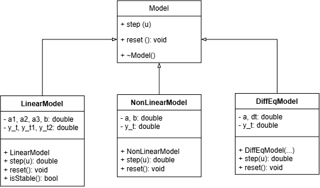
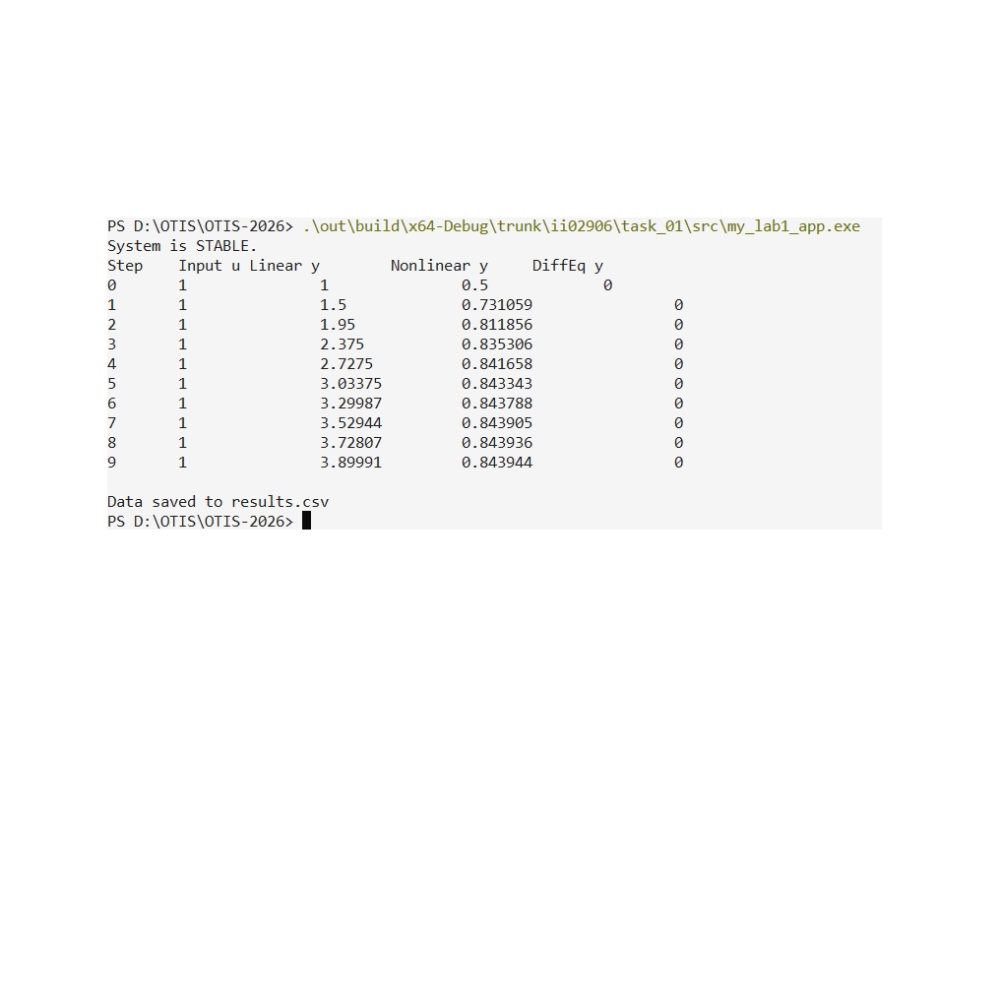
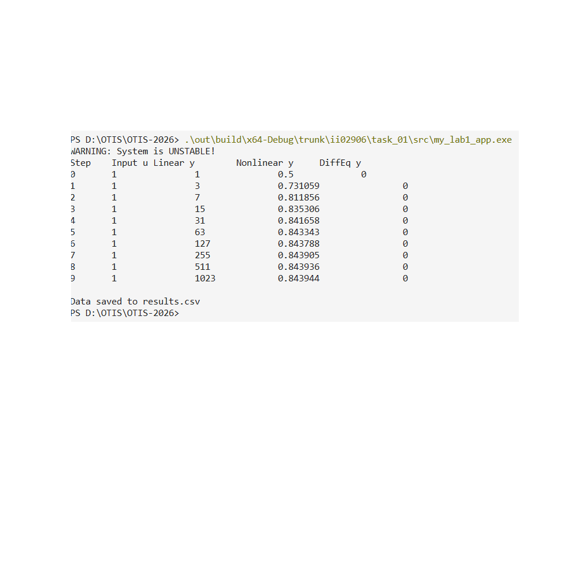
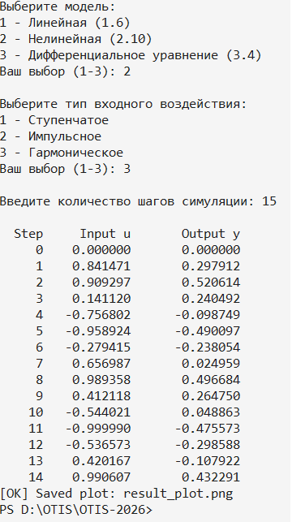
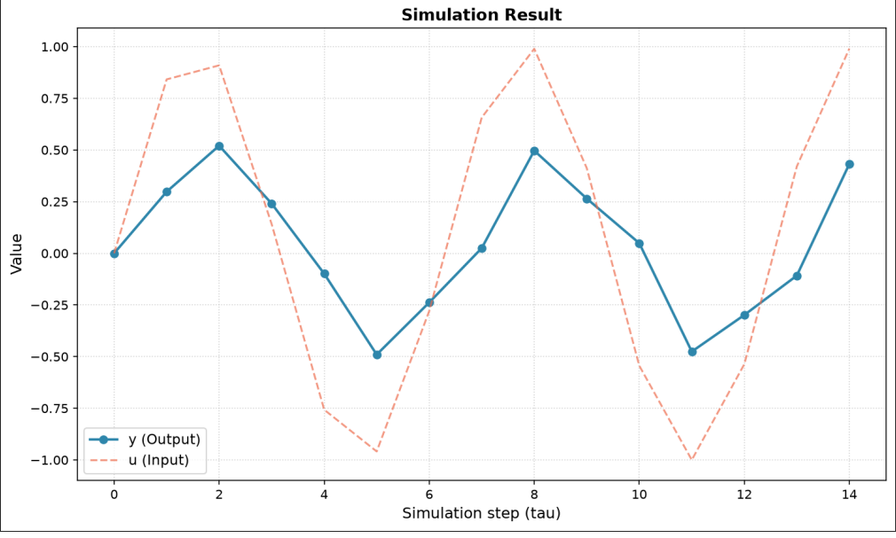

 Министерство образования Республики Беларусь

Учреждение образования

“Брестский Государственный технический университет”

Кафедра ИИТ

       

Лабораторная работа №1

По дисциплине “Общая теория интеллектуальных систем”

Тема: “Моделирования температуры объекта”

     

Выполнила:

Студентка 2 курса

Группы ИИ-29

Дешунина А.Ю.

Проверил:

Дворанинович Д. А.

     

Брест 2026

## 1. Цель работы

Изучить методы математического моделирования управляемых объектов. Реализовать на языке C++ программу, моделирующую поведение трёх типов систем:
* **линейной дискретной модели** (Model 1.6 — Third-Order Dynamic System);
* **нелинейной дискретной модели** (Model 2.10 — Hyperbolic Tangent Smoothing);
* **непрерывного дифференциального уравнения** (Model 3.4 — Quadratic Self-Decay).

## 2. Постановка задачи

Согласно **варианту 16**, реализуются следующие модели:

| Блок | Модель | Название |
| :--- | :--- | :--- |
| 1 | Model 1.6 | Third-Order Dynamic System |
| 2 | Model 2.10 | Hyperbolic Tangent Smoothing |
| 3 | Model 3.4 | Quadratic Self-Decay |

**Требования к программе:**
1. Реализация на языке C++ с использованием принципов ООП.
2. Наличие абстрактного базового класса `Model` с виртуальным методом расчёта следующего шага.
3. Три типа входных воздействий:
   * ступенчатое `u_τ = const`,
   * импульсное `u_0 = 1, u_{τ>0} = 0`,
   * гармоническое `u_τ = sin(τ)`.
4. Возможность настройки количества шагов симуляции `n`.
5. Вывод результатов в табличном виде (в консоль и в CSV-файл).
6. Визуализация полученных результатов.
7. Сборка через CMake с запуском через `.bat`-файл.
8. (Advanced) Анализ устойчивости линейной дискретной модели через корни характеристического уравнения на Z-плоскости с выводом предупреждения при неустойчивости.

## 3. UML-диаграмма классов

На рисунке ниже представлена UML-диаграмма классов разработанной программы. Архитектура построена на двух иерархиях наследования:
* **Model** — абстрактный базовый класс всех математических моделей. Определяет общий интерфейс: метод `step(u)` для расчёта следующего шага симуляции, `reset()` для сброса состояния, а также методы анализа устойчивости `isStable()` и `stabilityWarning()`.
* **InputSignal** — абстрактный базовый класс генераторов входного воздействия с методами `getInput(tau)` и `name()`.

Конкретные реализации моделей (`LinearModel`, `NonLinearModel`, `DiffEqModel`) и сигналов (`StepInput`, `ImpulseInput`, `HarmonicInput`) наследуют соответствующие абстрактные классы и переопределяют виртуальные методы.

## 4. Математическое описание моделей

### 4.1. Model 1.6 — Third-Order Dynamic System

**Формула:**
$$y_{\tau+1} = a_1 \cdot y_{\tau} + a_2 \cdot y_{\tau-1} + a_3 \cdot y_{\tau-2} + b \cdot u_{\tau}$$

**Физический смысл:**
Модель описывает динамическую систему третьего порядка. Текущее состояние зависит от трёх предыдущих значений выхода и текущего входа. Такая модель характерна для систем с инерцией и запаздыванием.

**Анализ устойчивости (Advanced):**
Запишем характеристическое уравнение. Для этого приравняем вход к нулю ($u_\tau = 0$):
$$y_{\tau+1} - a_1 y_{\tau} - a_2 y_{\tau-1} - a_3 y_{\tau-2} = 0$$
Характеристическое уравнение на Z-плоскости:
$$z^3 - a_1 z^2 - a_2 z - a_3 = 0$$
Критерий устойчивости: для дискретной системы все корни характеристического уравнения должны лежать внутри единичного круга на Z-плоскости, то есть $|z| < 1$. В программе используется упрощенный критерий Шура-Кона для полинома 3-й степени.

### 4.2. Model 2.10 — Hyperbolic Tangent Smoothing

**Формула:**
$$y_{\tau+1} = a \cdot \tanh(y_{\tau}) + b \cdot u_{\tau}^3$$

**Физический смысл:**
Нелинейная модель, в которой используется гиперболический тангенс. Это обеспечивает «мягкое» ограничение (насыщение) выходного сигнала: при больших значениях $y$ рост замедляется, и система не уходит в бесконечность. Такая зависимость характерна для реальных систем с ограничениями (например, магнитное насыщение или ограничение скорости реакции).

**Анализ устойчивости:** для нелинейной модели линейный анализ (через характеристическое уравнение) неприменим. В программе метод `isStable()` для этой модели всегда возвращает `true`.

### 4.3. Model 3.4 — Quadratic Self-Decay

**Формула:**
$$\frac{dy}{dt} = -a \cdot y^2$$

**Физический смысл:**
Классическое уравнение квадратичного затухания. Скорость убывания пропорциональна квадрату текущего значения. Примеры: турбулентное трение, химические реакции второго порядка.

**Точное решение** получить сложно, поэтому в работе используется численное решение **методом Эйлера**:
$$y_{\tau+1} = y_{\tau} + \Delta t \cdot (-a \cdot y_{\tau}^2)$$

**Анализ устойчивости численной схемы:**
Численная схема устойчива, если шаг интегрирования $\Delta t$ достаточно мал. В программе проверяется условие: при слишком большом $\Delta t$ или $a$ может возникнуть расходимость.

## 5. Описание реализации

### 5.1. Архитектура ООП
Программа построена на двух независимых иерархиях наследования:
* **Model** (базовый класс): `step(u)`, `reset()`, `isStable()`, `stabilityWarning()`.
* **InputSignal** (базовый класс): `getInput(tau)`, `name()`.

### 5.2. Структура файлов

| Файл | Назначение |
| :--- | :--- |
| `src/Model.h` | Абстрактный базовый класс `Model` |
| `src/LinearModel.h/.cpp` | Model 1.6 — Third-Order Dynamic System + анализ устойчивости |
| `src/NonLinearModel.h/.cpp` | Model 2.10 — Hyperbolic Tangent Smoothing |
| `src/DiffEqModel.h/.cpp` | Model 3.4 — Quadratic Self-Decay (метод Эйлера) |
| `src/main.cpp` | Точка входа: меню, ввод параметров, симуляция, вывод результатов |
| `src/CMakeLists.txt` | Файл сборки модуля `src` |
| `CMakeLists.txt` | Локальный `CMakeLists.txt` уровня `task_01` |
| `run_tests.bat` | Скрипт автоматической сборки проекта через CMake |

### 5.3. Формат вывода результатов
Результаты симуляции выводятся двумя способами одновременно:
1. **В консоль** — табличный вид.
2. **В файл `results.csv`** — формат CSV с заголовком.

### 5.4. Сборка через CMake и `.bat`
Сборка проекта автоматизирована через скрипт `run_tests.bat`.

## 6. Результаты симуляции

Программа сохраняет результаты расчетов в файл `results.csv`. Для визуализации данных используется Python-скрипт `plot_results.py` с библиотекой `Matplotlib`, который автоматически строит график по сохраненным данным.

### 6.1. Проверка устойчивости (Доп. задание)
Для линейной модели 1.6 реализована проверка устойчивости по критерию Джури. Программа корректно определяет как устойчивые, так и неустойчивые системы.

**Устойчивая система (коэффициенты подобраны верно):**

**Неустойчивая система (коэффициенты вызывают расхождение):**

### 6.2. Вывод в консоль (Симуляция)
На скриншоте ниже показан процесс выбора параметров, таблица с результатами расчетов (гармоническое воздействие) и сообщение об успешном создании графика:

### 6.3. Визуализация (Python)
На графике представлены зависимости входного (пунктирная линия) и выходного (сплошная линия) сигналов для выбранной модели:

## 7. Выводы

В ходе выполнения лабораторной работы были получены следующие результаты:
1. Реализована программа на C++ с использованием принципов ООП.
2. Реализованы три модели в соответствии с **вариантом 16**: Model 1.6, Model 2.10, Model 3.4.
3. Реализованы три типа входных воздействий через отдельную иерархию классов `InputSignal`.
4. Выполнен анализ устойчивости (Advanced-задание) для линейной модели 1.6.
5. Проведена симуляция всех моделей при различных входных воздействиях.
6. Результаты визуализированы (графики сохранены в папке `doc`).
7. Сборка автоматизирована через CMake и скрипт `run_tests.bat`.

**Итог:** цель работы достигнута — программа корректно моделирует управляемые объекты, определяет их устойчивость и визуализирует переходные процессы.

## 8. Приложения

### 8.1. Ссылки на исходный код
Все файлы проекта расположены в каталоге `trunk/ii02906/task_01/`:

| Файл | Ссылка |
| :--- | :--- |
| `Model.h` | `src/Model.h` |
| `LinearModel.h` | `src/LinearModel.h` |
| `NonLinearModel.h` | `src/NonLinearModel.h` |
| `DiffEqModel.h` | `src/DiffEqModel.h` |
| `main.cpp` | `src/main.cpp` |
| `CMakeLists.txt` | `src/CMakeLists.txt` |
| `run_tests.bat` | `run_tests.bat` |

### 8.2. Пример выходных данных
Файл `results.csv` с результатами последнего прогона симуляции — во вложении к отчёту.