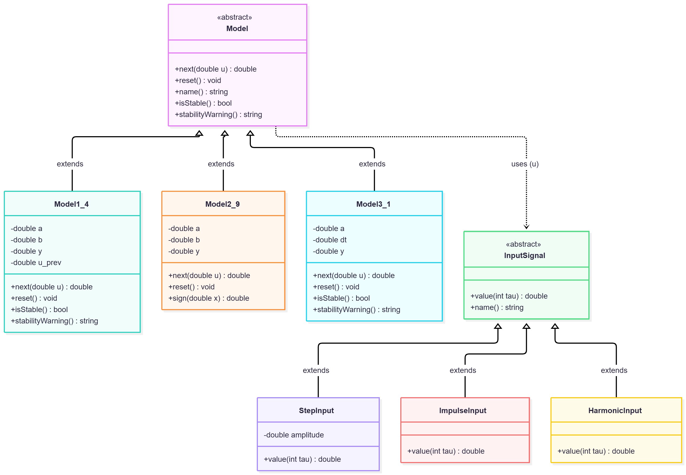
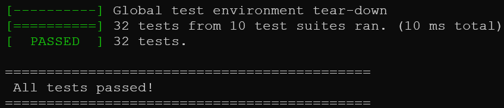
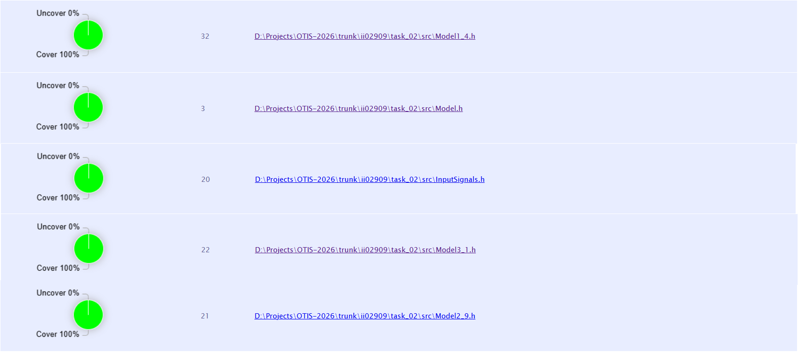

<p align="center">Министерство образования Республики Беларусь</p>
<p align="center">Учреждение образования</p>
<p align="center">«Брестский государственный технический университет»</p>
<p align="center">Кафедра ИИТ</p>
<br><br><br><br><br><br><br>
<p align="center">Лабораторная работа №2</p>
<p align="center">По дисциплине «Общая теория интеллектуальных систем»</p>
<p align="center">Тема: «Модульное тестирование программы моделирования управляемого объекта»</p>
<br><br><br><br><br>
<p align="right">Выполнил:</p>
<p align="right">Студент 2 курса</p>
<p align="right">Группы ИИ-29</p>
<p align="right">Игнатюк Д.А.</p>
<p align="right">Проверил:</p>
<p align="right">Дворанинович Д.А.</p>
<br><br><br><br><br>
<p align="center">Брест 2026</p>

---

## 1. Цель работы

Освоить модульное тестирование на C++ с использованием **Google Test**. 
Настроить локальную автоматизацию сборки и запуска тестов через `.bat`-файл. Измерить покрытие кода тестами.

## 2. Постановка задачи

1. Написать модульные тесты для моделей, сигналов и анализа устойчивости (из ЛР №1).
2. Использовать **параметризованные тесты** (`TEST_P`).
3. Использовать **моки** (Google Mock).
4. Создать `run_tests.bat` для автоматизации.
5. Измерить покрытие кода (OpenCppCoverage).

## 3. UML-диаграмма классов

Архитектура — та же, что в ЛР №1.



---

## 4. Описание тестов

| Файл | Кол-во тестов | Что проверяет |
|---|---|---|
| `test_model1_4.cpp` | 4 | значения, покой, `reset()`, `name()` |
| `test_model2_9.cpp` | 4 | `√\|u\|`, знак, ноль, `name()` |
| `test_model3_1.cpp` | 4 + 4 (`TEST_P`) | Эйлер, аналитика, `reset()`, `name()`, сходимость |
| `test_stability.cpp` | 10 | `isStable()`, `stabilityWarning()` для всех моделей |
| `test_signals.cpp` | 5 + 1 (мок) | Step, Impulse, Harmonic + мок |
| **Итого** | **32** | — |

**Параметризованный тест:** `VariousDtValues/Model31ConvergenceTest.EulerConvergesToAnalytical` — 4 запуска для `dt = 0.1, 0.05, 0.01, 0.001`.

**Мок:** `MockSignalTest.ModelCallsSignalValueWithCorrectTau` — проверяет, что модель вызывает `value(tau)`.

---

## 5. Локальная автоматизация

Скрипт **`run_tests.bat`**:
1. Проверяет CMake
2. Создаёт `build/`
3. `cmake ..`
4. `cmake --build . --config Debug`
5. `test\Debug\run_tests.exe`
6. Выводит `All tests passed!`

**Запуск:**
```
run_tests.bat
```

**Содержимое скрипта:**

```bat
@echo off
REM ============================================================
REM  Сборка проекта и запуск модульных тестов (Google Test)
REM ============================================================

setlocal
cd /d "%~dp0"

echo ============================================
echo  Building project and running tests...
echo ============================================
echo.

REM --- Проверка CMake ---
where cmake >nul 2>nul
if errorlevel 1 (
    echo [ERROR] CMake not found in PATH.
    pause
    exit /b 1
)

REM --- Создание папки сборки ---
if not exist "build" mkdir build
cd build

REM --- Конфигурация ---
echo [1/3] Configuring with CMake...
cmake ..
if errorlevel 1 (
    echo [ERROR] CMake configuration failed.
    pause
    exit /b 1
)

REM --- Сборка ---
echo.
echo [2/3] Building...
cmake --build . --config Debug
if errorlevel 1 (
    echo [ERROR] Build failed.
    pause
    exit /b 1
)

REM --- Запуск тестов ---
echo.
echo [3/3] Running tests...
echo ============================================
echo  Google Test results
echo ============================================
test\Debug\run_tests.exe
if errorlevel 1 (
    echo.
    echo [FAILED] Some tests failed!
    pause
    exit /b 1
)

echo.
echo ============================================
echo  All tests passed!
echo ============================================

pause
endlocal
```

---

## 6. Тестовое покрытие и результаты

- **Способ запуска:** Локальный скрипт (`run_tests.bat`)
- **Всего модульных тестов:** 32
- **Успешно пройденных тестов:** 32 / 32

| Модуль / Класс | Покрытие строк (Line Coverage) | Покрытие функций (Func Coverage) | Статус |
|---|---|---|---|
| `Model.h` | 100 % | 100 % | OK |
| `Model1_4.h` | 100 % | 100 % | OK |
| `Model2_9.h` | 100 % | 100 % | OK |
| `Model3_1.h` | 100 % | 100 % | OK |
| `InputSignals.h` | 100 % | 100 % | OK |
| **Итого** | **100 %** | **100 %** | **Success** |

**Скриншот `run_tests.bat`:**



**Скриншот отчёта покрытия:**



---

## 7. Выводы

В ходе работы:
1. Освоен **Google Test** для модульного тестирования C++.
2. Написано **32 теста** для **3 моделей**, **3 сигналов** и **анализа устойчивости**.
3. Использованы **`TEST_P`** и **моки**.
4. Настроена **автоматизация** через `run_tests.bat`.
5. Покрытие кода — **100%** по всем модулям.
6. Все тесты **проходят стабильно**.

**Цель работы достигнута.**