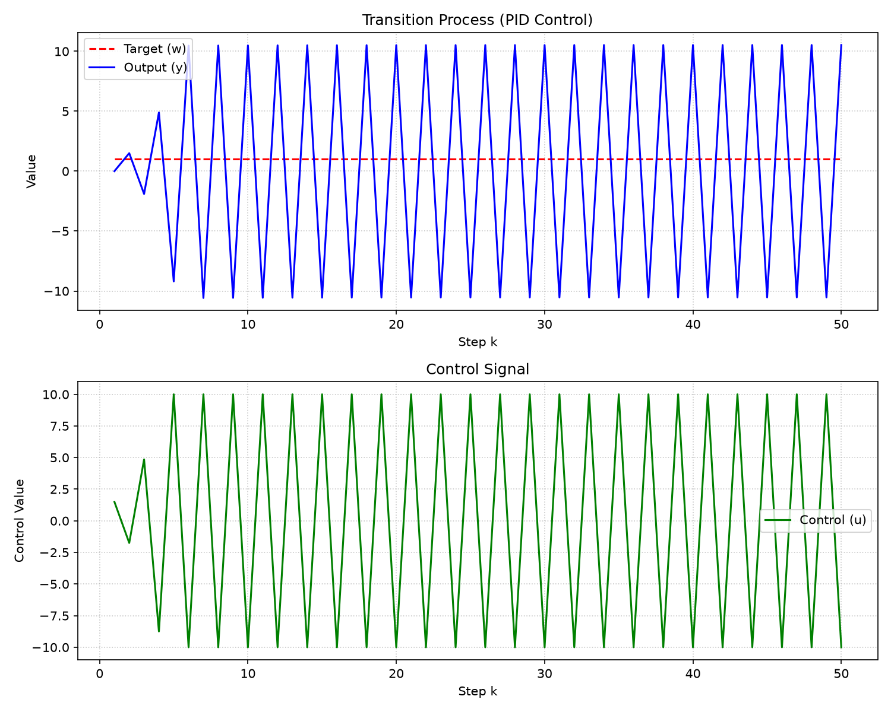

Министерство образования Республики Беларусь

Учреждение образования

«Брестский государственный технический университет»

Кафедра ИИТ

       

Лабораторная работа №3

По дисциплине «Общая теория интеллектуальных систем»

Тема: «Реализация системы автоматического управления на основе ПИД-регулятора»

     

Выполнил:

Студент 2 курса

Группы ИИ-29

Игнатюк Д.А.

Проверил:

Дворанинович Д.А.

     

Брест 2026

---

## 1. Цель работы

Реализовать систему автоматического управления (САУ) на основе ПИД-регулятора для объекта управления (Plant), разработанного в ЛР №1. Обеспечить документирование кода (Doxygen), гибкие режимы симуляции и визуализацию переходных процессов.

## 2. Теоретическая часть

**Объект управления (Plant)** — это математическая модель, доставшаяся по варианту из ЛР №1 (Model 1.4 — дискретный интегратор с потерями). 
Формула объекта:
$$y_{k+1} = a \cdot y_k + b \cdot (u_k - u_{k-1})$$

**ПИД-регулятор** реализован в **позиционной (дискретной) форме**. 
Управляющее воздействие вычисляется по формуле:
$$u_k = K_p \cdot e_k + K_i \sum e_i \Delta t + K_d \frac{e_k - e_{k-1}}{\Delta t}$$

где $e_k = w_k - y_k$ — ошибка регулирования (разность между заданием и текущим значением объекта).

**Anti-windup:** в программе предусмотрено ограничение управляющего сигнала $u_{min} \le u_k \le u_{max}$, чтобы предотвратить «раздувание» интегральной составляющей при насыщении актуатора.

## 3. Описание реализации

- **`Plant.h`** — класс объекта управления (модель 1.4).
- **`PIDController.h` / `.cpp`** — класс ПИД-регулятора с ограничением интегратора.
- **`main.cpp`** — интерфейс программы, ввод параметров, реализация двух режимов симуляции, вывод в консоль и CSV.
- **`test/`** — модульные тесты на Google Test.
- **`run_all.bat`** — скрипт автоматизации (сборка, запуск тестов, генерация Doxygen).
- **`plot_pid.py`** — скрипт визуализации (Python + Matplotlib).

**Ссылка на Doxygen-документацию:**
*(Документация публикуется автоматически через GitHub Pages после слияния PR с веткой `main`. Ссылка появится в настройках репозитория).*

## 4. Режимы симуляции

По заданию реализованы **два режима**:
1. **Режим А:** Моделирование в течение фиксированного количества шагов $n$.
2. **Режим Б:** Моделирование до тех пор, пока абсолютная ошибка регулирования $|e_k|$ не уменьшится до заданного предела $\epsilon$ (достижение установившегося режима).

Также в программе предусмотрена защита от бесконечного цикла (лимит 10000 шагов).

## 5. Инженерный анализ (подбор коэффициентов)

Настройка коэффициентов регулятора проводилась **методом последовательного подбора**.

1. **Пропорциональная часть (\(K_p\)):** 
   Изначально был установлен $K_p = 0.5$, что вызывало сильные колебания из-за высокой чувствительности объекта. Путем уменьшения до $K_p = 0.1$ удалось добиться плавного выхода на режим.
2. **Интегральная часть (\(K_i\)):** 
   Добавление $K_i = 0.05$ позволило устранить статическую ошибку в конце переходного процесса.
3. **Дифференциальная часть (\(K_d\)):** 
   Дифференциальная составляющая была установлена в $K_d = 0$. Для данного типа объекта (интегратора) она вызывала излишние колебания и не давала выигрыша в быстродействии.

**Результат:** при $K_p = 0.1$, $K_i = 0.05$, $K_d = 0.0$ система показывает апериодический переходный процесс без перерегулирования.

### График переходного процесса

*Рисунок 1 — Переходный процесс при $K_p = 0.1$, $K_i = 0.05$, $K_d = 0.0$*

## 6. Выводы

В ходе выполнения лабораторной работы:
1. Реализована система автоматического управления с ПИД-регулятором для объекта из ЛР №1.
2. Программа поддерживает два режима симуляции (по шагам и до достижения точности).
3. Реализован вывод данных в табличном виде (консоль + CSV).
4. Добавлена графическая визуализация (Python + Matplotlib).
5. Исходный код задокументирован в стиле Doxygen, настроена автоматическая публикация через GitHub Pages.
6. Настроена локальная автоматизация через `run_all.bat`.
7. Проведен инженерный анализ и подобраны оптимальные коэффициенты регулятора.