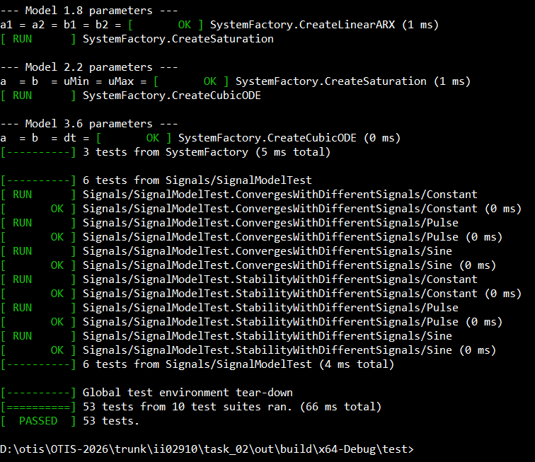
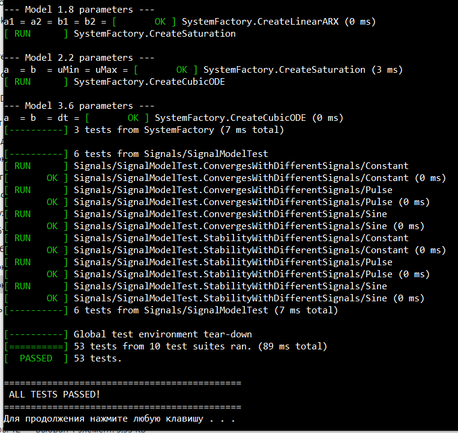
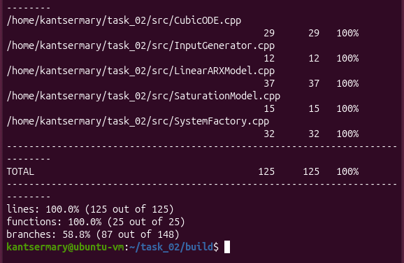
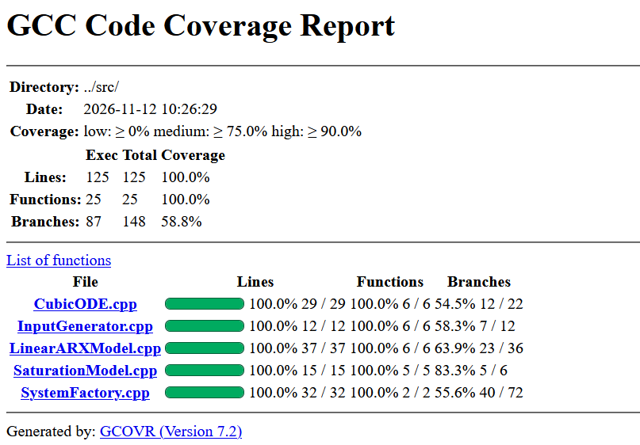

# Лабораторная работа №2

## Модульное тестирование и покрытие кода

**Студент:** Канцер Мария Алексеевна  
**Группа:** Группа ИИ-29   
**Идентификатор:** ii02910  
**Дисциплина:** Общая теория интеллектуальных систем (ОТИС)  

---

## 1. Цель работы

Освоить **модульное тестирование** на C++ с использованием **Google Test**, научиться **автоматизировать** запуск тестов и **измерять покрытие** кода тестами.

## 2. Постановка задачи

1. **Расширить** программу из Лабы №1 — добавить **модуль анализа устойчивости**.
2. Написать **модульные тесты** на **Google Test** для:
   - Основных функций **моделей** (Model 1.8, 2.2, 3.6)
   - Модуля **анализа устойчивости**
   - **Граничных** значений **нелинейностей**
   - **Инвариантов** и **физического смысла**
3. Использовать **параметризованные тесты** (`TEST_P`).
4. Использовать **моки** (подмена сигналов).
5. Создать **`run_tests.bat`** для **автоматической** сборки и запуска.
6. **Измерить** **покрытие** кода с помощью `gcov`.
7. Отразить результаты в **`readme.md`**.

## 3. Реализованные модели

| Блок | Модель | Название |
|:---:|:---:|---|
| 1 | **Model 1.8** | Generalized Autoregressive Linear Model |
| 2 | **Model 2.2** | Actuator Saturation Non-linearity |
| 3 | **Model 3.6** | Cubic Growth and Control |

## 4. Модуль анализа устойчивости

- Для **Model 1.8** — проверка корней характеристического уравнения `z² - a₁z - a₂ = 0` внутри единичного круга.
- Для **Model 3.6** — проверка устойчивости численной схемы Эйлера: `|1 + 3a·y²·Δt| < 1`.
- Для **Model 2.2** — линейный анализ неприменим (нелинейная модель).

## 5. Тестирование

### 5.1. Фреймворк

Используется **Google Test** (подключён через `FetchContent` в CMake).

### 5.2. Структура тестов

| Файл | Что тестирует |
|---|---|
| `test_linear_arx.cpp` | Model 1.8 (9 тестов) |
| `test_saturation.cpp` | Model 2.2 (9 тестов) |
| `test_cubic_ode.cpp` | Model 3.6 (9 тестов) |
| `test_stability.cpp` | Анализ устойчивости (9 тестов) |
| `test_param_signals.cpp` | Параметризованные (6 тестов) |
| `test_mock_signals.cpp` | Моки (3 теста) |
| `test_input_generator.cpp` | Сигналы (8 тестов) |
| `test_system_factory.cpp` | Фабрика (4 теста) |
| `test_main.cpp` | SanityCheck (1 тест) |

**Итого: 53 теста.**

### 5.3. Пример параметризованного теста (`TEST_P`)

```cpp
class SignalModelTest : public ::testing::TestWithParam<int>
{
protected:
    LinearARXModel model{0.5, 0.3, 1.0, 0.5};
    std::unique_ptr<InputSignal> signal;
    void SetUp() override { /* ... */ }
};

TEST_P(SignalModelTest, ConvergesWithDifferentSignals) { /* ... */ }

INSTANTIATE_TEST_SUITE_P(Signals, SignalModelTest,
    ::testing::Values(1, 2, 3));
```

### 5.4. Пример мока (подмена сигнала)

```cpp
class ModelWithMockSignal
{
public:
    LinearARXModel model{0.5, 0.3, 1.0, 0.5};
    std::function<double(int)> signal;
    double runStep(int tau) { return model.step(signal(tau)); }
};

TEST(MockSignal, LinearRamp)
{
    ModelWithMockSignal m;
    m.signal = [](int tau) { return static_cast<double>(tau); };
    // ...
}
```

## 6. Автоматизация — `run_tests.bat`

Скрипт **`run_tests.bat`**:
1. **Собирает** проект через **CMake**.
2. **Запускает** **`run_tests.exe`**.
3. **Выводит** результат (`ALL TESTS PASSED!` или ошибки).

**Запуск:**
```bat
run_tests.bat
```

## 7. Покрытие кода

**Инструмент:** `gcov` + `gcovr` (Linux / Ubuntu).

**Способ запуска:**
```bash
cmake .. -DCMAKE_CXX_FLAGS="--coverage -O0 -g"
cmake --build . -j4
./test/run_tests
gcovr --filter ".*LinearARXModel.*\.cpp" ... --print-summary .
```

### 7.1. Результаты покрытия

| Модуль / Класс | Покрытие строк (Line Coverage) | Покрытие функций (Func Coverage) | Статус |
|---|---|---|---|
| `LinearARXModel.cpp` | **100.0%** | **100.0%** | OK |
| `SaturationModel.cpp` | **100.0%** | **100.0%** | OK |
| `CubicODE.cpp` | **100.0%** | **100.0%** | OK |
| `InputGenerator.cpp` | **100.0%** | **100.0%** | OK |
| `SystemFactory.cpp` | **100.0%** | **100.0%** | OK |
| **Итого** | **100.0%** (125 / 125) | **100.0%** (25 / 25) | **Success** |

**Скриншоты:**


*Рис. 1. 53 теста — все пройдены*


*Рис. 2. Автоматический запуск через run_tests.bat*


*Рис. 3. Покрытие кода — 100% по строкам и функциям*


*Рис. 4. HTML-отчёт с 100% покрытием*

## 8. Выводы

- **Реализовано** **53 теста** на **Google Test**.
- **Покрытие** **кода** — **100%** по **строкам** и **функциям**.
- **Автоматизация** запуска — через **`run_tests.bat`**.
- **Параметризованные тесты** (`TEST_P`) — для **проверки** **сходимости** **при** **разных** **сигналах**.
- **Моки** — для **подмены** **входных** **воздействий**.

**Цель работы достигнута** — программа **полностью протестирована**, **покрытие** — **100%**.