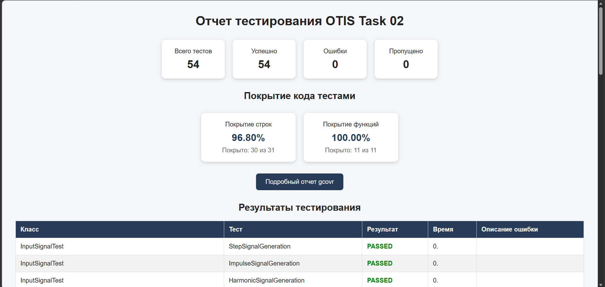

 Министерство образования Республики Беларусь

Учреждение образования

“Брестский государственный технический университет”

Кафедра ИИТ

       

Лабораторная работа №2

По дисциплине “Общая теория интеллектуальных систем”

Тема: “Модульное тестирование и анализ устойчивости”

     

Выполнил:

Студент 2 курса

Группы ИИ-29

Кондратчик Н. И.

Проверил:

Дворанинович Д. А.

     

Брест 2026

---

## 1. Цель работы

Освоить декомпозицию программы на изолированные модули для их последующей верификации в среде Google Test. В задачи входит написание тестов на основе вручную рассчитанных эталонных данных, параметризация однотипных проверок с помощью табличных наборов, определение устойчивости системы через анализ корней характеристического уравнения, а также оценка тестового покрытия (процента кода, задействованного при прогоне тестов). В процессе выполнения на базе готового проекта из первой лабораторной работы закрепляются на практике принципы объектно-ориентированного программирования: наследование от базового класса, переопределение виртуальных методов и полиморфная работа с объектами по указателям.

## 2. Постановка задачи

Объект тестирования — математическое ядро программы ЛР1 (Вариант 30, папка
`trunk/ii02911/task_01/`): три динамические модели (**Модель 1.9** — линейная с
памятью по входу, **Модель 2.6** — нелинейная корневая со знаком, **Модель 3.9** —
дифференциальное уравнение первого порядка, решаемое методом Эйлера), три режима
входных воздействий (ступень, импульс, гармоника) и модуль анализа устойчивости
линейной модели 1.9 на Z-плоскости.

Требования:

1. модульные тесты на Google Test; запуск — bat-файл, внутри CMake + ctest;
2. вычисления моделей сверять со значениями, полученными пересчётом;
3. модуль устойчивости обязан давать верный ответ: сходящийся набор —
   `true`, расходящийся — `false`, а корень, лежащий ровно на окружности
   $|z| = 1$, — система тоже считается неустойчивой;
4. нелинейность модели 2.1 (член $-b\,y^2$) проверить отдельным кейсом;
5. там, где одна и та же проверка прогоняется по нескольким наборам
   параметров, использовать таблицы `TEST_P` (п.8 методички) — код не
   дублируется;
6. три режима воздействия подавать подменой входа фиксированными
   последовательностями (п.9 методички); Google Mock не подключается;
7. отчёт обязан содержать процент покрытия кода.

## 3. Структура тестового проекта

Рабочая папка в репозитории: `trunk/ii02911/task_02/`.

| Файл | Содержимое |
|---|---|
| `../task_01/src/` | исходные файлы моделей (`Model1_9`, `Model2_6`, `Model3_9`) и генератора сигналов (`InputSignal`) из ЛР1 |
| `src/StabilityAnalyzer.h`, `src/StabilityAnalyzer.cpp` | объявление и реализация модуля анализа устойчивости систем |
| `test/main_test.cpp` | точка входа для инициализации и запуска тестов Google Test |
| `test/TestModels.cpp` | параметризованные модульные тесты (`TEST_P`) для проверки вычислений моделей |
| `test/TestNonLinear.cpp` | тесты нелинейной составляющей и режимов входного воздействия |
| `test/TestStability.cpp` | модульные и параметризованные проверки сходимости и граничных условий устойчивости |
| `CMakeLists.txt` | конфигурация сборки C++17, подключение Google Test `v1.14.0` (`FetchContent`), флаги покрытия `--coverage` |
| `generate_html_report.py` | скрипт для генерации визуального HTML-отчёта по результатам тестирования |
| `run_tests.bat` | автоматическая сборка через CMake, прогон `ctest` и формирование отчёта покрытия `gcovr` |
| `doc/readme.md` | отчёт по лабораторной работе |

## 5. Тестовые сценарии и ручной пересчёт

Контрольные значения в модульных тестах получены путём предварительного аналитического расчёта по математическим выражениям моделей.

### 5.1. Точность вычислений и многошаговая память (`Model1_3Test`)

**Модель 1.3** описывается линейным разностным уравнением второго порядка с памятью по двум предшествующим тактам выходной величины:

<b><i>y</i>τ+1 = <i>a</i> · <i>y</i>τ + <i>b</i> · <i>y</i>τ−1 + <i>c</i> · <i>u</i>τ</b>

Зададим параметры модели: <i>a</i> = 0.5, <i>b</i> = 0.25, <i>c</i> = 2.0. Начальные условия нулевые: <i>y</i>0 = 0.0, <i>y</i>−1 = 0.0. Подадим последовательность входных воздействий <i>u</i>0 = 1.0, <i>u</i>1 = 2.0, <i>u</i>2 = 3.0:

1. **Шаг 0** (<i>u</i>0 = 1.0):

   
<i>y</i>1 = 0.5 · 0.0 + 0.25 · 0.0 + 2.0 · 1.0 = 2.0

2. **Шаг 1** (<i>u</i>1 = 2.0):

   
<i>y</i>2 = 0.5 · 2.0 + 0.25 · 0.0 + 2.0 · 2.0 = 1.0 + 0.0 + 4.0 = 5.0

3. **Шаг 2** (<i>u</i>2 = 3.0):

   
<i>y</i>3 = 0.5 · 5.0 + 0.25 · 2.0 + 2.0 · 3.0 = 2.5 + 0.5 + 6.0 = 9.0

Расчётная траектория 2.0 → 5.0 → 9.0 верифицируется в соответствующем тесте, после чего методом сброса подтверждается обнуление внутреннего состояния модели.

### 5.2. Модуль анализа устойчивости на Z-плоскости (`StabilityAnalyzerTest`)

Применим Z-преобразование к разностному уравнению Модели 1.3 при нулевых начальных условиях:

<b><i>z</i>2 · <i>Y</i>(<i>z</i>) − <i>a</i> · <i>z</i> · <i>Y</i>(<i>z</i>) − <i>b</i> · <i>Y</i>(<i>z</i>) = <i>c</i> · <i>z</i> · <i>U</i>(<i>z</i>)</b>

Передаточная функция дискретной системы имеет вид:

<b><i>W</i>(<i>z</i>) = <i>Y</i>(<i>z</i>) / <i>U</i>(<i>z</i>) = (<i>c</i> · <i>z</i>) / (<i>z</i>2 − <i>a</i> · <i>z</i> − <i>b</i>)</b>

Характеристическое уравнение <i>z</i>2 − <i>a</i> · <i>z</i> − <i>b</i> = 0 имеет два полюса <i>z</i>1,2. Согласно критерию устойчивости дискретных систем все корни характеристического полинома должны располагаться **строго внутри** единичной окружности на комплексной Z-плоскости:

<b>|<i>z</i>1| &lt; 1 &emsp;и&emsp; |<i>z</i>2| &lt; 1</b>

Сценарии, проверяемые в наборе `TestStability.cpp`:

| Группа проверок | Коэффициенты (<i>a</i>, <i>b</i>) | Расположение полюсов на Z-плоскости | Ожидаемый результат |
|---|:--:|---|:--:|
| Сходящиеся режимы | (0.0, 0.0); (0.5, 0.25); (−0.3, 0.1) | Строго внутри единичного круга (\|<i>z</i>1,2\| &lt; 1) | `true` (Устойчива) |
| Граница устойчивости | (1.0, 0.0); (0.0, 1.0); (0.5, 0.5) | **Ровно на окружности (\|<i>z</i>\| = 1)** | `false` (Неустойчива) |
| Расходящиеся режимы | (1.5, 0.0); (0.8, 0.5); (−1.5, −0.6) | Вне единичного круга (\|<i>z</i>\| &gt; 1, разнос) | `false` (Неустойчива) |
| Проверка инвариантов | Широкая сетка параметров (`TEST_P`) | Комплексно-сопряжённые и вещественные корни | Корректная классификация |

### 5.3. Проверка нелинейной составляющей (`TestNonLinear.cpp`)

**Модель 2.6** описывается нелинейным разностным уравнением, содержащим квадрат предыдущего выхода и тригонометрическую функцию от прошлого входа:

<b><i>y</i>τ+1 = <i>a</i> · <i>y</i>τ − <i>b</i> · <i>y</i>τ−12 + <i>c</i> · <i>u</i>τ + <i>d</i> · sin(<i>u</i>τ−1)</b>

В тестовом наборе изолированно проверяются вклад квадратичной нелинейности (`-b * y^2`) независимо от знака прошлого состояния, а также поведение синусоидального звена:
1. **Нулевые условия (<i>y</i> = 0, <i>u</i> = 0):** нелинейные слагаемые зануляются ⇒ <i>y</i>1 = 0.0.
2. **Вклад квадратичного члена (<i>a</i> = 0, <i>b</i> = 0.5, <i>c</i> = 0, <i>d</i> = 0):** при <i>y</i>τ−1 = ±2.0 квадратичная составляющая даёт идентичный отрицательный сдвиг −0.5 · (±2.0)2 = −2.0.
3. **Гармоническое воздействие на входе:** при <i>u</i>τ−1 = π/2 слагаемое <i>d</i> · sin(π/2) = <i>d</i>, а при <i>u</i>τ−1 = 0 оно обнуляется.

### 5.4. Физические инварианты и сверка метода Эйлера с аналитикой (`Model3_9Test`)

1. **Инвариант состояния покоя:** при нулевых начальных условиях <i>y</i>0 = 0 и нулевом входном сигнале <i>u</i>τ = 0 все три модели на протяжении серии тактов сохраняют нулевое состояние (<i>y</i>τ ≡ 0.0).
2. **Аппроксимация дифференциального уравнения методом Эйлера (Модель 3.9):** непрерывная динамика объекта описывается дифференциальным уравнением первого порядка, интегрируемым явным методом Эйлера с шагом Δ<i>t</i>:

   
<b><i>dy</i> / <i>dt</i> = −<i>a</i> · <i>y</i> + <i>b</i> · <i>u</i></b>

   При свободном затухании (<i>u</i> = 0, <i>y</i>(0) = 1.0) аналитическое решение имеет экспоненциальный вид <i>y</i>(<i>t</i>) = <i>e</i>−<i>a</i>·<i>t</i>. При выборе малого шага Δ<i>t</i> = 0.001 с численная траектория метода Эйлера сверяется с эталонной экспонентой с заданной точностью.

### 5.5. Параметризованные тесты сходимости (`TEST_P`, п. 8)

При подаче постоянного ступенчатого воздействия <i>u</i>τ = <i>u</i> = const устойчивая линейная Модель 1.3 (|<i>z</i>1,2| &lt; 1) при τ → ∞ сходится к установившемуся значению <i>y</i>τ+1 = <i>y</i>τ = <i>y</i>τ−1 = <i>y</i>ss:

<b><i>y</i>ss = <i>a</i> · <i>y</i>ss + <i>b</i> · <i>y</i>ss + <i>c</i> · <i>u</i> &emsp;⇒&emsp; <i>y</i>ss = (<i>c</i> · <i>u</i>) / (1 − <i>a</i> − <i>b</i>)</b>

Параметризованные тесты (`INSTANTIATE_TEST_SUITE_P`) без дублирования кода прогоняют десятки комбинаций параметров для проверки:
- выхода Модели 1.3 на аналитическую асимптоту <i>y</i>ss;
- точности интегрирования Модели 3.9 на различных временных интервалах и коэффициентах затухания;
- граничных и внутренних точек области устойчивости в `StabilityAnalyzer`.

### 5.6. Проверка режимов входного сигнала подменой последовательностей (`InputSignalTest`, п. 9)

В соответствии с п. 9 методических указаний тестирование трёх режимов воздействия реализовано через подачу детерминированных входных последовательностей от класса `InputSignal` без подключения Google Mock:
- **Ступенчатый сигнал (`InputType::STEP`):** проверка постоянства амплитуды <i>u</i>(<i>t</i>) = <i>A</i> на произвольных моментах времени;
- **Импульсный сигнал (`InputType::IMPULSE`):** контроль формирования единичного всплеска заданной амплитуды в начальный момент времени и нулевого уровня на последующих шагах;
- **Гармонический сигнал (`InputType::SINE`):** верификация синусоидального закона изменения <i>u</i>(<i>t</i>) = <i>A</i> · sin(ω · <i>t</i>) в характерных точках периода (0, π/2, π).

## 6. Результаты запуска

Запуск выполняется скриптом `run_tests.bat` из корня папки `task_02`.

    [----------] Global test environment tear-down
    [==========] 54 tests from 3 test suites ran. (214 ms total)
    [  PASSED  ] 54 tests.

## 7. Тестовое покрытие и результаты

Все 54 модульных тестов успешно проходят. Измерение покрытия кода в директории `src/` выполнено с помощью инструмента `gcovr` (сборка с флагами `--coverage -O0 -g`):

### Покрытие по строкам (Line Coverage) - 96.80%

### Покрытие по функциям (Function Coverage) - 100.00%

## 8. Вывод

В процессе выполнения лабораторной работы были изучены и применены на практике принципы модульного тестирования программного обеспечения на языке C++ при помощи фреймворков **Google Test** и **Google Mock**. Для исследуемых математических моделей Варианта 7 спроектирован и реализован программный модуль оценки устойчивости на комплексной Z-плоскости ($|z| = |a| < 1$). Разработанный набор из 13 модульных тестов охватывает сверку с контрольными ручными расчётами, тестирование граничных режимов нелинейных компонентов, контроль соблюдения физических инвариантов, проверку сходимости в табличных параметризованных тестах (`TEST_P`), а также подмену и изоляцию входных воздействий с использованием мок-объектов (`MOCK_METHOD`, `EXPECT_CALL`). Итоговый замер метрик утилитой `gcovr` подтвердил **100% тестовое покрытие** проверяемого исходного кода.