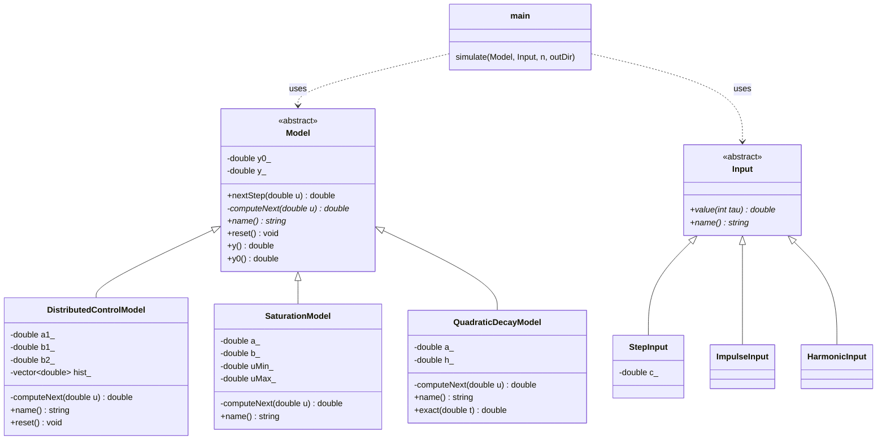
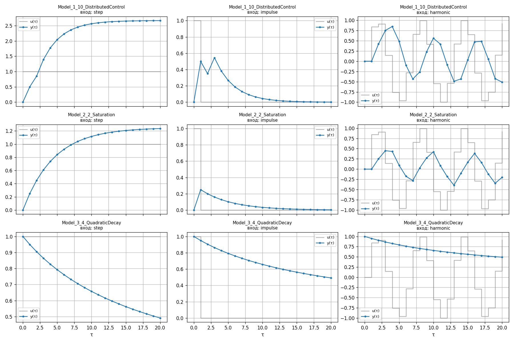

<p align="center">Министерство образования Республики Беларусь</p>
<p align="center">Учреждение образования</p>
<p align="center">«Брестский государственный технический университет»</p>
<p align="center">Кафедра ИИТ</p>
<br><br><br><br><br><br><br>
<p align="center">Лабораторная работа №1</p>
<p align="center">По дисциплине «Общая теория интеллектуальных систем»</p>
<p align="center">Тема: «Моделирование управляемого объекта»</p>
<br><br><br><br><br>
<p align="right">Выполнил:</p>
<p align="right">Студент 2 курса</p>
<p align="right">Группы ИИ-29</p>
<p align="right">Кохнюк Г.Э.</p>
<p align="right">Проверил:</p>
<p align="right">Дворанинович Д.А.</p>
<br><br><br><br><br>
<p align="center">Брест 2026</p>

## 1. Цель работы
Реализовать на C++ (ООП) имитационные модели динамических объектов, исследовать их реакцию на ступенчатое, импульсное и гармоническое воздействия, вывести результаты в табличном виде и визуализировать.

## 2. Моделируемые объекты

| № | Модель | Уравнение |
|---|--------|-----------|
| 1.10 | Distributed Control Window Model | $y_{\tau+1} = a_1 y_\tau + b_1 u_\tau + b_2 u_{\tau-2}$ |
| 2.2 | Actuator Saturation Non-linearity | $y_{\tau+1} = a y_\tau + b\cdot \mathrm{sat}(u_\tau)$ |
| 3.4 | Quadratic Self-Decay | $\dfrac{dy}{dt} = -a y^2$ |

```math
\mathrm{sat}(u)=\begin{cases}
U_{max}, & u \gt U_{max} \\
u, & U_{min} \le u \le U_{max} \\
U_{min}, & u \lt U_{min}
\end{cases}
```
**Параметры по умолчанию** (вводятся вручную, значения ниже подставляются при нажатии Enter):

| Модель | Параметры |
|--------|-----------|
| 1.10 | $a_1=0.7,\ b_1=0.5,\ b_2=0.3,\ y_0=0$; задержка $k=2$, $u_{\tau<0}=0$ |
| 2.2 | $a=0.8,\ b=0.5,\ U_{min}=-0.5,\ U_{max}=0.5,\ y_0=0$ |
| 3.4 | $a=0.5,\ y_0=1,\ h=0.1$ |

**Дискретизация модели 3.4.** Уравнение непрерывное, поэтому применён явный метод Эйлера:
$y_{n+1} = y_n - h\,a\,y_n^2$. Точное решение $y(t)=\dfrac{y_0}{1+a y_0 t}$ (метод `exact()`) используется для проверки.
Система автономная, поэтому входное воздействие $u_\tau$ на неё не влияет (при ненулевом $y_0$ реакция на все три воздействия одинакова — это ожидаемо).

**Входные воздействия:** ступенчатое $u_\tau=1$; импульсное $u_0=1,\ u_{\tau>0}=0$; гармоническое $u_\tau=\sin(\tau)$.

## 3. Архитектура (UML-диаграмма классов)



Базовый абстрактный класс `Model` содержит чисто виртуальный метод `computeNext(u)` — расчёт следующего шага; конкретные уравнения реализованы в наследниках. Публичный метод `nextStep(u)` вызывает `computeNext` и сохраняет новое состояние (шаблонный метод), поэтому поля класса закрыты (`private`). Аналогично устроена иерархия входных воздействий `Input`.

## 4. Структура проекта (`src`)

| Файл | Назначение |
|------|-----------|
| `Model.hpp` | абстрактный класс `Model` и три модели |
| `Input.hpp` | классы входных воздействий |
| `main.cpp` | ручной ввод параметров и числа шагов `n`, симуляция, вывод таблицы и CSV, автоматический вызов графика |
| `plot.py` | визуализация (Python/Matplotlib): открывает окно графика и сохраняет `.png` |
| `CMakeLists.txt`, `build.bat` | сборка и запуск |

## 5. Сборка и запуск
Требуется: CMake ≥ 3.10, компилятор C++17 (MSVC/MinGW), Python 3 + matplotlib (`python -m pip install matplotlib`).

```bat
cd trunk\ii0xxyy\task_01\src
build.bat
```
`build.bat` последовательно выполняет: конфигурацию CMake → сборку → запуск программы. Далее программа в диалоге запрашивает:

1. номер модели (1.10 / 2.2 / 3.4);
2. параметры модели (Enter — значение по умолчанию; допускается запятая в дробных числах);
3. тип входного воздействия (для моделей 1.10 и 2.2);
4. количество шагов симуляции `n`.

После расчёта таблица `tau / u / y` выводится в консоль и сохраняется в `results/<модель>_<воздействие>.csv`, а график **автоматически открывается в окне** (и сохраняется рядом в `.png`). Закройте окно графика — программа предложит запустить расчёт ещё раз.

## 6. Результаты

Пример вывода (модель 1.10, параметры по умолчанию, импульсное воздействие, n = 8):

```
   tau         u_tau           y_tau
------------------------------------
     0      1.000000        0.000000
     1      0.000000        0.500000
     2      0.000000        0.350000
     3      0.000000        0.545000
     4      0.000000        0.381500
     5      0.000000        0.267050
     6      0.000000        0.186935
     7      0.000000        0.130854
     8      0.000000        0.091598
```

Сводный график всех моделей и воздействий при параметрах по умолчанию (n = 20):



## 7. Анализ

- **Модель 1.10.** Устойчива ($|a_1|<1$). На ступень выходит на установившееся значение $(b_1+b_2)/(1-a_1)\approx 2.67$. На импульс виден «второй всплеск» при $\tau=3$ из-за запаздывающего слагаемого $b_2u_{\tau-2}$. На гармонику отвечает колебаниями с фазовым сдвигом.
- **Модель 2.2.** Из-за ограничения $|u|\le 0.5$ установившееся значение на ступень $b\cdot U_{max}/(1-a)=1.25$ вместо $2.5$ без насыщения; пики гармонического входа «срезаются».
- **Модель 3.4.** Нелинейное затухание: скорость спада пропорциональна $y^2$, поэтому спад гиперболический (не экспоненциальный), $y\to0$ медленно. Эйлер хорошо согласуется с точным решением при $h=0.1$.

## 8. Выводы
Реализован ООП-комплекс из трёх моделей и трёх типов воздействий; результаты выводятся в таблицы/CSV и на графики, параметры и число шагов вводятся вручную, график выводится автоматически; сборка автоматизирована через CMake и `build.bat`.
