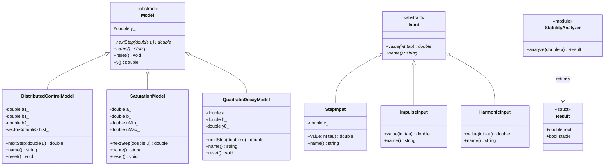

# Лабораторная работа №2

<p align="center">Министерство образования Республики Беларусь</p>
<p align="center">Учреждение образования</p>
<p align="center">«Брестский государственный технический университет»</p>
<p align="center">Факультет электронно-информационных систем</p>
<p align="center">Кафедра ИИТ</p>

<br><br><br>

<p align="center"><b>Лабораторная работа №2</b></p>
<p align="center"><b>По дисциплине: «Общая теория интеллектуальных систем»</b></p>
<p align="center"><b>Тема: «Модульное тестирование и анализ устойчивости»</b></p>

<br><br><br>

<p align="right">Выполнил:</p>
<p align="right">Студент 2 курса</p>
<p align="right">Группы ИИ29</p>
<p align="right">Кохнюк Г. Э.</p>
<p align="right">Проверил:</p>
<p align="right">Дворанович Д.А.</p>

<br><br><br>

<p align="center">Брест 2026</p>

---

## Вариант 10

В лабораторной работе используются математические модели и генераторы входных сигналов, реализованные в лабораторной работе №1.

## Задание

1. Покрыть модульными тестами с использованием Google Test модели и генераторы входных сигналов из лабораторной работы №1.
2. Реализовать анализ устойчивости выбранной линейной модели по корням характеристического уравнения.
3. Измерить покрытие исходного кода модульными тестами.

## Реализованные компоненты

В проекте реализованы три математические модели, три генератора входных сигналов, модуль анализа устойчивости и набор модульных тестов.

| Компонент | Файл | Назначение |
|---|---|---|
| Модели | `src/Model.hpp` | Реализация математических моделей |
| Входные сигналы | `src/Input.hpp` | Генерация ступенчатого, импульсного и гармонического сигналов |
| Анализатор устойчивости | `src/stabl.hpp` | Определение устойчивости по корню характеристического уравнения |
| Консольное приложение | `src/main.cpp` | Запуск моделирования и сохранение результатов |
| Тесты | `test/stabltest.cpp` | Проверка моделей, входных сигналов и анализатора устойчивости |
| Сборка приложения | `src/build.bat` | Сборка и запуск основной программы |
| Запуск тестов и покрытия | `test/run_tests.bat` | Сборка тестов, запуск Google Test и формирование отчёта покрытия |

## Математические модели

В проекте реализованы следующие модели.

### 1. Модель с распределённым управлением

Класс `DistributedControlModel` описывает дискретную систему с использованием текущего и задержанного входного воздействия.

Рекуррентное уравнение:

\[
y_{k+1}=a_1y_k+b_1u_k+b_2u_{k-2}
\]

где:

- \(y_k\) — текущее состояние системы;
- \(u_k\) — текущее входное воздействие;
- \(u_{k-2}\) — входное воздействие с задержкой в два шага;
- \(a_1,b_1,b_2\) — коэффициенты модели.

Для хранения истории входных воздействий используется контейнер `std::vector`.

### 2. Модель с насыщением входного воздействия

Класс `SaturationModel` описывает систему, в которой входное воздействие ограничивается заданными минимальным и максимальным значениями.

Уравнение модели:

\[
y_{k+1}=ay_k+b\cdot sat(u_k)
\]

Функция насыщения:

\[
sat(u)=
\begin{cases}
u_{min}, & u<u_{min},\\
u, & u_{min}\leq u\leq u_{max},\\
u_{max}, & u>u_{max}.
\end{cases}
\]

Для ограничения входного воздействия используется функция `std::clamp`.

### 3. Нелинейная модель квадратичного затухания

Класс `QuadraticDecayModel` описывает нелинейную динамическую систему.

Разностное уравнение:

\[
y_{k+1}=y_k-ha y_k^2
\]

где:

- \(a\) — коэффициент затухания;
- \(h\) — шаг дискретизации;
- \(y_k\) — текущее состояние системы.

Для сравнения результатов численного моделирования также реализовано аналитическое решение:

\[
y(t)=\frac{y_0}{1+ay_0t}
\]

## Генераторы входных сигналов

Для подачи входных воздействий на модели реализован абстрактный класс `Input` и три производных класса.

| Класс | Назначение | Математическое описание |
|---|---|---|
| `StepInput` | Ступенчатый сигнал | \(u(k)=c\) |
| `ImpulseInput` | Импульсный сигнал | \(u(k)=1\) при \(k=0\), иначе \(0\) |
| `HarmonicInput` | Гармонический сигнал | \(u(k)=\sin(k)\) |

Каждый генератор реализует два метода:

- `value(int tau)` — возвращает значение входного сигнала на заданном шаге;
- `name()` — возвращает название сигнала.

## Анализ устойчивости

Для анализа устойчивости реализован отдельный модуль `StabilityAnalyzer`, расположенный в файле `stabl.hpp`.

Для линейной дискретной модели первого порядка:

\[
y_{k+1}=ay_k
\]

при свободном движении системы характеристическое уравнение имеет вид:

\[
z-a=0
\]

Его корень:

\[
z=a
\]

Система асимптотически устойчива, если модуль корня строго меньше единицы:

\[
|z|<1
\]

Таким образом, критерий устойчивости:

\[
|a|<1
\]

В реализации используется следующая логика:

- если \(|a|<1\), система считается устойчивой;
- если \(|a|\geq 1\), система считается неустойчивой;
- если коэффициент не является конечным числом (`NaN`, `inf`), система также считается неустойчивой.

Анализатор возвращает структуру `Result`, содержащую:

- `root` — корень характеристического уравнения;
- `stable` — признак устойчивости системы.

Для выполнения анализа используется статический метод:

```cpp
StabilityAnalyzer::analyze(a);
```

Данный анализатор предназначен для линейной модели первого порядка и не является универсальным анализатором всех реализованных моделей.

## ООП-архитектура

В проекте используется объектно-ориентированный подход.

Основные классы моделей наследуются от абстрактного класса `Model`, который определяет общий интерфейс:

- `nextStep(double u)` — выполнение одного шага моделирования;
- `name()` — получение названия модели;
- `reset()` — сброс состояния;
- `y()` — получение текущего значения состояния.

Генераторы сигналов наследуются от абстрактного класса `Input`.

Анализатор устойчивости вынесен в отдельный модуль `StabilityAnalyzer` и не зависит от конкретных объектов моделей.

## UML-диаграмма классов



## Структура проекта

```text
task_02/
├── doc/
│   └── readme.md
│
├── src/
│   ├── main.cpp
│   ├── Model.hpp
│   ├── Input.hpp
│   ├── stabl.hpp
│   ├── CMakeLists.txt
│   ├── build.bat
│   ├── build/
│   ├── results/
│   ├── plot.py
│   └── .gitignore
│
└── test/
    ├── stabltest.cpp
    ├── CMakeLists.txt
    └── run_tests.bat
```

## Сборка и запуск основной программы

Для сборки и запуска основной программы используется файл `build.bat`, расположенный в каталоге `src`.

Запуск из командной строки:

```bat
cd src
build.bat
```

Можно передать количество шагов моделирования:

```bat
build.bat 100
```

По умолчанию используется 20 шагов.

Скрипт выполняет следующие действия:

1. Конфигурирует проект с помощью CMake.
2. Компилирует исходный код в конфигурации Release.
3. Запускает исполняемый файл.
4. Сохраняет результаты моделирования в каталоге `results`.
5. Запускает `plot.py` для построения графиков, если Python и Matplotlib установлены.

## Модульное тестирование

Для модульного тестирования используется фреймворк Google Test.

Все тесты находятся в файле `test/stabltest.cpp`.

Тестирование охватывает:

- работу анализатора устойчивости;
- корректность вычислений математических моделей;
- обработку граничных значений;
- сброс состояния моделей;
- работу генераторов входных сигналов;
- корректность названий моделей и сигналов;
- взаимодействие компонентов через тестовые объекты и Mock-объекты.

В проекте зарегистрировано **33 теста в 6 тестовых наборах**.

| Тестовый набор | Количество тестов | Назначение |
|---|:---:|---|
| `StabilityTests` | 10 | Проверка устойчивых, неустойчивых и граничных значений |
| `ModelTests` | 5 | Проверка основных вычислений моделей |
| Параметризованные тесты насыщения | 6 | Проверка работы ограничений входного сигнала |
| `MockInputTests` | 3 | Проверка взаимодействия с тестовыми входными объектами |
| `ModelBoundaryTests` | 6 | Проверка граничных случаев моделей |
| `ModelNameTests` | 3 | Проверка названий моделей и сигналов |
| **Всего** | **33** | |

## Измерение покрытия кода

Для измерения покрытия используется связка:

- GCC — компилятор C++;
- gcov — инструмент сбора информации о покрытии;
- gcovr — формирование отчётов о покрытии.

Сборка тестов производится с параметрами инструментирования покрытия `--coverage`, `-O0` и `-g`.

Для запуска тестирования и формирования отчёта используется файл `run_tests.bat`, расположенный в каталоге `test`.

Запуск:

```bat
cd test
run_tests.bat
```

Скрипт выполняет следующие действия:

1. Проверяет наличие GCC, CMake, Ninja, gcov и gcovr.
2. Конфигурирует отдельную сборку тестового проекта.
3. Собирает Google Test и тестовое приложение.
4. Запускает все модульные тесты.
5. Собирает данные о покрытии исходного кода.
6. Выводит статистику покрытия в консоль.
7. Формирует HTML- и XML-отчёты.

Результаты сохраняются в следующих каталогах:

```text
src/results/
├── tests/
│   └── test_results.xml
│
└── coverage/
    ├── index.html
    └── coverage.xml
```

HTML-отчёт `index.html` позволяет просмотреть покрытие отдельных строк исходного кода.

## Вывод

В ходе лабораторной работы было разработано программное решение, включающее:

- модульную организацию математических моделей и генераторов входных сигналов;
- реализацию анализатора устойчивости линейной дискретной модели;
- модульные тесты с использованием Google Test;
- проверку граничных случаев и взаимодействия компонентов;
- автоматизированную сборку и запуск основной программы;
- автоматизированный запуск тестов;
- измерение покрытия исходного кода с помощью gcov и gcovr;
- формирование HTML- и XML-отчётов о покрытии.

В результате была создана система, позволяющая проверять корректность работы реализованных компонентов и оценивать полноту их тестирования.