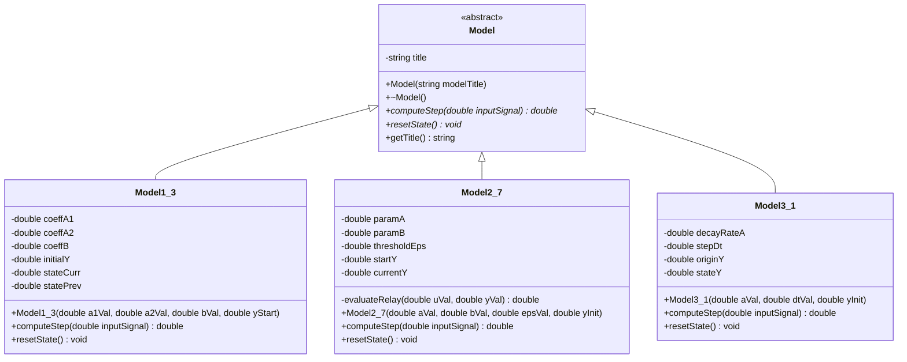
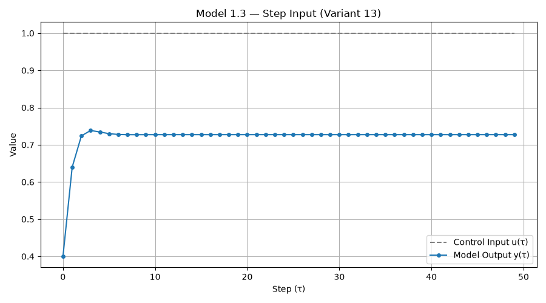
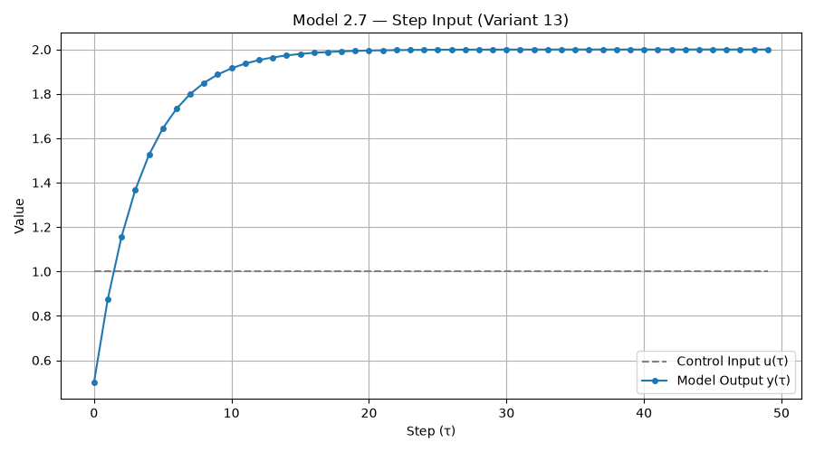
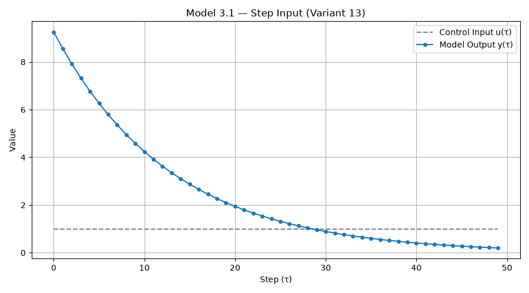

Министерство образования Республики Беларусь 
Учреждение образования 
«Брестский государственный технический университет» 
Кафедра интеллектуальных информационных технологий

   

<b>Лабораторная работа №1</b> 
По дисциплине: «Общая теория интеллектуальных систем» 
Тема: «Моделирование управляемого объекта» 
Вариант №13

   

Выполнил: 
Студент 2 курса, группы ИИ-29 
Курилюк А. С.  
Проверил: 
Иванюк Д. С.

   

Брест 2026

---

## 1. Цель работы
Изучить принципы объектно-ориентированного математического моделирования динамических систем на языке C++ с использованием системы автоматизации сборки CMake. Реализовать симуляцию поведения объектов управления при подаче ступенчатого, импульсного и гармонического входных воздействий, представить выходные данные в табличном виде, выполнить экспорт в `.csv` и визуализировать графики переходных процессов.

---

## 2. Математическое описание моделей (Вариант 13)

В соответствии с индивидуальным вариантом №13 реализованы три математические модели:

### 2.1. Линейная модель 1.3 (Колебательная / инерционная система 2-го порядка)
Уравнение модели:

$$y_{\tau+1} = a_1 y_\tau + a_2 y_{\tau-1} + b u_\tau$$

Используемые коэффициенты: $a_1 = 0.6$, $a_2 = -0.15$, $b = 0.4$, начальное условие $y_0 = 0.0$.

### 2.2. Нелинейная модель 2.7 (Релейный элемент с гистерезисом)
Уравнение модели:

$$y_{\tau+1} = a y_\tau + b \cdot \text{relay}(u_\tau, y_\tau)$$

Характеристика релейного звена `relay(u, y)`:
* принимает значение `1`, если $u_\tau > \epsilon$ или ($u_\tau \ge -\epsilon$ и $y_\tau > 0$);
* принимает значение `-1`, если $u_\tau < -\epsilon$ или ($u_\tau \le \epsilon$ и $y_\tau \le 0$).

Используемые параметры: $a = 0.75$, $b = 0.5$, порог гистерезиса $\epsilon = 0.2$, начальное условие $y_0 = 0.0$.

### 2.3. Дифференциальное уравнение 3.1 (Линейное затухание)
Исходное дифференциальное уравнение:

$$\frac{dy}{dt} = -a \cdot y$$

Численное решение методом Эйлера с шагом дискретизации $\Delta t$:

$$y_{\tau+1} = y_\tau + \Delta t \cdot (-a \cdot y_\tau)$$

Используемые параметры: $a = 0.15$, шаг $\Delta t = 0.5$, начальное условие $y_0 = 10.0$.

---

## 3. Архитектура программы и UML-диаграмма классов

Программа спроектирована с соблюдением принципов ООП. Абстрактный базовый класс `Model` определяет общий интерфейс расчёта следующего шага симуляции `computeStep(double)` и сброса состояния `resetState()`. Конкретные модели реализованы в классах-наследниках `Model1_3`, `Model2_7` и `Model3_1`.

---

## 4. Табличное представление и визуализация результатов

В программе реализована поддержка трёх типов входных воздействий $u_\tau$:
1. **Ступенчатое:** $u_\tau = 1.0$;
2. **Импульсное:** $u_0 = 1.0$, $u_{\tau > 0} = 0.0$;
3. **Гармоническое:** $u_\tau = \sin(\tau)$.

Ниже приведён фрагмент табличного вывода результатов симуляции (первые 10 шагов из $n = 50$ при ступенчатом воздействии $u_\tau = 1.0$), экспортируемых в консоль и файл `simulation_data.csv`:

| Шаг ($\tau$) | Вход $u(\tau)$ | Модель 1.3 $y(\tau)$ | Модель 2.7 $y(\tau)$ | Модель 3.1 $y(\tau)$ |
| :---: | :---: | :---: | :---: | :---: |
| 0 | 1.0000 | 0.4000 | 0.5000 | 9.2500 |
| 1 | 1.0000 | 0.6400 | 0.8750 | 8.5563 |
| 2 | 1.0000 | 0.7240 | 1.1563 | 7.9145 |
| 3 | 1.0000 | 0.7384 | 1.3672 | 7.3209 |
| 4 | 1.0000 | 0.7344 | 1.5254 | 6.7719 |
| 5 | 1.0000 | 0.7299 | 1.6440 | 6.2640 |
| 6 | 1.0000 | 0.7278 | 1.7330 | 5.7942 |
| 7 | 1.0000 | 0.7272 | 1.7998 | 5.3596 |
| 8 | 1.0000 | 0.7271 | 1.8498 | 4.9577 |
| 9 | 1.0000 | 0.7272 | 1.8874 | 4.5858 |

### 4.1. График переходного процесса — Линейная модель 1.3

### 4.2. График переходного процесса — Нелинейная модель 2.7

### 4.3. График переходного процесса — Дифференциальное уравнение 3.1

---

## 5. Сборка и запуск проекта

Сборка проекта осуществляется с помощью системы CMake и автоматизирована через скрипт `build.bat`, расположенный в каталоге `src/`. После компиляции программа запрашивает у пользователя выбор модели, тип управляющего сигнала, параметры уравнения и количество шагов симуляции $n$, выводит таблицу значений и вызывает скрипт `plot.py` для отображения графика.

---

## 6. Вывод
В ходе выполнения лабораторной работы на языке C++ была разработана объектно-ориентированная программа для моделирования линейных, нелинейных и непрерывных динамических систем по варианту №13. Создана иерархия классов с использованием полиморфизма, настроена кроссплатформенная сборка через CMake и выполнена визуализация результатов средствами Python и библиотеки Matplotlib.