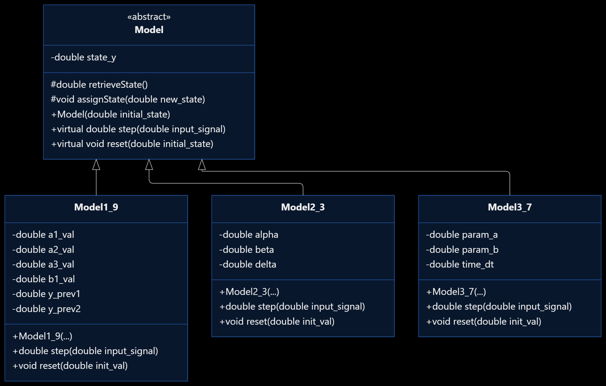
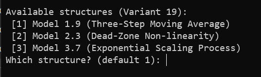
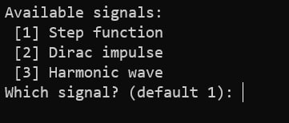
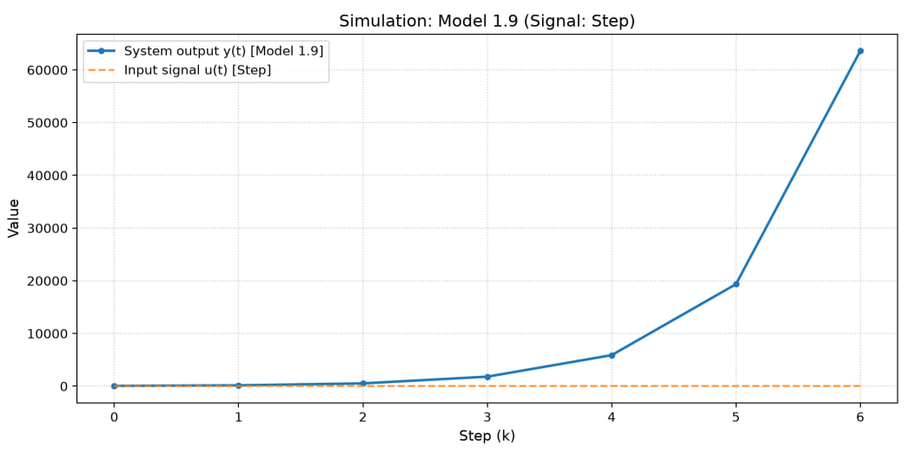
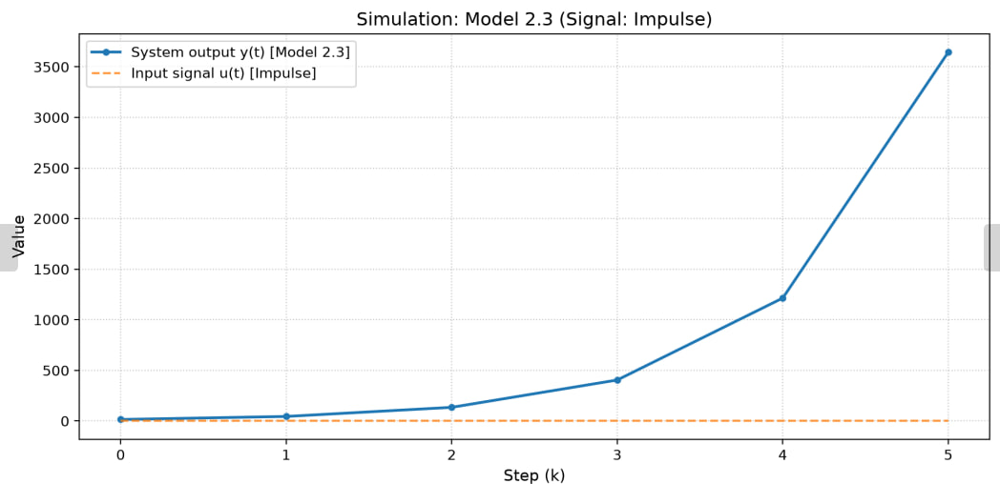
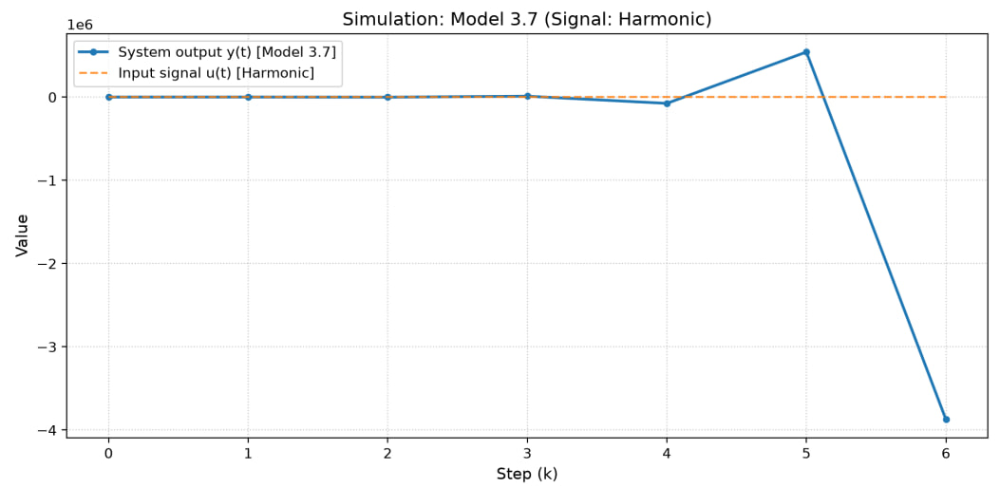
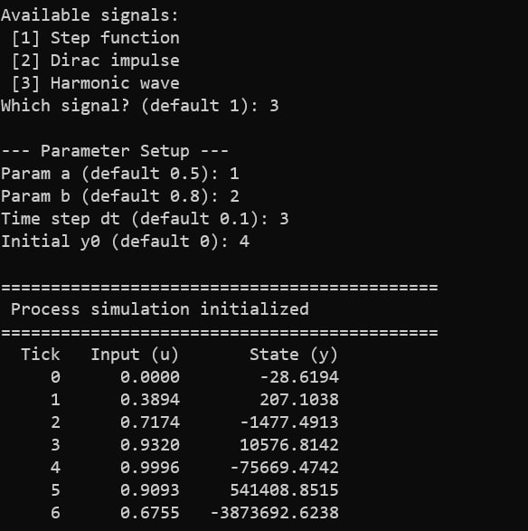

<p align="center">Министерство образования Республики Беларусь</p>
<p align="center">Учреждение образования</p>
<p align="center">«Брестский Государственный технический университет»</p>
<p align="center">Кафедра ИИТ</p>

<br><br><br><br>

<p align="center">Лабораторная работа №1</p>
<p align="center">По дисциплине «Общая теория интеллектуальных систем»</p>
<p align="center">Тема: «Моделирования температуры объекта»</p>

<br><br><br>

<p align="right">Выполнил:</p>
<p align="right">Студент 2 курса</p>
<p align="right">Группы ИИ-29</p>
<p align="right">Лебедь А.Н.</p>
<p align="right">Проверил:</p>
<p align="right">Дворанинович Д. А.</p>

<br><br><br>

<p align="center">Брест 2026</p>

---

# Вариант 19

- Линейная модель: **Model 1.9**
- Нелинейная модель: **Model 2.3**
- Дифференциальное уравнение: **Model 3.7**

# Реализованные модели

## Model 1.9

Трёхшаговая линейная модель:

`y(t+1) = a1*y(t) + a2*y(t-1) + a3*y(t-2) + b1*u(t)`

## Model 2.3

Нелинейная модель с зоной нечувствительности:

`y(k+1) = alpha * y(k) + beta * deadzone(u(k), delta)`

где `deadzone(u, delta)` равна `u - delta` при `u > delta`, `u + delta` при `u < -delta` и `0` в остальных случаях.

## Model 3.7

Дифференциальная модель задаётся уравнением:

`dy/dt = -exp(a) * y + b * u`

Для численного моделирования используется явный метод Эйлера:

`y(k+1) = y(k) + dt * (-exp(a) * y(k) + b * u(k))`

# Входные воздействия

1. Ступенчатое: `u(t) = A`
2. Импульсное: `u(0) = A`, `u(t > 0) = 0`
3. Гармоническое: `u(k) = sin(0.4*k)`

# ООП

Создан абстрактный базовый класс `Model` с чисто виртуальным методом `step(input_signal)`.
# UML



От него наследуются:

- `Model1_9`
- `Model2_3`
- `Model3_7`

Для Model 1.9 дополнительно учитываются два предыдущих значения выходной величины.

# Функционал


**Программа:**

- реализует базовый абстрактный класс `Model`;
- позволяет использовать три математические модели: `Model1_9`, `Model2_3`, `Model3_7`;
- принимает коэффициенты для каждой модели;
- позволяет задавать начальное значение состояния `y0`;
- принимает входное воздействие `input_signal`;
- для модели `Model1_9` учитывает два предыдущих значения состояния;
- для модели `Model2_3` реализует зону нечувствительности (Deadzone);
- для модели `Model3_7` реализует дискретизацию дифференциального уравнения методом Эйлера;
- вычисляет новое значение состояния на каждом шаге;
- обновляет состояние модели после каждого вычисления;
- позволяет сбрасывать модель к начальному значению с помощью `reset()`;
- использует наследование и виртуальные методы для реализации разных математических моделей.

# Сборка

На Windows используется `build.bat`:

```bat
@echo off
setlocal

echo === [1/5] Creating build directory ===
if not exist build (
    mkdir build
)
cd build

echo === [2/5] Configuring project with CMake (MinGW) ===
cmake -G "MinGW Makefiles" ..
if %errorlevel% neq 0 (
    echo [ERROR] CMake configuration failed!
    pause
    exit /b %errorlevel%
)

echo === [3/5] Compiling the project ===
cmake --build .
if %errorlevel% neq 0 (
    echo [ERROR] Build failed!
    pause
    exit /b %errorlevel%
)

echo.
echo === [4/5] Running simulation ===
task_01.exe
if %errorlevel% neq 0 (
    echo [ERROR] Simulation failed!
    pause
    exit /b %errorlevel%
)

cd ..

echo.
echo === [5/5] Generating and opening plot ===
py src\plot.py
if %errorlevel% neq 0 (
    echo [ERROR] Python script failed!
    pause
    exit /b %errorlevel%
)

echo.
echo ========================================
echo All done! Graph saved to doc/ and opened.
echo ========================================
pause
```

После сборки исполняемый файл находится здесь:

`build/task_01.exe`

# Запуск

Программа запускается без аргументов:

```text
otis_task_01.exe
```

После запуска пользователь выбирает модель, задаёт её коэффициенты, вид входного воздействия, число шагов моделирования и начальное значение.

# Пример работы

После запуска появляется :



После выбора модели вводятся соответствующие коэффициенты.

Затем выбирается воздействие:


Полученные данные выводятся в консоль и сохраняются в `results.csv`.

После этого автоматически запускается `plot.py`.


# Работа модели 1.9

# Работа модели 2.3

# Работа модели 3.7



# **Вывод**

В ходе лабораторной работы была разработана объектно-ориентированная программа для моделирования динамических систем.

Были реализованы три математические модели: линейная модель 1.9, нелинейная модель 2.3 и дифференциальная модель 3.7. Для каждой модели созданы отдельные классы, унаследованные от базового абстрактного класса `Model`.

Программа позволяет задавать необходимые коэффициенты, начальное состояние системы и входное воздействие. Реализованы вычисление нового состояния модели, обновление предыдущих значений и сброс модели к начальному состоянию.

В ходе работы были изучены принципы объектно-ориентированного программирования, наследование, инкапсуляция и использование виртуальных методов для реализации различных математических моделей.