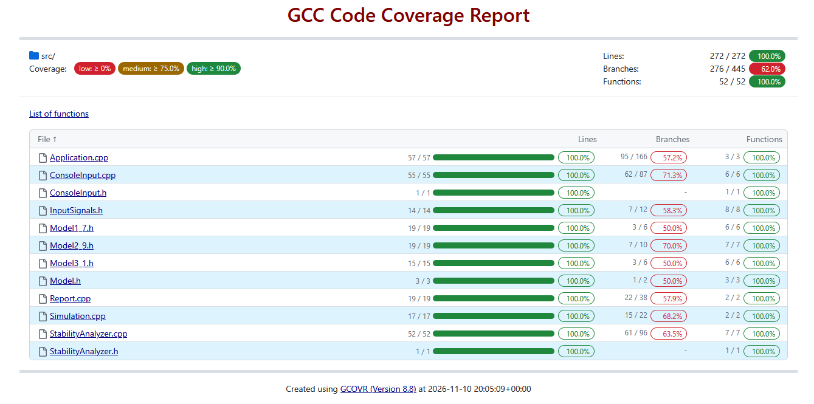
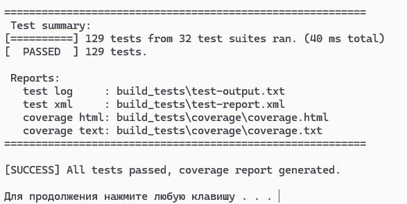

<p align="center">Министерство образования Республики Беларусь</p>
<p align="center">Учреждение образования</p>
<p align="center">«Брестский государственный технический университет»</p>
<p align="center">Кафедра ИИТ</p>
<br><br><br><br><br><br><br>
<p align="center">Лабораторная работа №2</p>
<p align="center">По дисциплине «Общая теория интеллектуальных систем»</p>
<p align="center">Тема: «Модульные тесты и анализ покрытия кода»</p>
<br><br><br><br><br>
<p align="right">Выполнил:</p>
<p align="right">Студент 2 курса</p>
<p align="right">Группы ИИ-29</p>
<p align="right">Углик С.С.</p>
<p align="right">Проверил:</p>
<p align="right">Дворанинович Д.А.</p>
<br><br><br><br><br>
<p align="center">Брест 2026</p>

---

## 1. Цель работы

Расширить программу из лабораторной работы №1 (вариант 7: модели 1.7, 2.9, 3.1) модулем анализа устойчивости на Z-плоскости, покрыть код модульными тестами на Google Test / Google Mock и автоматизировать сборку, запуск тестов и измерение покрытия локальным скриптом `run_tests.bat`.

## 2. Анализ устойчивости

Асимптотическая устойчивость линейной дискретной системы: все корни характеристического уравнения лежат **строго внутри** единичного круга, $|z| < 1$. Граница $|z| = 1$ устойчивой **не считается** (процесс не затухает), для неё выводится отдельное предупреждение.

### 2.1. Модель 1.7

$y_{t+1} = a\,y_t + b_1 u_t + b_2 u_{t-1} + b_3 u_{t-2}$

Свободное движение ($u \equiv 0$): $y_{t+1} - a\,y_t = 0$. Подстановка $y_t = z^t$ даёт $z - a = 0$, то есть $z = a$.

В форме состояния $x_t = (y_t,\ u_{t-1},\ u_{t-2})^T$ матрица системы

$$A = \begin{pmatrix} a & b_2 & b_3 \\ 0 & 0 & 0 \\ 0 & 1 & 0 \end{pmatrix}$$

(1-я строка — $y_{t+1}$; 2-я — $u_t$ приходит со входа, обратной связи нет; 3-я — сдвиг $u_{t-1} \to u_{t-2}$; $\det(A-\lambda I)=(a-\lambda)\lambda^2$) имеет собственные числа $\{a, 0, 0\}$, поэтому коэффициенты $b_1, b_2, b_3$ на устойчивость не влияют:

$$\boxed{|a| < 1}$$

Установившееся значение для ступени амплитуды $A$: $y_\infty = A\,\dfrac{b_1 + b_2 + b_3}{1 - a}$.

### 2.2. Модель 2.9

$y_{t+1} = a\,y_t + b\sqrt{|u_t|}\,\mathrm{sign}(u_t)$. Свободное движение то же, $z = a$, условие $|a| < 1$ (при ограниченном входе выход ограничен). В ЛР1 метод `isStable()` у этой модели всегда возвращал `true`, в ЛР2 это исправлено.

### 2.3. Модель 3.1 (метод Эйлера)

$\dot y = -a\,y \;\Rightarrow\; y_{t+1} = (1 - a\,\Delta t)\,y_t$, корень $z = 1 - a\,\Delta t$:

$$\boxed{|1 - a\,\Delta t| < 1 \iff 0 < a\,\Delta t < 2}$$

Разбор случаев: $a\Delta t > 2$ — схема численно неустойчива (уменьшить $\Delta t$); $a < 0$ — неустойчив сам объект; $a\Delta t = 2$ или $a = 0$ — граница; $\Delta t \le 0$ или нечисловые параметры — анализ невозможен.

### 2.4. Реализация

Модуль `src/StabilityAnalyzer.{h,cpp}`: `firstOrderRoot`, `eulerRoot`, `classifyRoot` (→ `Stable / Boundary / Unstable / Invalid`), `classifyFirstOrder`, `classifyEuler`, `firstOrderWarning`, `eulerWarning`. Методы `isStable()` и `stabilityWarning()` моделей делегируют проверку анализатору. В `runApplication` предупреждение печатается **до** симуляции (`printStabilityWarning`), после чего пользователь решает, продолжать ли.

## 3. Что изменено относительно ЛР1

| Изменение | Зачем |
|---|---|
| Логика вынесена из `main` в библиотеку `otis_core` (`Simulation`, `Report`, `ConsoleInput`, `Application`) | тесты линкуются с библиотекой; `main.cpp` — одна строка |
| `simulate(Model&, const InputSignal&, n)` без ввода-вывода | проверка шагов симуляции и подмена сигнала через Google Mock |
| Ввод принимает `std::istream` / `std::ostream` | сценарий программы целиком тестируется через `stringstream` |
| `StabilityAnalyzer` вместо логики внутри моделей | отдельный проверяемый модуль анализа устойчивости |
| `Model2_9::isStable()` проверяет $\lvert a\rvert<1$ | раньше всегда `true` |
| Предупреждение для 3.1 различает $a<0$, $a\Delta t>2$, границу, $\Delta t\le 0$ | в ЛР1 любое нарушение называлось «численная неустойчивость» |
| При конце ввода (EOF) выбрасывается `InputClosed` | в ЛР1 `readChoice` зацикливался навсегда |

## 4. Структура

```text
task_02/
├── CMakeLists.txt        # GoogleTest v1.15.2 (FetchContent), опции OTIS_BUILD_TESTS, OTIS_ENABLE_COVERAGE
├── run_tests.bat         # сборка + тесты + отчёт о покрытии
├── src/                  # Model*.h, InputSignals.h (из ЛР1), StabilityAnalyzer, Simulation, Report,
│                         # ConsoleInput, Application, main.cpp, CMakeLists.txt
├── test/                 # 5 файлов тестов, CMakeLists.txt
└── doc/readme.md
```

## 5. Запуск

Нужны: MinGW-w64 GCC (g++, gcov в `PATH`), CMake ≥ 3.16, Ninja (`python -m pip install ninja`) или `mingw32-make`, `python -m pip install gcovr`, доступ к GitHub при первой сборке (загрузка GoogleTest).

```bat
run_tests.bat
```

Скрипт: настраивает CMake в `build_tests\` с флагами `--coverage -O0 -g` → собирает → запускает `otis_tests.exe` → строит отчёты.
Результаты: `build_tests\test-output.txt`, `build_tests\test-report.xml` (JUnit-подобный XML gtest), `build_tests\coverage\coverage.html`, `coverage.txt`, `summary.txt`.
Без паузы в конце: `run_tests.bat nopause`.

## 6. Тесты

| Файл | Что проверяется | Тестов |
|---|---|:---:|
| `test_stability.cpp` | корни $z=a$, $z=1-a\Delta t$; классификация по модулю корня (в т.ч. комплексные $0.6\pm0.8i$); границы $\lvert z\rvert=1$, $\pm1.000001$, NaN/Inf; тексты предупреждений | 40 |
| `test_models.cpp` | значения моделей по ручному расчёту; граничные значения 2.9 ($u=0$, $u=\pm1$, малые и большие $u$); инварианты (покой при $u=0$, нечётность, `reset`); метод Эйлера против $e^{-at}$ и порядок ошибки; сигналы | 30 |
| `test_simulation_param.cpp` | **`TEST_P`**: шаги симуляции для 11 наборов (модель × сигнал), сходимость 1.7 к $y_\infty$ (6 наборов), согласие прогноза анализатора с поведением (затухает / не затухает / расходится) | 23 |
| `test_simulation_mock.cpp` | **Google Mock**: `MockInputSignal` в режимах ступень / импульс / гармоника, порядок вызовов `value(1..n)`, `MockModel` (`reset` перед первым шагом, исключения), предупреждение об устойчивости | 11 |
| `test_application.cpp` | `readDouble/readInt/readChoice`, таблица, CSV, фабрики, сценарий программы целиком (в т.ч. неустойчивая модель, отмена, EOF) | 25 |
| **Итого** |  | **129** |

Из них 58 запусков приходится на `TEST_P` (6 наборов тестов) и 71 на обычные `TEST`.

Примеры ручного расчёта (ступень, $a=0.5,\ b_1=0.4,\ b_2=0.2,\ b_3=0.1$): $y_1=0.4$, $y_2=0.5\cdot0.4+0.4+0.2=0.8$, $y_3=0.5\cdot0.8+0.7=1.1$, $y_4=1.25$ — совпадает с `example_output.csv` из ЛР1. Для 2.9 ($a=0.6,\ b=0.5$, ступень): $0.5,\ 0.8,\ 0.98$. Для 3.1 ($a=0.8,\ \Delta t=0.05$): $0.96,\ 0.9216,\ 0.884736$.

> **Замечание о границах нелинейности.** В варианте 7 нет насыщения (2.2) и зоны нечувствительности (2.3), поэтому граничные значения проверены для нелинейности модели 2.9: $u=0$ (`sign` и корень), $u=\pm1$ (корень совпадает с входом), $u=\pm 4$, очень малые входы.

## 7. Тестовое покрытие и результаты

- **Способ запуска:** локальный скрипт `run_tests.bat`
- **Всего модульных тестов:** 129
- **Успешно пройденных тестов:** 129 / 129

| Файл | Покрытие строк | Покрытие функций | Статус |
| :--- | :---: | :---: | :---: |
| `src/Application.cpp` | 100 % (57/57) | 100 % (3/3) | OK |
| `src/ConsoleInput.cpp` | 100 % (55/55) | 100 % (6/6) | OK |
| `src/ConsoleInput.h` | 100 % (1/1) | 100 % (1/1) | OK |
| `src/InputSignals.h` | 100 % (14/14) | 100 % (8/8) | OK |
| `src/Model1_7.h` | 100 % (19/19) | 100 % (6/6) | OK |
| `src/Model2_9.h` | 100 % (19/19) | 100 % (7/7) | OK |
| `src/Model3_1.h` | 100 % (15/15) | 100 % (6/6) | OK |
| `src/Model.h` | 100 % (3/3) | 100 % (3/3) | OK |
| `src/Report.cpp` | 100 % (19/19) | 100 % (2/2) | OK |
| `src/Simulation.cpp` | 100 % (17/17) | 100 % (2/2) | OK |
| `src/StabilityAnalyzer.cpp` | 100 % (52/52) | 100 % (7/7) | OK |
| `src/StabilityAnalyzer.h` | 100 % (1/1) | 100 % (1/1) | OK |
| **Итоговый результат** | **100.0 % (272/272)** | **100.0 % (52/52)** | **Success** |

`main.cpp` исключён из отчёта опцией `--exclude`. Покрытие ветвлений (branches) составляет 62.0 % (276 из 445); в расчёт качества кода кафедрой не принимается, так как непокрытыми остаются системные ассемблерные ветви раскрутки исключений стандартной библиотеки C++.

Измерено локально на Windows: GCC, gcovr 8.8.

Отчёт о покрытии (`build_tests\coverage\coverage.html`):



Результат выполнения `run_tests.bat` (все тесты пройдены):



## 8. Выводы

Программа ЛР1 реорганизована под тестирование: расчётная логика вынесена в библиотеку, а ввод-вывод принимает потоки. Реализован модуль анализа устойчивости на Z-плоскости: $z=a$ для моделей 1.7 и 2.9, $z=1-a\Delta t$ для схемы Эйлера, граница $\lvert z\rvert=1$ считается неустойчивой, перед симуляцией выводится предупреждение. Написано 129 тестов (`TEST`, `TEST_P`, Google Mock); значения моделей проверены ручным расчётом, поведение анализатора сверено с реальным поведением симуляции.    Покрытие строк и функций составило 100 %, все 129 тестов проходят при запуске `run_tests.bat`.
