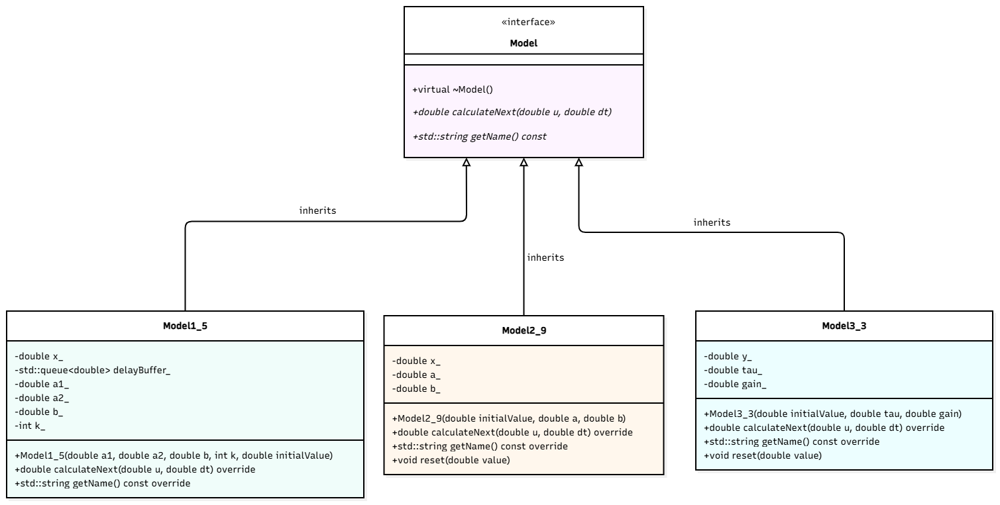
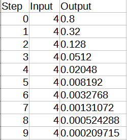
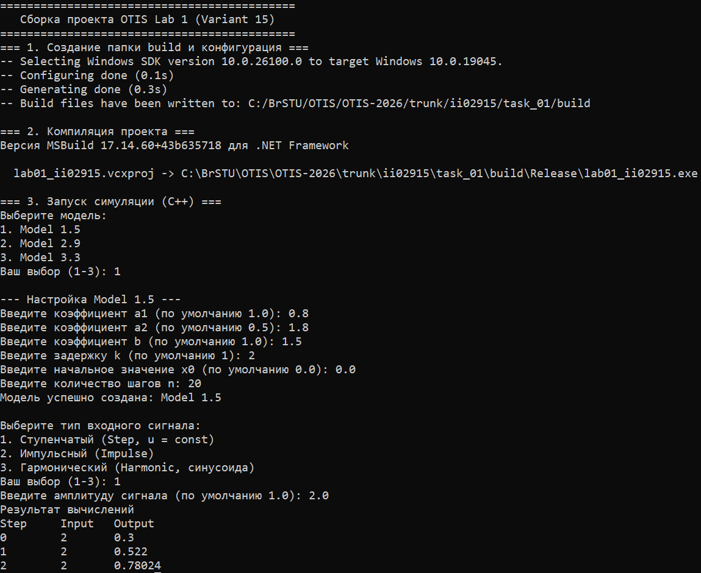
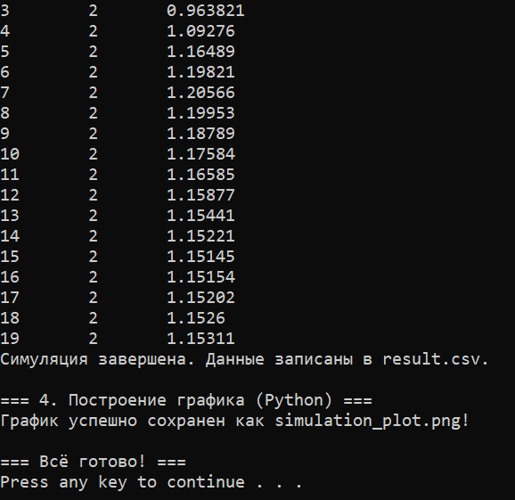
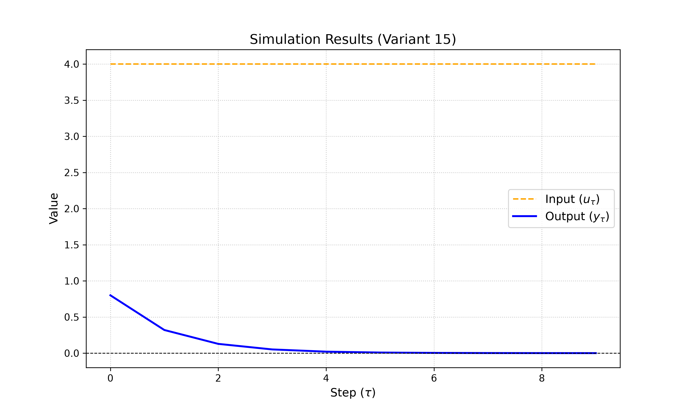
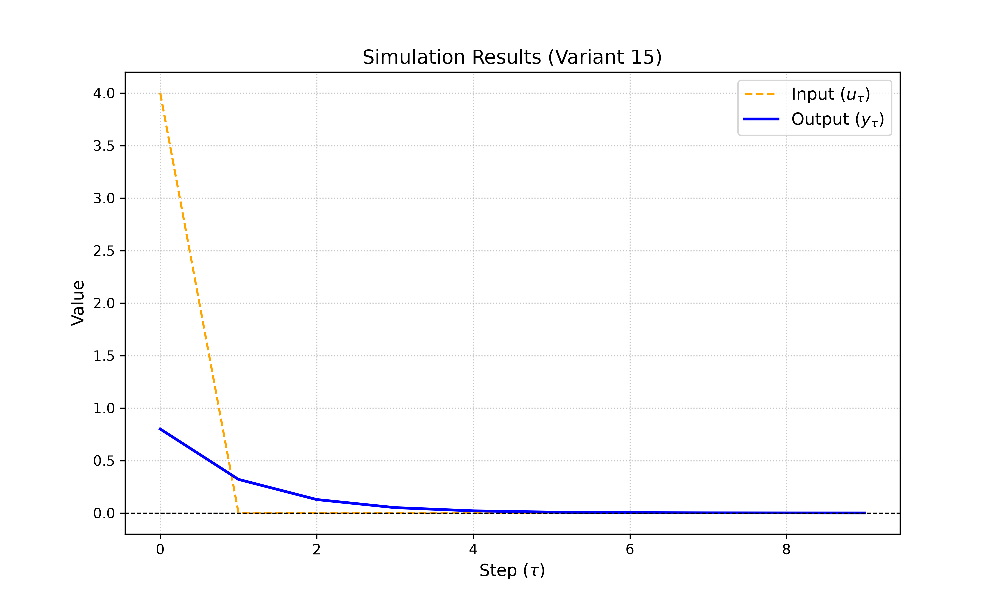
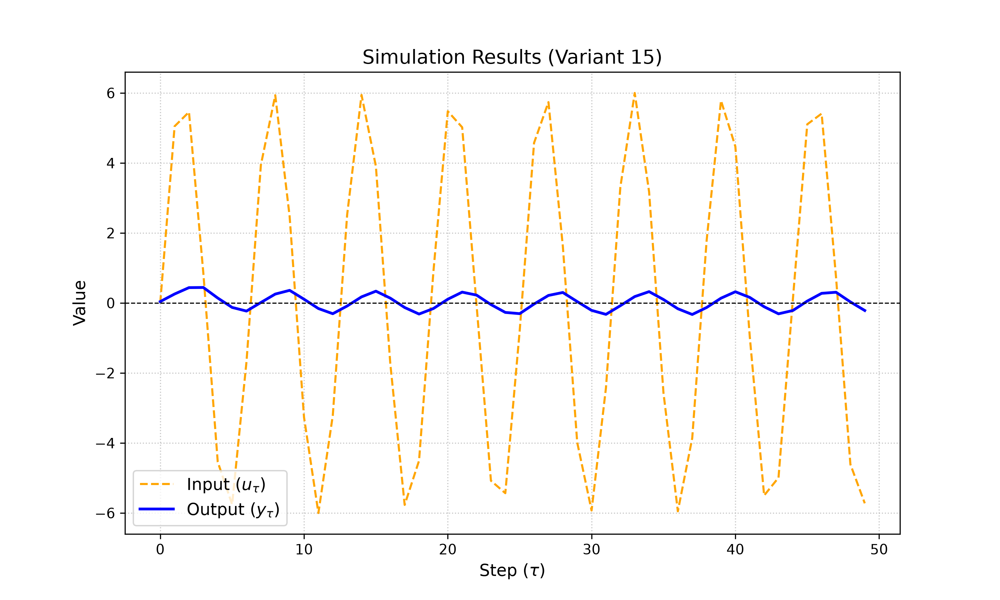

<p align="center"> Министерство образования Республики Беларусь</p>
<p align="center">Учреждение образования</p>
<p align="center">“Брестский Государственный технический университет”</p>
<p align="center">Кафедра ИИТ</p>
<br><br><br><br><br><br><br>
<p align="center">Лабораторная работа №1</p>
<p align="center">По дисциплине “Общая теория интеллектуальных систем”</p>
<p align="center">Тема: “Моделирования температуры объекта”</p>
<br><br><br><br><br>
<p align="right">Выполнил:</p>
<p align="right">Студентка 2 курса</p>
<p align="right">Группы ИИ-29</p>
<p align="right">Малютюк А. С.</p>
<p align="right">Проверил:</p>
<p align="right">Дворанинович Д. А.</p>
<br><br><br><br><br>
<p align="center">Брест 2026</p>


---
## Цель работы
Изучить методы математического моделирования управляемых объектов. Реализовать на языке C++ программу, моделирующую поведение трёх типов систем:
- Линейная модель: **Model 1.5**
- Нелинейная модель: **Model 2.9**
- Дифференциальное уравнение: **Model 3.3**

## Описание моделей
### Модель 1.5 System with State Delay

$$\Large y_{\tau+1} = a_1y_{\tau} + a_2y_{\tau-k} + bu_{\tau}$$

Здесь `a1`, `a2`, `b` это постоянные коэффициенты.

Линейная динамическая система, в которой текущая скорость изменения состояния зависит не только от текущего состояния и входа, но и от предыстории — значения переменной в прошлом с задержкой на $k$ шагов (реализуется с помощью очереди-буфера).

**Применение:** Демонстрирует поведение линейных систем с транспортным запаздыванием, где реакция системы наступает с «памятью» о предыдущих состояниях.

### Модель 2.9

$$\Large y_{\tau+1} = ay_{\tau} + b\sqrt{|u_{\tau}|} \cdot \text{sign}(u_{\tau})$$

Здесь `a`, `b` это постоянные коэффициенты.

Нелинейная система управления, в которой входной сигнал преобразуется через функцию квадратного корня с сохранением знака (моделирует физические процессы, например, гидравлическое сопротивление или прохождение потока через клапан, где расход пропорционален корню из перепада давления).

**Применение:** Показывает характер отклика нелинейного звена при различных типах сигналов (импульсном, гармоническом, шаговом) с эффектом сглаживания или быстрой фильтрации амплитуд.

### Модель 3.3

$$\Large \frac{dy}{dt} = -a \cdot y + b \cdot u$$

Здесь `a`, `b` это постоянные коэффициенты.

Классическое апериодическое звено первого порядка (типичный объект регулирования в теории автоматического управления), дискретизированное методом Эйлера.

**Применение:** Используется как стандартный эталонный процесс для исследования переходных характеристик, времени разгона и инертности системы.

## Входные воздействия

1. Ступенчатое: $$u(t) = A$$
2. Импульсное: $$u(t) = \begin{cases} A, & t = 0 \\ 0, & t > 0 \end{cases}$$
3. Гармоническое: $$u(t) = A \cdot \sin(t)$$

## Классы и UML

Был создан базовый класс **Models** с виртуальным методом **calculateNext()**.

От него наследуются три класса для каждой модели:
  * Model1_5
  * Model2_9
  * Model3_3



*рис. 1. UML-диаграмма классов*

## Cборка

Через **build.bat**

```bat
@echo off
chcp 65001 > nul
echo ============================================
echo    Сборка проекта OTIS Lab 1 (Variant 15)
echo ============================================

REM Проверяем, есть ли CMakeLists.txt в папке src
if not exist "src\CMakeLists.txt" (
    echo [ERROR] Файл CMakeLists.txt не найден в папке: src\
    pause
    exit /b 1
)

echo === 1. Создание папки build и конфигурация ===
cmake -S src -B build

echo.
echo === 2. Компиляция проекта ===
cmake --build build --config Release

if %errorlevel% neq 0 (
    echo [Ошибка] Компиляция не удалась!
    pause
    exit /b %errorlevel%
)

echo.
echo === 3. Запуск симуляции (C++) ===
REM Ищем .exe файл в возможных папках сборки
if exist build\lab01_ii02915.exe (
    build\lab01_ii02915.exe
) else if exist build\Debug\lab01_ii02915.exe (
    build\Debug\lab01_ii02915.exe
) else if exist build\Release\lab01_ii02915.exe (
    build\Release\lab01_ii02915.exe
) else (
    echo [Ошибка] Не найден скомпилированный exe-файл!
    pause
    exit /b 1
)

echo.
echo === 4. Построение графика (Python) ===
if exist src\plot.py (
    python src\plot.py
) else (
    echo [Предупреждение] Файл src\plot.py не найден, график не построен.
)

echo.
echo === Всё готово! ===
pause
```

## Демонстрация работы исполняемого файла



*рис. 2. Содержимое файла .csv*




*рис. 3-4. Вывод работы программы на экран*



*рис. 5. Пример графика 1*



*рис. 6. Пример графика 2*



*рис. 7. Пример графика 2*

### Программа позволяет:
   * Выбрать нужную модель
   * Ввести определенные коэффициенты
   * Выбрать входной сигнал
   * Сохранить результаты в виде таблицы
   * Сразу увидеть график с помощью matplotlib
   * Сохранить картинку

### Вывод:
Мной были изучены 3 математические модели и реализованы на языке С++ с применением принципов ООП, настроена автоматическая сборка проекта с использованием CMake, а так же написан .bat файл для компиляции проекта.
