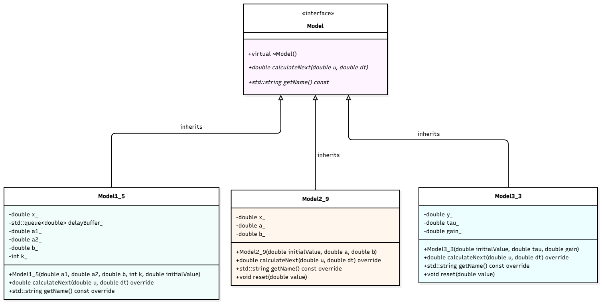
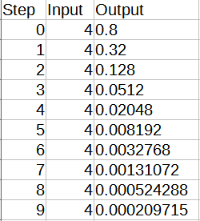
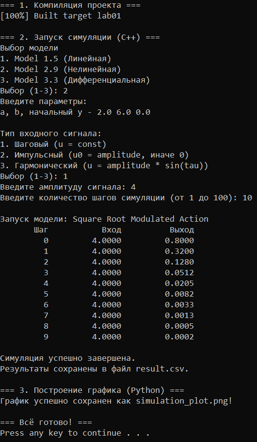
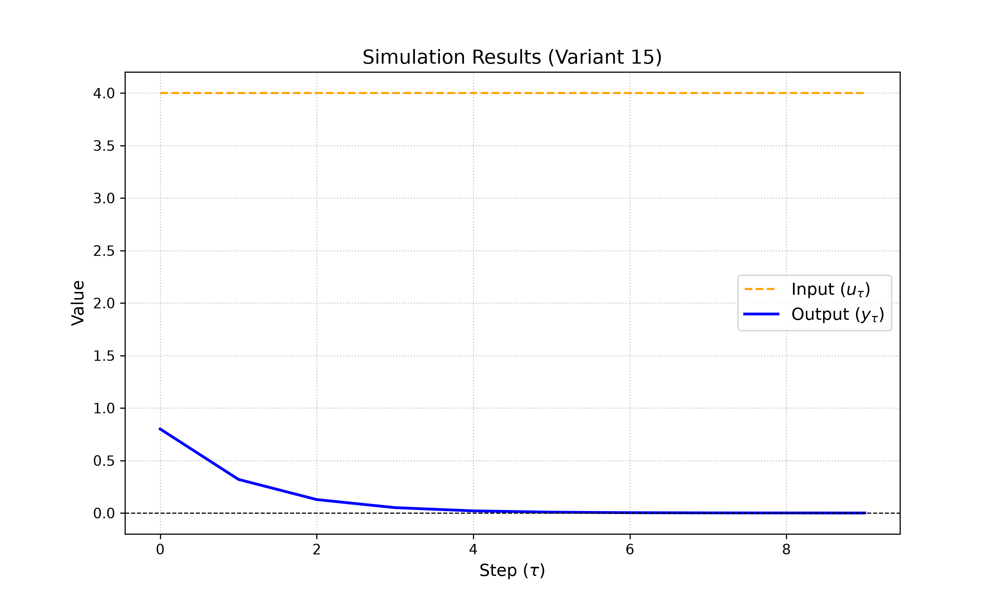
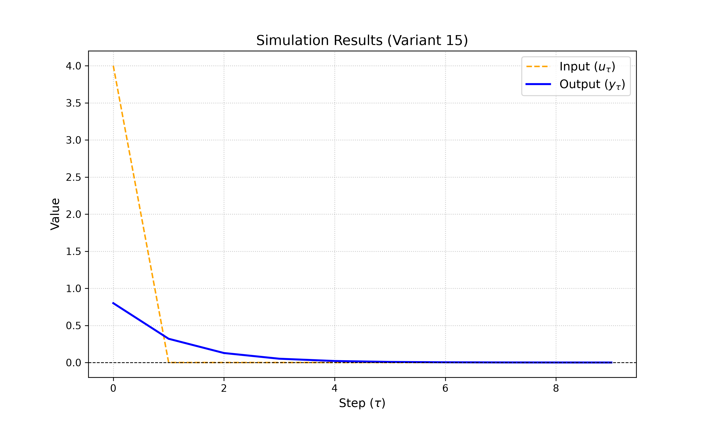
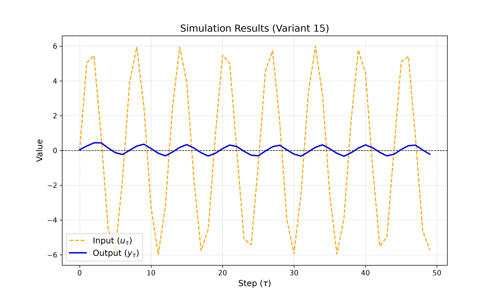

<p align="center"> Министерство образования Республики Беларусь</p>
<p align="center">Учреждение образования</p>
<p align="center">“Брестский Государственный технический университет”</p>
<p align="center">Кафедра ИИТ</p>
<br><br><br><br><br><br><br>
<p align="center">Лабораторная работа №1</p>
<p align="center">По дисциплине “Общая теория интеллектуальных систем”</p>
<p align="center">Тема: “Моделирования температуры объекта”</p>
<br><br><br><br><br>
<p align="right">Выполнил:</p>
<p align="right">Студент 2 курса</p>
<p align="right">Группы ИИ-29</p>
<p align="right">Малютюк А. С.</p>
<p align="right">Проверил:</p>
<p align="right">Дворанинович Д. А.</p>
<br><br><br><br><br>
<p align="center">Брест 2026</p>


---
## Цель работы
Изучить методы математического моделирования управляемых объектов. Реализовать на языке C++ программу, моделирующую поведение трёх типов систем:
- Линейная модель: **Model 1.5**
- Нелинейная модель: **Model 2.9**
- Дифференциальное уравнение: **Model 3.3**

## Описание моделей
### Модель 1.5 System with State Delay

$$\Large y_{\tau+1} = a_1y_{\tau} + a_2y_{\tau-k} + bu_{\tau}$$

Где `a1`, `a2`, `b` — постоянные коэффициенты.

Линейная динамическая система, в которой текущая скорость изменения состояния зависит не только от текущего состояния и входа, но и от предыстории — значения переменной в прошлом с задержкой на $k$ шагов (реализуется с помощью очереди-буфера).

**Применение:** Демонстрирует поведение линейных систем с транспортным запаздыванием, где реакция системы наступает с «памятью» о предыдущих состояниях.

### Модель 2.9

$$\Large y_{\tau+1} = ay_{\tau} + b\sqrt{|u_{\tau}|} \cdot \text{sign}(u_{\tau})$$

Где `a`, `b` — постоянные коэффициенты.

Нелинейная система управления, в которой входной сигнал преобразуется через функцию квадратного корня с сохранением знака (моделирует физические процессы, например, гидравлическое сопротивление или прохождение потока через клапан, где расход пропорционален корню из перепада давления).

**Применение:** Показывает характер отклика нелинейного звена при различных типах сигналов (импульсном, гармоническом, шаговом) с эффектом сглаживания или быстрой фильтрации амплитуд.

### Модель 3.3

$$\Large \frac{dy}{dt} = -a \cdot y + b \cdot u$$

Где `a`, `b` — постоянные коэффициенты.

Классическое апериодическое звено первого порядка (типичный объект регулирования в теории автоматического управления), дискретизированное методом Эйлера.

**Применение:** Используется как стандартный эталонный процесс для исследования переходных характеристик, времени разгона и инертности системы.

## Входные воздействия

1. Ступенчатое: `u(t) = A`
2. Импульсное: `u(0) = A`, `u(t > 0) = 0`
3. Гармоническое: `u(t) = A * sin(t)`

## Классы и UML

Был создан базовый класс **Models** с виртуальным методом **calculateNext()**.

От него наследуются три класса для каждой модели:
  * Model1_5
  * Model2_9
  * Model3_3



## Cборка

Через **build.bat**

```bat
@echo off
chcp 65001 >nul
setlocal

echo ============================================
echo    Сборка проекта OTIS Lab 1 (Variant 15)
echo ============================================
echo.

:: Переход в папку со скриптом
cd /d "%~dp0"

:: Проверка наличия CMakeLists.txt (исправлено расширение)
if not exist "CMakeLists.txt" (
    echo [ERROR] Файл CMakeLists.txt не найден в папке: %~dp0
    pause
    exit /b 1
)

:: Удаление старой папки build для чистой сборки
if exist "build" (
    echo [INFO] Удаление старой папки build...
    rmdir /s /q build
)

:: Шаг 1: Конфигурация CMake
echo [1/3] Конфигурация проекта...
cmake -S . -B build -G "MinGW Makefiles"
if errorlevel 1 (
    echo [ERROR] Ошибка конфигурации CMake! Убедитесь, что установлены CMake и MinGW (g++ / gcc).
    pause
    exit /b 1
)

:: Шаг 2: Сборка проекта
echo [2/3] Компиляция проекта...
cmake --build build
if errorlevel 1 (
    echo [ERROR] Ошибка компиляции! Проверьте исходный код проекта.
    pause
    exit /b 1
)

:: Шаг 3: Копирование exe в корень проекта
echo [3/3] Копирование исполняемого файла...
if exist "build\lab01.exe" (
    copy /Y "build\lab01.exe" ".\lab01.exe" >nul
    echo [OK] Исполняемый файл успешно создан: lab01.exe
) else if exist "build\Release\lab01.exe" (
    copy /Y "build\Release\lab01.exe" ".\lab01.exe" >nul
    echo [OK] Исполняемый файл успешно создан: lab01.exe
) else (
    echo [WARNING] Исполняемый файл не найден в папке build. Проверьте имя таргета в CMakeLists.txt!
)

echo.
echo ============================================
echo    Сборка завершена успешно!
echo ============================================
echo.
pause
endlocal
```

Для запуска исполняющего файла и plot.py для графика сдела файл **run.bat**

```bat
@echo off
chcp 65001 >nul
setlocal

echo ============================================
echo    Сборка проекта OTIS Lab 1 (Variant 15)
echo ============================================
echo.

:: Переход в папку со скриптом
cd /d "%~dp0"

:: Проверка наличия CMakeLists.txt (исправлено расширение)
if not exist "CMakeLists.txt" (
    echo [ERROR] Файл CMakeLists.txt не найден в папке: %~dp0
    pause
    exit /b 1
)

:: Удаление старой папки build для чистой сборки
if exist "build" (
    echo [INFO] Удаление старой папки build...
    rmdir /s /q build
)

:: Шаг 1: Конфигурация CMake
echo [1/3] Конфигурация проекта...
cmake -S . -B build -G "MinGW Makefiles"
if errorlevel 1 (
    echo [ERROR] Ошибка конфигурации CMake! Убедитесь, что установлены CMake и MinGW (g++ / gcc).
    pause
    exit /b 1
)

:: Шаг 2: Сборка проекта
echo [2/3] Компиляция проекта...
cmake --build build
if errorlevel 1 (
    echo [ERROR] Ошибка компиляции! Проверьте исходный код проекта.
    pause
    exit /b 1
)

:: Шаг 3: Копирование exe в корень проекта
echo [3/3] Копирование исполняемого файла...
if exist "build\lab01.exe" (
    copy /Y "build\lab01.exe" ".\lab01.exe" >nul
    echo [OK] Исполняемый файл успешно создан: lab01.exe
) else if exist "build\Release\lab01.exe" (
    copy /Y "build\Release\lab01.exe" ".\lab01.exe" >nul
    echo [OK] Исполняемый файл успешно создан: lab01.exe
) else (
    echo [WARNING] Исполняемый файл не найден в папке build. Проверьте имя таргета в CMakeLists.txt!
)

echo.
echo ============================================
echo    Сборка завершена успешно!
echo ============================================
echo.
pause
endlocal
```

## Демонстрация работы исполняемого файла











### Программа позволяет:
   * Выбрать нужную модель
   * Ввести определенные коэффициенты
   * Выбрать входной сигнал
   * Сохранить результаты в виде таблицы
   * Сразу увидеть график с помощью matplotlib
   * Сохранить картинку