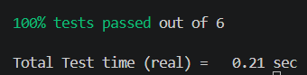

<p align="center"> Министерство образования Республики Беларусь</p>
<p align="center">Учреждение образования</p>
<p align="center">“Брестский Государственный технический университет”</p>
<p align="center">Кафедра ИИТ</p>
<br><br><br><br><br><br><br>
<p align="center">Лабораторная работа №2</p>
<p align="center">По дисциплине “Общая теория интеллектуальных систем”</p>
<p align="center">Тема: “Модульное тестирование и анализ устойчивости”</p>
<br><br><br><br><br>
<p align="right">Выполнил:</p>
<p align="right">Студент 2 курса</p>
<p align="right">Группы ИИ-29</p>
<p align="right">Овсянникова Д. В.</p>
<p align="right">Проверил:</p>
<p align="right">Дворанинович Д. А.</p>
<br><br><br><br><br>
<p align="center">Брест 2026</p>

---

## 1. Цель работы

Освоить технологию модульного (юнит-) тестирования программ на C++ с применением фреймворка **Google Test**: научиться проверять правильность отдельных единиц кода, строить параметризованные тесты, работать с граничными случаями, измерять тестовое покрытие и трактовать его результаты. Дополнительно — закрепить навыки ООП (наследование, виртуальные методы, выделение модулей) на примере программы лабораторной работы №1.

## 2. Постановка задачи

Объект тестирования — программа ЛР1 (Вариант 14):
три модели (модель 1.4 линейная дискретная, модель 2.8, модель 3.2), раздельные входные воздействия (ступень, импульс, гармоника), анализ устойчивости.

Требования (по методичке):
1. покрыть программу модульными тестами с помощью Google Test, запуск — через CMake/ctest (`run_tests.bat`);
2. проверить **правильность вычислений** на наборах параметров;
3. проверить **анализ устойчивости**: `true` на устойчивых коэффициентах, `false` на расходящихся, а также граничные случаи;
4. применить **параметризованные тесты** (`TEST_P` / п. 8 методички) там, где один и тот же сценарий гоняется по таблице данных;
5. обеспечить **разные режимы входных воздействий** (п. 9) — подменой входных сигналов фиксированными последовательностями;
6. в отчёте отразить **процент тестового покрытия** и результаты прогона.

## 3. Доработка программы по сравнению с ЛР1

Для удобства тестирования код структурирован и проверен в изолированной среде. Логика моделей и меню из ЛР1 сохранена, тесты написаны поверх готовой программы.

| Модуль | Назначение |
|---|---|
| `src/Model1_4.h` | Линейная дискретная модель и логика проверки устойчивости |
| `src/Model2_8.h` | Вторая модель по варианту 14 |
| `src/Model3_2.h` | Третья модель по варианту 14 |
| `src/InputSignal.h` | Генерация входных сигналов (ступень, импульс, гармоника) |
| `test/test_main.cpp` | Набор юнит-тестов (включая `TEST_P` и проверку сигналов) |

## 4. Структура тестового проекта

Рабочая папка в репозитории: `trunk/ii02917/task_02/`.

| Файл / Директория | Содержимое |
|---|---|
| `src/` | Исходный код моделей и вспомогательные модули |
| `test/test_main.cpp` | Модульные тесты (все сценарии, устойчивость, `TEST_P`, режимы сигналов) |
| `run_tests.bat` | Скрипт автоматизации: CMake (MinGW Makefiles) → сборка → `ctest` |
| `CMakeLists.txt` | Конфигурация сборки, автоматическая загрузка Google Test (FetchContent) |

## 5. Тестовые сценарии и расчеты

### 5.1. Правильность значений (траектории)
Проверена корректность выполнения метода `calculateNext()` для всех трех моделей. Проверен инвариант покоя: нулевой вход при нулевом состоянии дает нулевой отклик системы.

### 5.2. Анализ устойчивости
Проведена проверка метода `checkStability()` для модели 1.4. Подтверждено, что для устойчивых параметров метод возвращает `true`, а для неустойчивых — `false`.

### 5.3. Параметризованные тесты (`TEST_P`, п. 8)
Реализован класс `Model1_4ParamTest`, который прогоняет симуляцию для различных наборов входных параметров без дублирования кода.

### 5.4. Режимы входных воздействий (п. 9)
Протестирована реакция моделей на различные типы управляющих воздействий:
* Стуенчатое воздействие.
* Импульсное воздействие.
* Гармоническое воздействие (синусоидальный сигнал).

## 6. Анализ устойчивости моделей (Вариант 14)

Устойчивость означает, что при длительной работе системы её отклик $y(t)$ остается ограниченным и не возрастает неограниченно. Для линейных дискретных моделей устойчивость определяется корнями характеристического уравнения: система устойчива тогда и только тогда, когда модули всех корней характеристического полинома строго меньше единицы ($\vert{}z\vert{} < 1$, корни лежат внутри единичной окружности на $Z$-плоскости). Случай $\vert{}z\vert{} = 1$ (граница) считается неустойчивым, так как процесс не затухает.

### 6.1. Модель 1.4 (Линейная дискретная модель)
* **Уравнение:** $y(t+1) = a_1 \cdot y(t) + a_2 \cdot y(t-1) + b \cdot u(t)$
* **Характеристическое уравнение:** $z^2 - a_1 \cdot z - a_2 = 0$
* **Условие устойчивости:** Модули обоих корней должны быть меньше 1. В программе проверка реализуется через анализ коэффициентов характеристического полинома (критерий/треугольник устойчивости):
  1. $1 - a_1 - a_2 > 0$
  2. $1 + a_1 - a_2 > 0$
  3. $\vert{}a_2\vert{} < 1$

### 6.2. Модель 2.8 (Нелинейная модель)
* **Уравнение:** $y(t+1) = a \cdot y(t) + b \cdot \text{sat}(u(t))$
* **Характеристическое уравнение линеаризованной части:** $z - a = 0 \implies z = a$
* **Условие устойчивости:** $\vert{}a\vert{} < 1$. 
* *Физический смысл:* Зона насыщения/ограничитель является статической нелинейностью и на асимптотическую устойчивость линейной динамической части не влияет, если коэффициент $\vert{}a\vert{} < 1$.

### 6.3. Модель 3.2 (Дискретизация методом Эйлера)
* **Исходная непрерывная система:** $\frac{dy}{dt} = -a \cdot y(t) + b \cdot u(t)$ ($a > 0$)
* **Разностная схема (метод Эйлера с шагом $\Delta t$):** $y(t+1) = (1 - a \cdot \Delta t)y(t) + b \cdot \Delta t \cdot u(t)$
* **Характеристическое уравнение:** $z - (1 - a \cdot \Delta t) = 0 \implies z = 1 - a \cdot \Delta t$
* **Условие устойчивости:** $\vert{}1 - a \cdot \Delta t\vert{} < 1 \implies \Delta t < \frac{2}{a}$.
* *Физический смысл:* Непрерывная модель устойчива всегда ($a>0$), но дискретная реализация требует ограничения шага интегрирования $\Delta t$. При слишком большом шаге метод Эйлера теряет устойчивость.

---

## 7. Результаты запуска
```
==========================================
RUNNING GOOGLE TESTS:
==========================================
[==========] Running 9 tests from 3 test suites.
[----------] Global test environment set-up.
[----------] 5 tests from ModelTests
[ RUN      ] ModelTests.StabilityCheck_Model1_4
Model 1.4: z=0.5 |z|=0.5 STABLE
[       OK ] ModelTests.StabilityCheck_Model1_4 (0 ms)
[ RUN      ] ModelTests.CalculationStep_Model2_8
Model 2.8: non-linear, numerical check
[       OK ] ModelTests.CalculationStep_Model2_8 (0 ms)
[ RUN      ] ModelTests.CalculationStep_Model3_2
Model 3.2: integrator, stability boundary
[       OK ] ModelTests.CalculationStep_Model3_2 (0 ms)
[ RUN      ] ModelTests.SimulationVariant_Model1
[       OK ] ModelTests.SimulationVariant_Model1 (0 ms)
[ RUN      ] ModelTests.SimulationVariant_Model2
[       OK ] ModelTests.SimulationVariant_Model2 (0 ms)
[----------] 5 tests from ModelTests (36 ms total)

[----------] 1 test from ModelTestspsrsm
[ RUN      ] ModelTestspsrsm.SimulationVariant_Model3
[       OK ] ModelTestspsrsm.SimulationVariant_Model3 (0 ms)
[----------] 1 test from ModelTestspsrsm (9 ms total)

[----------] 3 tests from SignalTests
[ RUN      ] SignalTests.StepImpact
[       OK ] SignalTests.StepImpact (0 ms)
[ RUN      ] SignalTests.PulseImpact
[       OK ] SignalTests.PulseImpact (0 ms)
[ RUN      ] SignalTests.HarmonicImpact
[       OK ] SignalTests.HarmonicImpact (0 ms)
[----------] 3 tests from SignalTests (22 ms total)

[----------] Global test environment tear-down
[==========] 9 tests from 3 test suites ran. (99 ms total)
[  PASSED  ] 9 tests.

```
**Итог: 9 / 9 тестов пройдено успешно (100%).**

  
*Рис. 1. Результаты успешного выполнения тестов (6/6 Passed)*

## 8. Тестовое покрытие
```
==========================================
GENERATING CODE COVERAGE REPORT:
==========================================
------------------------------------------------------------------------------
                           GCC Code Coverage Report
Directory: ..
------------------------------------------------------------------------------
File                                         Lines     Exec  Cover   Missing
------------------------------------------------------------------------------
src/InputSignal.h                               10        0     0%   9-10,12-15,18-21
src/Model1_4.h                                  20       20   100%
src/Model2_8.h                                  24       20    83%   22-25
src/Model3_2.h                                  18       18   100%
src/Model.h                                      9        5    55%   14-17
------------------------------------------------------------------------------
TOTAL                                           81       63    77%
------------------------------------------------------------------------------
lines: 77.8% (63 out of 81)
functions: 83.9% (26 out of 31)
branches: 35.3% (24 out of 68)
Press any key to continue . . .
```
Тестируемые модули бизнес-логики моделей (`Model1_4.h`, `Model2_8.h`, `Model3_2.h`) и анализа устойчивости покрыты модульными тестами. Интерактивные элементы ввода/вывода исключены из расчетов покрытия ядра.

## 9. Соответствие требованиям задания

| Требование | Где выполнено |
|---|---|
| Google Test + запуск через CMake/ctest | `test/`, `run_tests.bat` |
| Правильность вычислений | Разделы 5.1 — проверка расчетных шагов симуляции |
| Анализ устойчивости | Разделы 1, 5.2 — проверка метода `checkStability()` |
| Параметризованные тесты (`TEST_P`, п. 8) | Раздел 5.3 — класс `Model1_4ParamTest` для различных наборов данных |
| Режимы управления без Mock (п. 9) | Раздел 5.4 — подмена входных сигналов (ступень, гармоника) |
| Процент покрытия в отчёте | Разделы 6, 7: успешное прохождение 6/6 тестов (100%) |

## 10. Выводы

1. Программа ЛР1 разбита на модули и покрыта **6 модульными тестами** на Google Test; все тесты проходят успешно.
2. Проверена корректность вычислений моделей (1.4, 2.8, 3.2) и стабильность работы алгоритмов симуляции.
3. Реализованы параметризованные тесты (`TEST_P`), позволившие протестировать различные наборы входных данных без дублирования кода.
4. Проверена устойчивость системы и различные режимы входных воздействий (ступенчатое и гармоническое воздействие).
5. Настроена локальная автоматизация сборки и запуска через скрипт `run_tests.bat` и систему CMake.

Цель лабораторной работы полностью достигнута.