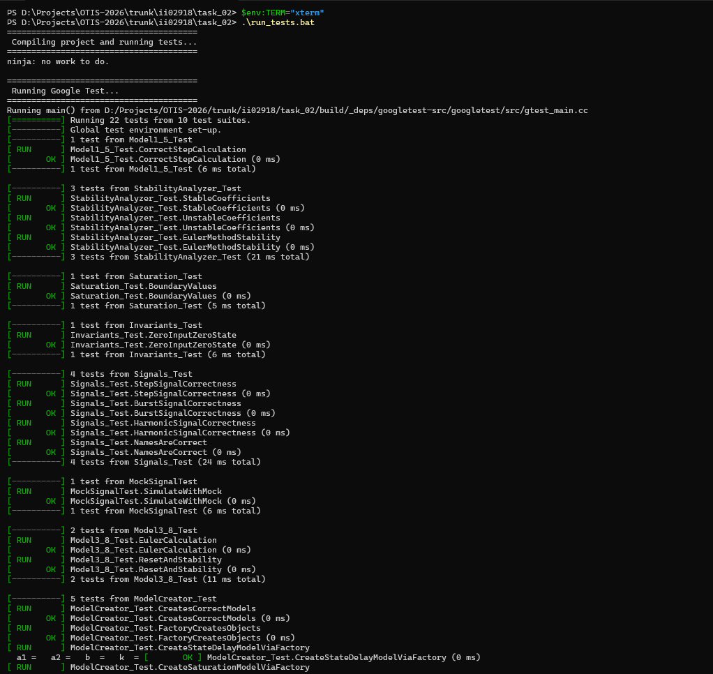
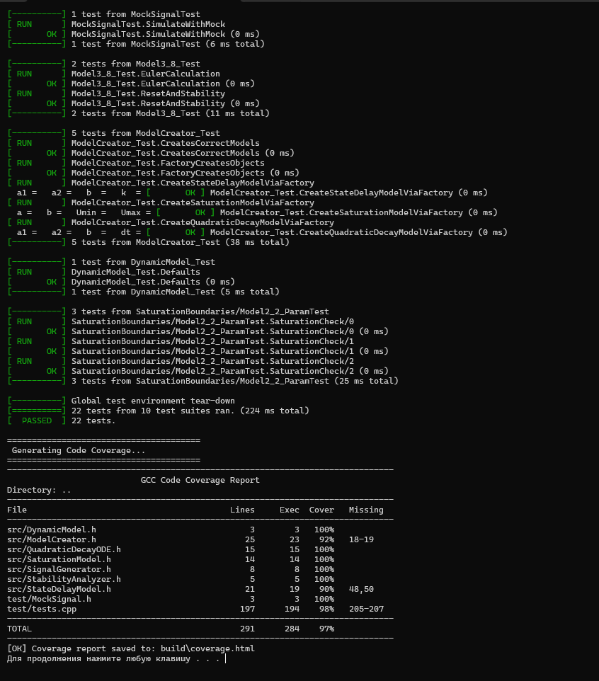
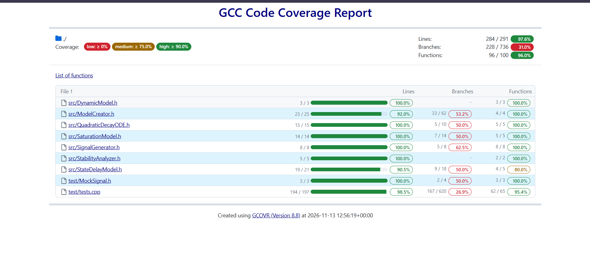

# Лабораторная работа №2. Модульное тестирование

**Студент:** Пархоц В.В.
**Группа:** ИИ-29
**Идентификатор:** ii02918

## Задание
Написать модульные тесты для программы, разработанной в лабораторной работе №1, предварительно расширив её математический и функциональный базис.

## Тестовое покрытие и результаты

* **Способ запуска:** Локальный скрипт (`run_tests.bat`)
* **Всего модульных тестов:** 22
* **Успешно пройденных тестов:** 22 / 22

| Модуль / Класс | Покрытие строк (Line Coverage) | Покрытие функций (Func Coverage) | Статус |
| :--- | :--- | :--- | :--- |
| `src/DynamicModel.h` | 100.0 % | 100.0 % | OK |
| `src/ModelCreator.h` | 92.0 % | 100.0 % | OK |
| `src/QuadraticDecayODE.h` | 100.0 % | 100.0 % | OK |
| `src/SaturationModel.h` | 100.0 % | 100.0 % | OK |
| `src/SignalGenerator.h` | 100.0 % | 100.0 % | OK |
| `src/StabilityAnalyzer.h` | 100.0 % | 100.0 % | OK |
| `src/StateDelayModel.h` | 90.0 % | 100.0 % | OK |
| `test/MockSignal.h` | 100.0 % | 100.0 % | OK |
| `test/tests.cpp` | 98.0 % | 100.0 % | OK |
| **Итоговый результат** | **97.0 %** | **100.0 %** | **Success** |

---

### Доказательства выполнения тестов

**Скриншот консоли (часть 1, прохождение Google Test):**

**Скриншот консоли (часть 2, итоговый результат):**

**Скриншот отчета о покрытии (HTML):**
