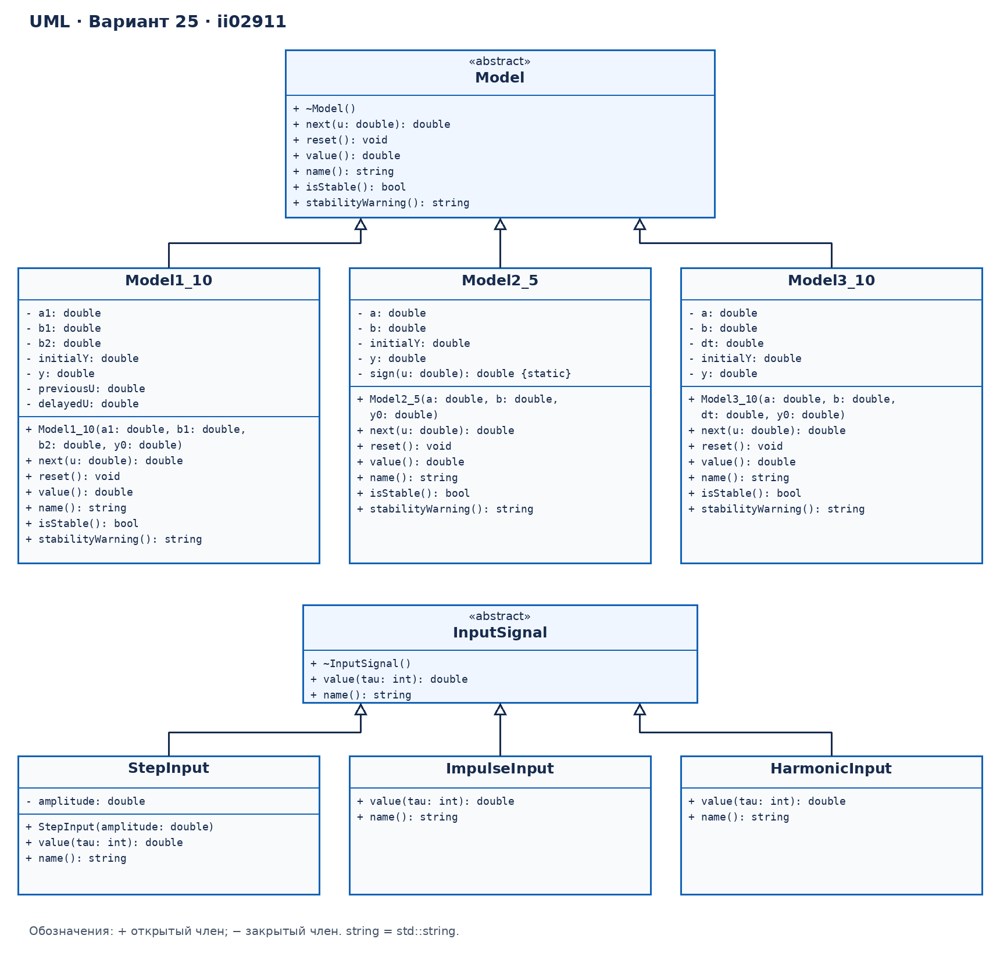
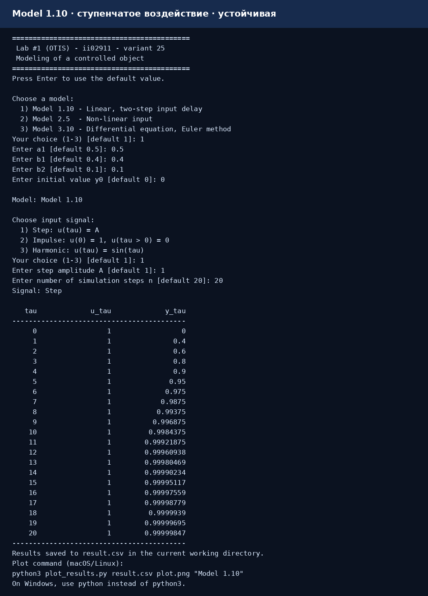
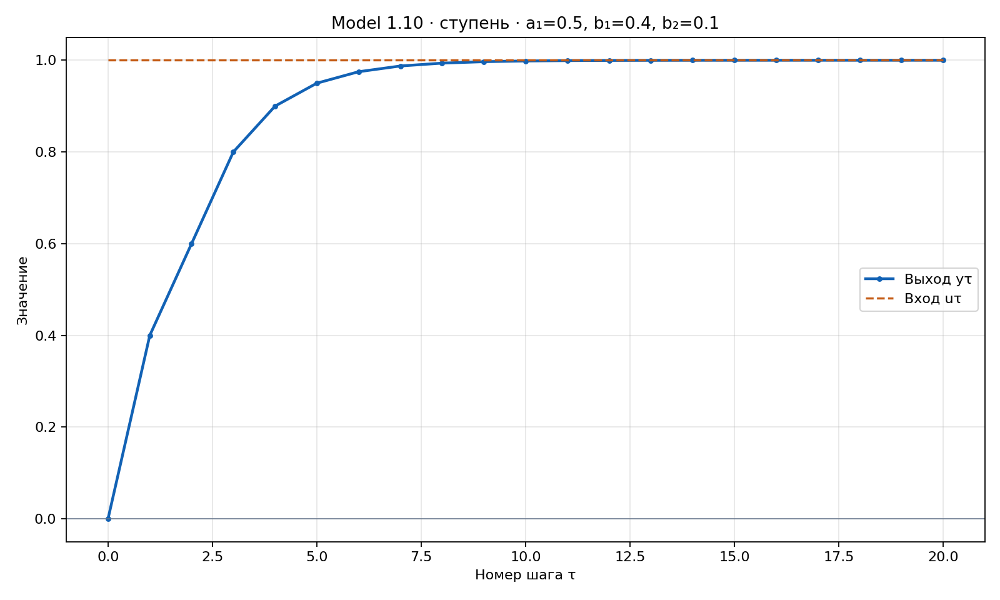
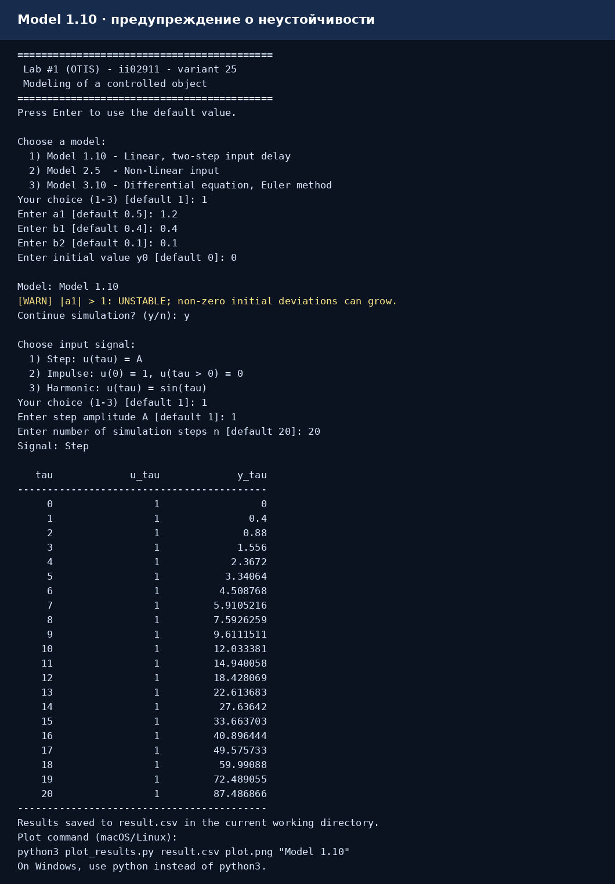
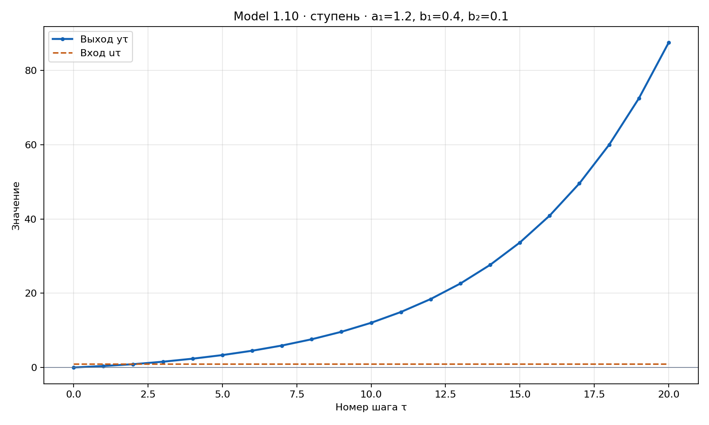
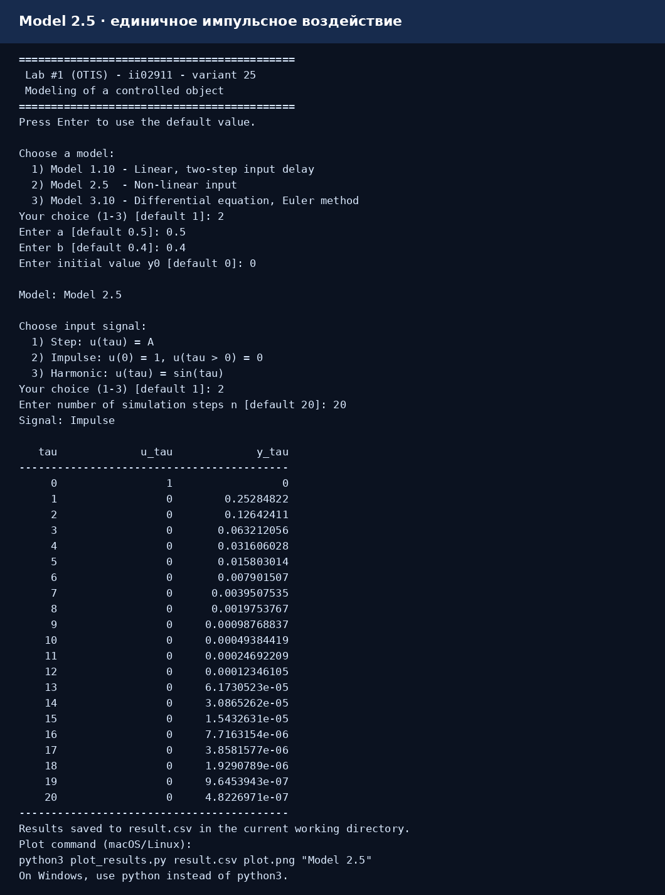
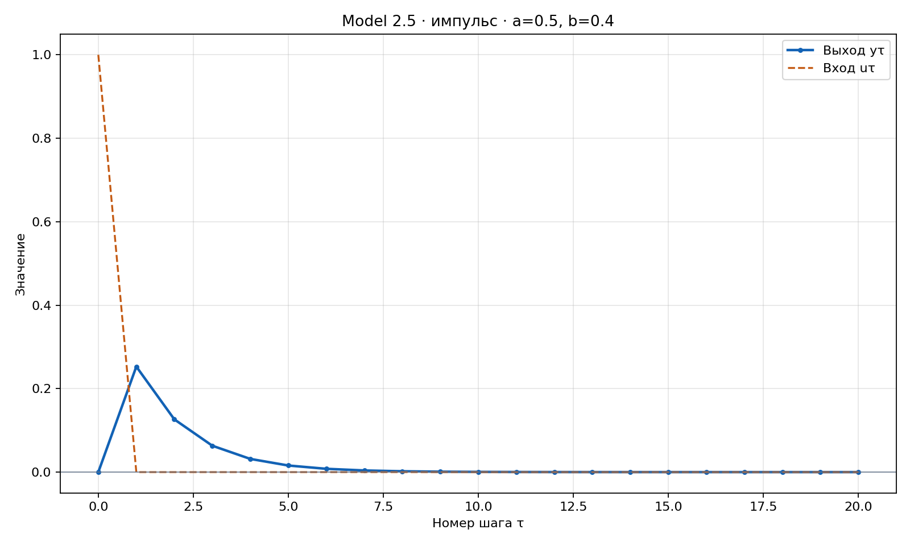
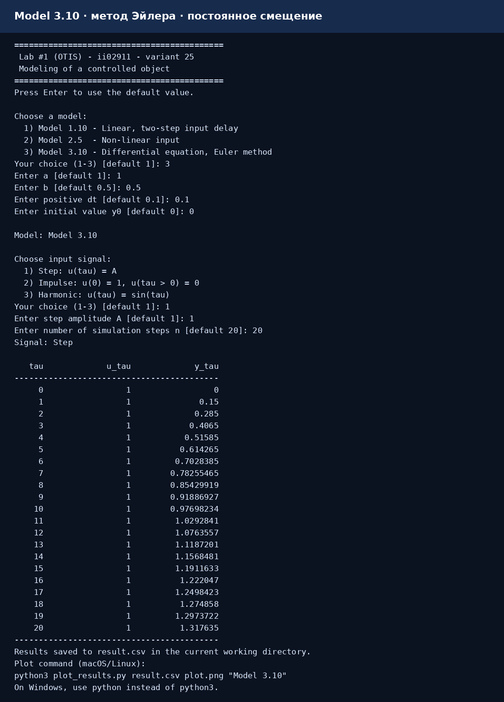
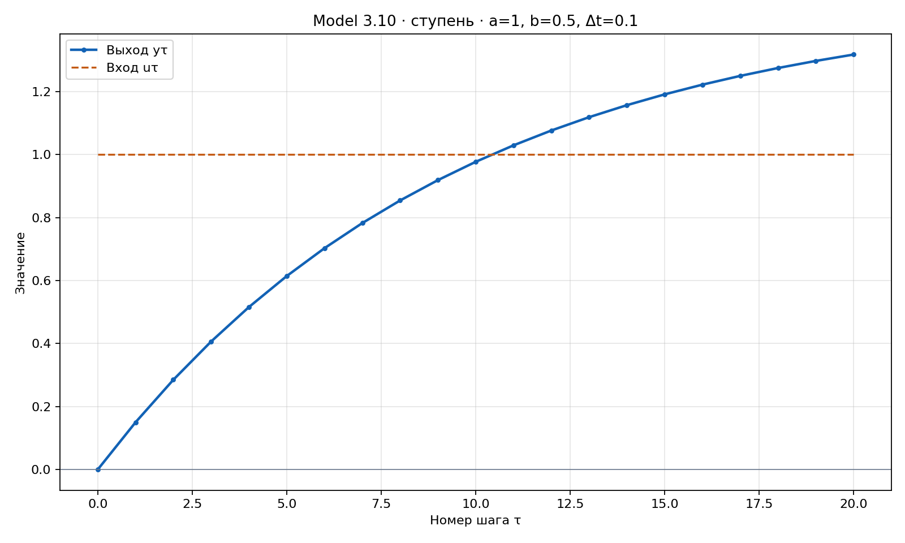

<p align="center">Министерство образования Республики Беларусь</p>
<p align="center">Учреждение образования</p>
<p align="center">«Брестский государственный технический университет»</p>
<p align="center">Кафедра ИИТ</p>
<br><br><br><br>
<p align="center">Лабораторная работа №1</p>
<p align="center">По дисциплине «Общая теория интеллектуальных систем»</p>
<p align="center">Тема: «Моделирование управляемого объекта»</p>
<p align="center">Вариант 25</p>
<br><br><br>
<p align="right">Выполнил:</p>
<p align="right">Студент 2 курса</p>
<p align="right">группы ИИ-29</p>
<p align="right">Плисюк К. В.</p>
<p align="right">Проверил:</p>
<p align="right">Дворанинович Д.А.</p>
<br><br><br>
<p align="center">Брест 2026</p>

---

## 1. Цель работы

Изучить моделирование управляемого объекта с помощью линейной дискретной модели, нелинейной дискретной модели и дифференциального уравнения. Реализовать модели на C++, исследовать реакцию на три типа входного воздействия, представить результаты в таблицах и на графиках.

## 2. Постановка задачи

По [таблице вариантов](https://github.com/brstu/OTIS-2026/blob/main/task_01/readme.md) для варианта 25 выбраны:

| Блок | Модель | Название |
|---|---|---|
| 1 | **Model 1.10** | Distributed Control Window Model |
| 2 | **Model 2.5** | Signum Friction and Exponential Growth |
| 3 | **Model 3.10** | Basic External Constant Offset |

## 3. UML-диаграмма классов



*Рис. 1. Две иерархии классов: математические модели и входные воздействия.*

Абстрактный класс `Model` определяет общий интерфейс модели:

| Метод | Назначение |
|---|---|
| `next(double u)` | Рассчитать и сохранить следующее состояние |
| `reset()` | Восстановить начальное состояние, очистить память входов |
| `value() const` | Получить текущее значение выхода |
| `name() const` | Получить название модели |
| `isStable() const` | Проверить затухание начального отклонения |
| `stabilityWarning() const` | Получить текст предупреждения |

Классы `Model1_10`, `Model2_5`, `Model3_10` наследуют `Model` и реализуют соответствующие формулы. Коэффициенты и состояние находятся в закрытых полях `private`.

Абстрактный класс `InputSignal` определяет методы `value(int tau)` и `name()`. Наследники `StepInput`, `ImpulseInput`, `HarmonicInput` формируют разные входные воздействия. На диаграмме знак `+` обозначает открытый член, знак `−` — закрытый. Тип `string` соответствует `std::string` в коде; квалификатор `const` у методов чтения указан в объявлениях заголовочных файлов.

## 4. Математическое описание моделей

### 4.1. Model 1.10 — линейная модель с задержкой входа

$$
y_{\tau+1}=a_1y_\tau+b_1u_\tau+b_2u_{\tau-2}.
$$

Обозначения:

| Параметр | Смысл |
|---|---|
| $y_\tau$ | Выход объекта на текущем шаге |
| $u_\tau$ | Текущее управляющее воздействие |
| $a_1$ | Влияние текущего состояния на следующее |
| $b_1$ | Влияние текущего входа |
| $b_2$ | Влияние входа с задержкой на два шага |

Начальное состояние $y_0$ вводит пользователь. Для управления до начала моделирования принято $u_{-1}=u_{-2}=0$.

Поля `previousU` и `delayedU` хранят $u_{\tau-1}$ и $u_{\tau-2}$. Сначала рассчитывается новое состояние, затем история входа сдвигается. Поэтому задержанный вход $u_0$ впервые используется при вычислении $y_3$.

**Анализ устойчивости.** При одинаковом управлении разность двух выходных последовательностей удовлетворяет уравнению:

$$
e_{\tau+1}=a_1e_\tau.
$$

Для решения $e_\tau=Cz^\tau$ получаем характеристическое уравнение $z-a_1=0$, то есть $z=a_1$. Начальные отклонения затухают при:

$$
|a_1|<1.
$$

Если включить в расширенное состояние две ячейки памяти входа, дополнительные собственные значения равны нулю и условие не изменяется. При $|a_1|=1$ отклонения не затухают, а при $|a_1|>1$ могут возрастать. Программа предупреждает о таких коэффициентах до запуска симуляции.

### 4.2. Model 2.5 — нелинейное преобразование входа

$$
y_{\tau+1}=ay_\tau+b\operatorname{sign}(u_\tau)(1-e^{-|u_\tau|}).
$$

Функция знака:

$$
\operatorname{sign}(u)=
\begin{cases}
1,&u>0,\\
0,&u=0,\\
-1,&u<0.
\end{cases}
$$

Нелинейная входная часть ограничена по модулю величиной $|b|$, поскольку $0\le 1-e^{-|u|}<1$. При $u=0$ её значение равно нулю.

В коде используется `-std::expm1(-std::abs(u))`. Это выражение равно $1-e^{-|u|}$, но точнее вычисляется при очень малом $|u|$.

В этой модели нелинейность относится только ко входу. Для двух состояний при одинаковом управлении $e_{\tau+1}=ae_\tau$. Поэтому программа также проверяет условие $|a|<1$: при нём начальные отклонения затухают, а ограниченная входная часть даёт ограниченный выход. Условие получено из конкретной формулы модели, а не перенесено на произвольную нелинейную систему.

### 4.3. Model 3.10 — дифференциальное уравнение

$$
\frac{dy}{dt}=-ay+b+u.
$$

Используется явный метод Эйлера с положительным шагом $\Delta t$:

$$
y_{\tau+1}=y_\tau+\Delta t(-ay_\tau+b+u_\tau).
$$

На каждом шаге вычисляется производная в текущей точке, затем её значение умножается на шаг времени и прибавляется к текущему состоянию.

В модели $b$ — постоянное внешнее смещение. Даже при нулевом управлении выход может изменяться. Для постоянного управления $u=A$ и $a\ne0$ равновесие равно:

$$
y^*=\frac{b+A}{a}.
$$

**Устойчивость схемы Эйлера.** Начальное отклонение удовлетворяет уравнению $e_{\tau+1}=(1-a\Delta t)e_\tau$. Поэтому необходимо:

$$
|1-a\Delta t|<1.
$$

При $a>0$ это эквивалентно $0<a\Delta t<2$. При нарушении условия выводится предупреждение. Граница $|1-a\Delta t|=1$ не относится к области затухания отклонений.

### 4.4. Входные воздействия и нумерация шагов

| Выбор | Тип сигнала | Определение |
|---|---|---|
| 1 | Ступенчатый | $u_\tau=A$, значение $A$ вводится пользователем |
| 2 | Импульсный | $u_0=1$, $u_{\tau>0}=0$ |
| 3 | Гармонический | $u_\tau=\sin(\tau)$ |

Все сигналы равны нулю при $\tau<0$. В `sin` угол задаётся в радианах. Гармоническое воздействие зависит от номера шага $\tau$ согласно условию. Для дифференциальной модели физическое время равно $t_\tau=\tau\Delta t$.

Расчёт начинается с нулевого шага, чтобы единичный импульс точно соответствовал $u_0=1$. При $n$ переходах выводятся $n+1$ строка: начальное состояние $y_0$ и состояния $y_1,\ldots,y_n$. В строке с номером $\tau$ показаны $u_\tau$ и $y_\tau$; следующий выход вычисляется по этой строке. В последней строке значение входа показано для полноты таблицы, но переход к $y_{n+1}$ уже не выполняется.

## 5. Описание реализации

### 5.1. Архитектура и алгоритм

Объекты моделей и сигналов выбираются через `std::unique_ptr` на базовый тип. Такой указатель автоматически освобождает выбранный объект. Виртуальные деструкторы обеспечивают корректное уничтожение наследников. Общая функция `simulate(Model&, const InputSignal&, int)` использует виртуальные методы, поэтому цикл расчёта не зависит от конкретной формулы.

Алгоритм:

1. Вывести меню моделей и получить выбор пользователя.
2. Ввести коэффициенты; для модели 3.10 дополнительно ввести положительный шаг $\Delta t$.
3. Ввести начальное состояние $y_0$, создать выбранную модель.
4. Проверить устойчивость. При предупреждении запросить `y` для продолжения или `n` для отмены.
5. Выбрать входной сигнал; для ступени ввести амплитуду $A$.
6. Ввести число переходов $n$ от 1 до 10000.
7. Вызвать `reset`, создать `result.csv`, вывести начальную строку.
8. На каждом следующем шаге получить воздействие, вычислить новое состояние и вывести строку таблицы.
9. Закрыть CSV и показать команду построения графика.

Пустая строка означает выбор значения по умолчанию. Неверный ввод вызывает повторный запрос. Проверяются диапазоны выбора, целое положительное $n$, конечность чисел и положительность $\Delta t$. При завершении ввода программа заканчивает работу с сообщением об ошибке. При переполнении сохраняются только уже рассчитанные конечные строки.

### 5.2. Структура файлов

Основной каталог: `trunk/ii02911/task_01`.

| Файл или каталог | Назначение |
|---|---|
| `CMakeLists.txt` | Настройка проекта и подключение `src` |
| `build.bat` | Автоматическая сборка CMake в Windows |
| `plot_results.py` | Построение графика по CSV |
| `src/CMakeLists.txt` | Сборка исполняемого файла `ii02911_task_01` |
| `src/Model.h` | Абстрактный базовый класс моделей |
| `src/Model1_10.h` | Линейная модель и память двух входов |
| `src/Model2_5.h` | Модель с нелинейным преобразованием входа |
| `src/Model3_10.h` | Дифференциальная модель, метод Эйлера |
| `src/InputSignals.h` | Базовый класс сигналов и три наследника |
| `src/main.cpp` | Ввод, выбор объектов, расчёт и сохранение CSV |
| `doc/readme.md` | Отчёт |
| `doc/example_output.csv` | Пример результата модели 1.10 |
| `doc/screenshots/` | Десять PNG: сборка, вывод программы, UML и графики |

### 5.3. Формат вывода

CSV содержит столбцы `tau,u_tau,y_tau`:

| Столбец | Значение |
|---|---|
| `tau` | Номер шага |
| `u_tau` | Вход на этом шаге |
| `y_tau` | Выход на этом шаге |

Числа записываются с 17 значащими цифрами, чтобы сохранить точность `double`. Консольная таблица использует более короткое представление. Файл создаётся в текущем рабочем каталоге. При повторном запуске `result.csv` заменяется; нужный результат можно предварительно сохранить под другим именем.

### 5.4. Построение графика

Для визуализации нужны Python и Matplotlib. Установка Matplotlib:

```bash
python3 -m pip install matplotlib
```

После запуска программы выполнить из каталога `task_01`:

```bash
python3 plot_results.py result.csv plot.png "Model 1.10"
```

Скрипт читает три столбца CSV и создаёт PNG с двумя линиями: выход $y_\tau$ и вход $u_\tau$. Файл `plot.png` можно открыть в Finder или проводнике. Для Windows используется команда `python`, если интерпретатор установлен под этим именем.

Для проверки на готовом примере без повторного расчёта:

```bash
python3 plot_results.py doc/example_output.csv plot.png "Model 1.10"
```

## 6. Результаты симуляции

Проведены девять основных экспериментов: каждая из трёх моделей проверена со ступенчатым, импульсным и гармоническим воздействием. Во всех этих экспериментах $n=20$, $y_0=0$, амплитуда ступени $A=1$.

| Модель | Коэффициенты |
|---|---|
| 1.10 | $a_1=0.5$, $b_1=0.4$, $b_2=0.1$ |
| 2.5 | $a=0.5$, $b=0.4$ |
| 3.10 | $a=1$, $b=0.5$, $\Delta t=0.1$ |

### 6.1. Model 1.10 — устойчивая система

Для ступенчатого воздействия первые три перехода:

$$
y_1=0.5\cdot0+0.4\cdot1+0.1\cdot0=0.4,
$$
$$
y_2=0.5\cdot0.4+0.4\cdot1+0.1\cdot0=0.6,
$$
$$
y_3=0.5\cdot0.6+0.4\cdot1+0.1\cdot1=0.8.
$$

На третьем переходе начинает действовать задержанный вход $u_0$. Установившееся значение при ступени:

$$
y^*=\frac{b_1+b_2}{1-a_1}=\frac{0.4+0.1}{1-0.5}=1.
$$

В следующей таблице приведены результаты всех трёх воздействий. Числа округлены до восьми знаков после точки. Вход для ступени равен 1, для импульса — 1 только при $\tau=0$, для гармонического режима — $\sin(\tau)$.

| $\tau$ | $y_\tau$, ступень | $y_\tau$, импульс | $y_\tau$, гармонический вход |
|---:|---:|---:|---:|
| 0 | 0.00000000 | 0.00000000 | 0.00000000 |
| 1 | 0.40000000 | 0.40000000 | 0.00000000 |
| 2 | 0.60000000 | 0.20000000 | 0.33658839 |
| 3 | 0.80000000 | 0.20000000 | 0.53201317 |
| 4 | 0.90000000 | 0.10000000 | 0.40660169 |
| 5 | 0.95000000 | 0.05000000 | -0.00849041 |
| 10 | 0.99843750 | 0.00156250 | 0.40938524 |
| 20 | 0.99999847 | 0.00000153 | -0.25535931 |



*Рис. 3. Фактический вывод программы для модели 1.10 и ступенчатого воздействия.*



*Рис. 4. Выход модели 1.10 стремится к единице.*

Проверка чистой задержки при $a_1=0$, $b_1=0$, $b_2=1$, импульсном воздействии и $y_0=0$ дала $0,0,0,1,0,0$. Это подтверждает использование $u_0$ именно при вычислении $y_3$.

### 6.2. Model 1.10 — неустойчивая система

Дополнительный эксперимент: $a_1=1.2$, $b_1=0.4$, $b_2=0.1$, $y_0=0$, $A=1$, $n=20$. Характеристический корень $z=1.2$ лежит вне единичного круга. До выбора входного сигнала программа выводит предупреждение и предлагает продолжить или отменить расчёт.

| $\tau$ | $u_\tau$ | $y_\tau$ |
|---:|---:|---:|
| 0 | 1.0 | 0.00000000 |
| 1 | 1.0 | 0.40000000 |
| 2 | 1.0 | 0.88000000 |
| 3 | 1.0 | 1.55600000 |
| 4 | 1.0 | 2.36720000 |
| 5 | 1.0 | 3.34064000 |
| 10 | 1.0 | 12.03338132 |
| 20 | 1.0 | 87.48686649 |



*Рис. 5. Предупреждение выводится до начала симуляции; для демонстрации выбран ответ `y`.*



*Рис. 6. Рост выхода при $a_1=1.2$ и выбранном ступенчатом воздействии.*

При $a_1=1$ программа отдельно сообщает о границе устойчивости. Это означает отсутствие затухания начального отклонения; поведение конкретного выхода также зависит от воздействия.

### 6.3. Model 2.5 — нелинейная модель

Для единичного импульса:

$$
y_1=0.4(1-e^{-1})\approx0.2528482235.
$$

После импульса вход равен нулю и выполняется $y_{\tau+1}=0.5y_\tau$. При ступени предельное значение равно:

$$
y^*=\frac{0.4(1-e^{-1})}{1-0.5}\approx0.5056964471.
$$

| $\tau$ | $y_\tau$, ступень | $y_\tau$, импульс | $y_\tau$, гармонический вход |
|---:|---:|---:|---:|
| 0 | 0.00000000 | 0.00000000 | 0.00000000 |
| 1 | 0.25284822 | 0.25284822 | 0.00000000 |
| 2 | 0.37927234 | 0.12642411 | 0.22756962 |
| 3 | 0.44248439 | 0.06321206 | 0.35266196 |
| 4 | 0.47409042 | 0.03160603 | 0.22897694 |
| 5 | 0.48989343 | 0.01580301 | -0.09784585 |
| 10 | 0.50520260 | 0.00049384 | 0.27823374 |
| 20 | 0.50569596 | 0.00000048 | -0.10460443 |



*Рис. 7. Фактический вывод программы для модели 2.5 и импульсного воздействия.*



*Рис. 8. После импульса выход нелинейной модели затухает.*

Отдельно проверены отрицательное воздействие $u=-1$, нулевой вход и очень малое воздействие $u=10^{-14}$. Функция знака меняет направление входной части, а `expm1` сохраняет точность при малом входе.

### 6.4. Model 3.10 — метод Эйлера

При $a=1$, $b=0.5$, $\Delta t=0.1$, $y_0=0$ и ступени $A=1$ первый шаг:

$$
y_1=0+0.1(-1\cdot0+0.5+1)=0.15.
$$

Собственный коэффициент численной схемы $z=1-a\Delta t=0.9$ находится внутри единичного круга. Установившееся значение при ступени — $1.5$.

| $\tau$ | $y_\tau$, ступень | $y_\tau$, импульс | $y_\tau$, гармонический вход |
|---:|---:|---:|---:|
| 0 | 0.00000000 | 0.00000000 | 0.00000000 |
| 1 | 0.15000000 | 0.15000000 | 0.05000000 |
| 2 | 0.28500000 | 0.18500000 | 0.17914710 |
| 3 | 0.40650000 | 0.21650000 | 0.30216213 |
| 4 | 0.51585000 | 0.24485000 | 0.33605792 |
| 5 | 0.61426500 | 0.27036500 | 0.27677188 |
| 10 | 0.97698234 | 0.36440283 | 0.46837162 |
| 20 | 1.31763502 | 0.45272019 | 0.37121164 |



*Рис. 9. Фактический вывод программы для модели 3.10 и ступенчатого воздействия.*



*Рис. 10. Численное решение модели 3.10, шаг $\Delta t=0.1$.*

После единичного импульса модель 3.10 стремится к $b/a=0.5$, поскольку постоянное смещение $b$ продолжает действовать. При гармоническом управлении возникают колебания на фоне этой постоянной составляющей.

Для постоянного управления $u=A$ аналитическое решение при $a\ne0$:

$$
y(t)=\frac{b+A}{a}+\left(y_0-\frac{b+A}{a}\right)e^{-at}.
$$

Проверка при $a=1$, $b=0.5$, $A=1$, $y_0=0$ в один и тот же момент $t=1$:

| Шаг $\Delta t$ | Число переходов | Абсолютная погрешность |
|---|---:|---:|
| 0.1 | 10 | 0.028801502 |
| 0.05 | 20 | 0.014090278 |
| 0.025 | 40 | 0.006970502 |

При уменьшении шага вдвое ошибка примерно уменьшается вдвое, что соответствует первому порядку точности метода Эйлера.

### 6.5. Проверка программы

Пройдены 25 проверочных сценариев. В девяти основных экспериментах все 189 строк сравнены с независимыми формулами суммирования вкладов входных воздействий. Дополнительно проверены:

- задержка на два шага;
- ненулевое начальное состояние каждой модели;
- отрицательное и очень малое управление;
- предупреждение при неустойчивых коэффициентах и на границе устойчивости;
- условие устойчивости Эйлера и его сходимость;
- значения по умолчанию;
- неверные числа, неверные пункты меню и ограничения $n$;
- положительность шага интегрирования;
- расчёт 10000 переходов;
- завершение ввода и числовое переполнение.

Отдельная проверка заголовочных классов подтвердила работу `reset`: восстанавливаются заданное $y_0$ и нулевая история входа. Также проверены сигналы при отрицательном, нулевом и положительном номерах шага. Скрипт `plot_results.py` использован для формирования четырёх графиков отчёта.

## 7. Выводы

Реализованы модели 1.10, 2.5 и 3.10 варианта 25. Применены абстрактные классы, наследование, инкапсуляция и полиморфизм. Созданы три генератора входного воздействия, предусмотрены настройка числа шагов и начального состояния, таблица CSV и визуализация Python/Matplotlib.

Для линейной модели учтена задержка управления на два шага. Для дифференциального уравнения применён метод Эйлера и проверено уменьшение погрешности при уменьшении шага. Реализованы предупреждения при коэффициентах, не обеспечивающих затухание начальных отклонений. Численные результаты проверены независимыми расчётами.

## 8. Приложения

### 8.1. Исходный код

| Файл | Ссылка |
|---|---|
| Абстрактная модель | [Model.h](../src/Model.h) |
| Линейная модель | [Model1_10.h](../src/Model1_10.h) |
| Нелинейная модель | [Model2_5.h](../src/Model2_5.h) |
| Дифференциальная модель | [Model3_10.h](../src/Model3_10.h) |
| Входные сигналы | [InputSignals.h](../src/InputSignals.h) |
| Основная программа | [main.cpp](../src/main.cpp) |
| CMake для исходников | [src/CMakeLists.txt](../src/CMakeLists.txt) |
| CMake для лабораторной | [CMakeLists.txt](../CMakeLists.txt) |
| Сборка Windows | [build.bat](../build.bat) |
| Построение графика | [plot_results.py](../plot_results.py) |
| Пример таблицы | [example_output.csv](example_output.csv) |

### 8.2. Что вводить для повторения экспериментов

Все значения вводятся по одному в ответ на очередной запрос. В примерах десятичный разделитель — точка. Нажатие Enter без ввода выбирает значение по умолчанию.

| Запрос | Линейная: ступень | Нелинейная: импульс | Дифференциальная: ступень |
|---|---:|---:|---:|
| Номер модели | 1 | 2 | 3 |
| $a_1$ или $a$ | 0.5 | 0.5 | 1 |
| $b_1$ или $b$ | 0.4 | 0.4 | 0.5 |
| $b_2$ | 0.1 | Не запрашивается | Не запрашивается |
| $\Delta t$ | Не запрашивается | Не запрашивается | 0.1 |
| $y_0$ | 0 | 0 | 0 |
| Номер сигнала | 1 | 2 | 1 |
| Амплитуда $A$ | 1 | Не запрашивается | 1 |
| Число переходов $n$ | 20 | 20 | 20 |

Для гармонического воздействия выбирается сигнал 3; амплитуда в этом режиме не запрашивается. Для демонстрации неустойчивости линейной модели изменить $a_1$ на 1.2, остальные параметры оставить как в таблице и после предупреждения ответить `y`.

Для быстрого запуска линейной модели с параметрами по умолчанию можно восемь раз нажать Enter: модель 1, $a_1=0.5$, $b_1=0.4$, $b_2=0.1$, $y_0=0$, сигнал 1, $A=1$, $n=20$.

### 8.3. Изображения

| Файл | Содержание |
|---|---|
| `01_build_via_bat.png` | Журнал проверочной сборки CMake в Linux |
| `02_model_1_10_step_stable.png` | Вывод устойчивой линейной модели |
| `03_model_1_10_unstable_warning.png` | Предупреждение и неустойчивый расчёт |
| `04_model_2_5_impulse.png` | Вывод нелинейной модели с импульсом |
| `05_model_3_10_offset.png` | Вывод дифференциальной модели |
| `06_uml_class_diagram.png` | UML двух иерархий классов |
| `07_plot_model_1_10.png` | График модели 1.10 |
| `08_plot_model_2_5.png` | График модели 2.5 |
| `09_plot_model_3_10.png` | График модели 3.10 |
| `10_plot_unstable.png` | График неустойчивой линейной модели |
