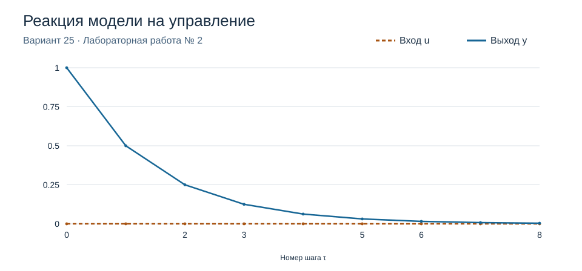
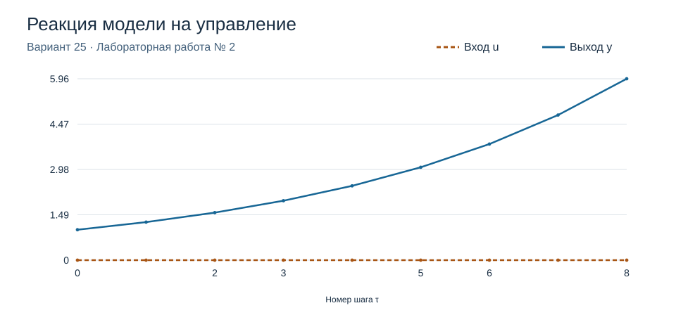
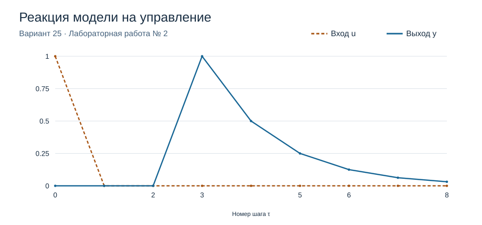

# Лабораторная работа № 2. Модульное тестирование и анализ устойчивости

Брестский государственный технический университет · Кафедра ИИТ  
Дисциплина «Общая теория интеллектуальных систем»  
Выполнил Плисюк К. В., 2 курс, группа ИИ-29, вариант 25  
Проверил Дворанинович Д. А. · Брест, 2026

**Цель работы** — проверить расчёты трёх моделей из первой лабораторной и установить, при каких коэффициентах начальное отклонение линейной модели затухает. Проверка включает прогноз до симуляции, расчёты на известных данных и измерение покрытия C++-кода.

## 1. Связь с первой лабораторной

Из ЛР № 1 перенесены три класса моделей, общий интерфейс `Model`, генераторы ступени, импульса и гармонического воздействия. Сохранены интерактивный ввод коэффициентов, выбор начального состояния и вывод в `result.csv`. В ЛР № 2 единый анализатор классифицирует корень характеристического уравнения. Цикл симуляции вынесен в отдельный файл, поэтому тест может подать заданные значения через интерфейс `InputSignal` и проверить выход на каждом шаге.

| Блок | Модель варианта 25 | Что проверяется |
|---|---|---|
| 1 | 1.10 · Линейная модель с задержкой входа | Вклад текущего и задержанного управления, затухание начального отклонения |
| 2 | 2.5 · Нелинейное преобразование входа | Знак, нулевой и малый вход, насыщение, затухание после импульса |
| 3 | 3.10 · Уравнение с постоянным смещением | Шаг Эйлера, равновесие, сходимость при уменьшении шага |

[Условие ЛР № 2](https://github.com/Gippapotam/OTIS-2026/tree/ii02920/task_02) · [Первая лабораторная](https://github.com/Gippapotam/OTIS-2026/tree/ii02920/trunk/ii02920/task_01) · [Образец оформления](https://github.com/Gippapotam/OTIS-2026/tree/ii02920/trunk/ii02922/task_02)

## 2. Линейная модель и критерий устойчивости

Для модели 1.10 справедливо

$$
y_{k+1}=a_1 y_k+b_1 u_k+b_2 u_{k-2},\qquad u_{-2}=u_{-1}=0.
$$

Возьмём два процесса с одинаковой историей управления и разными начальными значениями. При вычитании их уравнений оба слагаемых управления сокращаются. Для разности выходов получаем

$$
e_{k+1}=a_1 e_k,\qquad e_k=a_1^k e_0.
$$

Подстановка решения вида $e_k=Cz^k$ даёт характеристическое уравнение $z-a_1=0$ и корень $z=a_1$. Если включить в вектор состояния две ячейки памяти управления, характеристический многочлен станет $z^2(z-a_1)$. Два дополнительных нулевых корня лежат внутри единичного круга.

| Положение корня | Поведение начального отклонения при $e_0\ne0$ | Реакция программы |
|---|---|---|
| $\lvert z\rvert<1$ | Модуль отклонения стремится к нулю | Продолжает ввод параметров |
| $z=1$ или $z=-1$ | Модуль сохраняется. При $z=-1$ знак чередуется | Предупреждает о границе и спрашивает, продолжать ли расчёт |
| $\lvert z\rvert>1$ | Модуль растёт с каждым шагом | Предупреждает о росте и спрашивает, продолжать ли расчёт |

Проверка выполняется сразу после ввода коэффициентов и начального состояния. При отмене программа завершается до открытия CSV. Классификацию и тексты предупреждений содержит [stability.cpp](../src/stability.cpp).

**Численная проверка.** При $y_0=1$, $b_1=b_2=0$ и нулевом входе ответ равен $a_1^k$. Восьмой шаг даёт $0{,}00390625$ при $a_1=0{,}5$ и $5{,}96046448$ при $a_1=1{,}25$. Графики построены по CSV двух запусков. На вертикальных осях использованы отдельные шкалы.

| Затухание при $a_1=0{,}5$ | Рост при $a_1=1{,}25$ |
|---|---|
|  |  |

**Проверка задержки вручную.** Оставим только задержанное управление. Зададим $a_1=0{,}5$, $b_1=0$, $b_2=1$, $y_0=0$ и подадим единичный импульс. На шагах 0 и 1 в формуле стоят $u_{-2}$ и $u_{-1}$. На шаге 2 впервые подставляется $u_0=1$, поэтому первым ненулевым выходом оказывается $y_3$.

| $k$ | 0 | 1 | 2 | 3 | 4 | 5 |
|---|---:|---:|---:|---:|---:|---:|
| $u_k$ | 1 | 0 | 0 | 0 | 0 | 0 |
| $y_k$ | 0 | 0 | 0 | 1 | 0,5 | 0,25 |

## 3. Нелинейная модель и метод Эйлера

**Модель 2.5** вычисляет

$$
y_{k+1}=a y_k+b\,\operatorname{sign}(u_k)(1-e^{-|u_k|}).
$$

Удобный вход для ручной проверки — $u=\ln 2$. Тогда $e^{-|u|}=1/2$. При $b=1$ и $y_0=0$ выход после первого шага равен $0{,}5$, а при $u=-\ln 2$ получается $-0{,}5$. Отдельный тест с $u=10^{-14}$ проверяет точность вычисления через `expm1`. Нелинейность относится ко входу. При одинаковом управлении разность состояний удовлетворяет $e_{k+1}=ae_k$, поэтому критерий затухания — $|a|<1$.

**Модель 3.10** описывается уравнением $y'=-ay+b+u$. Явный шаг Эйлера имеет вид

$$
y_{k+1}=y_k+h(-a y_k+b+u_k),\qquad h>0.
$$

При $a=1$, $b=0{,}5$, $u=1$, $h=0{,}1$ и $y_0=0$ первый шаг даёт $y_1=0{,}15$. Разность численных решений умножается на $1-ah$ за шаг. Условие затухания схемы — $|1-ah|<1$.

Для тех же постоянных параметров точное решение равно $y(t)=1{,}5(1-e^{-t})$. Сравнение выполнено в общей точке $t=1$.

| Шаг $h$ | Число шагов | $y(1)$ по Эйлеру | Абсолютная ошибка |
|---:|---:|---:|---:|
| 0,1 | 10 | 0,97698234 | 0,02880150 |
| 0,05 | 20 | 0,96227112 | 0,01409028 |
| 0,025 | 40 | 0,95515134 | 0,00697050 |

При каждом делении шага пополам ошибка уменьшается приблизительно вдвое. Тест проверяет, что отношение соседних ошибок находится между 1,9 и 2,2.

## 4. Организация тестов

Google Test создаёт отдельный тест для каждого набора параметров `TEST_P`. В число **53** входят все экземпляры, в том числе самостоятельные проверки `TEST` и `TEST_F`.

| Группа проверок | Число | Что вызовет ошибку теста |
|---|---:|---|
| Классификация корней | 10 | Ошибочная классификация нуля, чисел рядом с $\pm1$, точек границы и нечисловых значений |
| Последовательные шаги модели 1.10 | 6 | Ошибка в коэффициенте, знаке или порядке сдвига задержки |
| Отклонения при одинаковом управлении | 5 | Неверное затухание, чередование знака или рост |
| Нелинейная модель 2.5 | 6 | Ошибка знака, погрешность у нуля или неверный предел входной добавки |
| Шаги модели 3.10 и сходимость Эйлера | 8 | Неверное равновесие, вклад смещения или порядок точности |
| Сброс состояния и связь моделей с анализатором | 2 | Сохранение истории входов после сброса или неверный корень |
| Генераторы сигналов | 4 | Ошибка до начала, в момент импульса или на последующих шагах |
| Симуляция с подменой сигнала | 3 | Несовпадение любой строки CSV с эталонной траекторией |
| Сценарии консольной программы | 9 | Предупреждение после старта, перезапись при отмене, ошибка обработки ввода, файла или переполнения |
| **Итого** | **53** | |

В тестах симулятора класс `TableSignal` реализует интерфейс `InputSignal` и возвращает заранее выписанные отсчёты ступени, импульса или синусоиды. Это позволяет обнаружить сдвиг на один шаг даже при правильном генераторе и отдельно проверить сами генераторы. [Расчётные тесты](../test/test_models.cpp) · [Проверки консольного сценария](../test/test_application.cpp)

## 5. Результаты и покрытие

Контрольная сборка выполнена на macOS arm64 с Apple Clang 21, CMake 4.4.3 и Google Test 1.17.0. CTest выполнил **53 теста из 53**, пропусков и ошибок нет. LLVM Coverage учитывает исполняемые строки C++ в `task_02/src` и общий заголовок `task_01/src/InputSignals.h`, включая точку входа `main.cpp`. Выборка профиля состоит только из запусков тестов. Скрипт визуализации и код Google Test исключены.

| Модуль | Покрытые строки | Покрытые функции |
|---|---:|---:|
| База Model и три математические модели | 72 / 72 | 22 / 22 |
| Генераторы входных сигналов | 21 / 21 | 8 / 8 |
| Анализатор устойчивости | 16 / 16 | 2 / 2 |
| Симуляция и формирование строк CSV | 16 / 16 | 1 / 1 |
| Консольный сценарий | 90 / 90 | 9 / 9 |
| Точка входа main.cpp | 0 / 3 | 0 / 1 |
| **Итого** | **215 / 218 · 98,62 %** | **42 / 43 · 97,67 %** |

Покрытие ветвей — **77 из 84 (91,67 %)**. Тесты вызывают `runApplication` напрямую, передают ему потоки и проверяют результат. В `main.cpp` остались три строки точки входа. Отдельный запуск исполняемой программы проверил их работу и дал CSV для графиков. Этот запуск не включён в процент модульного покрытия.

[Протокол CTest](test_report.txt) · [Отчёт llvm-cov](coverage.txt)

## 7. Вывод

Все три модели варианта 25 прошли проверку по независимо рассчитанным значениям. Для модели 1.10 задержанный импульс впервые влияет на $y_3$, а затухание начального отклонения определяется одним коэффициентом $a_1$. Проверки у границы единичного круга подтвердили, что программа различает затухание, сохранение амплитуды и рост. Для модели Эйлера уменьшение шага вдвое дало ожидаемое для метода первого порядка снижение погрешности.
