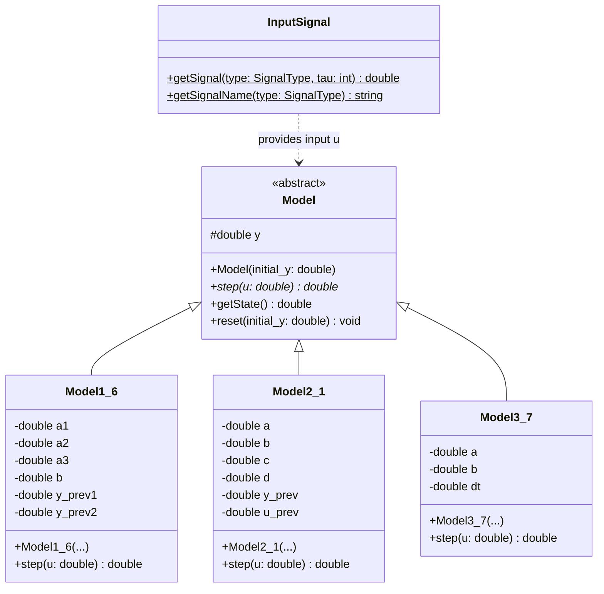
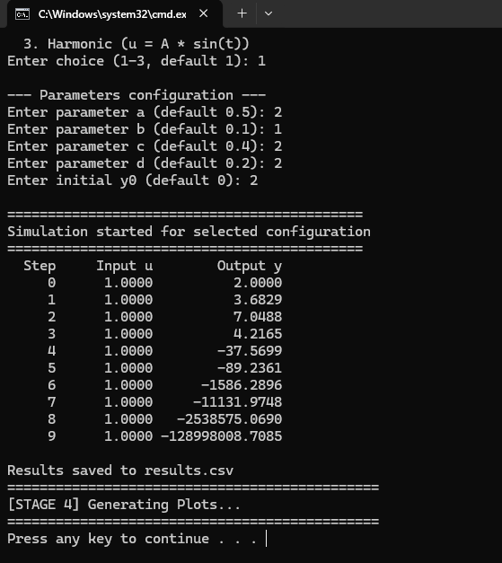
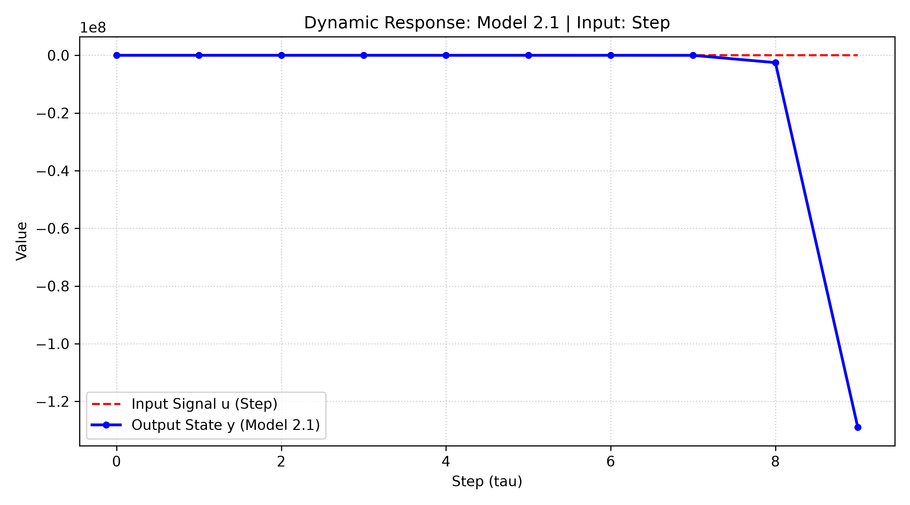

<p align="center">Министерство образования Республики Беларусь</p>

<p align="center">Учреждение образования</p>

<p align="center">«Брестский государственный технический университет»</p>

<p align="center">Кафедра ИИТ</p>

<br><br><br><br><br>

<p align="center"><b>Лабораторная работа №1</b></p>

<p align="center"><b>По дисциплине: «Общая теория интеллектуальных систем»</b></p>

<p align="center"><b>Тема: «Моделирование динамических систем»</b></p>

<br><br><br><br>

<p align="right">Выполнил:</p>

<p align="right">Студент 2 курса</p>

<p align="right">Группы ИИ-29</p>

<p align="right">Сидорко А.Д.</p>

<p align="right">Проверил:</p>

<p align="right">Дворанинович Д. А.</p>

<br><br><br><br>

<p align="center">Брест 2026</p>

---

## Вариант 23

- Линейная модель: Model 1.6
- Нелинейная модель: Model 2.1
- Дифференциальное уравнение: Model 3.7

## Реализованные модели

| Блок | Модель | Тип | Название |
|:--:|:--:|:--:|---|
| 1 | 1.6 | линейная дискретная | Third-Order Dynamic System |
| 2 | 2.1 | нелинейная дискретная | Quadratic Feedback and Harmonic Control |
| 3 | 3.7 | дифференциальное уравнение | Dynamic System Solved by Euler Method |


## Входные воздействия

1. Ступенчатое: `u(t) = A`
2. Импульсное: `u(0) = A`, `u(t > 0) = 0`
3. Гармоническое: `u(t) = A * sin(t)`


## ООП

В проекте используется абстрактный базовый класс `Model`, который определяет общий интерфейс для всех динамических систем.

Основной метод:

```cpp
virtual double step(double u) = 0;
```

Метод `step()` выполняет один шаг моделирования с заданным входным воздействием и возвращает новое состояние системы.

От базового класса наследуются:

- `Model1_6` — линейная дискретная модель третьего порядка;
- `Model2_1` — нелинейная дискретная модель;
- `Model3_7` — модель дифференциального уравнения.

Класс `InputSignal` отвечает за формирование входных воздействий. Использование наследования и полиморфизма позволяет работать с разными моделями через единый интерфейс.

## UML-диаграмма классов



## Пример работы программы

### Сборка и запуск

Сборка проекта осуществляется с помощью файла `build.bat`.

```bat
@echo off
chcp 65001 > nul
echo ==============================================
echo STARTING BUILD PROCESS (Variant 23)
echo ==============================================

:: Шаг 1: Конфигурация CMake
echo [STAGE 1] CMake Configuration...
cmake -B build -S .
if %errorlevel% neq 0 goto error

:: Шаг 2: Сборка проекта
echo [STAGE 2] Building Project...
cmake --build build --config Release
if %errorlevel% neq 0 goto error

:: Шаг 3: Поиск и запуск исполняемого файла
echo [STAGE 3] Execution
if exist "build\src\Release\task_01.exe" (
    "build\src\Release\task_01.exe"
) else if exist "build\src\Debug\task_01.exe" (
    "build\src\Debug\task_01.exe"
) else if exist "build\src\task_01.exe" (
    "build\src\task_01.exe"
) else if exist "build\src\ii02921_task_01.exe" (
    "build\src\ii02921_task_01.exe"
) else if exist "build\Release\task_01.exe" (
    "build\Release\task_01.exe"
) else if exist "build\Debug\task_01.exe" (
    "build\Debug\task_01.exe"
) else if exist "build\task_01.exe" (
    "build\task_01.exe"
) else if exist "build\ii02921_task_01.exe" (
    "build\ii02921_task_01.exe"
) else (
    echo [ERROR] Executable not found in build directory!
    goto error
)
if %errorlevel% neq 0 goto error

:: Шаг 4: Запуск Python-скрипта для генерации графиков
echo ==============================================
echo [STAGE 4] Generating Plots...
echo ==============================================
if exist "src\plot.py" (
    python src\plot.py
) else if exist "plot.py" (
    python plot.py
) else (
    echo [WARNING] plot.py not found, skipping plot generation.
)

goto end

:error
echo ==============================================
echo ERROR: Process terminated with failure.
echo ==============================================

:end
pause
```

После сборки программа запускается автоматически либо вручную из каталога `build`.

### Демонстрация исполняемого файла

После запуска пользователь выбирает количество шагов моделирования, модель и тип входного сигнала. Программа вычисляет состояния системы и выводит результаты.

Результаты сохраняются в файл `results.csv`.

### Демонстрация исполняемого файла task_01.exe:



При запуске исполняемого файла мы получаем результат `results.csv`, после чего автоматически запускается `src/plot.py` для визуализации ответа:

### Пример графика переходных процессов

## Вывод

В ходе лабораторной работы была разработана программа для моделирования динамических систем варианта 23.

Программа:
- моделирует линейную дискретную систему Model 1.6;
- моделирует нелинейную дискретную систему Model 2.1;
- решает дифференциальное уравнение Model 3.7 численным методом Эйлера;
- поддерживает ступенчатое, импульсное и гармоническое входные воздействия;
- позволяет задавать параметры моделей и количество шагов;
- выводит результаты моделирования в табличном виде;
- сохраняет результаты в `results.csv`;
- строит графики с использованием Python и Matplotlib.

Таким образом, реализованы основные принципы объектно-ориентированного программирования и получен инструмент для исследования реакции динамических систем на различные входные воздействия.
