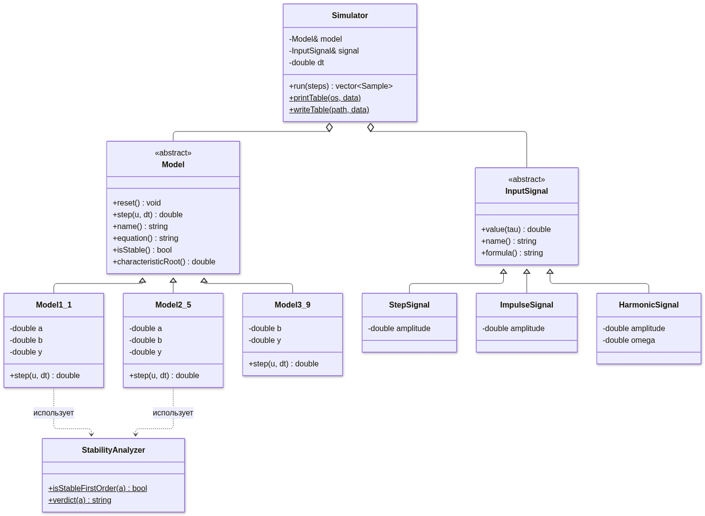
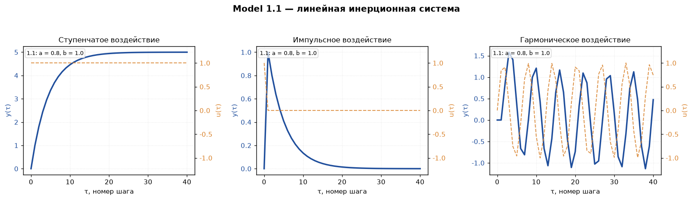
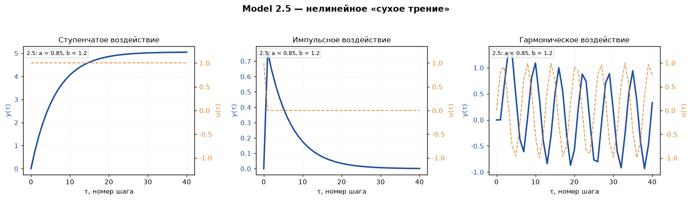
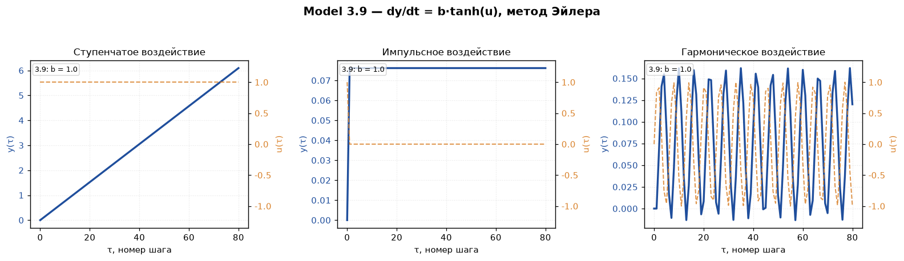

<p align="center">Министерство образования Республики Беларусь</p>
<p align="center">Учреждение образования</p>
<p align="center">«Брестский государственный технический университет»</p>
<p align="center">Кафедра ИИТ</p>

<br>

<p align="center">Лабораторная работа №1</p>
<p align="center">по дисциплине «Общая теория интеллектуальных систем»</p>
<p align="center">Тема: «Моделирование объекта управления»</p>

<br>

<p align="right">Выполнил:</p>
<p align="right">студент 2 курса</p>
<p align="right">группы ИИ-29</p>
<p align="right">Савко Н.В.</p>
<p align="right">Проверил:</p>
<p align="right">Дворанинович Д. А.</p>

<br>

<p align="center">Брест 2026</p>

---

# Вариант 11

| Блок | Модель | Название |
| :---: | :---: | :--- |
| 1. Линейная модель | **Model 1.1** | Стандартная инерционная система первого порядка |
| 2. Нелинейная модель | **Model 2.5** | Нелинейность «сухое трение» (signum) |
| 3. Дифференциальное уравнение | **Model 3.9** | Ограниченная скорость изменения (tanh) |

---

## 1. Цель работы

Разработать на языке C++ программу, которая моделирует поведение объекта управления
на дискретных моментах времени $\tau = 0, 1, 2, \dots, n$, выводит результаты в
табличном виде и строит графики переходных процессов. Программа должна быть
реализована с использованием принципов ООП, собираться системой CMake и
запускаться через `.bat`-файл.

## 2. Постановка задачи

В соответствии с заданием необходимо:

1. Реализовать линейную дискретную модель, нелинейную модель и дифференциальное
   уравнение согласно варианту № 11.
2. Предусмотреть настройку количества шагов симуляции $n$.
3. Использовать три типа входных воздействий:
   * ступенчатое $u_\tau = \text{const}$;
   * импульсное $u_0 = 1,\ u_{\tau>0} = 0$;
   * гармоническое $u_\tau = \sin(\tau)$.
4. Выводить результаты в табличном виде в консоль.
5. Построить графики переходных процессов.
6. Создать UML-диаграмму классов.
7. Реализовать программу на основе ООП: базовый абстрактный класс `Model`
   с виртуальным методом расчёта шага и классы-наследники для конкретных уравнений.
8. Собирать проект через CMake, запуск сборки — через `build.bat`.

---

## 3. Математические модели

### 3.1. Model 1.1 — линейная инерционная система

$$y_{\tau+1} = a\,y_{\tau} + b\,u_{\tau}$$

Характеристическое уравнение:

$$z - a = 0 \quad\Rightarrow\quad z = a.$$

Дискретная система устойчива, если корень лежит внутри единичной окружности
Z-плоскости:

$$|z| = |a| < 1.$$

При ступенчатом входе $u_\tau = 1$ установившееся значение:

$$y_{\text{уст}} = \frac{b}{1-a}.$$

В работе приняты коэффициенты $a = 0{,}8$, $b = 1{,}0$, поэтому
$y_{\text{уст}} = 1 / (1 - 0{,}8) = 5$.

### 3.2. Model 2.5 — нелинейное «сухое трение»

$$y_{\tau+1} = a\,y_{\tau} + b\cdot\operatorname{sign}(u_{\tau})\cdot\left(1 - e^{-|u_{\tau}|}\right)$$

Свойства нелинейной функции:

* $f(0) = 0$ — при нулевом входе система остаётся в покое;
* $f(-u) = -f(u)$ — функция нечётная;
* $|f(u)| < 1$ — ограничение по модулю;
* при малых $|u|$: $f(u) \approx u$, поэтому линеаризованная модель совпадает
  с Model 1.1 и имеет тот же корень $z = a$.

В работе приняты $a = 0{,}85$, $b = 1{,}2$. Для ступеньки $u = 1$:
$f(1) = 1 - e^{-1} \approx 0{,}632$, установившееся значение
$y_{\text{уст}} = b\,f(1)/(1-a) \approx 5{,}06$.

### 3.3. Model 3.9 — дифференциальное уравнение

$$\frac{dy}{dt} = b\cdot\tanh(u)$$

Уравнение решается явным методом Эйлера с шагом $\Delta t$:

$$y_{\tau+1} = y_{\tau} + \Delta t\cdot b\cdot\tanh(u_{\tau}).$$

Правая часть не зависит от $y$, поэтому характеристического уравнения для этой
модели нет: система нейтральна по выходу. При постоянном входе $u$ точное
решение — линейная функция $y(t) = y_0 + b\tanh(u)\,t$, а метод Эйлера даёт
погрешность порядка $O(\Delta t)$.

---

## 4. Входные воздействия

| Тип | Формула | Реализация |
| :--- | :--- | :--- |
| Ступенчатое | $u_\tau = A$ | `StepSignal` |
| Импульсное | $u_0 = A,\ u_{\tau>0} = 0$ | `ImpulseSignal` |
| Гармоническое | $u_\tau = A\sin(\omega\tau)$ | `HarmonicSignal` |

По умолчанию $A = 1$, $\omega = 1$, что соответствует требованию задания
$u_\tau = \sin(\tau)$.

---

## 5. Архитектура программы

Программа построена по принципу «стратегия»: абстрактный класс `Model` задаёт
интерфейс расчёта одного шага, а конкретные уравнения вынесены в наследников.
Входные воздействия реализованы аналогичной иерархией классов `InputSignal`.
Класс `Simulator` связывает модель и сигнал и формирует таблицу результатов.
Модуль `StabilityAnalyzer` проверяет устойчивость линейных моделей.



### Состав классов

| Класс | Назначение |
| :--- | :--- |
| `Model` | Абстрактный базовый класс модели: `reset()`, `step()`, `name()`, `equation()`, `isStable()` |
| `Model1_1` | Реализация $y_{\tau+1} = a y_\tau + b u_\tau$ |
| `Model2_5` | Реализация нелинейности «сухое трение» |
| `Model3_9` | Интегрирование $dy/dt = b\tanh(u)$ методом Эйлера |
| `InputSignal` | Абстрактное входное воздействие |
| `StepSignal`, `ImpulseSignal`, `HarmonicSignal` | Конкретные сигналы |
| `Simulator` | Движок симуляции, печать и сохранение таблицы |
| `StabilityAnalyzer` | Проверка условия $|a| < 1$ и текстовое заключение |

### Структура каталогов

```text
trunk/ii02911/task_01/
├── CMakeLists.txt          # точка входа для сборки задания
├── build.bat               # сборка + демонстрационный запуск + графики
├── plot_results.py         # построение графиков по результатам программы
├── src/
│   ├── CMakeLists.txt
│   ├── Model.h
│   ├── Model1_1.h / .cpp
│   ├── Model2_5.h / .cpp
│   ├── Model3_9.h / .cpp
│   ├── InputSignal.h / .cpp
│   ├── Simulator.h / .cpp
│   ├── StabilityAnalyzer.h / .cpp
│   └── main.cpp
└── doc/
    ├── readme.md           # этот отчёт
    └── screenshots/
        ├── plot_model_1_1.png
        ├── plot_model_2_5.png
        ├── plot_model_3_9.png
        └── uml.png
```

---

## 6. Результаты моделирования

Параметры расчёта: $a = 0{,}8$, $b = 1{,}0$ для Model 1.1;
$a = 0{,}85$, $b = 1{,}2$ для Model 2.5; $b = 1{,}0$, $\Delta t = 0{,}1$
для Model 3.9. Количество шагов — 40 для первых двух моделей и 80 для третьей.

### 6.1. Model 1.1

| τ | u(τ) | y(τ) |
|---:|---:|---:|
| 0 | 1.000 | 0.0000 |
| 1 | 1.000 | 1.0000 |
| 2 | 1.000 | 1.8000 |
| 3 | 1.000 | 2.4400 |
| 4 | 1.000 | 2.9520 |
| 5 | 1.000 | 3.3616 |
| 6 | 1.000 | 3.6893 |
| 7 | 1.000 | 3.9514 |
| 8 | 1.000 | 4.1611 |
| 9 | 1.000 | 4.3289 |
| 10 | 1.000 | 4.4631 |



Видны характерные свойства инерционного звена: выход асимптотически приближается
к $y_{\text{уст}} = 5$, при импульсном воздействии — экспоненциально затухает,
при гармоническом — повторяет вход с запаздыванием и уменьшением амплитуды.

### 6.2. Model 2.5

| τ | u(τ) | y(τ) |
|---:|---:|---:|
| 0 | 1.000 | 0.0000 |
| 1 | 1.000 | 0.7585 |
| 2 | 1.000 | 1.4033 |
| 3 | 1.000 | 1.9514 |
| 4 | 1.000 | 2.4172 |
| 5 | 1.000 | 2.8132 |
| 6 | 1.000 | 3.1497 |
| 7 | 1.000 | 3.4358 |
| 8 | 1.000 | 3.6790 |
| 9 | 1.000 | 3.8857 |
| 10 | 1.000 | 4.0614 |



Из-за нелинейности «сухое трение» первый шаг даёт не $b = 1{,}2$, а
$b\,(1 - e^{-1}) \approx 0{,}7585$: часть входного воздействия «теряется» на
преодоление трения. При гармоническом сигнале форма выхода отличается от
синусоиды — это проявление нелинейных свойств модели.

### 6.3. Model 3.9

| τ | u(τ) | y(τ) |
|---:|---:|---:|
| 0 | 1.000 | 0.0000 |
| 1 | 1.000 | 0.0762 |
| 2 | 1.000 | 0.1523 |
| 3 | 1.000 | 0.2285 |
| 4 | 1.000 | 0.3046 |
| 5 | 1.000 | 0.3808 |
| 6 | 1.000 | 0.4570 |
| 7 | 1.000 | 0.5331 |
| 8 | 1.000 | 0.6093 |
| 9 | 1.000 | 0.6854 |
| 10 | 1.000 | 0.7616 |



При ступеньке выход растёт линейно с постоянной скоростью
$\Delta t\,b\tanh(1) \approx 0{,}0762$ за шаг, что совпадает с аналитическим
решением. Импульс даёт один приращённый шаг, после чего выход остаётся
постоянным, а гармонический вход интегрируется в косинусоиду.

---

## 7. Анализ устойчивости (дополнительное задание)

Для линейных моделей первого порядка характеристическое уравнение имеет вид
$z - a = 0$. Критерий устойчивости: $|a| < 1$. Модуль `StabilityAnalyzer`
реализует эту проверку, а программа выводит предупреждение **до начала
симуляции**, если коэффициент задан неверно.

Пример для неустойчивого коэффициента $a = 1{,}2$:

```text
Устойчивость: |a| = 1.200 >= 1 — процесс расходится (модель НЕУСТОЙЧИВА).

!!!!!!!!!!!!!!!!!!!!!!!!!!!!!!!!!!!!!!!!!!!!!!!!!!!!!!!!!!!!!!
!!  ВНИМАНИЕ: ПРОЦЕСС РАСХОДИТСЯ!
!!  Корень |z| = |a| >= 1 лежит вне единичной окружности.
!!  Симуляция будет неустойчивой: уменьшите |a| < 1.
!!!!!!!!!!!!!!!!!!!!!!!!!!!!!!!!!!!!!!!!!!!!!!!!!!!!!!!!!!!!!!

|    0 |       1.0000 |       0.0000 |
|    1 |       1.0000 |       1.0000 |
|    2 |       1.0000 |       2.2000 |
|    3 |       1.0000 |       3.6400 |
|    4 |       1.0000 |       5.3680 |
|    5 |       1.0000 |       7.4416 |
```

Для Model 2.5 проверка выполняется по линеаризации в точке $u = 0$: при малых
отклонениях $f(u) \approx u$, поэтому локальная устойчивость также определяется
условием $|a| < 1$. Для Model 3.9 анализ неприменим, так как уравнение не
содержит обратной связи по $y$.

---

## 8. Сборка и запуск

### 8.1. Требования

* CMake 3.10 или новее;
* компилятор C++17: MinGW-w64 (`g++`) или MSVC (Visual Studio 2022);
* Python 3 с библиотекой `matplotlib` — только для построения графиков.

### 8.2. Быстрый старт

```bat
build.bat
```

Скрипт выполняет четыре шага:

1. конфигурирует проект через CMake (при наличии `g++` использует
   генератор `MinGW Makefiles`, иначе — генератор по умолчанию);
2. собирает `otis_lab1_ii02911.exe` в каталог `build\bin`;
3. запускает демонстрационный расчёт;
4. строит графики в `doc\screenshots`.

### 8.3. Ручная сборка

```bat
cmake -S . -B build
cmake --build build --config Release
build\bin\otis_lab1_ii02911.exe --model 1.1 --signal step --steps 30
```

### 8.4. Параметры командной строки

| Параметр | Значение по умолчанию | Описание |
| :--- | :--- | :--- |
| `--model` | `1.1` | Модель: `1.1`, `2.5` или `3.9` |
| `--signal` | `step` | Сигнал: `step`, `impulse`, `harmonic` |
| `--steps` | `30` | Количество шагов симуляции $n$ |
| `--a` | `0.8` | Коэффициент $a$ |
| `--b` | `1.0` | Коэффициент $b$ |
| `--dt` | `0.1` | Шаг интегрирования $\Delta t$ |
| `--amplitude` | `1.0` | Амплитуда входного сигнала $A$ |
| `--omega` | `1.0` | Частота гармонического сигнала $\omega$ |
| `--out` | — | Сохранить таблицу в текстовый файл |

Пример:

```bat
build\bin\otis_lab1_ii02911.exe --model 3.9 --signal harmonic --steps 80 --out result.txt
```

### 8.5. Формат вывода

Таблица печатается в консоль в виде:

```text
+------+--------------+--------------+
| tau  |      u(tau)  |      y(tau)  |
+------+--------------+--------------+
|    0 |       1.0000 |       0.0000 |
|    1 |       1.0000 |       1.0000 |
|    2 |       1.0000 |       1.8000 |
+------+--------------+--------------+
```

Файл `--out` содержит те же данные с разделителем-табуляцией (без CSV).
Он используется только скриптом `plot_results.py` для построения графиков.

---

## 9. Выводы

В ходе лабораторной работы была разработана программа на C++17, моделирующая
объект управления для варианта № 11. Реализованы линейная модель первого порядка
(Model 1.1), нелинейная модель с «сухим трением» (Model 2.5) и дифференциальное
уравнение с ограниченной скоростью (Model 3.9). Программа поддерживает три типа
входных воздействий, настраиваемое число шагов и выводит результаты в табличном
виде.

Архитектура построена на абстрактных классах `Model` и `InputSignal`, что
позволяет добавлять новые модели и сигналы без изменения движка симуляции.
Дополнительно реализован модуль анализа устойчивости, предупреждающий о
расходящемся процессе при $|a| \ge 1$. Построены графики переходных процессов
и UML-диаграмма классов, подтверждающие корректность выбранной структуры
программы.
