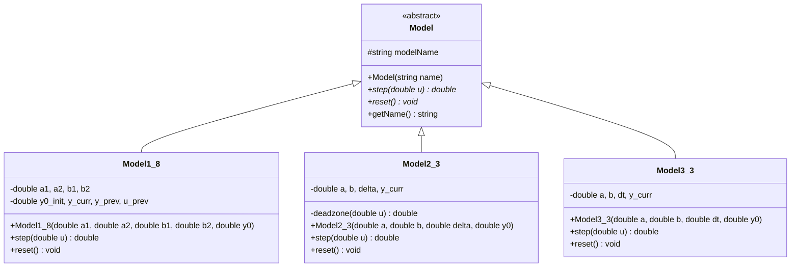
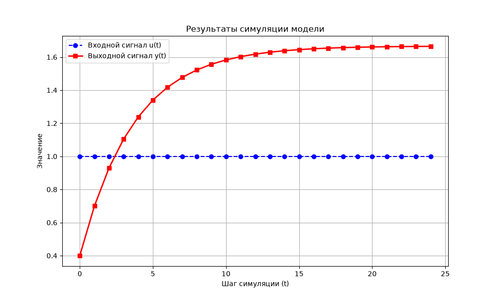
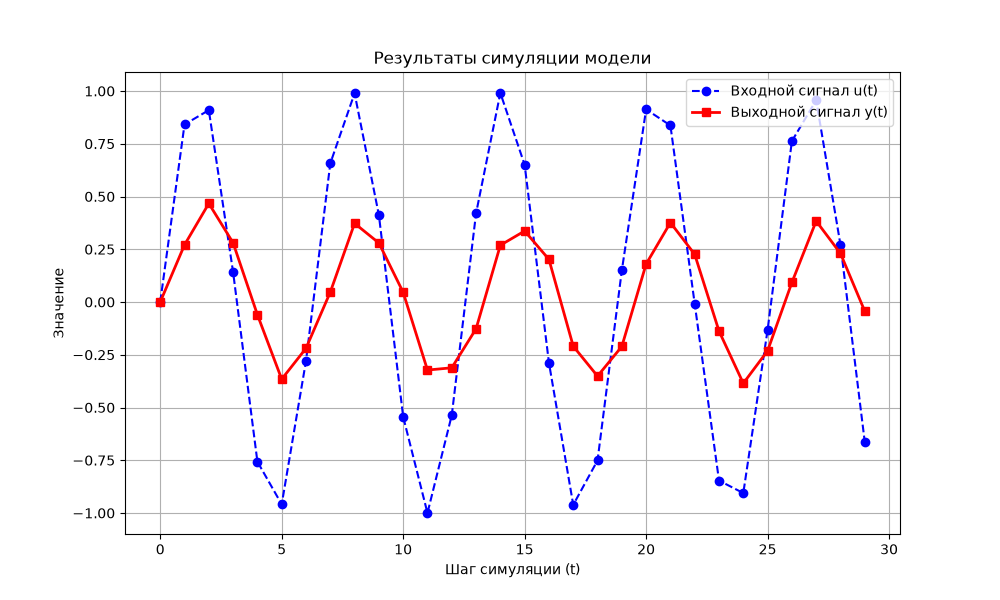
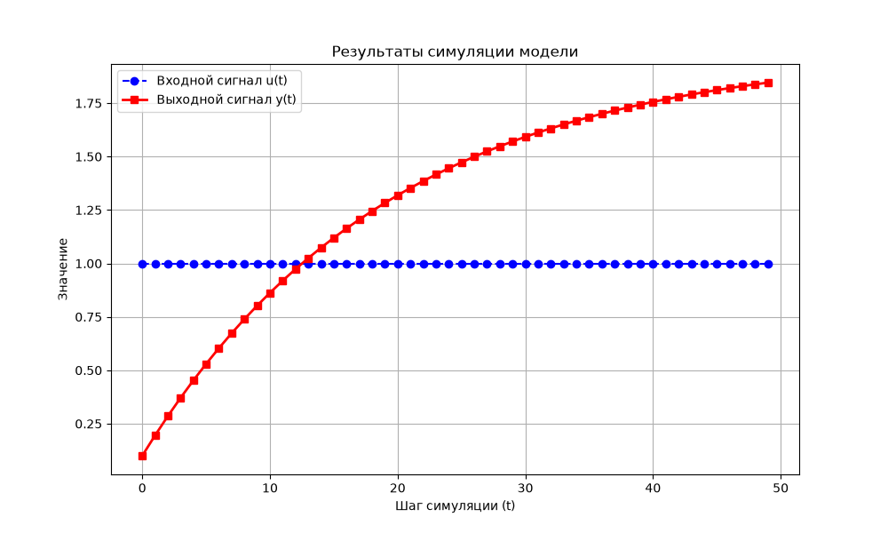

# Лабораторная работа №1

**Тема:** Моделирование линейных, нелинейных и дифференциальных систем.

**Выполнил:** студент 2-го курса группы ИИ-29 Таран П. Д.

**Вариант:** 24

## Постановка задачи

Реализовать программу на языке C++ для моделирования динамических систем на основе принципов объектно-ориентированного программирования (ООП).

Модели варианта 24:

1. **Линейная модель (Model 1.8 — обобщённая авторегрессионная модель):**
   `y(t+1) = a1 * y(t) + a2 * y(t-1) + b1 * u(t) + b2 * u(t-1)`
2. **Нелинейная модель (Model 2.3 — зона нечувствительности Dead-zone):**
   `y(t+1) = a * y(t) + b * deadzone(u(t))`
3. **Дифференциальное уравнение (Model 3.3 — процесс первого порядка, метод Эйлера):**
   `dy/dt = -a * y + b * u`

## ООП-архитектура и UML-диаграмма классов

Архитектура программы построена на базе полиморфизма и наследования. Создан базовый абстрактный класс `Model` с чисто виртуальными методами `step(double u)` и `reset()`. Конкретные математические модели реализованы в виде классов-наследников `Model1_8`, `Model2_3` и `Model3_3`.

## Функционал программы

При запуске программа предлагает пользователю:

1. Выбрать одну из трёх математических моделей для расчёта (`1`, `2` или `3`).
2. Ввести с клавиатуры начальное значение `y0` и коэффициенты выбранного уравнения (`a1, a2, b1, b2`, либо `a, b, delta`, либо `a, b, dt`).
3. Выбрать тип входного воздействия `u(t)` и количество шагов симуляции `n`.

Типы входного воздействия:

| `type` | Воздействие| Результат |
|-|-|-|
| `1` | Ступенчатое | Константа (`1.0` или заданная `u_const`)|
| `2` | Импульсное | `1.0` при `t == 0`, иначе `0.0` |
| `3` |Гармоническое | `sin(t)` |

После выполнения расчёта программа выводит таблицу шагов в консоль, сохраняет данные и автоматически запускает скрипт `plot.py`, который сразу открывает окно с графиком на экране.

## Результаты работы программы

### 1. Линейная модель (Model 1.8)

Параметры: `y0 = 0`, `a1 = 0.5`, `a2 = 0.2`, `b1 = 0.4`, `b2 = 0.1`, ступенчатое воздействие `u = 1.0`, шагов `n = 25`.

### 2. Нелинейная модель (Model 2.3)

Параметры: `y0 = 0`, `a = 0.6`, `b = 0.5`, `delta = 0.3`, гармоническое воздействие `u(t) = sin(t)`, шагов `n = 30`.

### 3. Дифференциальное уравнение (Model 3.3)

Параметры: `y0 = 0`, `a = 0.5`, `b = 1.0`, `dt = 0.1`, ступенчатое воздействие `u = 1.0`, шагов `n = 50`.

