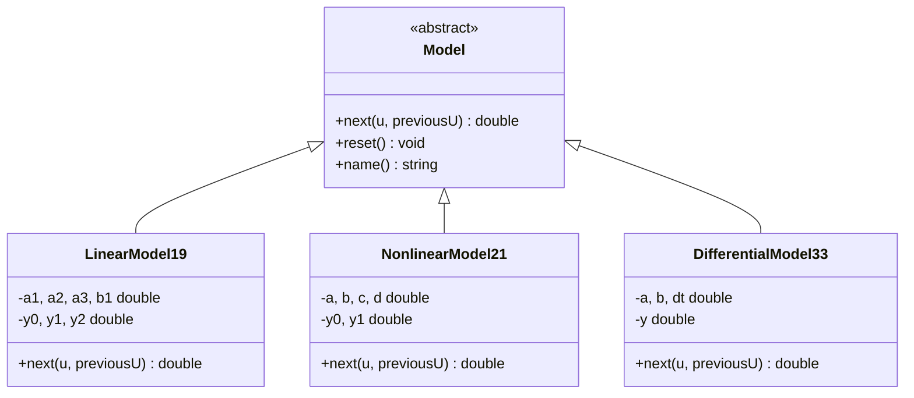
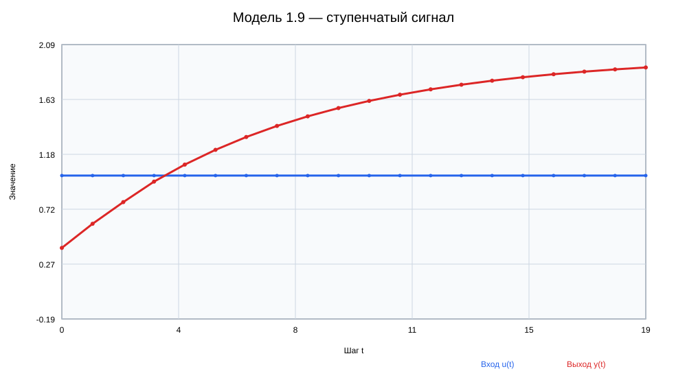
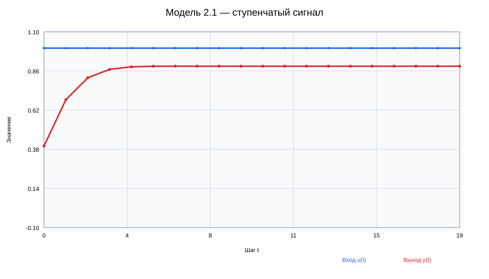
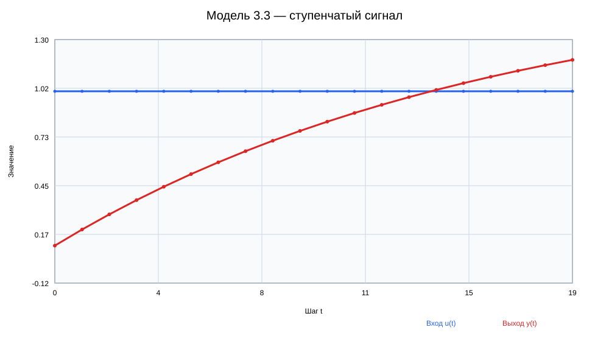

<p align="center">Министерство образования Республики Беларусь</p>
<p align="center">Учреждение образования</p>
<p align="center">«Брестский государственный технический университет»</p>
<p align="center">Кафедра интеллектуальных информационных технологий</p>
<br><br>
<p align="center"><b>Лабораторная работа № 1</b></p>
<p align="center">по дисциплине «Общая теория интеллектуальных систем»</p>
<p align="center">«Моделирование объектов управления»</p>
<br><br>
<p align="right">Выполнил: студент группы ИИ-29, № 25</p>
<p align="right">Тарабуко Вадим Леонидович</p>
<p align="right">Идентификатор: ii02925</p>
<p align="right">Проверил: Дворанинович Д. А.</p>
<br><br>
<p align="center">Брест 2026</p>

# Лабораторная работа № 1

**Вариант:** 9.

## 1. Цель работы

Реализовать на C++ три математические модели варианта, выполнить их пошаговое моделирование, применить объектно-ориентированное программирование и представить результат в виде таблицы и графика.

## 2. Модели варианта 9

### 2.1. Линейная модель 1.9

`y(t+1) = a1*y(t) + a2*y(t-1) + a3*y(t-2) + b1*u(t)`.

Модель учитывает три предыдущих значения выхода. Пользователь вводит коэффициенты `a1`, `a2`, `a3` и `b1`.

### 2.2. Нелинейная модель 2.1

`y(t+1) = a*y(t) - b*y²(t-1) + c*u(t) + d*sin(u(t-1))`.

Нелинейность возникает из-за квадрата предыдущего выхода и функции синуса. Пользователь вводит `a`, `b`, `c` и `d`.

### 2.3. Дифференциальная модель 3.3

`dy/dt = -a*y + b*u`.

Для численного расчёта используется метод Эйлера:

`y(t+1) = y(t) + dt*(-a*y(t) + b*u(t))`.

Пользователь вводит `a`, `b` и положительный шаг интегрирования `dt`.

## 3. Входные воздействия

| Номер | Воздействие | Формула |
|---:|---|---|
| 1 | Ступенчатое | `u(t) = A` |
| 2 | Импульсное | `u(0) = A`, далее `u(t) = 0` |
| 3 | Гармоническое | `u(t) = A*sin(t)` |

Амплитуда `A` и число шагов `n` вводятся пользователем. За один запуск выбираются одна модель и одно воздействие. Это позволяет исследовать нужный сценарий, а не рассчитывать все варианты сразу.

## 4. Алгоритм программы

1. Пользователь выбирает одну из трёх моделей.
2. Вводит коэффициенты выбранной модели.
3. Выбирает входное воздействие и вводит его амплитуду.
4. Вводит число шагов моделирования.
5. На каждом шаге программа вычисляет `u(t)` и следующее значение `y(t)`.
6. Результаты выводятся таблицей и записываются во временный CSV-файл.
7. Создаётся SVG-график, который автоматически открывается после расчёта.

CSV и рабочий график находятся в каталоге `results`. Это результаты запуска программы, поэтому они исключены через `.gitignore` и не должны попадать в Pull Request.

## 5. Объектно-ориентированное программирование

Абстрактный класс `Model` задаёт общий интерфейс:

- `next()` вычисляет следующий шаг;
- `reset()` возвращает модель в начальное состояние;
- `name()` возвращает её имя.

Классы `LinearModel19`, `NonlinearModel21` и `DifferentialModel33` наследуются от `Model` и по-разному реализуют метод `next()`. В функции `main()` выбранная модель хранится через `std::unique_ptr<Model>`. Благодаря виртуальному методу основной цикл не зависит от конкретной формулы.

## 6. UML-диаграмма



## 7. Сборка и запуск

На Windows нужно запустить `build.bat` из корня лабораторной работы. Скрипт выполняет настройку CMake, сборку и запуск программы.

Ручная сборка:

```text
cmake -S . -B build
cmake --build build --config Release
```

Пример ввода для линейной модели:

```text
модель: 1
a1 = 0.5
a2 = 0.2
a3 = 0.1
b1 = 0.4
воздействие: 1
амплитуда: 1
число шагов: 20
```

## 8. Результат

Программа выводит таблицу следующего вида:

| step | input | output |
|---:|---:|---:|
| 0 | 1.000000 | 0.400000 |
| 1 | 1.000000 | 0.600000 |
| 2 | 1.000000 | 0.780000 |
| 3 | 1.000000 | 0.950000 |

Синий график показывает входное воздействие `u(t)`, красный — выход модели `y(t)`.

### 8.1. Примеры визуализации

Линейная модель 1.9 при ступенчатом воздействии:



Нелинейная модель 2.1 при ступенчатом воздействии:



Дифференциальная модель 3.3 при ступенчатом воздействии:



## 9. Вывод

В работе реализованы три модели варианта 9, пользовательский ввод всех коэффициентов, выбор одного режима работы, настройка количества шагов, табличный вывод и автоматическое открытие графика. Программа построена на базовом абстрактном классе и классах-наследниках и собирается с помощью CMake и BAT-файла.
