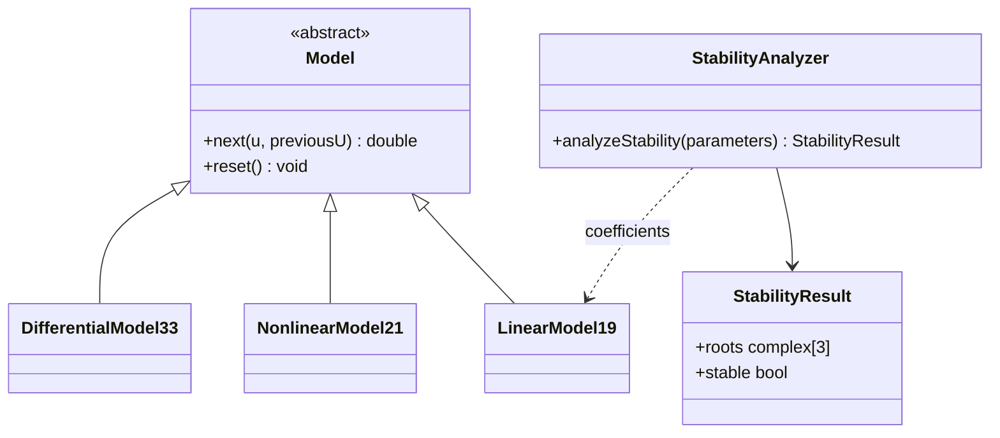

<p align="center">Министерство образования Республики Беларусь</p>
<p align="center">Учреждение образования</p>
<p align="center">«Брестский государственный технический университет»</p>
<p align="center">Кафедра интеллектуальных информационных технологий</p>
<br><br>
<p align="center"><b>Лабораторная работа № 2</b></p>
<p align="center">по дисциплине «Общая теория интеллектуальных систем»</p>
<p align="center">«Модульное тестирование и анализ устойчивости»</p>
<br><br>
<p align="right">Выполнил: студент группы ИИ-29</p>
<p align="right">Тарабуко Вадим Леонидович</p>
<p align="right">Проверил: Дворанинович Д. А.</p>
<br><br>
<p align="center">Брест 2026</p>

# Лабораторная работа № 2

**Вариант:** 9.
**Средства:** C++17, CMake, Google Test, gcovr.

## 1. Цель работы

Добавить к программе ЛР1 проверку устойчивости линейной модели. Написать модульные тесты для моделей и входных сигналов и определить покрытие кода тестами.

## 2. Программа

Пользователь выбирает модель варианта 9, вводит её коэффициенты, входное воздействие, амплитуду и число шагов. Результат выводится таблицей, сохраняется в локальный CSV-файл и показывается на автоматически открываемом SVG-графике. На графике подписаны оси и легенда: синяя линия показывает вход `u(t)`, красная — выход `y(t)`. Для Model 1.9 перед расчётом выполняется анализ устойчивости.

Используются модели:

- Model 1.9: `y(t+1)=a1*y(t)+a2*y(t-1)+a3*y(t-2)+b1*u(t)`;
- Model 2.1: `y(t+1)=a*y(t)-b*y²(t-1)+c*u(t)+d*sin(u(t-1))`;
- Model 3.3: `y(t+1)=y(t)+dt*(-a*y(t)+b*u(t))`.

## 3. Анализ устойчивости Model 1.9

При нулевом входе линейная модель имеет вид:

`y(t+1)=a1*y(t)+a2*y(t-1)+a3*y(t-2)`.

Подстановка решения `y(t)=z^t` даёт характеристическое уравнение:

`z³-a1*z²-a2*z-a3=0`.

Дискретная система асимптотически устойчива, если все корни находятся строго внутри единичного круга:

`|z1|<1`, `|z2|<1`, `|z3|<1`.

Корень с модулем `1` уже не считается асимптотически устойчивым. Корни третьей степени вычисляются численным методом Дюрана–Кернера. Для коэффициентов `a1=0.5`, `a2=0.2`, `a3=0.1` получаются:

| Корень | Модуль |
|---|---:|
| `0.864913` | `0.864913` |
| `-0.182457+0.286929i` | `0.340027` |
| `-0.182457-0.286929i` | `0.340027` |

Все модули меньше единицы, поэтому этот набор устойчив. При неустойчивом наборе программа до симуляции выводит предупреждение, но оставляет пользователю возможность увидеть расходящийся процесс.

## 4. Объектно-ориентированное программирование

Абстрактный класс `Model` содержит виртуальные методы `next()` и `reset()`. Три класса-наследника реализуют собственные формулы и хранят историю состояний. Параметры передаются в конструктор через простые структуры `LinearParameters`, `NonlinearParameters` и `DifferentialParameters`.

Анализатор устойчивости отделён от модели: функция `analyzeStability()` принимает коэффициенты и возвращает структуру `StabilityResult` с тремя корнями и логическим признаком `stable`.

## 5. UML-диаграмма



## 6. Модульные тесты

Тесты находятся в `test/models_test.cpp`. Проверяются:

- первые значения всех трёх моделей по ручному расчёту;
- метод Эйлера;
- сброс внутреннего состояния;
- состояние покоя при нулевом входе;
- названия и амплитуды трёх входных сигналов;
- ступенчатое, импульсное и гармоническое воздействия;
- несколько наборов коэффициентов линейной модели;
- устойчивый, неустойчивый и граничный случаи `|z|=1`;
- устойчивость модели с тремя нулевыми корнями.

Для проверки разных входных наборов применяются параметризованные тесты `TEST_P`. Входные воздействия подменяются чистой функцией `signalValue()`: тест непосредственно задаёт тип, шаг и амплитуду без консольного ввода.

## 7. Сборка, запуск тестов и покрытие

На Windows запускается `run_tests.bat`. Скрипт:

1. настраивает CMake;
2. собирает программу и тесты;
3. запускает CTest;
4. при наличии gcovr создаёт локальный отчёт покрытия.

Ручные команды:

```text
cmake -S . -B build -DBUILD_TESTING=ON -DENABLE_COVERAGE=ON
cmake --build build --config Debug
ctest --test-dir build -C Debug --output-on-failure
```

Фактический результат после последней проверки:

| Показатель | Результат |
|---|---:|
| Тестовых запусков | **21** |
| Успешно | **21 / 21** |
| Покрытие строк библиотеки | **98.1% (52 / 53)** |
| Покрытие ветвей библиотеки | **95.8% (23 / 24)** |

HTML/XML-файлы покрытия создаются только локально и в состав работы не включаются.

## 8. Вывод

К программе ЛР1 добавлена проверка устойчивости Model 1.9. Тестами проверены расчёты моделей, входные сигналы, сброс состояния и граничные случаи анализа устойчивости. Все 21 тест проходят успешно. Сборка, запуск тестов и получение отчёта покрытия выполняются одним BAT-файлом.
