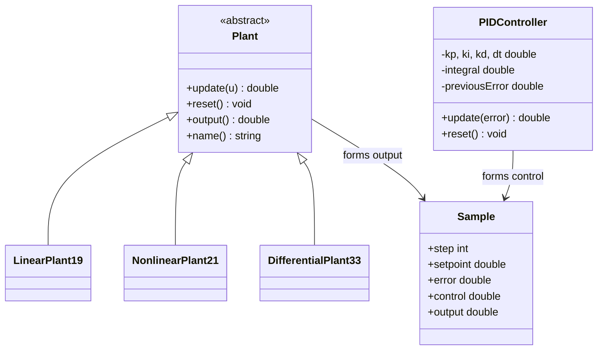
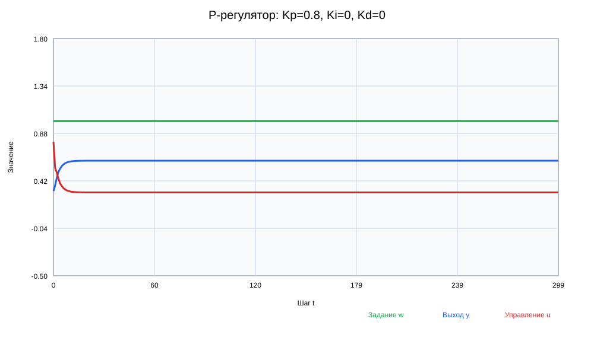
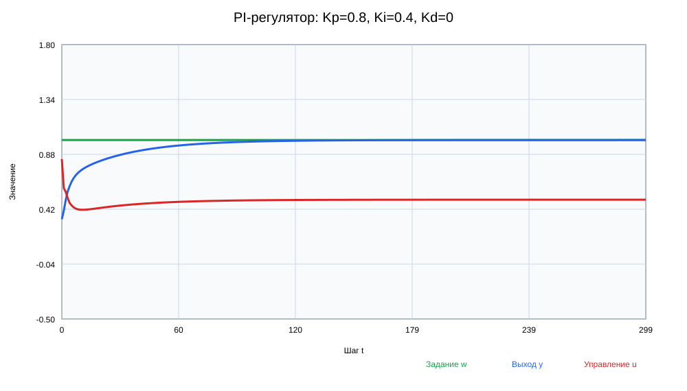
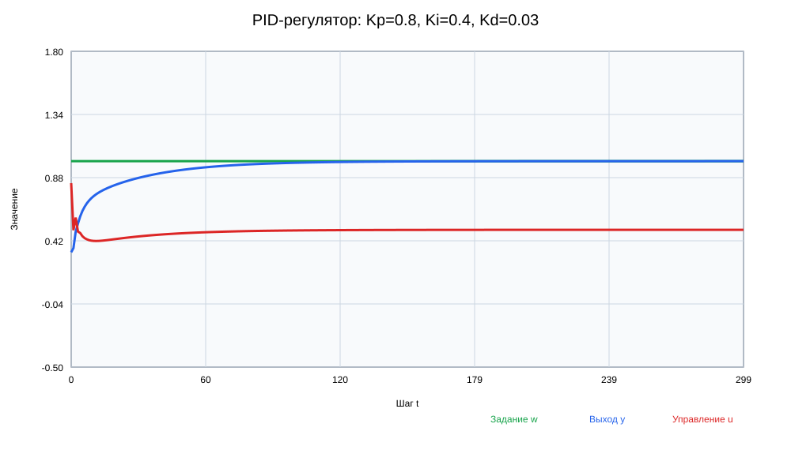
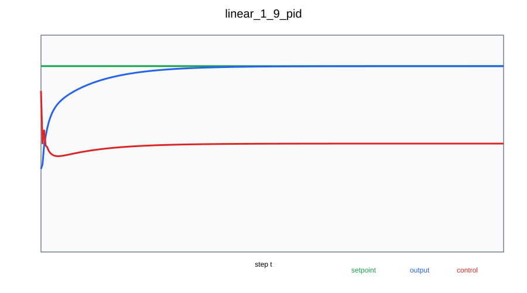
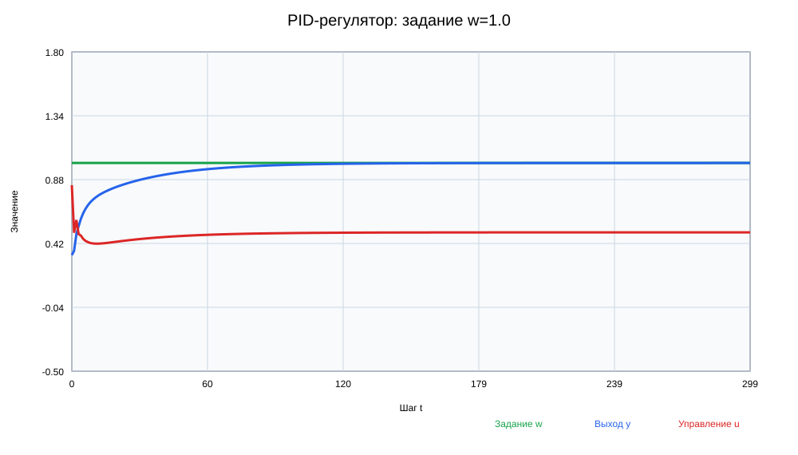
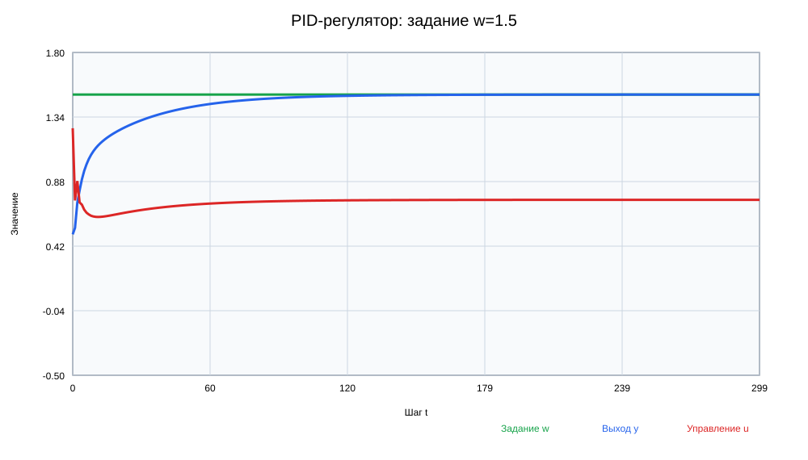

<p align="center">Министерство образования Республики Беларусь</p>
<p align="center">Учреждение образования</p>
<p align="center">«Брестский государственный технический университет»</p>
<p align="center">Кафедра интеллектуальных информационных технологий</p>
<br><br>
<p align="center"><b>Лабораторная работа № 3</b></p>
<p align="center">по дисциплине «Общая теория интеллектуальных систем»</p>
<p align="center">«ПИД-регулятор и автоматическое документирование»</p>
<br><br>
<p align="right">Выполнил: студент группы ИИ-29, № 25</p>
<p align="right">Тарабуко Вадим Леонидович</p>
<p align="right">Идентификатор: ii02925</p>
<p align="right">Проверил: Дворанинович Д. А.</p>
<br><br>
<p align="center">Брест 2026</p>

# Лабораторная работа № 3

**Вариант:** 9.
**Средства:** C++17, CMake, Google Test, Doxygen.

## 1. Цель работы

Создать замкнутую систему управления с дискретным ПИД-регулятором для трёх объектов из ЛР1. Добавить два режима моделирования, таблицу результатов, графики, тесты и документацию Doxygen.

## 2. Структура замкнутой системы

Заданное значение температуры `w(t)` сравнивается с выходом объекта `y(t)`:

`e(t) = w(t) - y(t)`.

Ошибка передаётся ПИД-регулятору. Он вычисляет управление `u(t)`, объект получает это управление и формирует новое значение `y(t)`. Новое значение снова возвращается на вход сравнения — это отрицательная обратная связь.

## 3. Дискретный ПИД-регулятор

В программе используется позиционная дискретная форма:

`u(t) = Kp*e(t) + Ki*sum(e(t)*dt) + Kd*(e(t)-e(t-1))/dt`.

- P-часть реагирует на текущую ошибку;
- I-часть накапливает ошибку и устраняет статическое отклонение;
- D-часть учитывает скорость изменения ошибки.

Пользователь вводит `Kp`, `Ki`, `Kd`, шаг `dt`, минимальное и максимальное управление. Если необработанное управление выходит за пределы, применяется ограничение. Интеграл не увеличивается дальше в сторону насыщения — это простой anti-windup.

## 4. Объекты управления и пользовательский ввод

Можно выбрать один объект варианта 9:

1. Model 1.9: `y(t+1)=a1*y(t)+a2*y(t-1)+a3*y(t-2)+b1*u(t)`;
2. Model 2.1: `y(t+1)=a*y(t)-b*y²(t-1)+c*u(t)+d*sin(u(t-1))`;
3. Model 3.3: `y(t+1)=y(t)+dt*(-a*y(t)+b*u(t))`.

Коэффициенты выбранного объекта вводятся пользователем. За один запуск рассчитывается только выбранный объект.

## 5. Объектно-ориентированное программирование

Абстрактный класс `Plant` задаёт общий интерфейс объекта управления:

- `update(u)` выполняет один шаг;
- `reset()` сбрасывает состояние;
- `output()` возвращает текущий выход;
- `name()` возвращает короткое имя.

Три класса-наследника реализуют формулы варианта. Коэффициенты передаются в конструкторы через структуры параметров. Класс `PIDController` хранит коэффициенты и внутреннее состояние регулятора. Функции `runFixed()` и `runUntilSettled()` принимают ссылку на общий интерфейс `Plant`, поэтому один алгоритм работает со всеми объектами.

## 6. UML-диаграмма



## 7. Режимы моделирования

Пользователь выбирает один режим:

1. **Режим А:** выполнить указанное количество шагов `n`.
2. **Режим Б:** выполнять расчёт, пока `|e(t)| <= epsilon` не сохранится пять шагов подряд.

Расчёт завершается после пяти последовательных шагов в заданном допуске. Если установившийся режим не достигнут, программа останавливается после 10000 шагов.

## 8. Табличный вывод и график

Порядок столбцов соответствует условию:

```text
t           w        e(t)        u(t)        y(t)
0      1.0000      0.6640      0.8400      0.3360
1      1.0000      0.6332      0.4970      0.3668
2      1.0000      0.5137      0.5892      0.4863
```

После расчёта программа строит и автоматически открывает график. В отчёте приведены графики настройки регулятора и работы с разными заданными значениями.

## 9. Настройка коэффициентов

Использован метод последовательного подбора для линейного объекта с параметрами `0.5`, `0.2`, `0.1`, `0.4`, заданием `w=1`, `dt=0.1` и пределами `[-5; 5]`.

### Шаг 1. P-регулятор

`Kp=0.8`, `Ki=0`, `Kd=0`. Система реагирует без колебаний, но остаётся статическая ошибка: после 300 шагов `y=0.615385`, `e=0.384615`.



### Шаг 2. PI-регулятор

Добавлено `Ki=0.4`. Интегральная часть постепенно устраняет остаточную ошибку: `y=0.999984`, `e=0.000016`.



### Шаг 3. PID-регулятор

Добавлено небольшое `Kd=0.03`, которое учитывает скорость изменения ошибки. Итоговый набор: `Kp=0.8`, `Ki=0.4`, `Kd=0.03`. После 300 шагов `y=0.999985`, `e=0.000015`.



| Настройка | Kp | Ki | Kd | Выход после 300 шагов | Ошибка |
|---|---:|---:|---:|---:|---:|
| P | 0.8 | 0 | 0 | 0.615385 | 0.384615 |
| PI | 0.8 | 0.4 | 0 | 0.999984 | 0.000016 |
| PID | 0.8 | 0.4 | 0.03 | 0.999985 | 0.000015 |

## 10. Разные заданные температуры

При одном наборе коэффициентов выполнены расчёты для трёх заданий:







Форма переходного процесса сохраняется, а установившийся выход соответствует заданному значению.

## 11. Модульные тесты

Google Test проверяет:

- первые шаги трёх объектов;
- использование введённых коэффициентов;
- отклонение неправильного `dt`;
- сброс объекта и ПИД-регулятора;
- P-часть и ограничение управления с двух сторон;
- отклонение неправильных настроек ПИД;
- оба режима моделирования;
- неверные параметры режимов;
- значения строки таблицы `t, w, e, u, y`.

Фактический результат: **14 / 14 тестов пройдено**.

## 12. Doxygen

Для классов и функций добавлены комментарии Doxygen. HTML-документация успешно сгенерирована и приложена к работе.

## 13. Сборка и запуск

На Windows запускается `run_all.bat`. Скрипт выполняет сборку, 14 тестов и генерацию Doxygen.

Ручные команды:

```text
cmake -S . -B build -DBUILD_TESTING=ON
cmake --build build --config Debug
ctest --test-dir build -C Debug --output-on-failure
doxygen Doxyfile
```

После этого запускается `lab3`, вводятся коэффициенты объекта, ПИД-регулятора, задание и режим.

## 14. Вывод

Программа управляет тремя объектами варианта 9 с помощью ПИД-регулятора. Пользователь вводит коэффициенты, выбирает объект и режим расчёта. Результаты выводятся в порядке `t, w, e, u, y` и отображаются на графике. Все 14 тестов проходят успешно, документация Doxygen сформирована.
