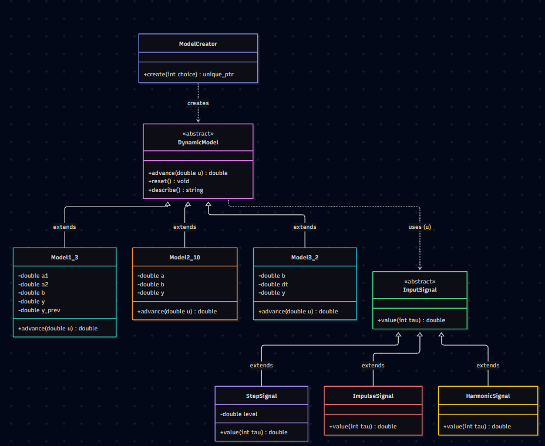
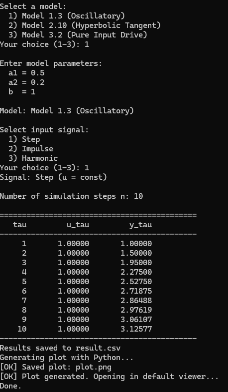
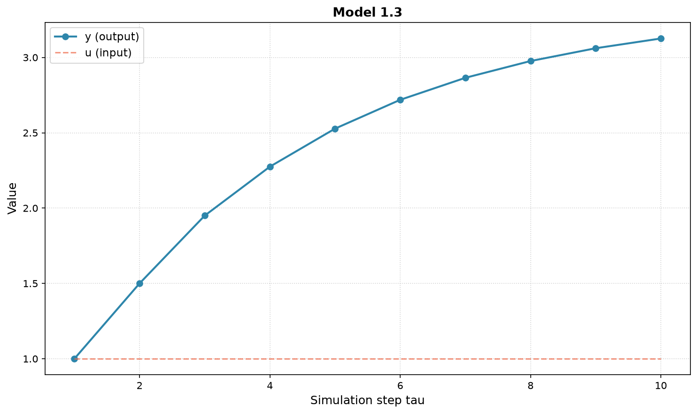
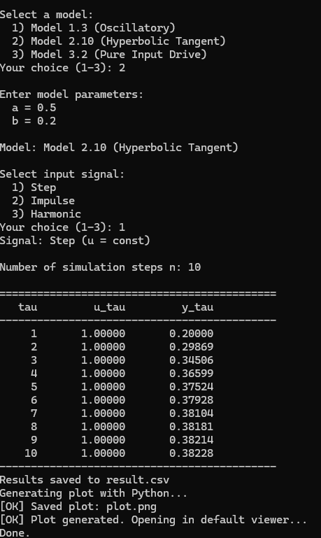
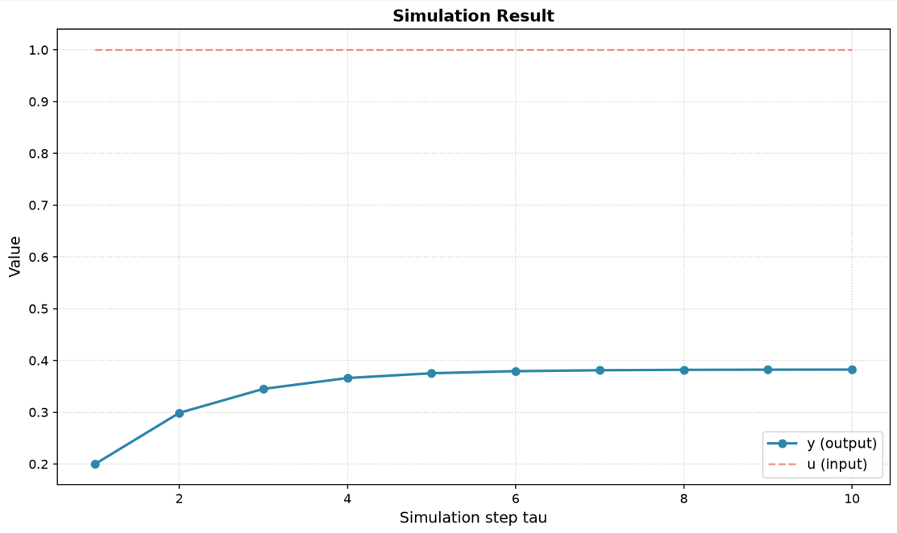
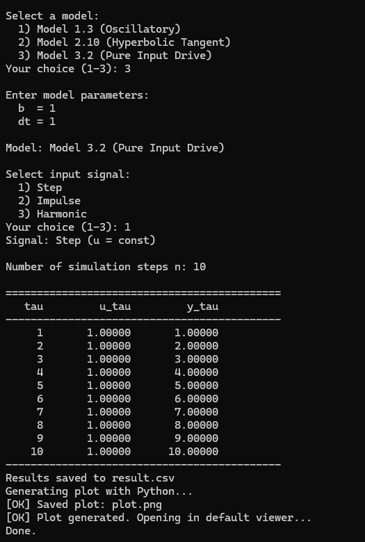
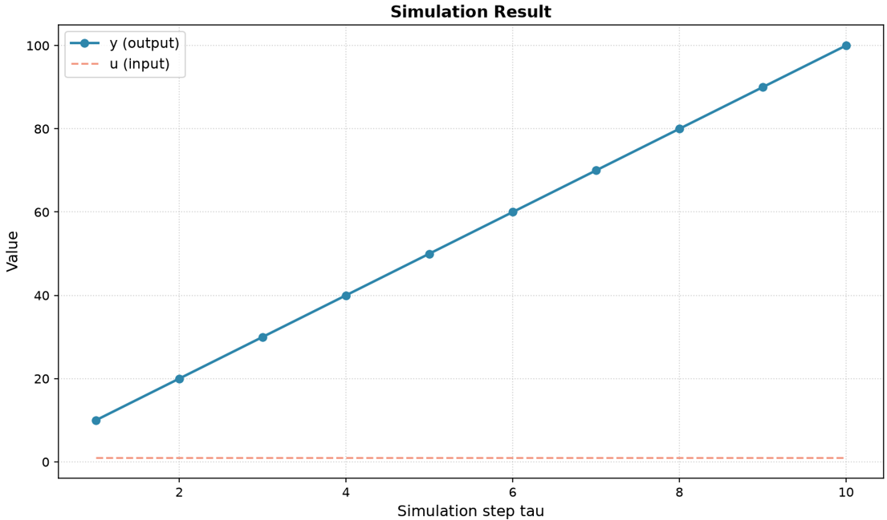

Министерство образования Республики Беларусь

Учреждение образования

«Брестский государственный технический университет»

Кафедра ИИТ

       

Лабораторная работа №1

По дисциплине «Общая теория интеллектуальных систем»

Тема: «Моделирование управляемого объекта»

     

Выполнил:

Студент 2 курса

Группы ИИ-29

Ярмоцик И.П.

Проверил:

Дворанинович Д.А.

     

Брест 2026

---

## 1. Цель работы

Изучить методы математического моделирования управляемых объектов. Реализовать на языке C++ программу, моделирующую поведение трёх типов систем (Model 1.3, 2.10, 3.2), с возможностью задания количества шагов, типа входного сигнала и анализа устойчивости.

## 2. Постановка задачи

Согласно варианту 6, реализуются следующие модели:

| Блок | Модель | Название |
|:---:|:---:|---|
| 1 | **Model 1.3** | Oscillatory System |
| 2 | **Model 2.10** | Hyperbolic Tangent System |
| 3 | **Model 3.2** | Pure Constant Input Drive |
**Требования к программе**
1. Реализация на C++ с использованием принципов ООП (наличие абстрактного базового класса `DynamicModel`).
2. Поддержка трёх типов входных воздействий (Step, Impulse, Harmonic).
3. Вывод результатов в консоль и в CSV-файл.
4. Визуализация результатов с помощью Python и Matplotlib.
5. Сборка проекта через CMake с автоматизацией через `.bat`-файл.

##3. UML-диаграмма классов

Архитектура программы построена на основе абстрактного базового класса DynamicModel, который задает интерфейс для всех математических моделей. Конкретные реализации (Model1_3, Model2_10, Model3_2) наследуют его. Входные сигналы реализованы через иерархию классов InputSignal.

*Рис. 1. UML-диаграмма классов*

**4. Математическое описание моделей**

###4.1. Model 1.3 — Oscillatory System
**Формула:** 
y_{\tau+1} = a_1 \cdot y_\tau + a_2 \cdot y_{\tau-1} + b \cdot u_\tau

**Физический смысл:** Линейная дискретная система второго порядка. Текущее состояние зависит от предыдущего (память) и от входа. Используется для описания колебательных процессов. Для реализации требуется хранить в памяти предыдущее значение y (переменная y_prev).*

###4.2. Model 2.10 — Hyperbolic Tangent Smoothing
**Формула:**
y_{\tau+1} = a \cdot \tanh(y_\tau) + b \cdot u_\tau^3
**Физический смысл:** Нелинейная модель. Функция \tanh (гиперболический тангенс) ограничивает рост состояния (эффект насыщения). Вход возводится в куб, что делает реакцию системы более резкой при больших значениях u.*

###4.3. Model 3.2 — Pure Constant Input Drive

**Формула (дифференциальное уравнение):** 
\frac{dy}{dt} = b \cdot u

**Метод Эйлера для дискретизации:** y_{\tau+1} = y_\tau + \Delta t \cdot (b \cdot u_\tau)
**Физический смысл:** Модель чистого интегрирования (накопления). Система просто суммирует входной сигнал с течением времени.

##5. Результаты симуляции

В ходе работы были проведены симуляции для каждой модели. Ниже представлены скриншоты консольного вывода и графики, построенные с помощью Python (Matplotlib).
5.1. Model 1.3 (Oscillatory)

Скриншот вывода программы: 
 
График переходного процесса: 

5.2. Model 2.10 (Hyperbolic Tangent)
 
График переходного процесса: 

5.3. Model 3.2 (Pure Input Drive)
 
График переходного процесса: 

##6. Выводы

В ходе выполнения лабораторной работы были успешно реализованы три математические модели на языке C++. Была спроектирована объектно-ориентированная архитектура с абстрактным базовым классом, что позволило избежать дублирования кода. Освоена сборка проекта через CMake и автоматизация через .bat-файл. Для визуализации данных был написан скрипт на Python, который наглядно демонстрирует переходные процессы систем. Цель работы достигнута в полном объеме.