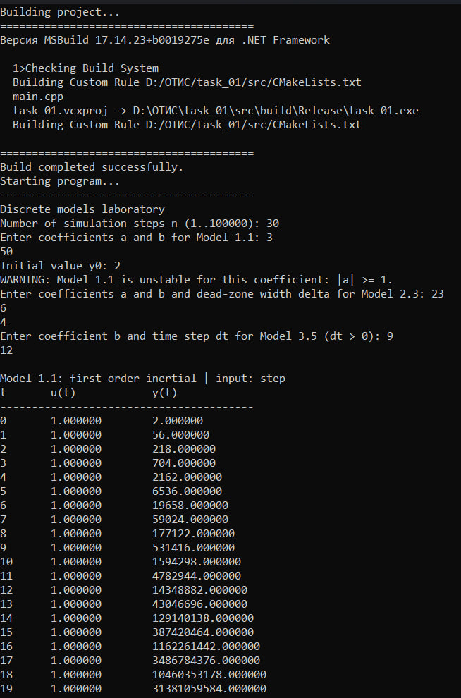
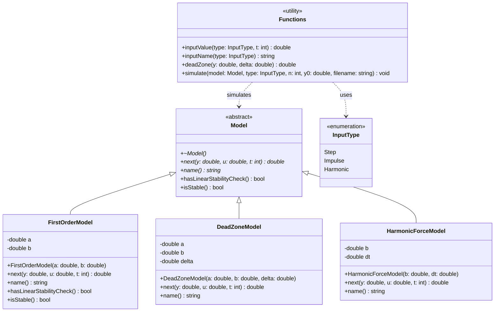

<p align="center">Министерство образования Республики Беларусь</p>
<p align="center">Учреждение образования</p>
<p align="center">«Брестский государственный технический университет»</p>
<p align="center">Кафедра ИИТ</p>
<br><br><br><br><br>
<p align="center"><b>Лабораторная работа №1</b></p>
<p align="center"><b>По дисциплине: «Общая теория интеллектуальных систем»</b></p>
<p align="center"><b>Тема: «Моделирование динамических систем»</b></p>
<br><br><br><br>
<p align="right">Выполнил:</p>
<p align="right">Студент 2 курса</p>
<p align="right">Группы ИИ30</p>
<p align="right">Богдан Н.С.</p>
<p align="right">Проверил:</p>
<p align="right">Дворанинович Д. А.</p>
<br><br><br><br>
<p align="center">Брест 2026</p>

---

## Вариант 1

- Линейная модель: **Model 1.1**
- Нелинейная модель: **Model 2.3**
- Дифференциальное уравнение: **Model 3.5**

## Реализованные модели

| Блок | Модель | Тип | Название | Класс | Уравнение |
|:--:|:--:|:--:|---|---|---|
| 1 | 1.1 | линейная дискретная | First-order inertial | `FirstOrderModel` | `y(t+1) = a·y(t) + b·u(t)` |
| 2 | 2.3 | нелинейная дискретная | Dead zone | `DeadZoneModel` | `y(t+1) = a·y(t) + b·DZ(y(t), δ)` |
| 3 | 3.5 | дифференциальное уравнение | Harmonic driving force | `HarmonicForceModel` | `dy/dt = b·sin(t)` |

### Model 1.1 — инерционное звено первого порядка

`y(t+1) = a·y(t) + b·u(t)`

Для линейной модели реализована проверка устойчивости: система устойчива при `|a| < 1`. Если условие не выполняется, программа выводит предупреждение.

### Model 2.3 — зона нечувствительности

`y(t+1) = a·y(t) + b·DZ(y(t), δ)`, где функция зоны нечувствительности:

```
DZ(y, δ) = y − δ,   если y > δ
DZ(y, δ) = y + δ,   если y < −δ
DZ(y, δ) = 0,       если |y| ≤ δ
```

### Model 3.5 — гармоническая вынуждающая сила

Дифференциальное уравнение `dy/dt = b·sin(t)` решается методом Эйлера с шагом `dt`:

`y(t+1) = y(t) + dt · b · sin(t·dt)`

> **Примечание.** В моделях 2.3 и 3.5 входное воздействие `u(t)` в правой части уравнения не используется (у Model 2.3 нелинейность зависит от `y`, у Model 3.5 внешняя сила задана самим уравнением). Поэтому графики `y(t)` для этих моделей при разных типах входа совпадают; `u(t)` при этом всё равно записывается в CSV.

## Входные воздействия

1. Ступенчатое: `u(t) = 1`
2. Импульсное: `u(0) = 1`, `u(t > 0) = 0`
3. Гармоническое: `u(t) = sin(t)`

## ООП

Создан абстрактный базовый класс `Model` с чисто виртуальными методами:

- `double next(double y, double u, int t) const` — вычисление следующего значения выхода;
- `string name() const` — название модели.

Также в базовом классе есть виртуальные методы `hasLinearStabilityCheck()` и `isStable()` (по умолчанию — проверка отсутствует, модель считается устойчивой).

От него наследуются классы конкретных моделей:
- `FirstOrderModel`
- `DeadZoneModel`
- `HarmonicForceModel`

Входные сигналы задаются перечислением `InputType { Step, Impulse, Harmonic }` и функцией `inputValue(type, t)`. Функция `simulate(...)` выполняет моделирование и сохраняет результат в CSV.

## Результат

Программа:
- моделирует все три системы варианта;
- симулирует отклик каждой модели на все три типа входных воздействий (ступенчатое, импульсное, гармоническое), всего 9 экспериментов;
- позволяет задать количество шагов `n` (1…100000) и параметры моделей;
- выводит результаты в табличном виде (`t`, `u(t)`, `y(t)`);
- сохраняет результаты в 9 CSV-файлов формата `t,u,y`;
- визуализирует графики через Python/Matplotlib (`plot_results.py`).

### Вводимые параметры

| Параметр | Описание |
|---|---|
| `n` | число шагов моделирования (1…100000) |
| `a`, `b`, `y0` | коэффициенты Model 1.1 и начальное значение `y0` (общее для всех моделей) |
| `a`, `b`, `delta` | коэффициенты Model 2.3 и ширина зоны нечувствительности `δ ≥ 0` |
| `b`, `dt` | коэффициент и шаг интегрирования Model 3.5 (`dt > 0`) |

### Выходные файлы

| Модель | Ступенчатое | Импульсное | Гармоническое |
|---|---|---|---|
| Model 1.1 | `model11_step.csv` | `model11_impulse.csv` | `model11_harmonic.csv` |
| Model 2.3 | `model23_step.csv` | `model23_impulse.csv` | `model23_harmonic.csv` |
| Model 3.5 | `model35_step.csv` | `model35_impulse.csv` | `model35_harmonic.csv` |

Для каждого CSV-файла `plot_results.py` строит и сохраняет график `y(t)` в одноимённый `.png`.

## Пример работы программы

### Сборка и запуск

Проект собирается через CMake (`CMakeLists.txt`, стандарт C++17, исполняемый файл `task_01`). Сборка и запуск автоматизированы файлом `build.bat`, который последовательно:

1. Ищет CMake (в `PATH`, затем в `Program Files`, `Program Files (x86)` и `%LocalAppData%\Programs`).
2. Конфигурирует проект: `cmake -S . -B build`.
3. Собирает его в конфигурации Release: `cmake --build build --config Release`.
4. Запускает `build\Release\task_01.exe` (или `build\task_01.exe`).
5. Проверяет наличие Python (`python` или `py -3`), при необходимости устанавливает `matplotlib` и запускает `plot_results.py`.

Для сборки необходимы CMake и Visual Studio Build Tools с компонентом «Desktop development with C++». Для построения графиков — Python 3.

Запуск:

```bat
build.bat
```

### Демонстрация исполняемого файла task_01.exe:



После работы программы в каталоге создаются CSV-файлы, после чего запускается `plot_results.py` для визуализации ответа.

### Графики переходных процессов Model 1.1 (First-order inertial)


### Графики переходных процессов Model 2.3 (Dead zone)


### Графики переходных процессов Model 3.5 (Harmonic driving force)


## UML Диаграмма классов


 