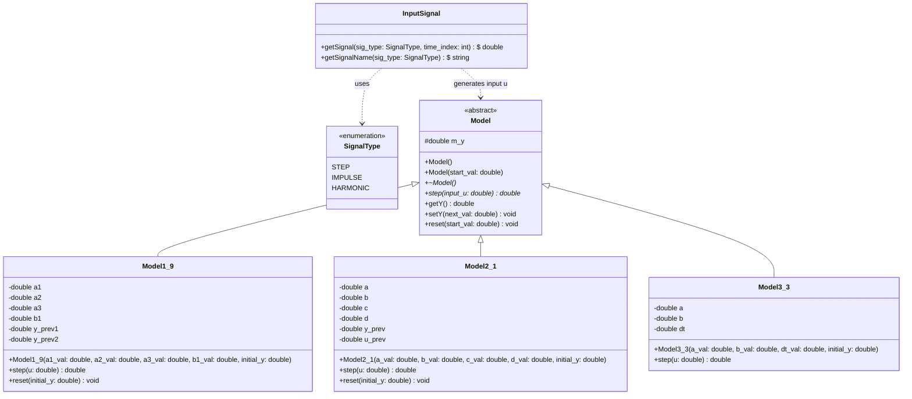
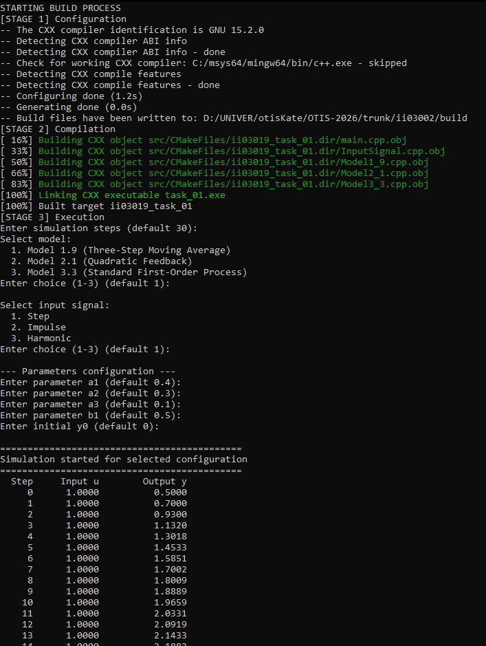
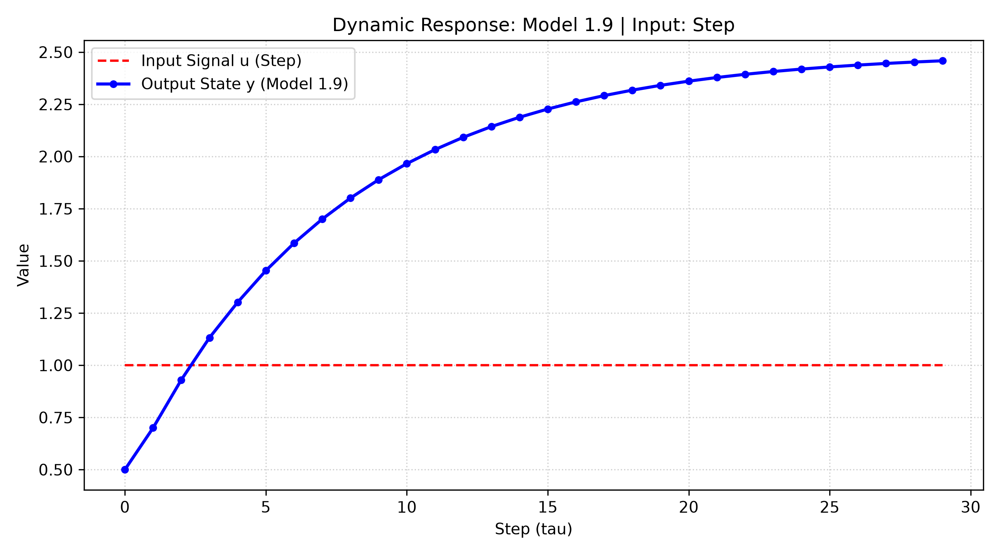

<p align="center">Министерство образования Республики Беларусь</p>
<p align="center">Учреждение образования</p>
<p align="center">«Брестский государственный технический университет»</p>
<p align="center">Кафедра ИИТ</p>
<br><br><br><br><br>
<p align="center"><b>Лабораторная работа №1</b></p>
<p align="center"><b>По дисциплине: «Общая теория интеллектуальных систем»</b></p>
<p align="center"><b>Тема: «Моделирование динамических систем»</b></p>
<br><br><br><br>
<p align="right">Выполнил:</p>
<p align="right">Студент 2 курса</p>
<p align="right">Группы ИИ-30</p>
<p align="right">Бычковская Е. А.</p>
<p align="right">Проверил:</p>
<p align="right">Дворанинович Д. А.</p>
<br><br><br><br>
<p align="center">Брест 2026</p>

---

## Вариант 9

- Линейная модель: **Model 1.9**
- Нелинейная модель: **Model 2.1**
- Дифференциальное уравнение: **Model 3.3**

## Реализованные модели

| Блок | Модель | Тип | Название |
|:--:|:--:|:--:|---|
| 1 | 1.9 | линейная дискретная | Three-Step Moving Average State Model |
| 2 | 2.1 | нелинейная дискретная | Quadratic Feedback and Harmonic Control |
| 3 | 3.3 | дифференциальное уравнение | Standard First-Order Process |

## Входные воздействия

1. Ступенчатое: `u(t) = A`
2. Импульсное: `u(0) = A`, `u(t > 0) = 0`
3. Гармоническое: `u(t) = A * sin(t)`

## ООП

Создан абстрактный базовый класс `Model` с чисто виртуальным методом `step(double u)`.

От него наследуются классы конкретных моделей:
- `Model1_1`
- `Model2_5`
- `Model3_9`

## ООП Архитектура

Создан базовый полиморфный класс `Model` с виртуальным методом перехода к следующему состоянию `step(double u)`.

От него наследуются конкретные классы моделей:
- `Model1_9` — дискретная модель с памятью на три предыдущих такта;
- `Model2_1` — нелинейная авторегрессионная модель со смешанной квадратичной и гармонической обратной связью;
- `Model3_3` — динамическая система первого порядка, решаемая методом численного интегрирования Эйлера.

Для генерации тестовых сигналов реализован отдельный класс `InputSignal`.

## UML Диаграмма классов



## Пример работы программы

### Сборка и запуск

Сборка осуществляется с помощью файла `build.bat`:

```bat
@echo off
setlocal
chcp 65001 >nul

if not exist "%~dp0CMakeLists.txt" (
    echo ERROR: CMakeLists.txt not found in this folder
    pause
    exit /b 1
)

cd /d "%~dp0"

echo STARTING BUILD PROCESS

echo [STAGE 1] Configuration
cmake -S . -B build -G "MinGW Makefiles"
if errorlevel 1 goto error

echo [STAGE 2] Compilation
cmake --build build
if errorlevel 1 goto error

echo [STAGE 3] Execution
if exist "build\src\ii03002_task_01.exe" (
    "build\src\ii03002_task_01.exe"
) else if exist "build\src\ii03019_task_01.exe" (
    "build\src\ii03019_task_01.exe"
) else if exist "build\src\task_01.exe" (
    "build\src\task_01.exe"
) else if exist "build\task_01.exe" (
    "build\task_01.exe"
) else (
    echo WARNING: Executable not found in standard paths
)
if errorlevel 1 goto error

echo [STAGE 4] Plotting
python src\plot.py 2>nul || py src\plot.py
if errorlevel 1 goto error

echo SUCCESS: Build completed successfully
pause
goto end

:error
echo ERROR: Build failed
pause
exit /b 1

:end
endlocal
```

После сборки исполняемый файл запускается автоматически либо вручную из каталога `build/src`.

### Демонстрация исполняемого файла task_01.exe:



При запуске исполняемого файла мы получаем результат `results.csv`, после чего автоматически запускается `src/plot.py` для визуализации ответа:

### Пример графика переходных процессов


## Вывод

В ходе лабораторной работы разработано программное решение, реализующее:
- расчёт отклика трёх динамических систем;
- симуляцию поведения под действием ступенчатого, импульсного и гармонического сигналов;
- параметрическую настройку количества тактов симуляции $n$;
- форматированный вывод расчётных данных в терминал и их экспорт в `results.csv`;
- автоматическое построение графиков переходных процессов средствами Python (`matplotlib`).
