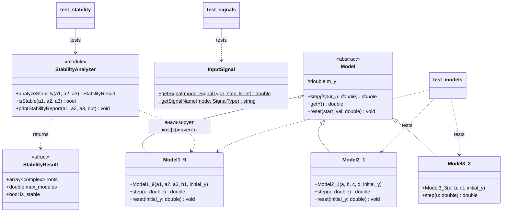
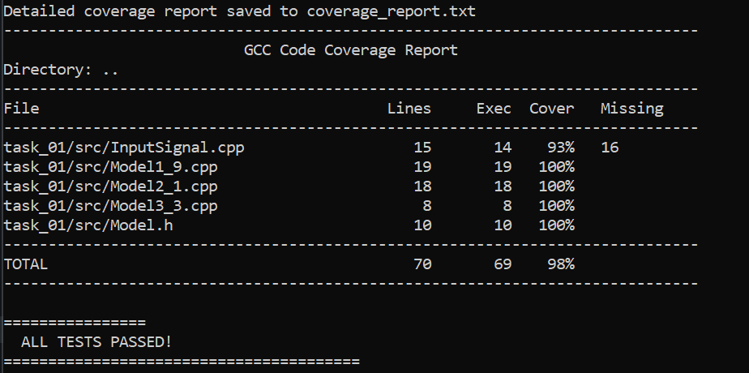

<p align="center">Министерство образования Республики Беларусь</p>
<p align="center">Учреждение образования</p>
<p align="center">«Брестский государственный технический университет»</p>
<p align="center">Кафедра ИИТ</p>
<br><br><br><br><br>
<p align="center"><b>Лабораторная работа №2</b></p>
<p align="center"><b>По дисциплине: «Общая теория интеллектуальных систем»</b></p>
<p align="center"><b>Тема: «Модульное тестирование и анализ устойчивости»</b></p>
<br><br><br><br>
<p align="right">Выполнил:</p>
<p align="right">Студент 2 курса</p>
<p align="right">Группы ИИ-30</p>
<p align="right">Бычковская Е. А.</p>
<p align="right">Проверил:</p>
<p align="right">Дворанинович Д. А.</p>
<br><br><br><br>
<p align="center">Брест 2026</p>

---

## Вариант 9

Используются модели из лабораторной работы №1:

- Линейная модель: **Model 1.9**
- Нелинейная модель: **Model 2.1**
- Дифференциальное уравнение: **Model 3.3**

## Задание

1. Покрыть модульными тестами (Google Test) модели и генератор входных сигналов из лабораторной работы №1.
2. Реализовать анализ устойчивости линейной модели Model 1.9 по корням характеристического уравнения.
3. Измерить покрытие кода тестами.

## Реализованные компоненты

| Компонент | Файл | Назначение |
|:--:|---|---|
| Модели и сигналы | `task_01/src/*` | Используются напрямую, без копирования |
| Анализатор устойчивости | `task_02/src/StabilityAnalyzer.h` | Корни характеристического полинома, вердикт, отчёт |
| Консольное приложение | `task_02/src/main.cpp` | Симуляция + проверка устойчивости до запуска |
| Тесты моделей | `task_02/test/test_models.cpp` | Model 1.9, 2.1, 3.3 |
| Тесты сигналов | `task_02/test/test_signals.cpp` | Ступенька, импульс, гармоника |
| Тесты устойчивости | `task_02/test/test_stability.cpp` | Устойчивые, неустойчивые и граничные случаи |


## Анализ устойчивости Model 1.9

Рекуррентное уравнение модели:

$$y_{k+1} = a_1 y_k + a_2 y_{k-1} + a_3 y_{k-2} + b_1 u_k$$

Для свободного движения ($u = 0$) ищем решение в виде $y_k = z^k$ и получаем характеристическое уравнение:

$$z^3 - a_1 z^2 - a_2 z - a_3 = 0$$

Система асимптотически устойчива, если все корни лежат строго внутри единичной окружности:

$$\max_i |z_i| < 1$$

Корни кубического многочлена вычисляются методом Дурана–Кернера. Граничный случай $|z| = 1$
считается неустойчивым (асимптотического затухания нет). При нечисловых коэффициентах
(`NaN`, `inf`) система также считается неустойчивой.

## ООП Архитектура

Классы моделей остаются теми же, что в лабораторной работе №1 (`Model` → `Model1_9`, `Model2_1`, `Model3_3`).
Анализ устойчивости вынесен в отдельный модуль без состояния — набор свободных функций и структура результата:

- `StabilityResult` — корни, максимальный модуль, признак устойчивости;
- `analyzeStability(a1, a2, a3)` — полный анализ;
- `isStable(a1, a2, a3)` — только вердикт;
- `printStabilityReport(a1, a2, a3, out)` — текстовый отчёт с предупреждением `WARNING`.

## UML Диаграмма классов



## Структура проекта

```text
task_02/
├── CMakeLists.txt
├── run_tests.bat
├── doc/
│   └── readme.md
├── src/
│   ├── CMakeLists.txt
│   ├── main.cpp
│   └── StabilityAnalyzer.h
└── test/
    ├── CMakeLists.txt
    ├── test_models.cpp
    ├── test_signals.cpp
    └── test_stability.cpp
```

## Пример работы программы

### Сборка и запуск тестов

Сборка и запуск тестов осуществляются с помощью файла `run_tests.bat` (из каталога `task_02`):

```bat
run_tests.bat
```

Скрипт выполняет этапы:

1. поиск компилятора MinGW GCC, `make` и `cmake`;
2. конфигурация CMake (`-G "MinGW Makefiles"`, `-DENABLE_COVERAGE=ON`); при первой сборке Google Test загружается из интернета;
3. компиляция (`cmake --build build --parallel`);
4. запуск `ctest --output-on-failure` с сохранением вывода в `test_report.txt`;
5. построение отчёта покрытия `gcovr` в `coverage_report.txt` (если установлен: `py -m pip install gcovr`).

### Демонстрация исполняемого файла ii03002_task_02.exe

Устойчивые коэффициенты (`a1 = 0.4, a2 = 0.3, a3 = 0.1, b1 = 0.5`, ступенчатый сигнал):

```text
Stability check: z^3 - (0.4)*z^2 - (0.3)*z - (0.1) = 0
  Roots: (0.874095,0) (-0.237047,0.241273) (-0.237047,-0.241273)
  Maximum root modulus: 0.874095
  System is STABLE (all roots are inside the unit circle).

step,u,y
0,1,0.5
1,1,0.7
2,1,0.93
3,1,1.132
4,1,1.3018
5,1,1.45332
6,1,1.58507
7,1,1.7002
```

Неустойчивые коэффициенты (`a1 = 1.4, a2 = 0.2, a3 = 0.1, b1 = 0.5`):

```text
Stability check: z^3 - (1.4)*z^2 - (0.2)*z - (0.1) = 0
  Roots: (1.5682,-6.84228e-49) (-0.0840989,0.238107) (-0.0840989,-0.238107)
  Maximum root modulus: 1.5682
  WARNING: system is UNSTABLE or marginally stable (a root is on/outside the unit circle).
```

## Тестирование

Используется Google Test. Всего зарегистрировано **25** тестов (с учётом параметризованных экземпляров `TEST_P`).

| Набор | Файл | Тестов | Что проверяется |
|---|---|:--:|---|
| Model 1.9 | `test_models.cpp` | 4 | Три траектории (`TEST_P`): ступенька, импульс, нулевой вход; сброс всех задержанных состояний |
| Model 2.1 | `test_models.cpp` | 3 | Ручные значения и задержанный вход; покой при нулевом входе; сброс состояния |
| Model 3.3 | `test_models.cpp` | 4 | Один и несколько шагов Эйлера; инвариант покоя; сходимость к аналитическому решению |
| InputSignal | `test_signals.cpp` | 4 | Ступенчатый, импульсный, гармонический сигналы; названия сигналов, включая `Unknown` |
| Устойчивость | `test_stability.cpp` | 10 | 6 параметризованных случаев (внутри, вне, на границе круга); текст предупреждения; нечисловые коэффициенты |

Входные сигналы подставляются фиксированными последовательностями прямо в тестах (stub-подход).
Отдельные mock-объекты не нужны: модели не имеют внешних зависимостей и принимают вход аргументом `step(u)`.

### Результаты тестов

Проверка всех 25 тестовых сценариев выполнена автоматически ожидаемые значения и вердикты
совпали с расчётом во всех случаях


## Вывод

В ходе лабораторной работы разработано программное решение, реализующее:
- модульные тесты (Google Test) для моделей 1.9, 2.1, 3.3 и генератора входных сигналов;
- анализ устойчивости Model 1.9 по корням характеристического уравнения (метод Дурана–Кернера) с предупреждением о неустойчивых и граничных параметрах;
- автоматическую сборку, запуск тестов и измерение покрытия средствами `run_tests.bat`, CMake и `gcovr`;
