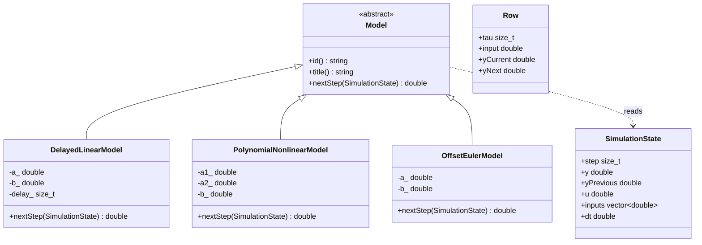
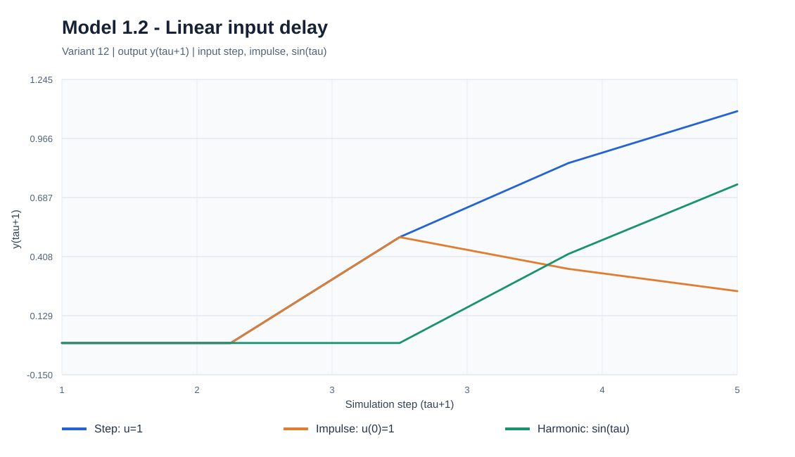
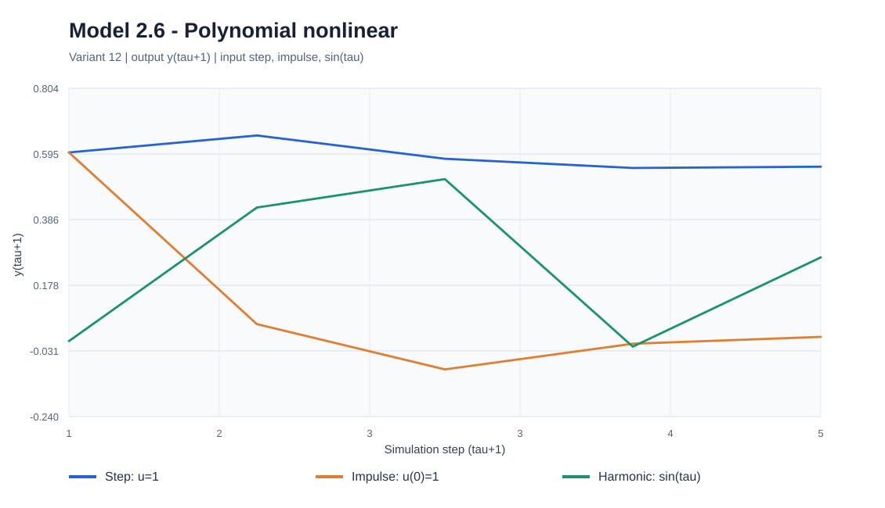
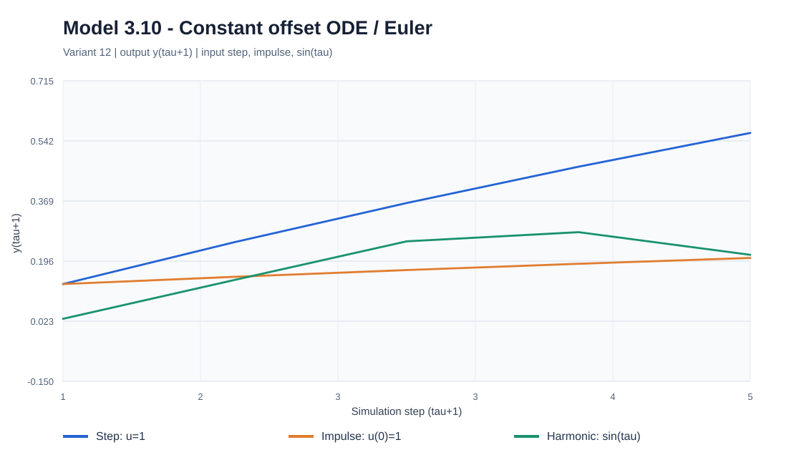

<p align="center">Министерство образования Республики Беларусь</p>
<p align="center">Учреждение образования «Брестский государственный технический университет»</p>
<p align="center">Кафедра ИИТ</p>

<br>

<p align="center"><b>ОТЧЁТ ПО ЛАБОРАТОРНОЙ РАБОТЕ № 1</b></p>
<p align="center">по дисциплине «Общая теория интеллектуальных систем»</p>
<p align="center"><b>Моделирование динамических систем</b></p>
<p align="center"><b>Вариант 12</b></p>
<p align="center">Каталог студента: ii03003</p>

<br>

<p align="right">Выполнил: Гаврилкович М. В.</p>
<p align="right">Группа: ии-30</p>
<p align="right">Проверил: Дворанинович Д. А.</p>

<p align="center">Брест, 2026</p>

---

## 1. Цель работы

Изучить моделирование дискретных линейных, нелинейных и непрерывных динамических систем на C++; закрепить объектно-ориентированное программирование, сборку CMake и систему управления версиями Git. Реализовать расчёт заданного числа шагов для трёх входных воздействий, табличный вывод, экспорт CSV и визуализацию результатов.

## 2. Задание и исходные данные

По таблице вариантов лабораторной работы № 1 выбран **вариант 12**, содержащий модели **1.2**, **2.6** и **3.10**. Для каждой модели исследуются три входных сигнала:

* ступенчатое (постоянное) воздействие: $u_\tau=1$;
* единичный импульс: $u_0=1$, $u_\tau=0$ при $\tau>0$;
* гармоническое воздействие: $u_\tau=\sin(\tau)$ (аргумент в радианах).

Начальные значения: $y_0=0$; для нелинейной модели, использующей историю, $y_{-1}=0$; значения входа при отрицательных индексах равны нулю. Количество шагов $n$ настраивается пользователем. В приведённых ниже контрольных таблицах $n=5$, шаг интегрирования $\Delta t=0.1$.

### 2.1. Линейная модель 1.2: запаздывание управляющего сигнала

$$y_{\tau+1}=a y_\tau+b u_{\tau-k},\qquad k\ge1.$$

Для эксперимента выбраны $a=0.7$, $b=0.5$, $k=2$. Это означает, что воздействие на текущий выход появляется с задержкой в два шага. Если $\tau<k$, используется $u_{\tau-k}=0$.

### 2.2. Нелинейная модель 2.6: полиномиальная зависимость

$$y_{\tau+1}=a_1 y_\tau^3-a_2 y_{\tau-1}+b u_\tau^2.$$

Коэффициенты: $a_1=0.25$, $a_2=0.15$, $b=0.6$. Кубическая степень состояния и квадрат управляющего сигнала делают систему нелинейной. Для расчёта требуется хранить текущее и предыдущее состояния.

### 2.3. Дифференциальная модель 3.10: внешний постоянный сдвиг

$$\frac{dy}{dt}=-ay+b+u.$$

Для численного решения применяется **явный метод Эйлера**:

$$y_{\tau+1}=y_\tau+\Delta t\left(-ay_\tau+b+u_\tau\right).$$

Параметры: $a=0.7$, $b=0.3$, $\Delta t=0.1$. Отличие от линейной дискретной модели состоит в предварительном вычислении производной и прибавлении её изменения за шаг $\Delta t$.

## 3. Архитектура и реализация программы

Реализация построена на абстрактном базовом классе `Model`, объявляющем виртуальный метод `nextStep`, который вычисляет $y_{\tau+1}$ по структуре `SimulationState` (текущее и предыдущее состояния, вход, история входов и шаг времени). Наследники реализуют соответствующие уравнения:

* `DelayedLinearModel` — линейная модель 1.2;
* `PolynomialNonlinearModel` — нелинейная модель 2.6;
* `OffsetEulerModel` — дифференциальная модель 3.10.

Программа использует **многомодульную архитектуру**: `models.cpp` содержит формулы, `simulation.cpp` отвечает за последовательность вычислений и вывод результатов, а `main.cpp` обрабатывает аргументы командной строки, показывает меню выбора модели и открывает график. Тип входного воздействия выбирается через перечисление `InputType`; функция `inputAt` формирует значения $u_\tau$.

### 3.1. UML-диаграмма классов



Диаграмма также приложена как [`../src/uml.puml`](../src/uml.puml) и [`../src/uml.svg`](../src/uml.svg).

### 3.2. Порядок выполнения моделирования

1. Программа обрабатывает число шагов `--steps`, шаг интегрирования `--dt`, параметры моделей и путь вывода `--out`.
2. Создаются три экземпляра классов-наследников `Model`; затем появляется **меню выбора одной модели** (`1`, `2` или `3`, выход — `0`).
3. Только для **выбранной** модели рассчитываются отклики на постоянный, импульсный и гармонический сигналы.
4. На каждом шаге определяется вход $u_\tau$ и вычисляется следующее состояние $y_{\tau+1}$.
5. **Полные таблицы выбранной модели** выводятся в консоль и сохраняются в три CSV-файла.
6. По трём сериям отклика выбранной модели формируется один SVG-график, который программа **сразу открывает в Windows** через приложение по умолчанию.
7. После расчёта меню появляется снова: можно выбрать следующую модель либо завершить программу.

## 4. Сборка и запуск

Проект использует язык **C++17**, компилятор G++ (или совместимый компилятор C++), систему сборки **CMake**, генератор **Ninja** и файл автоматической сборки `build.bat`.

На Windows достаточно открыть папку `src` и выполнить в командной строке:

```bat
build.bat
```

При запуске `build.bat` автоматически выполняются настройка CMake, сборка и тесты CTest; затем пользователь **выбирает модель в консольном меню**. Программа выводит только выбранную модель и сразу открывает её SVG-график в Windows. При выборе другой модели расчёт повторяется. При необходимости можно задать число шагов и шаг метода Эйлера:

```bat
build.bat 40 0.1
```

Либо запускать вручную (из каталога `src`, в PowerShell):

```powershell
cmake -S . -B build -G Ninja
cmake --build build
ctest --test-dir build --output-on-failure
.\build\lab1.exe --steps 5 --dt 0.1 --out results
```

Если запуск произведён с другим генератором CMake, путь к исполняемому файлу может отличаться. Файл `build.bat` предназначен для Windows и требует, чтобы команды `cmake`, `ninja`, `g++` были доступны через `PATH`.

## 5. Результаты вычислительного эксперимента

Для ручной проверки использованы параметры раздела 2 и число шагов $n=5$; в таблице приведено **конечное состояние $y_5$**. Все значения получены выполнением программы и чтением её CSV-файлов.

| Модель | Постоянный вход | Импульс | Гармонический вход |
|---|---:|---:|---:|
| 1.2 — с задержкой | 1.095000 | 0.245000 | 0.749164 |
| 2.6 — полиномиальная | 0.554754 | 0.013494 | 0.266359 |
| 3.10 — метод Эйлера | 0.565150 | 0.205224 | 0.214193 |

### 5.1. Контроль первых шагов модели 1.2 при постоянном входе

| $\tau$ | $u_\tau$ | $y_\tau$ | $y_{\tau+1}$ |
|---:|---:|---:|---:|
| 0 | 1 | 0.000000 | 0.000000 |
| 1 | 1 | 0.000000 | 0.000000 |
| 2 | 1 | 0.000000 | 0.500000 |
| 3 | 1 | 0.500000 | 0.850000 |
| 4 | 1 | 0.850000 | 1.095000 |

Сигнал не влияет на выход на первых двух шагах из-за $k=2$. На шаге $\tau=2$ используется $u_0=1$, поэтому $y_3=0.7\cdot0+0.5\cdot1=0.5$.

### 5.2. Контроль первых шагов модели 2.6 при постоянном входе

| $\tau$ | $y_\tau$ | $y_{\tau+1}$ |
|---:|---:|---:|
| 0 | 0.000000 | 0.600000 |
| 1 | 0.600000 | 0.654000 |
| 2 | 0.654000 | 0.579932 |

На первом шаге $y_1=0.25\cdot0^3-0.15\cdot0+0.6\cdot1^2=0.6$. На втором шаге $y_2=0.25\cdot0.6^3-0.15\cdot0+0.6=0.654$.

### 5.3. Контроль первых шагов модели 3.10 при постоянном входе

| $\tau$ | $y_\tau$ | $y_{\tau+1}$ |
|---:|---:|---:|
| 0 | 0.000000 | 0.130000 |
| 1 | 0.130000 | 0.250900 |
| 2 | 0.250900 | 0.363337 |

На первом шаге $y_1=0+0.1(-0.7\cdot0+0.3+1)=0.13$.

### 5.4. Графики результатов

Каждый график содержит **три кривые отклика** при постоянном, импульсном и гармоническом входах. Они созданы программой непосредственно в формате SVG. При обычном интерактивном запуске строится и автоматически открывается только график модели, выбранной в меню. В отчёте приведены все три графика из последовательных контрольных запусков меню.

**Модель 1.2:**



**Модель 2.6:**



**Модель 3.10:**



### 5.5. Интерпретация

* Для модели **1.2** запаздывание $k=2$ проявляется в нулевых первых двух переходах на постоянное воздействие. При $|a|<1$ свободная составляющая затухает.
* Для модели **2.6** ответ зависит нелинейно от величины $u_\tau$, причём знак входного сигнала не меняет непосредственно квадратный член $b u_\tau^2$.
* Для модели **3.10** производная учитывает и управление, и постоянное смещение $b$: после единичного импульса состояние может продолжить меняться при нулевом входе.

## 6. Тестирование

К проекту добавлены модульные проверки в `src/tests/test_models.cpp`. Они проверяют задержку $k=2$ линейной модели, первые шаги нелинейной модели с учётом $y_{\tau-1}$, явную формулу Эйлера, а также формирование импульсного и гармонического входа. Тесты выполняются командой `ctest --test-dir build --output-on-failure`.

**Результат проверки:** проект успешно собран с GCC 14.2.0 и CMake в Linux-среде; один тестовый набор `variant12_model_tests` завершился успешно (1/1). Дополнительно проверены интерактивный выбор каждой из трёх моделей, повторный выбор в одном запуске и создание только относящихся к выбору трёх CSV-файлов и одного SVG-графика. Windows-скрипт и автоматическое открытие SVG через Windows Shell подготовлены, но в данной среде Windows не запускались.

Отрицательные значения $y$ допустимы в численной модели. При некоторых коэффициентах полиномиальная система может расходиться; в ходе эксперимента использованы умеренные значения параметров для визуализации конечных траекторий.

## 7. Вывод

В работе реализованы три динамические модели варианта 12 на C++ с использованием полиморфизма и абстрактного базового класса. Исследованы три вида управляющих воздействий, предусмотрена настройка числа шагов и коэффициентов. При запуске пользователь выбирает нужную модель в меню: её результаты сразу выводятся в консоль полными таблицами, сохраняются в трёх CSV-файлах и визуализируются одним автоматически открываемым SVG-графиком. Использование CMake и `build.bat` обеспечивает воспроизводимый процесс сборки и запуска. Модульные тесты подтвердили корректность контрольных расчётов.

---

**Перед сдачей:** заменить поля `[ФИО студента]`, `[номер группы]`, `[ФИО преподавателя]` на реальные данные. Перепроверить текст и результаты в VS Code на своём компьютере. В исходном задании есть противоречие между формулировкой «10+10+10 моделей» и таблицей назначенных моделей; здесь выполнены три модели, указанные для варианта 12.
