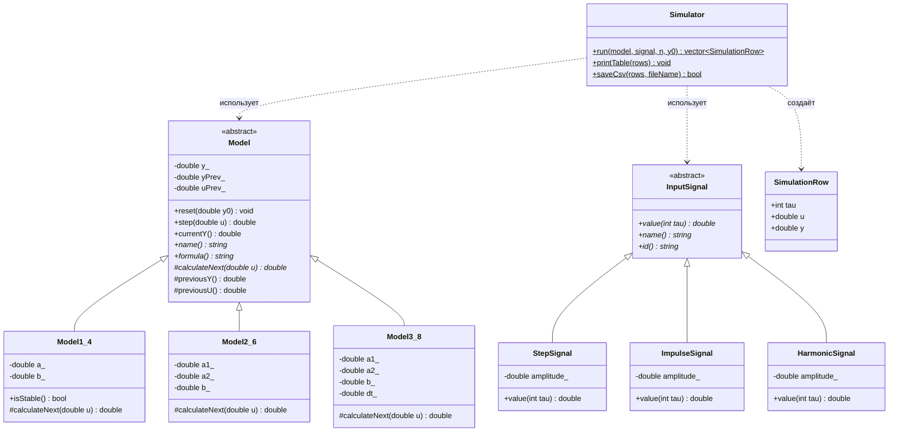
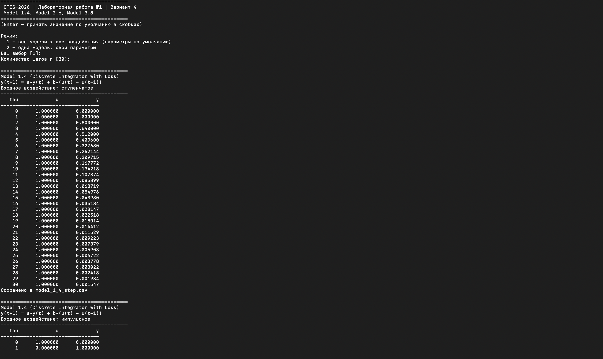
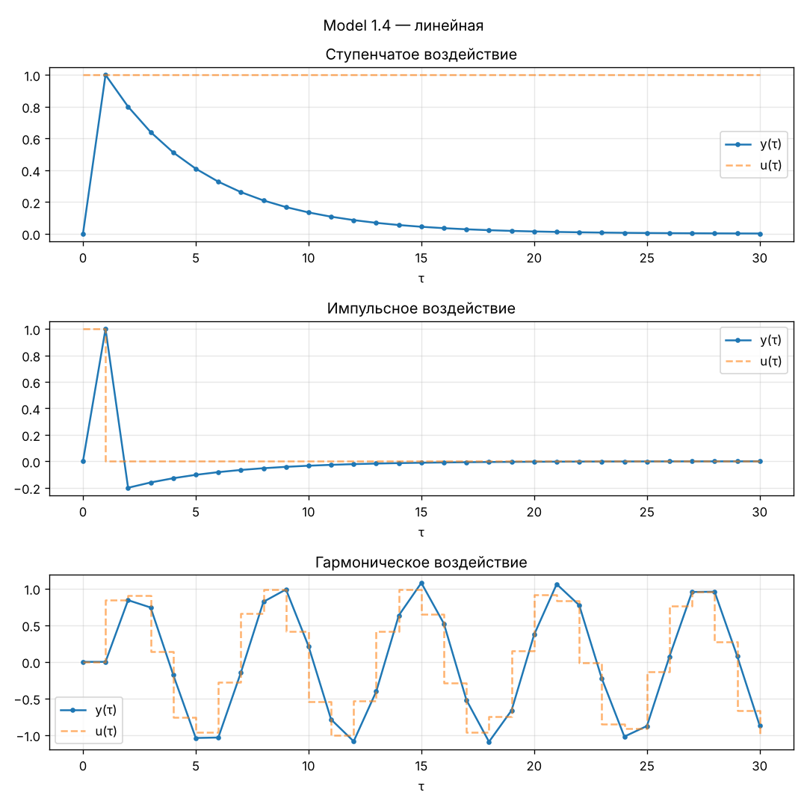
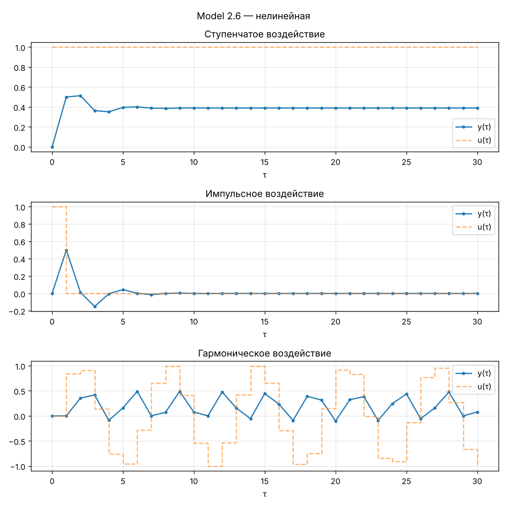
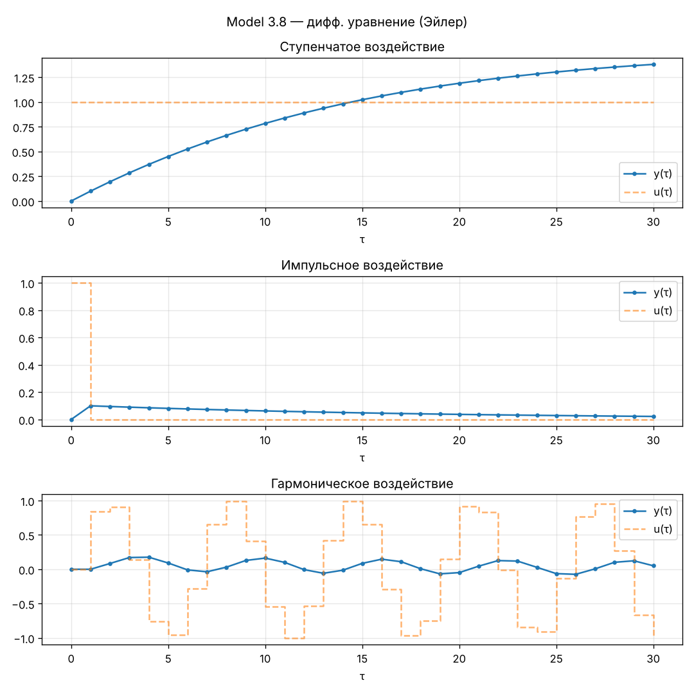

Министерство образования Республики Беларусь

Учреждение образования

“Брестский Государственный технический университет”

Кафедра ИИТ

       

Лабораторная работа №1

По дисциплине “Общая теория интеллектуальных систем”

Тема: “Моделирование температуры объекта”

     

Выполнил:

Студент 2 курса

Группы ИИ-30

Мацуй Н. В.

Проверил:

Дворанинович Д. А.

     

Брест 2026

---

## Задание

Написать на C++ программу, которая моделирует поведение объекта управления в дискретные моменты времени $\tau = 1, 2, \dots, n$ по трём математическим моделям, выводит результаты в табличном виде и строит графики.

**Вариант 4:**

| Блок | Модель |
| :--- | :--- |
| Линейная модель | Model 1.4 |
| Нелинейная модель | Model 2.6 |
| Дифференциальное уравнение | Model 3.8 |

## Реализованные модели

### Model 1.4 (Discrete Integrator with Loss)

$$y_{\tau+1} = a y_{\tau} + b(u_{\tau} - u_{\tau-1})$$

Выход реагирует на **изменение** входа, а не на сам вход, поэтому при постоянном входе $y$ затухает к нулю.

### Model 2.6 (Asymmetric Polynomial Backlash Simulation)

$$y_{\tau+1} = a_1 y_{\tau}^3 - a_2 y_{\tau-1} + b u_{\tau}^2$$

### Model 3.8 (Combined Linear-Quadratic Decay)

$$\frac{dy}{dt} = -a_1 y - a_2 y^2 + b u$$

Решается методом Эйлера с шагом $\Delta t$:

$$y_{\tau+1} = y_{\tau} + \Delta t \left(-a_1 y_{\tau} - a_2 y_{\tau}^2 + b u_{\tau}\right)$$

### Начальные условия

$y_0$ задаётся пользователем. Значения до начала моделирования принимаются равными $y_{-1} = y_0$, $u_{-1} = 0$.

### Параметры по умолчанию

| Модель | Параметры |
| :--- | :--- |
| Model 1.4 | $a = 0.8$, $b = 1.0$ |
| Model 2.6 | $a_1 = 0.1$, $a_2 = 0.3$, $b = 0.5$ |
| Model 3.8 | $a_1 = 0.5$, $a_2 = 0.1$, $b = 1.0$, $\Delta t = 0.1$ |

Общие: $y_0 = 0$, амплитуда входа $A = 1$, $n = 30$.

## Входные воздействия

1. Ступенчатое: $u_{\tau} = A$
2. Импульсное: $u_0 = 1$, $u_{\tau > 0} = 0$
3. Гармоническое: $u_{\tau} = A \sin(\tau)$

## Структура программы (ООП)

Создан абстрактный базовый класс `Model`. Он хранит состояние модели ($y_\tau$, $y_{\tau-1}$, $u_{\tau-1}$) в закрытых (`private`) полях, наследники читают его через методы `currentY()`, `previousY()`, `previousU()`. Класс содержит чисто виртуальный метод `calculateNext(u)`, который вычисляет следующий шаг симуляции. Невиртуальный метод `step(u)` вызывает `calculateNext()` и сдвигает историю значений, поэтому в классах-наследниках описана только формула своей модели.

Входные воздействия тоже реализованы иерархией классов: абстрактный `InputSignal` и наследники `StepSignal`, `ImpulseSignal`, `HarmonicSignal`.

Класс `Simulator` запускает моделирование заданной модели с заданным воздействием на $n$ шагов, выводит таблицу в консоль и сохраняет результат в CSV.

| Файл | Содержимое |
| :--- | :--- |
| `Model.h/.cpp` | абстрактный класс `Model` |
| `LinearModels.h/.cpp` | `Model1_4` |
| `NonLinearModels.h/.cpp` | `Model2_6` |
| `DiffEquations.h/.cpp` | `Model3_8` |
| `InputSignal.h/.cpp` | входные воздействия |
| `Simulator.h/.cpp` | моделирование, таблица, CSV |
| `main.cpp` | меню и ввод параметров |
| `plot.py` | построение графиков (Python + Matplotlib) |

## UML-диаграмма классов

## Сборка и запуск

Сборка выполняется через CMake, запускается файлом `build.bat` из папки `task_01`. Скрипт:

1. проверяет, что установлен CMake;
2. выбирает генератор `MinGW Makefiles`, если найден `g++`, иначе генератор по умолчанию (Visual Studio);
3. конфигурирует проект (`cmake -S . -B build`);
4. компилирует его (`cmake --build build --config Release`);
5. запускает программу из папки `build\bin`.

Исполняемый файл и `plot.py` после сборки лежат в `build\bin`.

Для macOS и Linux есть аналогичный скрипт `build.sh` (`./build.sh`), который выполняет те же шаги.

Для графиков нужен Python с библиотекой Matplotlib (`pip install matplotlib`).

## Работа программы

Программа имеет два режима:

1. **Все модели × все воздействия** — запрашивает только $n$, считает 9 вариантов с параметрами по умолчанию.
2. **Одна модель** — пользователь выбирает модель, вводит её коэффициенты, тип воздействия, амплитуду, $n$ и $y_0$.

Результаты выводятся в консоль таблицей и сохраняются в файлы `model_X_Y_<воздействие>.csv`. После этого автоматически запускается `plot.py`. В режиме 1 он строит по одному рисунку на модель с тремя графиками (все воздействия) и сохраняет их в `model_X_Y.png`. В режиме 2 строится один график только для выбранной модели и воздействия, например `model_1_4_step.png`.

Дополнительно:
- для Model 1.4 перед моделированием проверяется устойчивость, и при $|a| \ge 1$ выводится предупреждение;
- если $|y|$ превышает $10^6$ (Model 2.6 с кубом расходится при больших коэффициентах), моделирование останавливается с предупреждением.

### Пример табличного вывода (ступенчатое воздействие, первые 10 шагов)

| $\tau$ | $u$ | Model 1.4 | Model 2.6 | Model 3.8 |
| :---: | :---: | :---: | :---: | :---: |
| 0 | 1 | 0.0000 | 0.0000 | 0.0000 |
| 1 | 1 | 1.0000 | 0.5000 | 0.1000 |
| 2 | 1 | 0.8000 | 0.5125 | 0.1949 |
| 3 | 1 | 0.6400 | 0.3635 | 0.2848 |
| 4 | 1 | 0.5120 | 0.3511 | 0.3697 |
| 5 | 1 | 0.4096 | 0.3953 | 0.4499 |
| 6 | 1 | 0.3277 | 0.4009 | 0.5254 |
| 7 | 1 | 0.2621 | 0.3879 | 0.5963 |
| 8 | 1 | 0.2097 | 0.3856 | 0.6630 |
| 9 | 1 | 0.1678 | 0.3894 | 0.7254 |
| 10 | 1 | 0.1342 | 0.3902 | 0.7839 |

## Графики

### Model 1.4

При ступенчатом входе выход скачком поднимается до $b \cdot A = 1$ на первом шаге (вход изменился с 0 до 1), а затем затухает с множителем $a = 0.8$, потому что дальше вход не меняется. При импульсе — положительный всплеск, затем отрицательный ($-0.2$) из-за спада входа и затухание. При гармоническом входе выход повторяет форму синусоиды.

### Model 2.6

При ступенчатом входе процесс после затухающих колебаний устанавливается около $y \approx 0.389$ (корень уравнения $y = 0.1y^3 - 0.3y + 0.5$). Вход входит в модель в квадрате, поэтому знак входа не влияет на результат: при гармоническом воздействии $u^2 = \sin^2\tau$ имеет вдвое меньший период, и выход колеблется в основном в положительной области.

### Model 3.8

При ступенчатом входе $y$ плавно растёт к установившемуся значению — положительному корню $-0.5y - 0.1y^2 + 1 = 0$, то есть $y \approx 1.531$. За 30 шагов с $\Delta t = 0.1$ (3 единицы времени) процесс ещё не дошёл до него, для полного переходного процесса нужно $n \approx 100$. При гармоническом входе выход — сглаженная синусоида малой амплитуды.

## Анализ устойчивости (дополнительное задание)

Для Model 1.4 характеристическое уравнение однородной части $y_{\tau+1} = a y_{\tau}$:

$$z - a = 0 \quad \Rightarrow \quad z = a$$

Дискретная система устойчива, если корень лежит внутри единичного круга на Z-плоскости: $|a| < 1$. Программа проверяет это условие (`Model1_4::isStable()`) и при $|a| \ge 1$ выводит предупреждение до начала моделирования.

## Вывод

Реализована программа на C++ с объектно-ориентированной структурой: абстрактный класс `Model` с виртуальным методом расчёта следующего шага и три класса-наследника для моделей варианта 4. Модели исследованы при ступенчатом, импульсном и гармоническом воздействиях, результаты выведены в табличном виде, сохранены в CSV и визуализированы с помощью Python/Matplotlib. Сборка выполняется CMake через `build.bat`.
