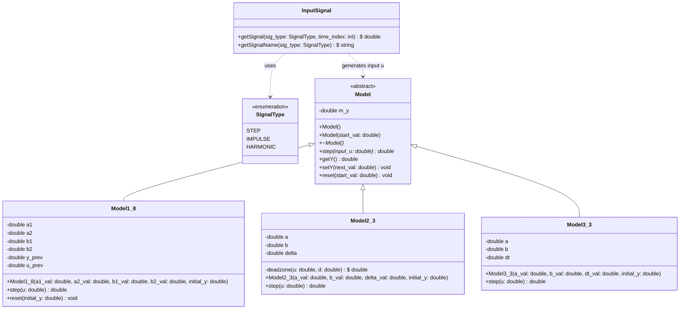
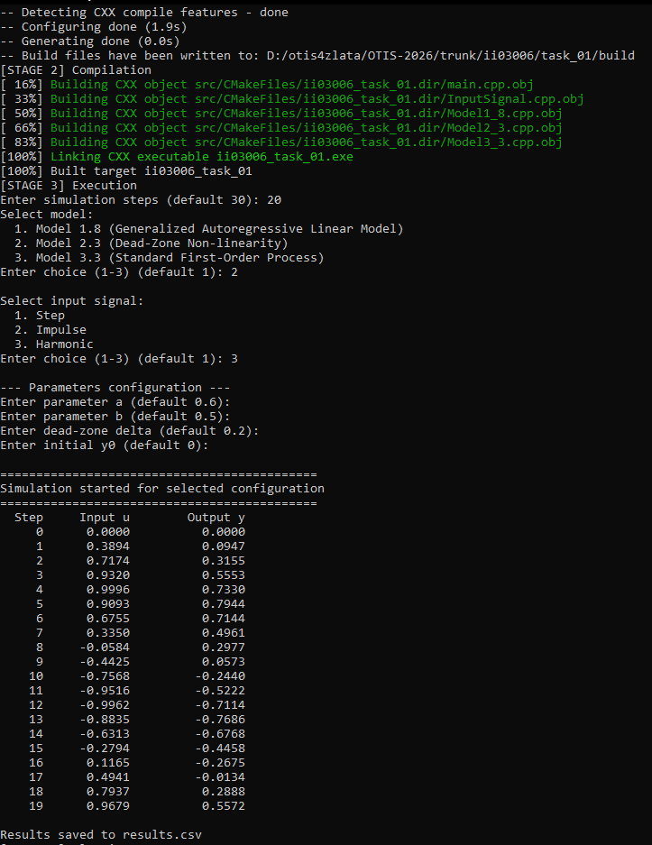
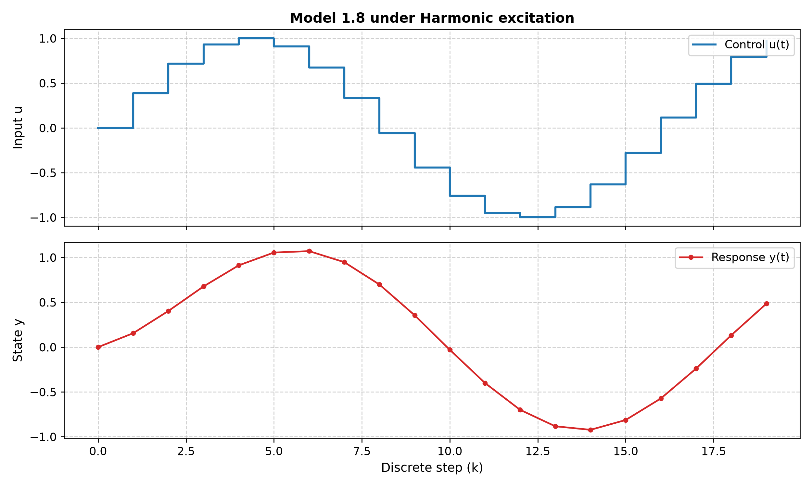

<p align="center">Министерство образования Республики Беларусь</p>
<p align="center">Учреждение образования</p>
<p align="center">«Брестский государственный технический университет»</p>
<p align="center">Кафедра ИИТ</p>
<br><br><br><br><br>
<p align="center"><b>Лабораторная работа №1</b></p>
<p align="center"><b>По дисциплине: «Общая теория интеллектуальных систем»</b></p>
<p align="center"><b>Тема: «Моделирование динамических систем»</b></p>
<br><br><br><br>
<p align="right">Выполнил:</p>
<p align="right">Студент 2 курса</p>
<p align="right">Группы ИИ-30</p>
<p align="right">Данилюк З. Б.</p>
<p align="right">Проверил:</p>
<p align="right">Дворанинович Д. А.</p>
<br><br><br><br>
<p align="center">Брест 2026</p>

---

## Вариант 24

- Линейная модель: **Model 1.8**
- Нелинейная модель: **Model 2.3**
- Дифференциальное уравнение: **Model 3.3**

## Реализованные модели

| Блок | Модель | Тип | Название |
|:--:|:--:|:--:|---|
| 1 | 1.8 | линейная дискретная | Generalized Autoregressive Linear Model |
| 2 | 2.3 | нелинейная дискретная | Dead-Zone Non-linearity |
| 3 | 3.3 | дифференциальное уравнение | Bounded Saturation Rate |

## Входной сигнал
Для тестирования переходных характеристик реализованы воздействия:
* **Ступень (Heaviside):** $u[k] = 1$
* **Единичный импульс (Dirac discrete):** $u[0] = 1$, $u[k > 0] = 0$
* **Гармоническое воздействие:** $u[k] = \sin(0.4 \cdot k)$

## ООП

Создан абстрактный базовый класс `Model` с виртуальным методом `step(double input_u)`.

От него наследуются классы моделей:
- `Model1_8`
- `Model2_3`
- `Model3_3`

## UML Диаграмма



## Пример работы программы

### Сборка и запуск

Сборка осуществляется с помощью файла `build.bat`:

```bat
@echo off
setlocal
chcp 65001 >nul

if not exist "%~dp0CMakeLists.txt" (
    echo ERROR: CMakeLists.txt not found in this folder
    pause
    exit /b 1
)

cd /d "%~dp0"

echo STARTING BUILD PROCESS

echo [STAGE 1] Configuration
cmake -S . -B build -G "MinGW Makefiles"
if errorlevel 1 goto error

echo [STAGE 2] Compilation
cmake --build build
if errorlevel 1 goto error

echo [STAGE 3] Execution
if exist "build\src\ii03006_task_01.exe" (
    "build\src\ii03006_task_01.exe"
) else if exist "build\ii03006_task_01.exe" (
    "build\ii03006_task_01.exe"
) else if exist "build\src\task_01.exe" (
    "build\src\task_01.exe"
) else if exist "build\task_01.exe" (
    "build\task_01.exe"
) else (
    echo WARNING: Executable not found in standard paths
)
if errorlevel 1 goto error

echo [STAGE 4] Plotting
(python src\plot.py 2>nul || py src\plot.py)
if errorlevel 1 goto error

if exist "doc\plot_task01.png" (
    start "" "doc\plot_task01.png"
)

echo SUCCESS: Build completed successfully
pause
goto end

:error
echo ERROR: Build failed
pause
exit /b 1

:end
endlocal
```

После сборки исполняемый файл запускается автоматически либо вручную из каталога `build/src`.

### Демонстрация task_01.exe:



При запуске исполняемого файла мы получаем результат `results.csv`, после чего автоматически запускается `src/plot.py` для визуализации ответа:

### Пример графика переходных процессов


## Вывод

Программа:
- моделирование поведения всех трёх динамических систем Варианта 24 (Model 1.8, Model 2.3, Model 3.3);
- расчёт переходных процессов при подаче типовых входных воздействий (ступенчатого, импульсного и гармонического сигналов);
- конфигурирование продолжительности симуляции через параметр количества тактов $n$;
- форматированный вывод динамики состояний в консоль и экспорт числового ряда в файл `results.csv`;
- автоматическую визуализацию графиков переходных процессов средствами библиотеки Matplotlib (Python).