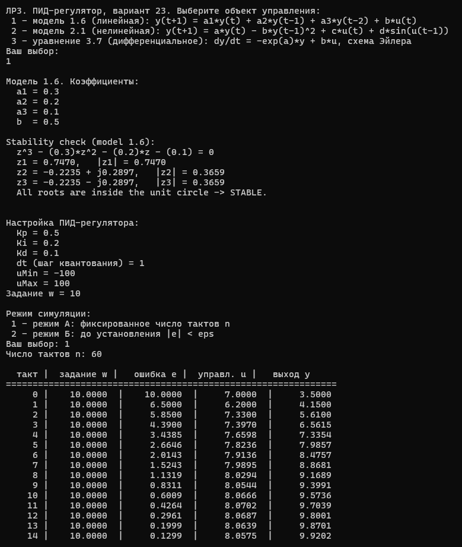
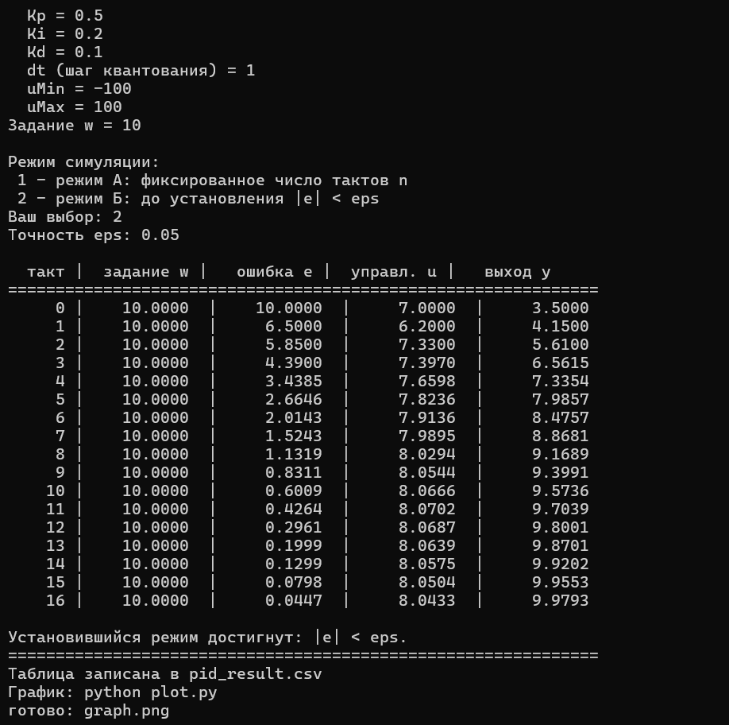
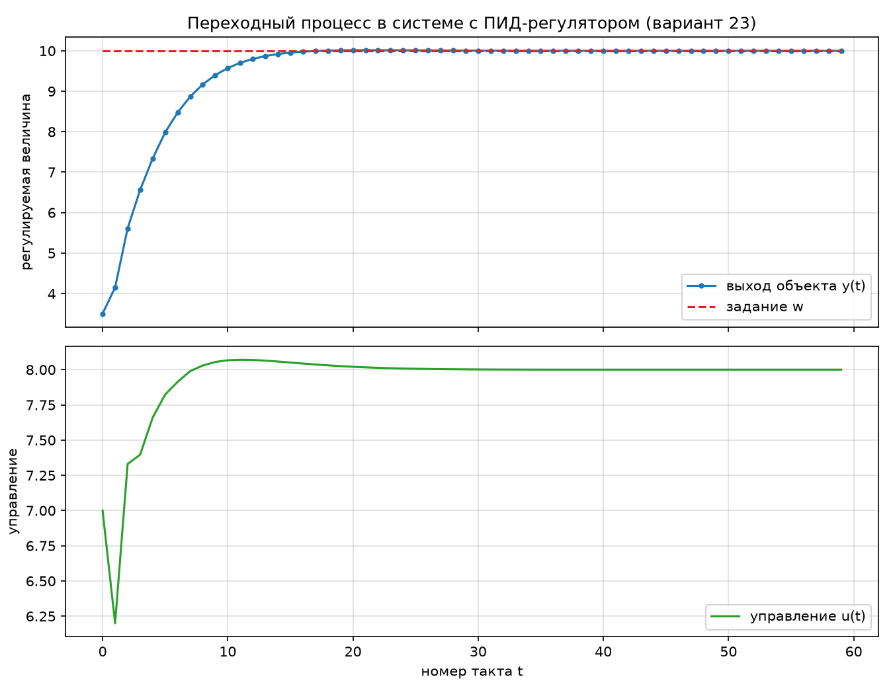
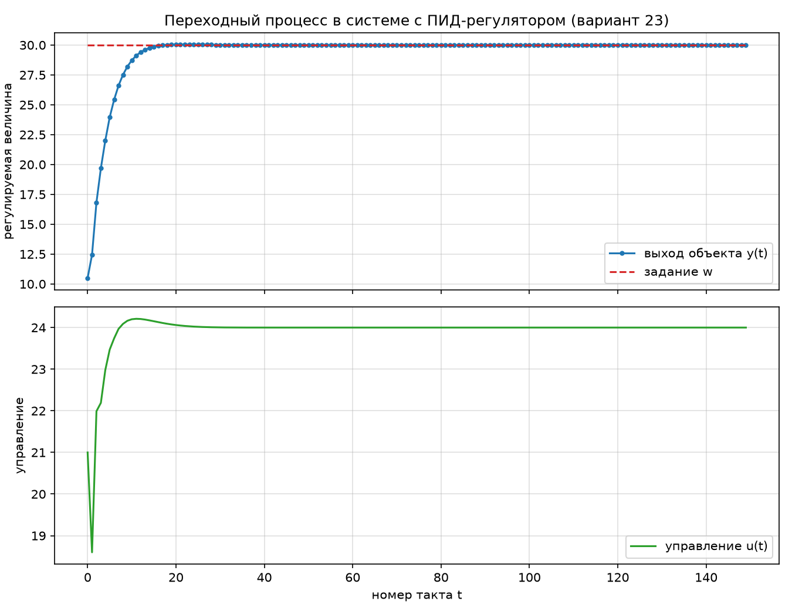
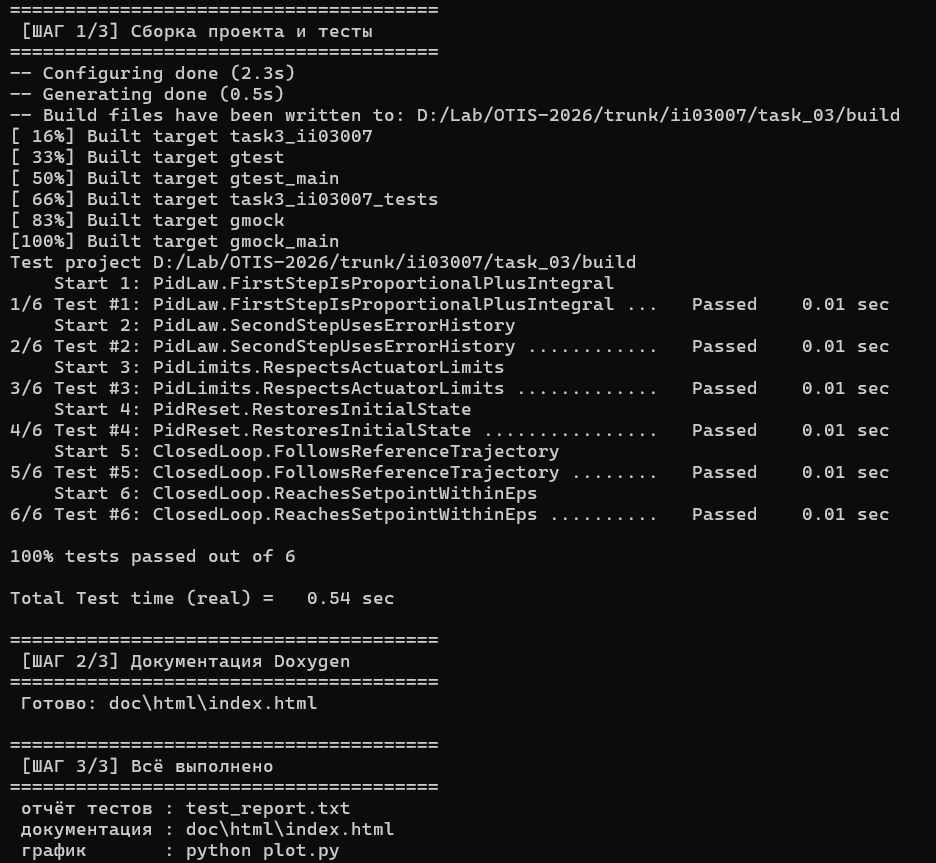
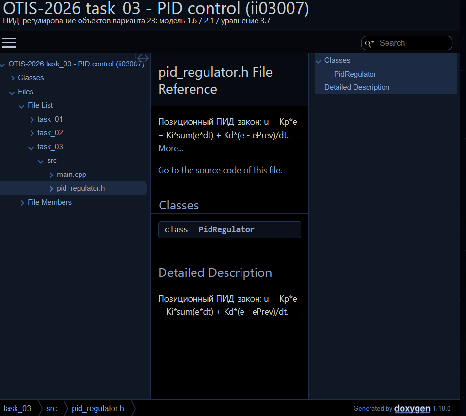

<p align="center"> Министерство образования Республики Беларусь</p>
<p align="center">Учреждение образования</p>
<p align="center">“Брестский Государственный технический университет”</p>
<p align="center">Кафедра ИИТ</p>
<br><br><br><br><br><br><br>
<p align="center">Лабораторная работа №3</p>
<p align="center">По дисциплине “Общая теория интеллектуальных систем”</p>
<p align="center">Тема: “Моделирования температуры объекта”</p>
<br><br><br><br><br>
<p align="right">Выполнил:</p>
<p align="right">Студент 2 курса</p>
<p align="right">Группы ИИ-30</p>
<p align="right">Киселевич А. В.</p>
<p align="right">Проверил:</p>
<p align="right">Дворанинович Д. А.</p>
<br><br><br><br><br>
<p align="center">Брест 2026</p>


---

## 1. Назначение работы

Собрать **замкнутую систему автоматического управления**: к математическим
моделям объектов, полученным по варианту в лабораторной работе №1, подключить
ПИД-регулятор и изучить поведение контура — выход на заданное значение, влияние
коэффициентов $K_p, K_i, K_d$ на качество процесса. Дополнительно отработать
модульное тестирование (Google Test) и автоматическую документацию
(Doxygen с публикацией на GitHub Pages).

## 2. Требования задания

1. отчёт в `task_03/doc/readme.md` — этот файл;
2. программа в каталоге `src/`;
3. упоминание работы в общем readme репозитория;
4. документирование кода Doxygen: результат в `doc/html` + GitHub Pages;
5. модульные тесты Google Test в `test/`;
6. результаты симуляции выводятся **только таблицей** `t, w, e(t), u(t), y(t)`;
7. графики переходных процессов (Python + matplotlib);
8. bat-файл, выполняющий полный цикл: сборка → тесты → документация;
9. объект управления — одна из **трёх моделей ЛР1**, переключение в меню;
10. **два режима**: А — заданное число тактов $n$; Б — до выхода на
    установившийся режим $|e| < \varepsilon$;
11. в отчёте — графики для разных $w$ и **пошаговая настройка** регулятора.

## 3. Закон управления и объекты

В основе лежит классическая запись ПИД-закона

$$u(t) = K_p\,e(t) + K_i\!\int e\,dt + K_d\,\frac{de}{dt}, \qquad e(t) = w - y(t),$$

использована её **позиционная** дискретная форма: управление считается заново
на каждом такте, а не приращением к предыдущему. Сумма заменяет интеграл,
разность — производную:

$$
u(t) = K_p\,e(t) + K_i \sum_{k=0}^{t} e(k)\,dt + K_d\,\frac{e(t)-e(t-1)}{dt}.
$$

В коде это метод `compute()` класса `PidRegulator` (`src/pid_regulator.h`):

```cpp
const double e = w - y;
integral_ += e * dt_;
const double derivative = hasPrev_ ? (e - ePrev_) / dt_ : 0.0;
double u = kp_ * e + ki_ * integral_ + kd_ * derivative;
if (u > uMax_) u = uMax_;
else if (u < uMin_) u = uMin_;
ePrev_ = e;
hasPrev_ = true;
return u;
```

Три величины хранятся между тактами: накопленный интеграл `integral_`,
прошлая ошибка `ePrev_` и флаг `hasPrev_`. Флаг нужен потому, что на первом
такте прошлой ошибки ещё нет — производная принудительно равна нулю, иначе
она дала бы ложный выброс. Выход обрезается по физическим пределам
исполнительного механизма $[u_{min}, u_{max}]$.

**Объекты** (все три — из варианта 23, ЛР1) выбираются пунктом меню:

| № | Тип | Уравнение |
|---|---|---|
| 1.6 | линейная дискретная | $y(t{+}1) = a_1 y(t) + a_2 y(t{-}1) + a_3 y(t{-}2) + b\,u(t)$ |
| 2.1 | нелинейная | $y(t{+}1) = a\,y(t) - b\,y^2(t{-}1) + c\,u(t) + d\sin u(t{-}1)$ |
| 3.7 | дифференциальное | $\dfrac{dy}{dt} = -e^{a}y + b\,u$, схема Эйлера |

Перед стартом для линейной модели вызывается модуль из ЛР2: он печатает корни
характеристического уравнения и вердикт, а при неустойчивом наборе программа
спрашивает подтверждение `Y/N`.

## 4. Исходные данные для опытов

Основные опыты выполнены на линейной модели **1.6** с набором
$a_1 = 0.3$, $a_2 = 0.2$, $a_3 = 0.1$, $b = 0.5$. Характеристическое уравнение
$z^3 - 0.3z^2 - 0.2z - 0.1 = 0$ имеет корни $z_1 = 0.7470$ и пару
$z_{2,3} = -0.2235 \pm j0.2897$ с модулями $0.3659$ — все внутри единичной
окружности, объект устойчив.

Статический коэффициент усиления:

$$g = \frac{b}{1 - a_1 - a_2 - a_3} = \frac{0.5}{1 - 0.3 - 0.2 - 0.1} = \frac{0.5}{0.4} = 1.25,$$

поэтому установившееся управление $u^* = w/g = 0.8\,w$: для $w = 10$ это 8, для
$w = 30$ — 24. Совпадение конца прогона с этим числом служит проверкой, что
контур собран верно.

Остальные параметры опытов: шаг квантования $dt = 1$, пределы актуатора
$u \in [-100, 100]$ — намеренно широкие, чтобы регулятор в них не упирался и
работал «в линейной зоне».

## 5. Режим А: протокол таблицей

Опыт ставится на модели 1.6 (коэффициенты 0.3 / 0.2 / 0.1 / 0.5), регулятор
настроен на 0.5 / 0.2 / 0.1, шаг $dt = 1$, задание $w = 10$, режим А с числом
тактов $n = 60$. Ниже — начало протокола, который программа печатает в консоль
(целиком он же лежит в `pid_result.csv`):

| $t$ | $w$ | $e(t)$ | $u(t)$ | $y(t)$ |
|---:|---:|---:|---:|---:|
| 0 | 10.0000 | 10.0000 | 7.0000 | 3.5000 |
| 1 | 10.0000 | 6.5000 | 6.2000 | 4.1500 |
| 2 | 10.0000 | 5.8500 | 7.3300 | 5.6100 |
| 3 | 10.0000 | 4.3900 | 7.3970 | 6.5615 |
| 4 | 10.0000 | 3.4385 | 7.6598 | 7.3354 |
| 5 | 10.0000 | 2.6646 | 7.8236 | 7.9857 |
| 6 | 10.0000 | 2.0143 | 7.9136 | 8.4757 |
| 7 | 10.0000 | 1.5243 | 7.9895 | 8.8681 |
| 8 | 10.0000 | 1.1319 | 8.0294 | 9.1689 |
| 9 | 10.0000 | 0.8311 | 8.0544 | 9.3991 |
| 10 | 10.0000 | 0.6009 | 8.0666 | 9.5736 |
| 11 | 10.0000 | 0.4264 | 8.0702 | 9.7039 |
| … | … | … | … | … |
| **21** | 10.0000 | −0.0140 | 8.0163 | **10.0150** |
| … | … | … | … | … |
| **59** | 10.0000 | 0.0000 | 8.0000 | 10.0000 |

Жирным отмечены две строки: такт 21 — максимум выхода за прогон, такт 59 — конец,
где управление встало на 8.0000, то есть $u^* = w/g$.

По этим числам видно: выход перемахнул задание на 0.15 %, полоса ±2 % взята на
13-м такте, к концу ошибка обнулилась. Такты 0–4 просчитаны вручную в 14.3, а
тест `ClosedLoop.FollowsReferenceTrajectory` гоняет замкнутый контур по той же
схеме, но со своим набором 0.5 / 0.1 / 0.1.

Каждая строка продублирована в `pid_result.csv` — поля разделены точкой с
запятой (`t;w;e;u;y`); этот файл и читает `plot.py`.



*Рис. 1. Окно программы: вопросы меню и таблица режима А.*

## 6. Режим Б: остановка по точности

Тот же опыт повторён в режиме 2 с порогом $\varepsilon = 0.05$: такты здесь не
считаются по счётчику, а идут до первого проваливания ошибки в коридор, о чём
программа сообщает отдельной строкой:

```
    14 |    10.0000  |     0.1299  |     8.0575  |     9.9202
    15 |    10.0000  |     0.0798  |     8.0504  |     9.9553
    16 |    10.0000  |     0.0447  |     8.0433  |     9.9793

Установившийся режим достигнут: |e| < eps.
```

Вышло **17 тактов** вместо шестидесяти. Порог взят на такте 16 при
$|e| = 0.0447$; в режиме А тот же рубеж пройден между 16-м и 17-м тактами, так
что режимы согласуются. Аварийный предел в 100000 тактов остался
невостребованным — он страхует случай, когда подобранные коэффициенты вообще не
дают сходимости.



*Рис. 2. Хвост протокола режима Б: останов по достигнутой точности.*

## 7. Как ведёт себя контур при другом задании (п. 7)

Скрипт `plot.py` берёт `pid_result.csv` и рисует две панели: сверху выход идёт
вместе с линией задания, снизу — управление. Коэффициенты регулятора в обоих
случаях одинаковые, меняется только задание.

**Задание $w = 10$.** Кривая приходит в 10.0000, управление — в 8.0000. Наибольшее
значение 10.0150 на такте 21, то есть перерегулирование 0.15 %; полоса ±2 %
занята с 13-го такта.



*Рис. 3. Прогон при $w = 10$: выход, задание и управление*

**Задание $w = 30$.** С тем же набором коэффициентов выход приходит в 30.0000, а
управление — в 24.0000. Пик 30.0451 — снова 0.15 %, полоса тоже с 13-го такта.
Пропорции не изменились, потому что модель линейна: кривые отличаются только
масштабом по вертикали, форма у них общая. Попутно проверена вторая точка
статики: $30/1.25 = 24$, как и предсказывает $u^* = w/g$.



*Рис. 4. Тот же регулятор при $w = 30$*

## 8. Последовательный подбор $K_p$, $K_i$, $K_d$ (п. 11)

Настройка шла по одному каналу: сначала только пропорциональный, затем
подключён интегральный, потом усилен он же, и в конце введён
дифференциальный. Ориентиры — установившееся значение $y^*$, остаточная ошибка
$e^* = w - y^*$, перерегулирование $\sigma$ и время установления (первый такт,
начиная с которого $|e| < 0.02w$ уже не выходит из полосы).

**Приём 1 — только P, $K_p = 0.5$, остальные каналы выключены.** Отклик резкий,
но до задания кривая не доходит: $y^* = 3.8462$ при $e^* = 6.1538$. Причина в
самом законе — остаточную ошибку держит формула
$e^* = w/(1 + K_p g) = 10/(1 + 0.625) = 6.1538$, поэтому один пропорциональный
канал принципиально её не снимает. В режиме Б такой набор не сходится ни за
какое разумное время; зато и заброса нет вовсе.

**Приём 2 — подключён интегратор, $K_i = 0.1$.** Накопленная сумма ошибок
сдвигает рабочую точку, и к концу прогона выход садится точно на задание:
$y^* = 10.0000$, $u^* = 8.0000$. Минус — медлительность: полоса ±2 % берётся
только на 38-м такте, а режиму Б нужно 54 такта. Заброса по-прежнему нет.

**Приём 3 — интегратор усилен до $K_i = 0.2$.** Точность та же, зато
быстродействие выросло втрое: установление за 14 тактов (режим Б — 18), а цена —
небольшой заброс 0.05 % ($y = 10.0053$ на такте 24).

**Приём 4 — введён дифференциатор, $K_d = 0.1$; этот набор и принят.**
Производная ошибки работает как предупреждение: регулятор сбавляет управление
ещё до подхода к заданию, и установление сокращается с 14 до 13 тактов (режим
Б — 17). Заброс укладывается в 0.15 % ($y = 10.0150$), остаточная ошибка
нулевая, $u^* = 8.0000$.

| Приём | Коэффициенты | $y^*$ | $e^*$ | $\sigma$, % | $t_{уст}$ |
|---|---|---|---|---|---|
| 1. P | 0.5 / 0 / 0 | 3.8462 | 6.1538 | 0 | не устанавливается |
| 2. PI | 0.5 / 0.1 / 0 | 10.0000 | 0 | 0 | 38 |
| 3. PI усиленный | 0.5 / 0.2 / 0 | 10.0000 | 0 | 0.05 | 14 |
| 4. PID | 0.5 / 0.2 / 0.1 | 10.0000 | 0 | **0.15** | **13** |


*Рис. 5. Принятый набор 0.5 / 0.2 / 0.1 (тот же прогон, что на Рис. 3): выход
на 10.0000, заброс 0.15 %*

**Дальше — уже не лучше.** За пределами найденных значений контур теряет
устойчивость: с $K_d = 1.0$ выход разгоняется до 48.48 к 54-му такту и затем
уходит в минус, с $K_p = 2.5$ то же самое случается раньше — максимум 48.51 на
такте 10. Виноваты ступенчатое задание и инерция модели: дифференциатор бьётся о
скачок ошибки, а слишком большой $K_p$ гонит управление с перелётом. Поэтому
приняты умеренные 0.5 / 0.2 / 0.1.

## 9. Проверка регулятора автотестами (п. 5)

Тесты лежат в `test/test_regulator.cpp`; `ctest` показывает шесть пройденных из
шести:

| Тест | Что проверяет |
|---|---|
| `PidLaw.FirstStepIsProportionalPlusIntegral` | на первом такте истории нет, вклад дают только P и I ($u = 2.5$) |
| `PidLaw.SecondStepUsesErrorHistory` | на втором такте подключается разностный член, интеграл подрастает ($u = 1.65$) |
| `PidLimits.RespectsActuatorLimits` | при заведомо огромной ошибке управление не выходит за $[u_{min}, u_{max}]$ |
| `PidReset.RestoresInitialState` | `reset()` возвращает регулятор в состояние «до первого такта» |
| `ClosedLoop.FollowsReferenceTrajectory` | контур на модели 1.6 повторяет ручной просчёт пяти тактов ($y$: 3.0; 3.35; 4.4325; 5.098375; 5.64908125) |
| `ClosedLoop.ReachesSetpointWithinEps` | за конечное число тактов ошибка становится меньше $\varepsilon$ |

Последние два берут настоящую модель 1.6 из ЛР1, поэтому проверяют не формулы по
отдельности, а работу связки «регулятор + объект».



*Рис. 6. Тесты пройдены*

## 10. Автоматическая документация и GitHub Pages (п. 4)

Справку собирает Doxygen. Чтобы ему было что описывать, в начале каждого файла
`src/` стоит короткий комментарий `/** @file/@brief */`. Настройки — в
`Doxyfile`: он читает папки `src` у `task_03`, `task_01` и `task_02`, а готовые
страницы кладёт в `doc/html/`. LaTeX и Graphviz выключены, поэтому доставлять
ничего не нужно.

Пересборка идёт сама — на втором шаге `run_all.bat`. Открывать справку с файла
`doc/html/index.html`, всего получается около 120 файлов. Для проверки без
репозитория она выложена на GitHub Pages из ветки `github-pages` (рядом лежит
`.nojekyll` — без него GitHub не отдаёт служебные папки Doxygen).



*Рис. 7. Сгенерированная документация*

## 11. Bat-файлы: сборка, тесты, документация (п. 8)

| Файл | Что делает |
|---|---|
| `run_all.bat` | три шага подряд: configure и сборка через CMake → `ctest` с записью отчёта в `test_report.txt` → генерация Doxygen; в конце печатает сводку с путями. MinGW Makefiles подставляются только если в PATH есть и g++, и mingw32-make, иначе берётся генератор по умолчанию |
| `run_program.bat` | запускает exe (если его нет — сначала собирает); после прогона, при установленном Python, рисует `graph.png` |

Числа для ввода — по одному в строке, в том порядке, в каком их спрашивает
программа:

```
          [общая часть]                [настройка PID]    [задание и режим]
w=10 PID:   1  0.3  0.2  0.1  0.5  →   0.5  0.2  0.1  1  -100  100  →   10  1  60
w=30 PID:   1  0.3  0.2  0.1  0.5  →   0.5  0.2  0.1  1  -100  100  →   30  1  150
P (приём 1): 1  0.3  0.2  0.1  0.5  →   0.5  0    0    1  -100  100  →   10  1  60
PI (приём 2): 1  0.3  0.2  0.1  0.5  →   0.5  0.1  0    1  -100  100  →   10  1  60
PI (приём 3): 1  0.3  0.2  0.1  0.5  →   0.5  0.2  0    1  -100  100  →   10  1  60
режим Б:    1  0.3  0.2  0.1  0.5  →   0.5  0.2  0.1  1  -100  100  →   10  2  0.05
```

(1 — это модель 1.6, дальше $a_1, a_2, a_3, b$; при устойчивом наборе вопроса
Y/N не будет; строка PID — $K_p, K_i, K_d, dt, u_{min}, u_{max}$; режим 1 —
счётчик тактов, режим 2 — порог $\varepsilon$.)

## 12. Таблица выполнения пунктов задания

| Пункт задания | Чем закрыт |
|---|---|
| 1. Отчёт `doc/readme.md` | этот файл |
| 2. Код в `src/` | `pid_regulator.h`, `main.cpp` + модули ЛР1 |
| 3. Строка в общий readme | `ii03007 \| task_03 \| PID controller + gtest + doxygen \| 6/6 OK \|` |
| 4. Doxygen, `doc/html`, Pages | раздел 10 |
| 5. Google Test | раздел 9 (6 из 6) |
| 6. Таблица `t w e(t) u(t) y(t)` | раздел 5 и `pid_result.csv` |
| 7. Графики переходных процессов | разделы 7–8, `plot.py` |
| 8. bat-файл полного цикла | раздел 11 |
| 9. Объекты ЛР1, переключение | меню в `main.cpp`, раздел 3 |
| 10. Режимы А и Б | разделы 5–6 |
| 11. Разные $w$ и настройка | разделы 7–8 |

## 13. Что получилось в итоге

1. Собрана замкнутая система «ПИД + объект ЛР1»: позиционный закон управления,
   обрезка сигнала по пределам исполнительного механизма.
2. Одна программа гоняет все три объекта варианта 23 (выбор пунктом меню),
   умеет останавливаться по счётчику тактов или по достигнутой точности и
   печатает протокол, из которого берётся CSV для графиков.
3. Правильность подтверждают три независимые проверки: ручной просчёт первых
   тактов, шесть автотестов (в том числе контур целиком) и совпадение
   установившегося управления с $w/g$.
4. Подбор коэффициентов дал ожидаемую картину: пропорциональный канал оставляет
   ошибку $w/(1 + K_p g)$ (у нас 6.1538), интегратор её снимает, но замедляет
   процесс до 38 тактов, рост $K_i$ ускоряет его до 14, а дифференциатор доводит
   до 13 тактов, добавив лишь 0.15 % заброса.
5. Сборка, тесты и справка автоматизированы bat-файлами; документация
   публикуется через GitHub Pages.

Цель работы достигнута.

## 14. Дополнительные материалы

### 14.1. Состав каталога `task_03`

| Файл | Что делает |
|---|---|
| `task_01/src/model.h`, `model1.6.h`, `model2.1.h`, `model3.7.h` | модели объектов (из ЛР1) |
| `task_02/src/stability.h` | проверка устойчивости модели 1.6 перед стартом |
| `src/pid_regulator.h` | ПИД-регулятор, позиционная форма |
| `src/main.cpp` | замкнутый контур, меню, протокол, CSV |
| `test/test_regulator.cpp` | шесть автотестов |
| три `CMakeLists.txt` | сборка `task3_ii03007` и `task3_ii03007_tests` |
| `plot.py` | графики по `pid_result.csv` |
| `run_all.bat`, `run_program.bat` | полный цикл / запуск программы |
| `Doxyfile`, `doc/html/` | справка Doxygen |
| `doc/docimages/` | все рисунки отчёта: `1.png` … `7.png` |
| `doc/readme.md` | отчёт |

### 14.2. Быстрый запуск

```
cd trunk/ii03007/task_03
run_all.bat        :: сборка + 6 тестов + doxygen
run_program.bat    :: интерактивный прогон программы
python plot.py     :: график по свежему pid_result.csv
```

### 14.3. Проверка первых тактов вручную (режим А, w = 10)

Считаем для набора 0.5 / 0.2 / 0.1 при пустой истории. Нулевой такт: ошибка
$e_0 = 10 - 0 = 10$, интеграл $10{\cdot}1 = 10$, производной нет, значит
$u_0 = 0.5{\cdot}10 + 0.2{\cdot}10 = 7$; объект отдаёт $y_1 = 0.5{\cdot}7 = 3.5$.
Первый такт: $e_1 = 6.5$, интеграл 16.5, производная $(6.5{-}10)/1 = -3.5$,
откуда $u_1 = 3.25 + 3.3 - 0.35 = 6.2$, а $y_2 = 0.3{\cdot}3.5 + 0.5{\cdot}6.2 = 4.15$
— сходится с таблицей раздела 5. Второй такт: $e_2 = 5.85$,
$u_2 = 2.925 + 4.47 - 0.065 = 7.33$, $y_3 = 5.61$. Продолжая так же, получаем
$y = 10.0000$ к такту 21.