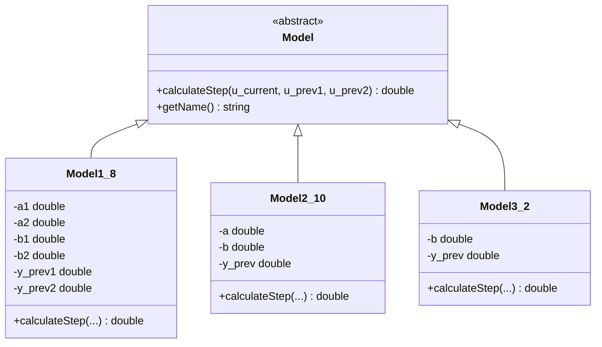
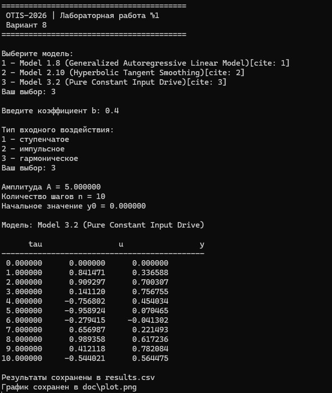
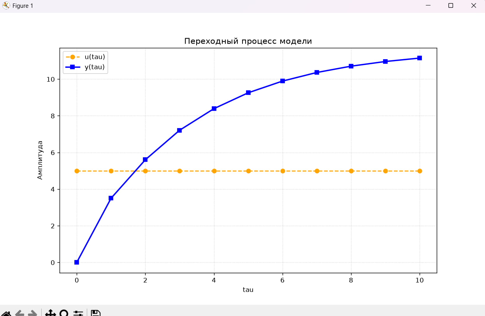
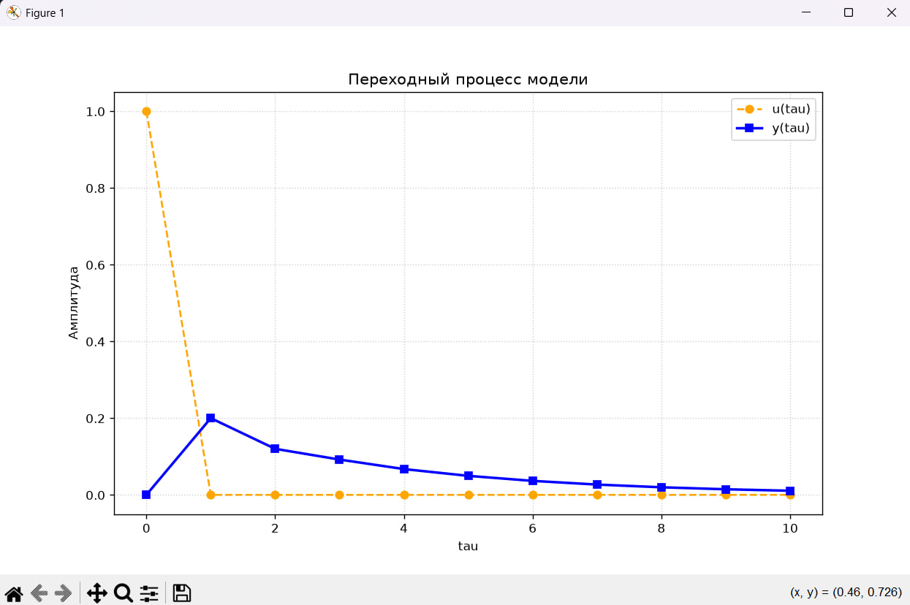
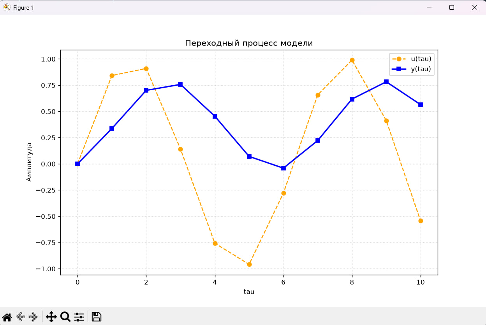

<p align="center">Министерство образования Республики Беларусь</p>
<p align="center">Учреждение образования</p>
<p align="center">“Брестский Государственный технический университет”</p>
<p align="center">Кафедра ИИТ</p>

<br><br><br><br><br><br>

<p align="center">Лабораторная работа №1</p>
<p align="center">По дисциплине “Общая теория интеллектуальных систем”</p>
<p align="center">Тема: “Моделирования температуры объекта”</p>

<br><br><br><br><br>

<p align="right">Выполнил:</p>
<p align="right">Студент 2 курса</p>
<p align="right">Группы ИИ-30</p>
<p align="right">Кулешов Н.С.</p>
<p align="right">Проверил:</p>
<p align="right">Дворанинович Д. А.</p>

<br><br><br><br><br>

<p align="center">Брест 2026</p>

---

## Вариант 8
* Обобщенная авторегрессионная линейная модель: **Model 1.8**
* Модель с гиперболическим сглаживанием: **Model 2.10**
* Дифференциальная модель постоянного воздействия: **Model 3.2**

## Математическое описание моделей

### Model 1.8 (Generalized Autoregressive Linear Model)
$$y(t+1) = a_1 \cdot y(t) + a_2 \cdot y(t-1) + b_1 \cdot u(t) + b_2 \cdot u(t-1)$$

### Model 2.10 (Hyperbolic Tangent Smoothing)
$$y(t+1) = a \cdot \tanh(y(t)) + b \cdot u(t)^3$$

### Model 3.2 (Pure Constant Input Drive)
$$y(t+1) = y(t) + dt \cdot (b \cdot u(t))$$

## Исследуемые входные воздействия $u(\tau)$
1. **Ступенчатое**: $u(\tau) = A$
2. **Импульсное**: $u(1) = A, \quad u(\tau > 1) = 0$
3. **Гармоническое**: $u(\tau) = A \cdot \sin(\tau)$

## Архитектура программы (ООП)
В основе программы лежит абстрактный класс `Model`, определяющий единый интерфейс расчёта следующего шага симуляции (`calculateStep`).
От абстрактного класса наследуются конкретные классы моделей:
* `Model1_8`
* `Model2_10`
* `Model3_2`



## Функциональные возможности
Разработанное приложение обеспечивает:
* Диалоговый выбор одной из трёх математических моделей;
* Интерактивный ввод коэффициентов уравнения ($a_1, a_2, b_1, b_2, a, b$);
* Настройку параметров симуляции (тип сигнала, количество шагов, начальные условия);
* Лаконичный вывод основных параметров и начальных результатов в консоль;
* Автоматический экспорт полной таблицы результатов в `doc/results.csv`;
* Автоматический запуск построения и отображения графиков переходных процессов средствами Python (`matplotlib`).

## Результат
Программа:
* позволяет выбрать модель;
* принимает заданные пользователем коэффициенты;
* позволяет выбрать тип входного воздействия;
* позволяет задать количество шагов симуляции $n$;
* выводит результаты расчетов в компактном табличном виде в консоль (с отсчетом $\tau$ от 1);
* автоматически сохраняет результаты в файл данных для построения графиков;
* строит графики переходных процессов с помощью Python и библиотеки Matplotlib.

## Пример работы программы

### Сборка
На Windows через `build.bat`:

```bat
@echo off
chcp 65001 > nul

if exist build (
    rmdir /q /s build
)

echo [1/2] Configuring project...
cmake -B build -S . > nul 2>&1

echo [2/2] Building project...
cmake --build build --config Release > nul 2>&1

set "EXE_PATH="
if exist "build\src\Release\LabWork1.exe" (
    set "EXE_PATH=build\src\Release\LabWork1.exe"
) else if exist "build\src\Debug\LabWork1.exe" (
    set "EXE_PATH=build\src\Debug\LabWork1.exe"
) else if exist "build\Release\LabWork1.exe" (
    set "EXE_PATH=build\Release\LabWork1.exe"
) else if exist "build\Debug\LabWork1.exe" (
    set "EXE_PATH=build\Debug\LabWork1.exe"
)

if defined EXE_PATH (
    "%EXE_PATH%"
) else (
    echo [ERROR] LabWork1.exe not found!
    pause
    exit /b 1
)

echo.
echo Generating plots...
if exist plot_generator.py (
    start /b python plot_generator.py
) else if exist doc\plot_generator.py (
    start /b doc\plot_generator.py
)

echo.
echo ==========================================
echo Program successfully completed.
echo ==========================================
cmd /k
```

После сборки запускать исполняемый файл из каталога `build`.

### Демонстрация исполняемого файла LabWork1.exe:


При запуске исполняемого файла мы получаем файл результатов `doc/results.csv`, после чего автоматически запускается `plot_generator.py` для визуализации ответа:

## Демонстрация ступенчатого воздействия


## Демонстрация импульсного воздействия


## Демонстрация гармонического воздействия
