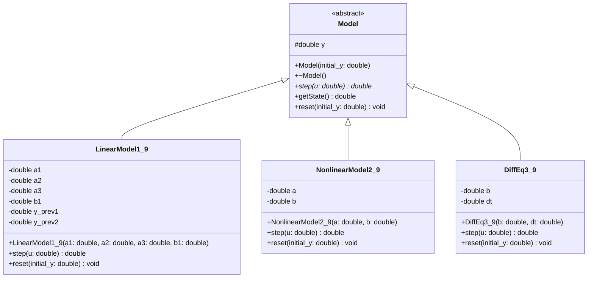
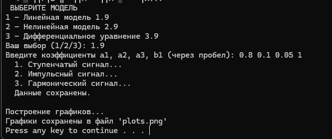
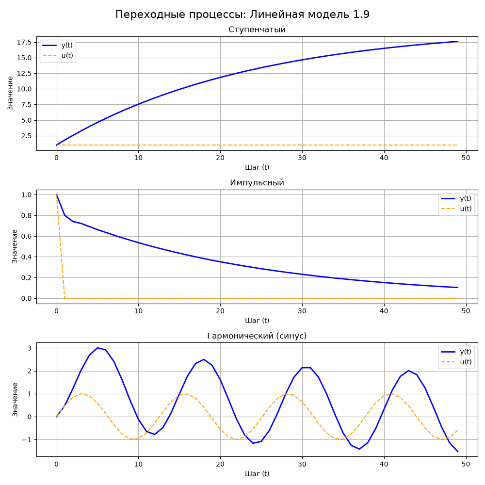

<p align="center"> Министерство образования Республики Беларусь</p>
<p align="center">Учреждение образования</p>
<p align="center">“Брестский Государственный технический университет”</p>
<p align="center">Кафедра ИИТ</p>
<br><br><br><br><br><br><br>
<p align="center">Лабораторная работа №1</p>
<p align="center">По дисциплине “Общая теория интеллектуальных систем”</p>
<p align="center">Тема: “Моделирования температуры объекта”</p>
<p align="center">Вариант 9</p>
<br><br><br><br><br>
<p align="right">Выполнил:</p>
<p align="right">Студент 2 курса</p>
<p align="right">Группы ИИ-30</p>
<p align="right">Ковальчук К.А.</p>
<p align="right">Проверил:</p>
<p align="right">Дворанинович Д. А.</p>
<br><br><br><br><br>
<p align="center">Брест 2026</p>


## 1. Цель работы
Изучение принципов объектно-ориентированного программирования (ООП) на языке C++, реализация математических моделей объектов управления, а также освоение инструментов сборки (CMake) и визуализации данных (Python/Matplotlib).

## 2. Постановка задачи
Разработать программу на C++, которая моделирует поведение трех типов объектов управления (линейного, нелинейного и дифференциального уравнения) в дискретные моменты времени. Программа должна поддерживать интерактивный ввод параметров, обрабатывать три типа входных сигналов и строить графики переходных процессов.

**Требования к реализации:**
*   Использование принципов ООП (базовый абстрактный класс и классы-наследники).
*   Ввод коэффициентов моделей пользователем с консоли.
*   Выбор исследуемой модели через консольное меню.
*   Автоматический расчет для трех типов сигналов (ступенька, импульс, синус).
*   Автоматическая генерация графиков.
*   Сборка проекта через CMake и bat-скрипт.

## 3. Структура программы

### 3.1. Иерархия классов

В основе программы лежит базовый абстрактный класс `Model`, который задает интерфейс для всех моделей. Он содержит чисто виртуальный метод `step(double u)` для расчета одного шага симуляции, метод `reset()` для сброса состояния и метод `getName()`.

Конкретные уравнения реализованы в виде классов-наследников:
*   `LinearModel1_9` — линейная модель;
*   `NonlinearModel2_9` — нелинейная модель;
*   `DiffEq3_9` — дифференциальное уравнение.


### 3.3. Состав проекта
*   `src/` — исходный код (файлы `.cpp` и `.h`).
*   `doc/` — документация (отчет и графики).
*   `CMakeLists.txt` — файл конфигурации сборки.
*   `build.bat` — скрипт для автоматической сборки и запуска.
*   `plot.py` — скрипт для визуализации результатов.

## 4. Математическое описание

### 4.1. Модель 1.9 — линейная модель с усреднением состояния
\[
y_{\tau+1} = a_1 y_\tau + a_2 y_{\tau-1} + a_3 y_{\tau-2} + b_1 u_\tau
\]

### 4.2. Модель 2.9 — нелинейная модель (модуляция квадратного корня)
\[
y_{\tau+1} = a y_\tau + b \sqrt{|u_\tau|} \cdot \text{sign}(u_\tau)
\]

### 4.3. Модель 3.9 — дифференциальное уравнение (ограниченная скорость насыщения)
\[
\frac{dy}{dt} = b \cdot \tanh(u)
\]
*В программе решается методом Эйлера с шагом \(\Delta t\):*
\[
y_{\tau+1} = y_\tau + \Delta t \cdot b \cdot \tanh(u)
\]

## 5. Организация ввода-вывода и сборка

### 5.1. Вывод результатов
Программа сохраняет результаты расчетов в CSV-файлы (например, `out_linear_step.csv`). Данные содержат номер шага, значение входа \(u\) и выхода \(y\).

### 5.2. Визуализация
Для построения графиков используется скрипт `plot.py` на языке Python с библиотекой `matplotlib`. Скрипт вызывается автоматически из C++ кода после завершения симуляции.

### 5.3. Сборка
Сборка проекта осуществляется с помощью системы CMake. Для автоматизации процесса используется скрипт `build.bat`, который создает папку `build`, конфигурирует проект, компилирует его, запускает исполняемый файл и вызывает Python для построения графиков.

**Пример работы программы (Сборка и запуск):**
```batch
@echo off
setlocal
chcp 65001 >nul

if not exist "CMakeLists.txt" (
    echo ERROR CMakeLists not found in this folder
    pause
    exit /b 1
)

cd /d "%~dp0"

echo STARTING BUILD PROCESS
echo [STAGE 1] Configuration
cmake -S . -B build -G "MinGW Makefiles"
if errorlevel 1 goto error

echo [STAGE 2] Compilation
cmake --build build
if errorlevel 1 goto error

echo [STAGE 3] Execution
if exist "build\lab1_app.exe" (
    "build\lab1_app.exe"
) else (
    echo WARNING Executable not found in standard paths
)

echo [STAGE 4] Plotting
python plot.py
if errorlevel 1 goto error

echo SUCCESS Build completed successfully
pause
goto end

:error
echo ERROR Build failed
pause
exit /b 1

:end
endlocal
```



После сборки исполняемый файл запускается автоматически. При запуске программа запрашивает параметры, сохраняет результат в results.csv, после чего автоматически запускается plot.py для визуализации.
Пример графика:

## 7. Выводы
В ходе выполнения работы была успешно разработана программа для моделирования объектов управления. Реализована архитектура на основе ООП. Освоены инструменты сборки CMake и визуализации данных. Программа корректно отрабатывает ввод пользователя и автоматически строит графики переходных процессов.
## 8. Приложения

### 8.1. Файлы проекта

Каталог в репозитории: `trunk/ii03009/task_01/`

| Файл | Ссылка |
|---|---|
| `model.h` | `src/model.h` |
| `linear_model_1_9.h` | `src/linear_model_1_9.h` |
| `linear_model_1_9.cpp` | `src/linear_model_1_9.cpp` |
| `nonlinear_model_2_9.h` | `src/nonlinear_model_2_9.h` |
| `nonlinear_model_2_9.cpp` | `src/nonlinear_model_2_9.cpp` |
| `diff_eq_3_9.h` | `src/diff_eq_3_9.h` |
| `diff_eq_3_9.cpp` | `src/diff_eq_3_9.cpp` |
| `main.cpp` | `src/main.cpp` |
| `CMakeLists.txt` | `CMakeLists.txt` |
| `build.bat` | `build.bat` |
| `plot.py` | `plot.py` |
| `readme.md` | `doc/readme.md` |
| `Скриншоты и графики` | `doc/Screenshots/` |