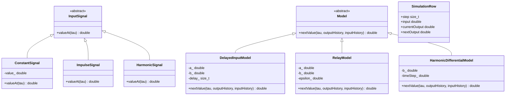
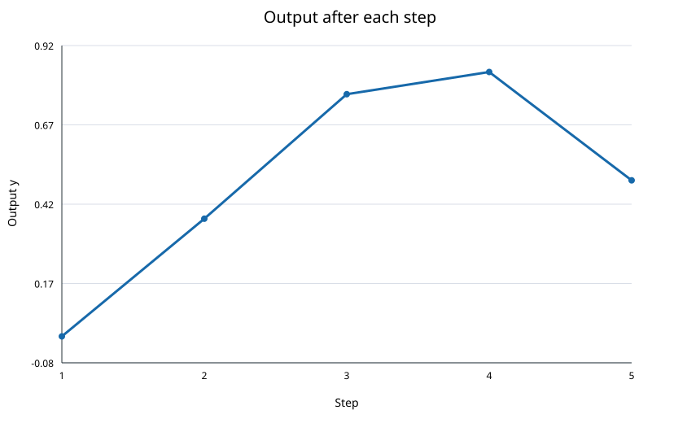

<p align="center">Министерство образования Республики Беларусь</p>
<p align="center">Учреждение образования</p>
<p align="center">«Брестский государственный технический университет»</p>
<p align="center">Кафедра ИИТ</p>
<br><br><br><br><br>
<p align="center"><b>Лабораторная работа №1</b></p>
<p align="center"><b>По дисциплине: «Общая теория интеллектуальных систем»</b></p>
<p align="center"><b>Тема: «Моделирование динамических систем»</b></p>
<br><br><br><br>
<p align="right">Выполнил:</p>
<p align="right">Студент 2 курса</p>
<p align="right">Группы ИИ-30</p>
<p align="right">Кулич П. Г.</p>
<p align="right">Проверил:</p>
<p align="right">Дворанинович Д. А.</p>
<br><br><br><br>
<p align="center">Брест 2026</p>

---

## Цель работы и вариант

Реализовать на C++ моделирование динамических систем с объектно-ориентированной архитектурой, тремя видами входного воздействия, таблицей результатов и графиком отклика. По [таблице вариантов задания](https://github.com/brstu/OTIS-2026/blob/main/task_01/readme.md) вариант **21** включает модели **1.2**, **2.7** и **3.5**.

## Математические модели

На шаге $\tau$ вход обозначается $u_\tau$, состояние — $y_\tau$. Пользователь задаёт начальное значение $y_0$ и число шагов $n>0$. В таблице шаги показаны с 1 до $n$: первый шаг преобразует $y_0$ в $y_1$ при входе $u_0$. В формулах сохранена индексация из задания.

| Модель | Уравнение | Параметры |
|---|---|---|
| 1.2 — линейная с задержкой входа | $y_{\tau+1}=a y_\tau+b u_{\tau-k}$ | $a$, $b$, $k\ge1$ |
| 2.7 — реле с гистерезисом | $y_{\tau+1}=a y_\tau+b\,\operatorname{relay}(u_\tau,y_\tau)$ | $a$, $b$, $\epsilon\ge0$ |
| 3.5 — дифференциальная | $\frac{dy}{dt}=b\sin(u)$; метод Эйлера: $y_{\tau+1}=y_\tau+\Delta t\,b\sin(u_\tau)$ | $b$, $\Delta t>0$ |

Для модели 1.2 значения $u_j$ при $j<0$ считаются нулевыми. Поэтому задержанный вход начинает влиять на результат только с шага $\tau=k$.

Реле в модели 2.7 принимает значение $+1$, когда $u>\epsilon$ либо $u\ge-\epsilon$ и $y>0$; в остальных случаях — $-1$. Так реализованы обе ветви формулы из задания. Например, при $u=0$ и $\epsilon>0$ знак реле сохраняется, если $y>0$, и равен $-1$, если $y\le0$.

Для дифференциальной модели $\Delta t$ используется при интегрировании методом Эйлера. Аргумент гармонического входа остаётся номером шага $\tau$, как задано в условии.

## Входные воздействия

| Вид | Значение на шаге $\tau$ |
|---|---|
| Постоянное | $u_\tau=A$, значение $A$ вводит пользователь |
| Импульсное | $u_0=1$, при $\tau>0$ — $0$ |
| Гармоническое | $u_\tau=\sin(\tau)$ |

## Архитектура программы

Абстрактный класс `Model` задаёт виртуальный метод `nextValue` для вычисления следующего значения $y$. От него наследуются `DelayedInputModel`, `RelayModel` и `HarmonicDifferentialModel`. Абстрактный класс `InputSignal` задаёт метод `valueAt`; его наследники формируют три вида входа. Функция `simulate` накапливает историю входа и состояния в последовательности `SimulationRow`. `printTable` печатает строки, `writeSvgPlot` строит график по $y_1,\ldots,y_n$ — результатам после шагов 1…$n$.

### UML-диаграмма классов

Та же диаграмма доступна отдельным текстовым файлом [uml.md](uml.md).



## Сборка и запуск

Нужны компилятор C++17 и CMake. В Windows из корня репозитория выполняется:

```powershell
.\trunk\ii03010\task_01\src\build.bat
```

Файл `build.bat` запускает настройку CMake и сборку. Его текущий путь выводит каталог сборки **за пределы Git-репозитория**. При конфигурации Visual Studio исполняемый файл запускается отдельно:

```powershell
..\build-ii03010-task01\Debug\ii03010_task_01.exe
```

Для иной конфигурации CMake путь к исполняемому файлу может отличаться. После запуска программа запрашивает модель, сигнал, $n$, $y_0$, параметры модели и, для постоянного сигнала, значение $A$. В консоли выводятся столбцы `Step`, `Input u`, `Before y`, `After y`; номера шагов начинаются с 1. Затем в каталоге сборки за пределами Git-репозитория создаётся SVG-график результатов после каждого шага. Программа показывает путь к нему и автоматически открывает его в приложении Windows, связанном с SVG.

Ввод проверяется: $n$ и $k$ должны быть положительными целыми, $\epsilon$ — неотрицательным числом, $\Delta t$ — положительным; коэффициенты и начальное значение должны быть конечными числами. При неверном вводе программа повторяет запрос.

## Примеры результатов

Для ручной сверки взяты $n=5$ и $y_0=0$. Во всех строках постоянный вход равен $A=1$. Параметры моделей: для 1.2 — $a=0.5$, $b=2$, $k=1$; для 2.7 — $a=0.5$, $b=1$, $\epsilon=0.2$; для 3.5 — $b=2$, $\Delta t=0.25$. В таблице приведено конечное значение после пяти шагов:

| Модель | Постоянный вход | Импульс | Гармоника |
|---|---:|---:|---:|
| 1.2 | 3.750000 | 0.250000 | 1.612273 |
| 2.7 | 1.937500 | 1.937500 | -0.187500 |
| 3.5 | 2.103677 | 0.420735 | 0.494374 |

Например, в модели 1.2 при импульсном входе первые значения состояния: $y_0=0$, $y_1=0$, $y_2=2$, $y_3=1$. На шаге $\tau=0$ задержанный вход ещё равен нулю, а на шаге $\tau=1$ используется $u_0=1$.

В модели 2.7 при гармоническом входе $u_0=0$ и $y_0=0$, поэтому реле выдаёт $-1$ и $y_1=-1$. На следующем шаге $u_1=\sin(1)>0.2$, реле выдаёт $+1$ и $y_2=0.5$.

Для модели 3.5 с гармоническим входом: $y_0=0$, $y_1=0$, $y_2\approx0.372812$, $y_3\approx0.767348$, $y_4\approx0.837674$, $y_5\approx0.494374$. Значения $y_1,\ldots,y_5$ отражены на графике ниже; $y_0$ используется как начальное состояние.

### Визуализация отклика



При каждом запуске программа создаёт новый SVG-график выбранной модели и сигнала в каталоге сборки и открывает его через Windows. Если для SVG нет связанного приложения, программа сообщает путь к сохранённому файлу. В репозитории сохранён один проверенный текстовый пример графика.

## Вывод

Реализованы три модели варианта 21 и три типа входного воздействия. Программа позволяет задавать число шагов и параметры, выводит результаты таблицей и строит график. Абстрактные базовые классы и наследники отражены на UML-диаграмме; сборка выполняется через CMake и `build.bat`.
