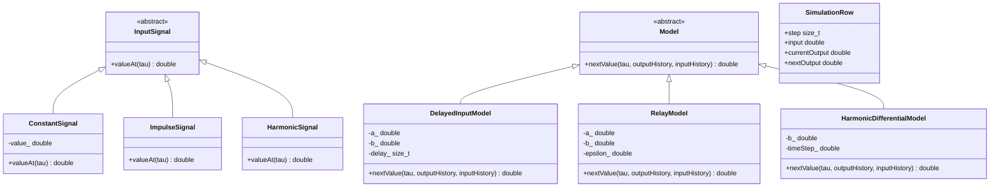

# UML-диаграмма классов

Функция `simulate` получает модель и входной сигнал через ссылки на базовые классы и формирует последовательность `SimulationRow`. Функции `printTable` и `writeSvgPlot` выводят эту последовательность в консоль и в SVG соответственно. Это свободные функции, поэтому на диаграмме нет отдельного класса симулятора.
