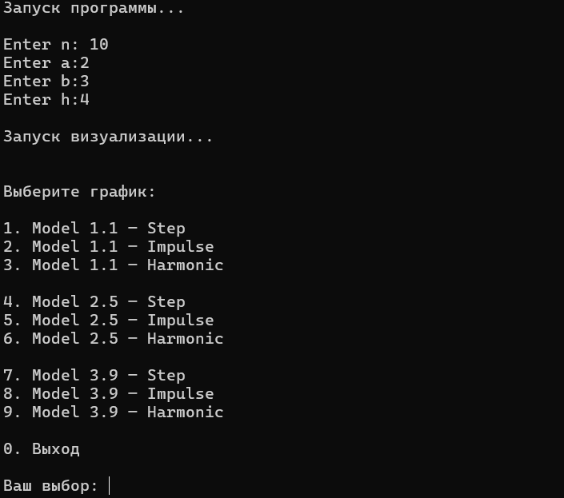
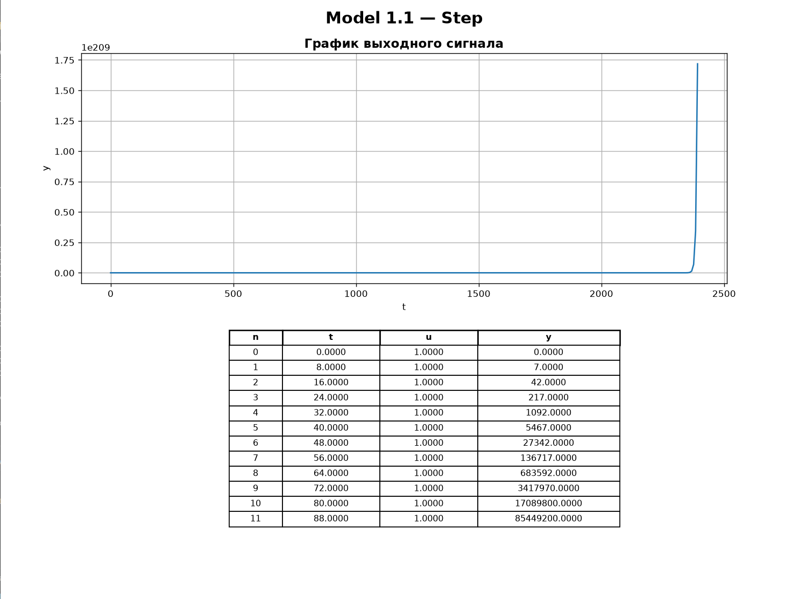
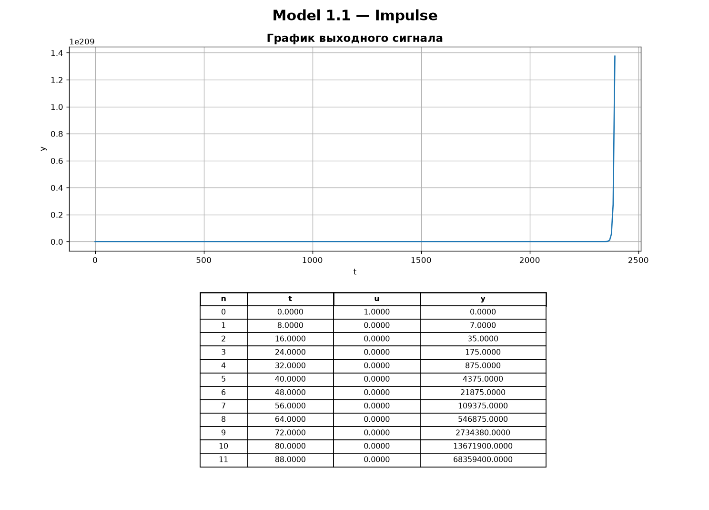
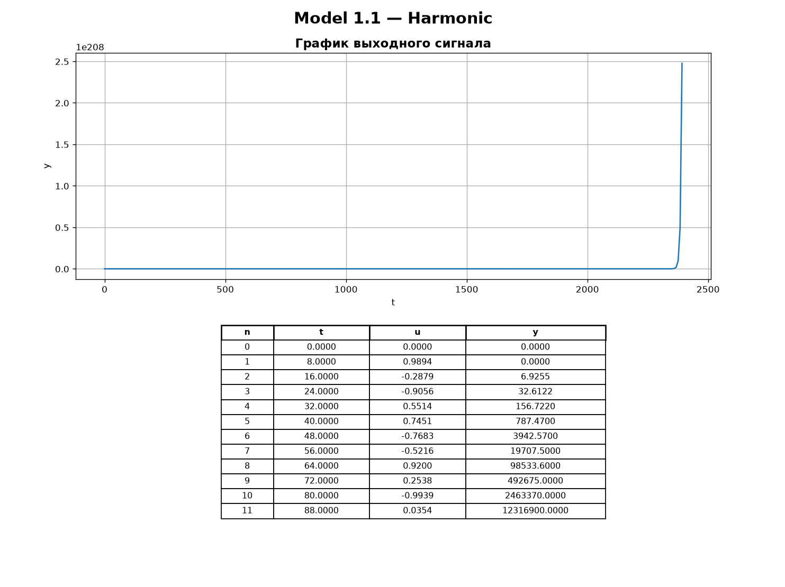
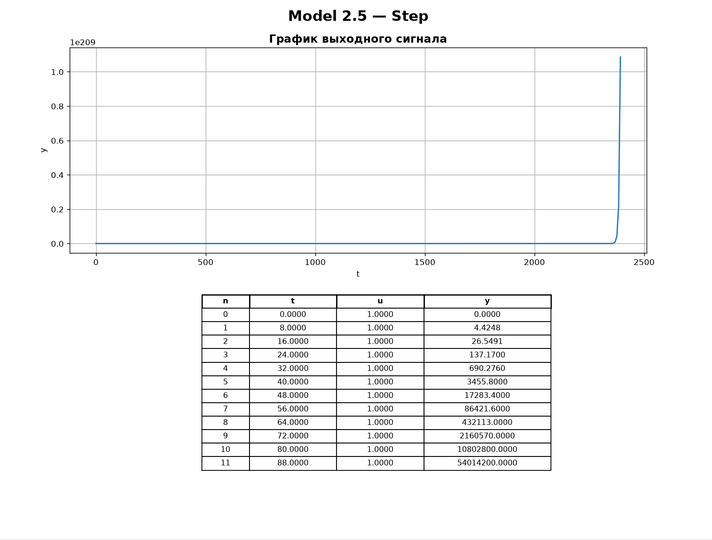
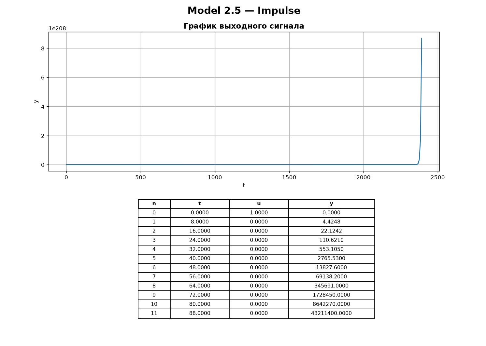
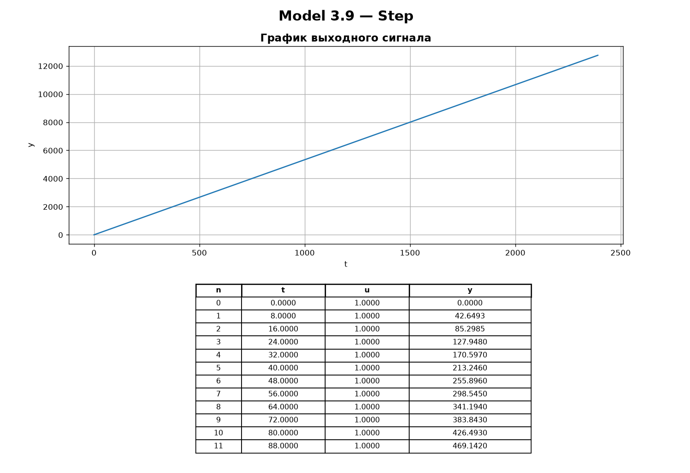
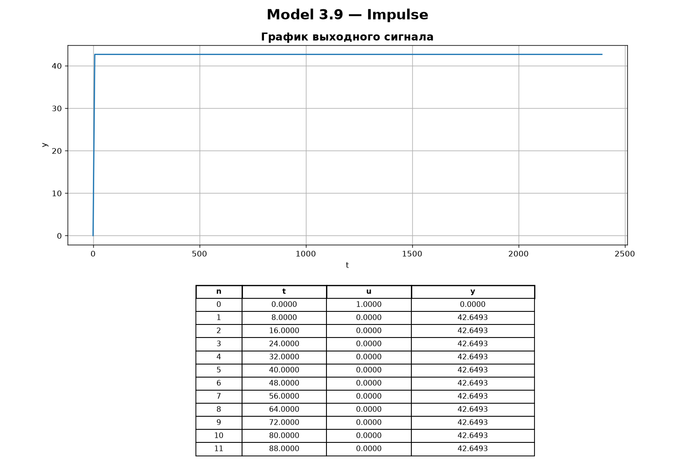
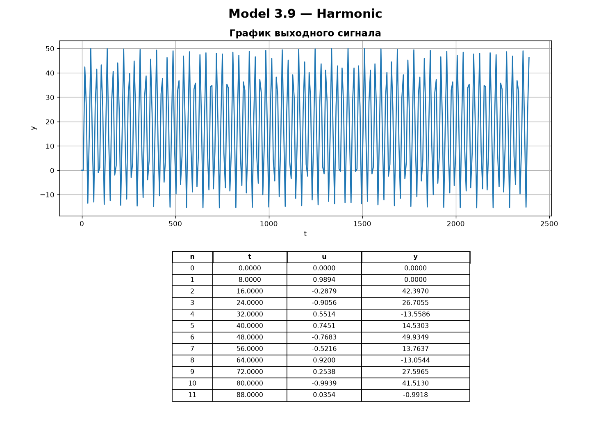
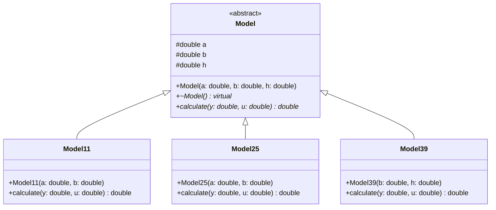

<p align="center">Министерство образования Республики Беларусь</p>
<p align="center">Учреждение образования</p>
<p align="center">“Брестский Государственный технический университет”</p>
<p align="center">Кафедра ИИТ</p>
<br><br><br><br><br><br><br>
<p align="center">Лабораторная работа №1</p>
<p align="center">По дисциплине “Общая теория интеллектуальных систем”</p>
<p align="center">Тема: “Моделирование температуры объекта”</p>
<br><br><br><br><br>
<p align="right">Выполнил:</p>
<p align="right">Студент 2 курса</p>
<p align="right">Группы ИИ-30</p>
<p align="right">Ляхов М. А.</p>
<p align="right">Проверил:</p>
<p align="right">Дворанинович Д. А.</p>
<br><br><br><br><br>
<p align="center">Брест 2026</p>

## Цель работы

Реализовать на C++ с использованием ООП три модели динамики температуры объекта (линейную, нелинейную и заданную дифференциальным уравнением), смоделировать их отклик на три типа входных воздействий и визуализировать результаты.

## Вариант

- Линейная модель: **Model 1.1**
- Нелинейная модель: **Model 2.5**
- Дифференциальное уравнение: **Model 3.9**

## Математические модели

### Model 1.1 (линейная)

`y(t+1) = a*y(t) + b*u(t)`

### Model 2.5 (нелинейная)

`y(t+1) = a*y(t) + b*sign(u(t))*(1 - exp(-|u(t)|))`

### Model 3.9 (дифференциальное уравнение)

`dy/dt = b*tanh(u)`

Для Model 3.9 используется метод Эйлера:

`y(t+1) = y(t) + h*b*tanh(u(t))`

где `a`, `b` — коэффициенты модели, `h` — шаг интегрирования.

## Входные воздействия

1. Ступенчатое: `u(t) = 1`
2. Импульсное: `u(0) = 1`, `u(t > 0) = 0`
3. Гармоническое: `u(t) = sin(t)`

Начальное условие для всех моделей: `y(0) = 0`.

## Объектно-ориентированная реализация

Создан абстрактный базовый класс `Model`, содержащий общие параметры модели (`a`, `b`, `h`) и **чисто виртуальный** метод `calculate(y, u)`, возвращающий значение выхода на следующем шаге. Деструктор базового класса виртуальный, что обеспечивает корректное удаление объектов-наследников через указатель на `Model`.

Наследники переопределяют `calculate` в соответствии со своей математической моделью:

- `Model11` — линейная модель;
- `Model25` — нелинейная модель;
- `Model39` — модель на основе дифференциального уравнения (метод Эйлера).

Благодаря полиморфизму код расчёта работает с любой моделью через указатель/ссылку на `Model`, не зная её конкретного типа.

## Функционал программы

Программа позволяет:

- выбрать одну из трёх моделей: Model 1.1, Model 2.5, Model 3.9;
- ввести коэффициенты выбранной модели (`a`, `b`, а для Model 3.9 — `b` и шаг `h`);
- выбрать тип входного воздействия: ступенчатое, импульсное или гармоническое;
- задать количество шагов моделирования `n`;
- выполнить расчёт `y(t)` по выбранной модели с начальным условием `y(0) = 0`;
- сохранить результаты каждого расчёта в отдельный CSV-файл формата `t,u,y`:
  `model11_step.csv`, `model11_impulse.csv`, `model11_harmonic.csv`,
  `model25_step.csv`, `model25_impulse.csv`, `model25_harmonic.csv`,
  `model39_step.csv`, `model39_impulse.csv`, `model39_harmonic.csv`;
- построить графики по CSV-файлам средствами Python/Matplotlib (`src/visual.py`).

## Сборка и запуск

На Windows используется скрипт `build.bat`:

```bat
@echo off
chcp 65001 > nul

cd /d "%~dp0"

echo.
echo Сборка проекта...
cmake -S src -B build

if errorlevel 1 (
    echo Ошибка CMake.
    pause
    exit /b 1
)

cmake --build build --config Debug

if errorlevel 1 (
    echo Ошибка сборки.
    pause
    exit /b 1
)

echo.
echo Запуск программы...
echo.

".\build\Debug\ii03011_task_01.exe"

if errorlevel 1 (
    echo.
    echo Ошибка C++ программы.
    pause
    exit /b 1
)

echo.
echo Запуск визуализации...
echo.

".\.venv\Scripts\python.exe" "src\visual.py"

if errorlevel 1 (
    echo.
    echo Ошибка Python.
    pause
    exit /b 1
)

pause
```

### Пример работы программы



## Результаты моделирования

### Model 1.1

Ступенчатое воздействие:



Импульсное воздействие:



Гармоническое воздействие:



### Model 2.5

Ступенчатое воздействие:



Импульсное воздействие:



Гармоническое воздействие:


### Model 3.9

Ступенчатое воздействие:



Импульсное воздействие:



Гармоническое воздействие:



### UML-диаграмма классов



## Выводы

В ходе работы реализованы три модели динамики температуры объекта на основе абстрактного базового класса `Model` с чисто виртуальным методом `calculate` и тремя наследниками, а также три типа входных воздействий. Результаты моделирования сохраняются в CSV-файлы и визуализируются средствами Python/Matplotlib.

Наблюдения (для `|a| < 1`):

- в линейной модели Model 1.1 при ступенчатом воздействии выход стремится к установившемуся значению `b/(1 - a)`, при импульсном затухает, при гармоническом колеблется с тем же периодом, что и входной сигнал;
- в нелинейной модели Model 2.5 слагаемое `1 - exp(-|u|)` ограничивает вклад входа, поэтому отклик отличается от линейной модели, особенно при больших значениях `u`;
- в модели Model 3.9 выход является интегралом (по Эйлеру) от `b*tanh(u)`: при ступенчатом воздействии он растёт линейно, при импульсном после первого шага остаётся постоянным, при гармоническом колеблется около некоторого уровня.
