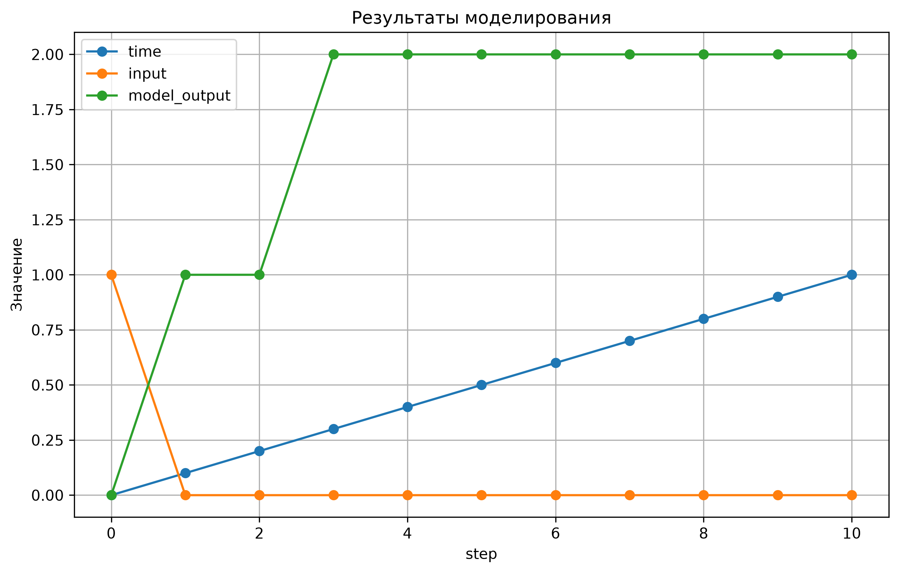
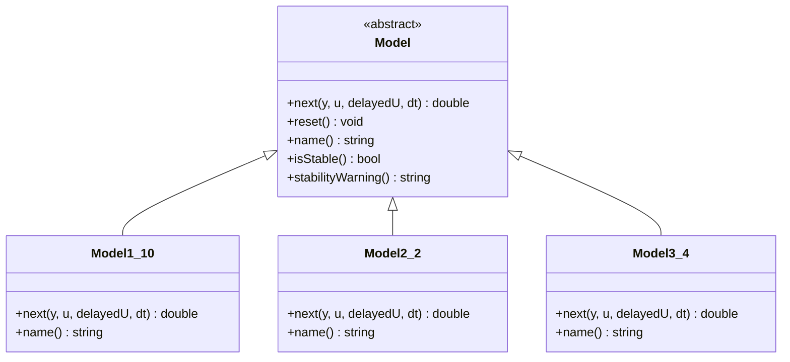

<p align="center"> Министерство образования Республики Беларусь</p>
<p align="center">Учреждение образования</p>
<p align="center">“Брестский Государственный технический университет”</p>
<p align="center">Кафедра ИИТ</p>
<br><br><br><br><br><br><br>
<p align="center">Лабораторная работа №1</p>
<p align="center">По дисциплине “Общая теория интеллектуальных систем”</p>
<p align="center">Тема: “Моделирования температуры объекта”</p>
<br><br><br><br><br>
<p align="right">Выполнил:</p>
<p align="right">Студент 2 курса</p>
<p align="right">Группы ИИ-30</p>
<p align="right">Мацукевич К. И.</p>
<p align="right">Проверил:</p>
<p align="right">Дворанинович Д. А.</p>
<br><br><br><br><br>
<p align="center">Брест 2026</p>


## Вариант

- Линейная модель: **Model 1.10**
- Нелинейная модель: **Model 2.2**
- Дифференциальное уравнение: **Model 3.4**

## Реализованные модели

### Model 1.10

`Distributed Control Window Model`

### Model 2.2

`Actuator Saturation Non-linearity`

### Model 3.4

`Quadratic Self-Decay`

## Входные воздействия

1. Ступенчатое: `u(t) = A`
2. Импульсное: `u(0) = A`, `u(t > 0) = 0`
3. Гармоническое: `u(t) = A*sin(t)`

## ООП

Создан абстрактный базовый класс `Model` с виртуальным методом `тext()`.

От него наследуются:

- `Model1_10`
- `Model2_2`
- `Model3_4`

## Результат

Программа:

- реализует три математические модели: линейную, модель с насыщением и дифференциальную;
- использует абстрактный базовый класс `Model`;
- позволяет задать параметры моделирования;
- формирует входной сигнал;
- выполняет моделирование на заданном количестве шагов;
- выводит результаты моделирования в табличном виде;
- сохраняет результаты в файл `results.csv`;
- позволяет построить график результатов с помощью Python и библиотеки Matplotlib;
- сохраняет построенный график в папку `doc/`.

## Пример работы программы:

### Сборка

На Windows build.bat:

```bat
@echo off
setlocal

cd /d "%~dp0"

echo Configuring project...
cmake -S . -B build
if errorlevel 1 goto error

echo.
echo Building project...
cmake --build build --config Release
if errorlevel 1 goto error

echo.
echo Build completed successfully!
echo.
echo Starting program...
echo.

build\Release\task_01.exe

if not exist "results.csv" (
    echo.
    echo Error: results.csv was not found.
    pause
    exit /b 1
)

echo.
echo Building graph from results.csv...
echo.

python src\plot.py "results.csv"

if errorlevel 1 (
    echo.
    echo Error: Python graph script failed.
    pause
    exit /b 1
)

echo.
echo Graph created successfully!
echo.

if not exist "doc\graph.png" (
    echo.
    echo Error: graph.png was not created.
    pause
    exit /b 1
)

echo Opening graph...
start "" "%~dp0doc\graph.png"

echo.
echo Program and graph finished.
pause
exit /b 0

:error
echo.
echo Build failed. Check the error messages above.
pause
exit /b 1

```

После сборки запускать исполняемый файл из каталога `build`.

### Демонстрация исполняемого файла otis_task_01.exe:


При запуске исполняемого файла мы получаем результат файл.csv, после чего автоматически запускается plot.py для визуализации ответа:

## Демострация графика



## UML


