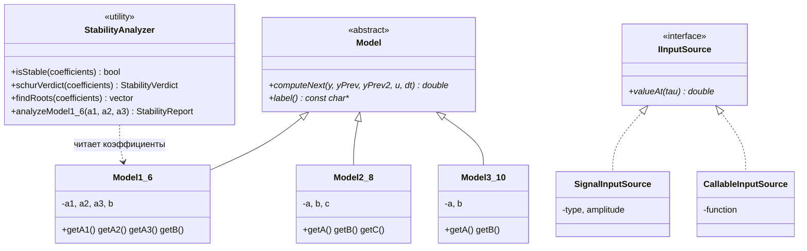
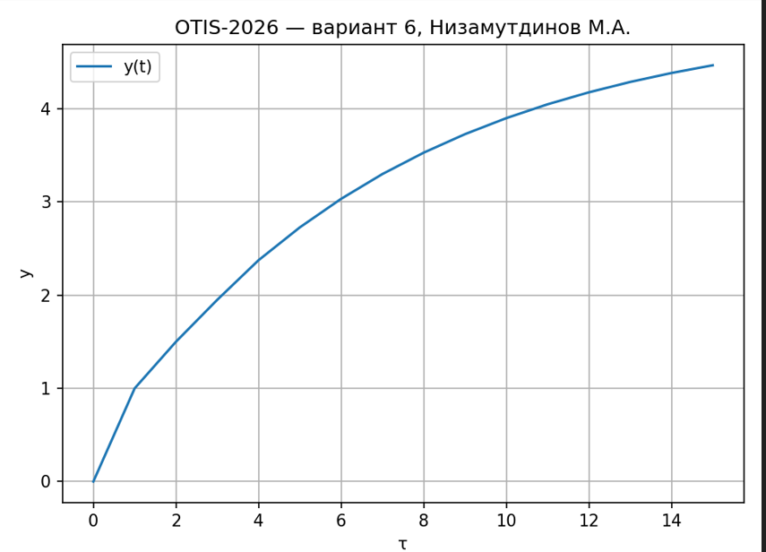
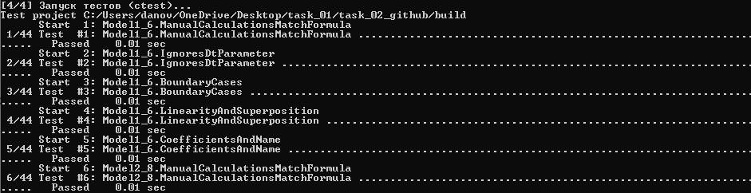
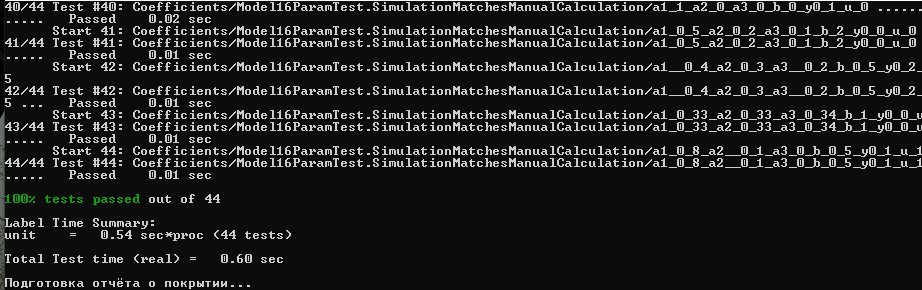
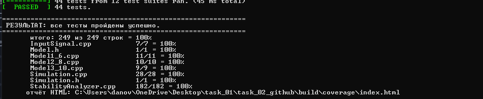

<p align="center"> Министерство образования Республики Беларусь</p>
<p align="center">Учреждение образования</p>
<p align="center">“Брестский Государственный технический университет”</p>
<p align="center">Кафедра ИИТ</p>
<br><br><br><br><br><br><br>
<p align="center">Лабораторная работа №2</p>
<p align="center">По дисциплине “Общая теория интеллектуальных систем”</p>
<p align="center">Тема: “Модульное тестирование и анализ устойчивости моделей”</p>
<br><br><br><br><br>
<p align="right">Выполнил:</p>
<p align="right">Студент 2 курса</p>
<p align="right">Группы ИИ-30</p>
<p align="right">Низамутдинов М. А.</p>
<p align="right">Проверил:</p>
<p align="right">Дворанинович Д. А.</p>
<br><br><br><br><br>
<p align="center">Брест 2026</p>

---

## 1. Цель работы

Обернуть готовый код лабораторной работы №1 модульными тестами
(Google Test) и добавить в проект анализ устойчивости динамических
систем.

Задачи:

1. Разделить код на библиотеку моделей и консольное приложение.
2. Написать тесты на корректность расчётов, граничные значения и
   анализ устойчивости.
3. Освоить параметризованные тесты `TEST_P` и подмену входного
   сигнала через Google Mock.
4. Реализовать модуль проверки устойчивости (критерий Шура) и
   выводить предупреждение `WARNING` перед началом симуляции.

---

## 2. Структура проекта

```
task_02_github/
├── CMakeLists.txt          сборка проекта (FetchContent -> Google Test)
├── run_tests.bat           сборка + ctest + покрытие
├── readme.md               этот отчёт
├── doc/                    материалы отчёта
│   └── Screenshots/        скриншоты (тесты, покрытие, запуск)
├── src/
│   ├── Model.h             абстрактный базовый класс
│   ├── Model1_6.h/.cpp     линейная модель 3-го порядка
│   ├── Model2_8.h/.cpp     нелинейная модель
│   ├── Model3_10.h/.cpp    метод Эйлера
│   ├── InputSignal.h/.cpp  ступенька / импульс / гармоника
│   ├── Simulation.h/.cpp   движок симуляции, интерфейс IInputSource
│   ├── StabilityAnalyzer.h/.cpp  критерий Шура, корни, WARNING
│   ├── main.cpp            консольное приложение
│   └── plot.py             построение графиков
└── test/
    ├── TestUtils.h              общие вспомогательные функции
    ├── test_main.cpp            собственная точка входа
    ├── test_model_1_6.cpp       тесты модели 1.6 + TEST_P
    ├── test_model_2_8.cpp       тесты модели 2.8
    ├── test_model_3_10.cpp      тесты модели 3.10
    ├── test_input_signal.cpp    тесты сигналов + Google Mock
    ├── test_simulation.cpp      тесты движка симуляции
    └── test_stability.cpp       тесты модуля устойчивости
```

Единственный `CMakeLists.txt` находится в корне проекта: он описывает
и библиотеку `otis_core`, и приложение, и тесты. Отдельного
`src/CMakeLists.txt` нет.

Схема зависимостей:



---

## 3. Что изменено в коде лабораторной работы №1

### 3.1 Выделение библиотеки

Основная программа из ЛР1 содержала `main()` и логику в одном каталоге,
поэтому её нельзя было использовать в тестах. Теперь логика вынесена
в статическую библиотеку `otis_core`:

- `otis_core` — модели, сигналы, симуляция, анализ устойчивости;
- `otis_task_02` — консольное приложение (`main.cpp`);
- `otis_tests` — тестовый исполняемый файл.

`main.cpp` **не входит** в библиотеку: иначе в тестовом проекте
оказались бы два `main()` и линковка упала бы с `LNK2005`.

### 3.2 Геттеры коэффициентов

Для анализа устойчивости модулю нужен доступ к коэффициентам моделей,
которые раньше были `private` и не имели аксессоров. Добавлены:

```cpp
// Model1_6
double getA1() const;
double getA2() const;
double getA3() const;
double getB()  const;

// Model2_8
double getA() const;
double getB() const;
double getC() const;

// Model3_10
double getA() const;
double getB() const;
```

Реализация тривиальна и не меняет поведение моделей:

```cpp
double Model1_6::getA1() const { return a1; }
double Model1_6::getA2() const { return a2; }
double Model1_6::getA3() const { return a3; }
double Model1_6::getB()  const { return b;  }
```

Геттеры помечены `const` и покрыты отдельными тестами
`Model1_6.CoefficientsAndName`, `Model2_8.CoefficientsAndName`,
`Model3_10.CoefficientsAndName`.

### 3.3 Вынос симуляции в отдельный модуль

Цикл интегрирования раньше был «зашит» в `main()`. Теперь он вынесен
в функцию `simulate()`, а входной сигнал задаётся через интерфейс:

```cpp
class IInputSource
{
public:
    virtual ~IInputSource() = default;
    virtual double valueAt(int tau) const = 0;
};
```

Реализации: `SignalInputSource` (ступенька/импульс/гармоника) и
`CallableInputSource` (произвольная лямбда). Наличие виртуальной
функции позволяет подменять сигнал мок-объектом Google Mock.

### 3.4 Предупреждение до симуляции

В `main.cpp` анализ устойчивости выполняется **до** запуска
интегрирования:

```cpp
std::cout << StabilityAnalyzer::describe(setup.stability);
StabilityAnalyzer::printWarningIfNeeded(setup.stability, std::cout);
```

То есть пользователь видит вердикт раньше, чем получит расходящуюся
таблицу чисел.

---

## 4. Тесты

### 4.1 Перечень наборов тестов

| Файл | Набор тестов | Тестов | Что проверяется |
|---|---|---|---|
| `test_model_1_6.cpp` | `Model1_6` | 5 | формулы, история, линейность, геттеры |
| | `Model16ParamTest` | 9 | наборы коэффициентов через `TEST_P` |
| `test_model_2_8.cpp` | `Model2_8` | 5 | нелинейные члены, границы, конечность |
| `test_model_3_10.cpp` | `Model3_10` | 5 | метод Эйлера, точность, границы |
| `test_input_signal.cpp` | `InputSignal` | 3 | ступенька, импульс, гармоника |
| | `InputSource` | 1 | делегирование обёрток `IInputSource` |
| | `MockSignal` | 2 | подмена входа через Google Mock |
| `test_simulation.cpp` | `Simulation` | 5 | сдвиг истории, число шагов |
| `test_stability.cpp` | `StabilityRoots` | 1 | поиск корней полинома |
| | `SchurCriterion` | 2 | критерий Шура |
| | `Model16Stability` | 2 | устойчивость модели 1.6 |
| | `StabilityWarning` | 4 | формирование `WARNING` |

Родственные проверки сгруппированы в один тест, а конкретные
случаи размечены `SCOPED_TRACE("...")`: при падении gtest выводит не
только имя теста, но и метку случая, поэтому число тестов
сокращается без потери самих проверок.

### 4.2 Проверка правильности расчётов

Первые шаги каждой модели сверяются с ручным счётом.

**Model 1.6**: `a1 = 0.5`, `a2 = 0.2`, `a3 = 0.1`, `b = 2`, `y0 = 0`, `u = 1`

```
y(0) = 0
y(1) = 0.5*0   + 0.2*0 + 0.1*0 + 2*1 = 2
y(2) = 0.5*2   + 0.2*0 + 0.1*0 + 2*1 = 3
y(3) = 0.5*3   + 0.2*2 + 0.1*0 + 2*1 = 3.9
```

**Model 3.10**: `a = 0.5`, `b = 1`, `dt = 0.1`, `y0 = 0`, `u = 1`

```
y(1) = 0    + 0.1*(-0.5*0    + 1 + 1) = 0.2
y(2) = 0.2  + 0.1*(-0.5*0.2  + 1 + 1) = 0.39
y(3) = 0.39 + 0.1*(-0.5*0.39 + 1 + 1) = 0.5705
```

**Model 2.8**: `a = 1.5`, `b = 0.5`, `c = 0.25`, `y0 = 0.5`, `u = 0.2`

```
y(1) = 1.5*0.5*(1-0.5) + 0.5*0.2 + 0.25*sin(0.5*0.2) = 0.499958354161707
```

Эталонные значения получены независимым расчётом в Python/NumPy и
занесены в тесты. Общий допуск задан в `test/TestUtils.h` как
`kEps = 1e-12` и применяется во всех сравнениях с плавающей точкой,
если в конкретном тесте не указано иное.

### 4.3 Граничные значения

Проверяются случаи, где формула вырождается:

- `u = 0` — отклик только от начального состояния;
- `y0 = 0` и `u = 0` — система остаётся в покое;
- `a1 = a2 = a3 = 0` — модель пропускает вход на выход без памяти;
- `b = 0` — вход не влияет на выход;
- `a1 = 1`, `a2 = a3 = 0` — состояние сохраняется (граница устойчивости);
- `dt = 0` для модели 3.10 — интегрирования нет;
- `a*dt = 2` — полюс `z = -1`, незатухающие колебания;
- нулевая и отрицательная амплитуда сигнала;
- отсутствие `NaN`/`Inf` при больших коэффициентах.

### 4.4 Параметризованные тесты `TEST_P`

Для модели 1.6 параметры `a1`, `a2`, `a3`, `b` (а также `y0`, `u` и
ожидаемая траектория) объединены в структуру:

```cpp
struct Model16Case
{
    double a1, a2, a3, b, y0, u;
    int steps;
    std::vector<double> expected;
};

class Model16ParamTest : public ::testing::TestWithParam<Model16Case> {};

TEST_P(Model16ParamTest, SimulationMatchesManualCalculation)
{
    const Model16Case& param = GetParam();
    Model1_6 model(param.a1, param.a2, param.a3, param.b);
    const std::vector<double> actual =
        otis_test::runConstant(model, param.y0, param.u, param.steps);
    otis_test::expectNear(actual, param.expected);
}
```

Последний аргумент `INSTANTIATE_TEST_SUITE_P` — генератор читаемых
имён. Без него gtest назвал бы тесты
`Coefficients/Model16ParamTest.SimulationMatchesManualCalculation/0`,
а с ним — `.../a1_0_5_a2_0_2_a3_0_1_b_2_y0_0_u_1`, что сразу говорит,
какой набор упал.

Наборы подобраны так, чтобы покрыть разные режимы:

| `a1` | `a2` | `a3` | `b` | `y0` | `u` | Особенность |
|---|---|---|---|---|---|---|
| 0.5 | 0.2 | 0.1 | 2.0 | 0.0 | 1.0 | устойчивый базовый набор |
| 0.5 | 0.2 | 0.1 | 2.0 | 1.0 | 1.0 | тот же набор, ненулевое `y0` |
| 0.9 | -0.2 | 0.05 | 1.0 | 0.5 | 0.5 | знакопеременное затухание |
| 0.0 | 0.0 | 0.0 | 1.0 | 0.7 | 0.3 | без памяти, проход входа |
| 1.0 | 0.0 | 0.0 | 0.0 | 1.0 | 0.0 | граница устойчивости |
| 0.5 | 0.2 | 0.1 | 2.0 | 0.0 | 0.0 | нулевой вход |
| -0.4 | 0.3 | -0.2 | 0.5 | 2.0 | -1.5 | отрицательные коэффициенты и вход |
| 0.33 | 0.33 | 0.34 | 1.0 | 0.0 | 2.0 | сумма = 1, накопление входа |
| 0.8 | -0.1 | 0.0 | 0.5 | 1.0 | 1.0 | нулевой `a3` |

### 4.5 Google Mock

Подмена входного сигнала выполняется мок-классом:

```cpp
class MockInputSource : public IInputSource
{
public:
    MOCK_METHOD(double, valueAt, (int tau), (const, override));
};
```

Пример проверки импульсного режима:

```cpp
MockInputSource input;
EXPECT_CALL(input, valueAt(0)).WillOnce(Return(3.0));
EXPECT_CALL(input, valueAt(::testing::Ne(0))).WillRepeatedly(Return(0.0));
```

Мок используется и для интеграционной проверки: модель 3.10 с
мок-сигналом должна дать заранее известную траекторию. Отдельный тест
`MockSignal.SimulationUsesMockedInput` подтверждает, что
движок запрашивает вход на каждом такте — это ловит ошибку, при которой
сигнал читается один раз и «замерзает».

---

## 5. Анализ устойчивости

### 5.1 Постановка задачи

Дискретная линейная система с характеристическим полиномом

```
c0 + c1*z + ... + cn*z^n = 0
```

асимптотически устойчива тогда и только тогда, когда все его корни
лежат **строго внутри** единичной окружности Z-плоскости:

```
|z_i| < 1  для всех i
```

### 5.2 Критерий Шура

Корни напрямую не вычисляются. Используется рекурсия Шура–Кона:
полином приводится к моническому виду, затем многократно применяется
преобразование

```
если |a0| >= |an|      ->  система не устойчива
q_k = (an*p_k - a0*p_{n-k}) / (an^2 - a0^2),  k = 1..n
```

и степень понижается на единицу, пока не останется константа.
Вердиктов три:

| Вердикт | Условие | Смысл |
|---|---|---|
| `Stable` | все `|z| < 1` | процесс затухает |
| `Marginal` | есть `|z| = 1` | на границе, колебания не затухают |
| `Unstable` | есть `|z| > 1` | процесс расходится |

Корни дополнительно вычисляются методом Дюрана–Кернера — не для
вердикта, а для наглядного вывода в отчёт. Согласованность критерия
Шура с положением корней проверяется на эталонных наборах
(`SchurCriterion.StableCubic`, `UnstableCubic`, `UnitRootIsMarginal`):
для полинома `z^3 - 0.5*z^2 - 0.2*z - 0.1` оба подхода дают
`|z|max = 0.864913416 < 1`, а для `z^3 - 2*z^2` находится корень
`z = 2`. Тест `ScalingDoesNotChangeVerdict` подтверждает, что
умножение полинома на константу не меняет вердикт.

### 5.3 Модель 1.6 (анализ устойчивости)

В текущей реализации спектральный анализ выполняется только для
линейной **Model 1.6**. Для нелинейной Model 2.8 и модели 3.10
(метод Эйлера) корректная оценка требует линеаризации в рабочей
точке, поэтому к ним критерий Шура не применяется: они покрыты
функциональными тестами (раздел 4).

**Model 1.6** — линейная модель 3-го порядка:

```
y(t+1) = a1*y(t) + a2*y(t-1) + a3*y(t-2) + b*u(t)
```

Передаточная функция даёт характеристическое уравнение

```
z^3 - a1*z^2 - a2*z - a3 = 0
```

В коде коэффициенты задаются по возрастанию степени:
`{-a3, -a2, -a1, 1.0}`. Устойчивость определяется критерием Шура
(п. 5.2), корни для наглядного вывода находятся методом
Дюрана–Кернера.

### 5.4 Пример вывода для неустойчивой системы

При `a1 = 2`, `a2 = a3 = 0` корень `z = 2` лежит вне единичной
окружности, поэтому перед симуляцией печатается:

```
----------------------------------------------------------------------------
  АНАЛИЗ УСТОЙЧИВОСТИ (критерий Шура, Z-плоскость)
----------------------------------------------------------------------------
Модель: Model 1.6 (linear, order 3)
Характеристическое уравнение: -0*z^0 + -0*z^1 + -2*z^2 + +1*z^3 = 0
Корни:
  z = 0.000000   (|z| = 0.000000)
  z = 2.000000   (|z| = 2.000000)
  z = -0.000000   (|z| = 0.000000)
Вердикт (критерий Шура): UNSTABLE

============================================================
WARNING: система НЕУСТОЙЧИВА:
         решение будет расходящимся, результаты симуляции не имеют смысла.
         Модель: Model 1.6 (linear, order 3)
         Корни характеристического уравнения:
           z = 0.000000   (|z| = 0.000000)
           z = 2.000000   (|z| = 2.000000)
           z = -0.000000   (|z| = 0.000000)
============================================================
```

Для границы устойчивости (`a1 = 1`) выводится отдельный текст:
`WARNING: система НЕУСТОЙЧИВА (на границе |z| = 1)`. Вместо «решение
будет расходящимся» этот вариант сообщает, что колебания не затухают
и численное решение может «уплывать».

---

## 6. Сборка и запуск

### 6.1 Требования

- Visual Studio 2022 (MSVC, рабочая нагрузка «Разработка классических
  приложений на C++»);
- CMake 3.20 или новее;
- доступ в интернет при первой сборке: Google Test скачивается
  через `FetchContent`.

### 6.2 Сборка с тестами

```bat
run_tests.bat
```

Скрипт выполняет четыре шага: находит `vcvars64.bat`, конфигурирует
проект, собирает его и запускает `ctest`. При наличии `gcovr` или
`OpenCppCoverage` дополнительно считается покрытие; если их нет —
шаг аккуратно пропускается с пояснением, а не завершается ошибкой.

Конфигурация задаётся аргументом:

```bat
run_tests.bat Release
```

Если нет доступа к GitHub, путь к заранее скачанным исходникам
googletest задаётся переменной окружения:

```bat
set OTIS_GTEST_DIR=C:\libs\googletest-1.14.0
run_tests.bat
```

### 6.3 Запуск вручную

```bat
cmake -S . -B build -G "Visual Studio 17 2022" -A x64
cmake --build build --config Debug
ctest --test-dir build -C Debug --output-on-failure
```

Запуск отдельной группы тестов:

```bat
build\bin\Debug\otis_tests.exe --gtest_filter=Model16ParamTest.*
build\bin\Debug\otis_tests.exe --gtest_filter=SchurCriterion.*
build\bin\Debug\otis_tests.exe --gtest_list_tests
```

### 6.4 Консольное приложение

```bat
build\bin\Debug\otis_task_02.exe    # для конфигурации Debug
build\bin\Release\otis_task_02.exe  # для конфигурации Release
```

После ввода параметров программа выводит в терминал структурированный отчёт:

1. **Заголовок работы** — дисциплина, тема, вариант, студент, группа.
2. **Анализ устойчивости** — характеристическое уравнение, корни, спектральный радиус, вердикт критерия Шура (выводится **до** начала симуляции, п.2 задания).
3. **Результаты симуляции** — параметры модели, тип сигнала, амплитуда, число шагов, dt, таблица значений tau/u/y.
4. **Построение графика** — вызов `python plot.py`, сохранение `result.png`.
5. **Сохранение CSV** — результаты записываются в `results.csv`.

Также программа сообщает, если не удалось построить график (например, Python или matplotlib не установлены).

Пример запуска: модель 1.6 (`a1=0.5, a2=0.2, a3=0.1, b=1`),
ступенчатый вход амплитуды 1, `n=15`, `y0=0`. Система устойчива
(`|z|max < 1`), переходный процесс затухает и выходит на установившееся
значение:



*Рис. 4. Переходный процесс `y(t)` модели 1.6 при ступенчатом входе; график построен `plot.py` по `results.csv`*

---

## 7. Результаты

### 7.1 Тестирование

| Файл тестов | Тестовых случаев |
|---|---|
| `test_model_1_6.cpp` | 5 + 9 параметризованных |
| `test_model_2_8.cpp` | 5 |
| `test_model_3_10.cpp` | 5 |
| `test_input_signal.cpp` | 6 |
| `test_simulation.cpp` | 5 |
| `test_stability.cpp` | 9 |
| **Итого** | **44** |

Все тесты проходят: `100% tests passed, 0 tests failed out of 44`.
Итоговая строка выводится `ctest` и дублируется в конце
`run_tests.bat`.

Вывод тестового приложения `otis_tests.exe` (полный список `[ RUN ]` /
`[ OK ]` по каждому тесту):





*Рис. 1–3. Полный вывод модульных тестов ЛР №2 (44 теста, 12 наборов, все PASSED)*

### 7.2 Покрытие

Покрытие измерено инструментом `OpenCppCoverage` (MSVC-сборка
`Debug`) и сохранено в `build\coverage\index.html`; числа ниже взяты
из `build\coverage.xml` после прогона последней версии тестов.

| Файл | Покрыто строк | Всего строк | Покрытие |
|---|---|---|---|
| `src/Model.h` | 1 | 1 | 100 % |
| `src/Model1_6.cpp` | 11 | 11 | 100 % |
| `src/Model2_8.cpp` | 10 | 10 | 100 % |
| `src/Model3_10.cpp` | 9 | 9 | 100 % |
| `src/Simulation.cpp` | 28 | 28 | 100 % |
| `src/Simulation.h` | 1 | 1 | 100 % |
| `src/StabilityAnalyzer.cpp` | 182 | 182 | 100 % |
| `src/InputSignal.cpp` | 7 | 7 | 100 % |
| **Итого по `src/`** | **249** | **249** | **100 %** |

Все модели, движок симуляции, генерация сигналов и анализатор
устойчивости покрыты полностью. Ранее непокрытыми в
`StabilityAnalyzer.cpp` оставались три защитные строки: обрезка
нулевых старших коэффициентов при поиске корней и в критерии Шура,
а также ветка линейного полинома `degree == 1` в `findRoots`.
Они закрыты точечными проверками — `findRoots({1.0, 2.0, 0.0})`,
`findRoots({2.0, 1.0})` и `schurVerdict({0.5, 1.0, 0.0})`.

`main.cpp` в покрытие не входит: он содержит диалог с пользователем
и недоступен для юнит-тестов. Именно поэтому вся логика вынесена в
`otis_core` — непокрытым остаётся только ввод-вывод.

### 7.3 Замечание о покрытии под MSVC

`gcovr` работает с инструментацией GCC/Clang и к MSVC-сборке напрямую
неприменим. Практический эквивалент для MSVC — `OpenCppCoverage`,
который запускает тестовый исполняемый файл и собирает покрытие по
PDB-файлам.

Покрытие измеряется только на конфигурации `Debug`: в `Release`
отладочная информация в PDB не генерируется, и инструмент не может
сопоставить инструкции с исходным кодом. Поэтому `run_tests.bat`
запускается без аргументов, а при явном указании `Release` честно
сообщает, что покрытие не измерено, вместо вывода нулевых значений.

Бинарники конфигураций разведены по каталогам `build\bin\Debug` и
`build\bin\Release`. Это важно именно для покрытия: при общем
каталоге `Release`-сборка перезаписывала `otis_tests.exe`, оставляя
рядом Debug-PDB, и `OpenCppCoverage` показывал `0 из 0 строк`.

---

## 8. Выводы

1. Готовый код ЛР1 удалось покрыть тестами без изменения алгоритмов:
   потребовалось только разделить библиотеку и приложение и добавить
   геттеры коэффициентов.
2. Ручной расчёт первых шагов и независимый расчёт в NumPy позволили
   получить эталонные значения, к которым тесты оказались чувствительны
   уже на допуске `1e-12`.
3. Параметризованные тесты `TEST_P` убрали дублирование: 9 наборов
   коэффициентов описываются одной таблицей вместо девяти функций,
   а генератор имён сразу указывает упавший набор.
4. Google Mock через интерфейс `IInputSource` дал возможность проверять
   режимы ступеньки, импульса и гармоники без разбора консольного ввода.
5. Критерий Шура вычисляет устойчивость без поиска корней; на
   эталонных наборах его вердикт согласуется с положением корней
   (`|z|max`) и с независимо посчитанными значениями спектрального
   радиуса, что подтверждает корректность реализации.
6. Проверка устойчивости перед симуляцией полезна практически: для
   `a1 = 2` модель формально считается, но результат расходится и
   смысла не имеет — предупреждение `WARNING` снимает эту ловушку.
7. Измеренное покрытие `src/` составило 249 из 249 строк (100 %):
   все 44 теста проходят. Родственные проверки объединены в
   укрупнённые тесты с разметкой `SCOPED_TRACE`, поэтому число
   тестов снизилось со 103 до 44, а покрытие выросло с 98.8 % до
   100 %: три прежде непокрытые защитные ветки анализатора
   устойчивости закрыты точечными проверками.
8. Сборка и измерение покрытия потребовали развести бинарники
   конфигураций по разным каталогам. Без этого `Release` затирал
   `Debug`-исполняемый файл, и инструмент покрытия показывал ноль
   строк — ошибка выглядела как проблема тестов, хотя тесты были
   исправны.

---

## 9. Приложение. Состав проекта

| Файл | Назначение |
|---|---|
| src/Model.h | абстрактный базовый класс |
| src/Model1_6.h, src/Model1_6.cpp | модель 1.6 |
| src/Model2_8.h, src/Model2_8.cpp | модель 2.8 |
| src/Model3_10.h, src/Model3_10.cpp | модель 3.10 |
| src/InputSignal.h, src/InputSignal.cpp | генерация входного сигнала |
| src/Simulation.h, src/Simulation.cpp | цикл симуляции, `SimStep`, источники входа |
| src/StabilityAnalyzer.h, src/StabilityAnalyzer.cpp | корни, критерий Шура, `WARNING` |
| src/main.cpp | точка входа, меню, вывод |
| src/plot.py | построение графика |
| test/TestUtils.h | общие допуски и помощники тестов |
| test/test_main.cpp | точка входа тестового бинарника |
| test/test_model_1_6.cpp | тесты модели 1.6 и `TEST_P` |
| test/test_model_2_8.cpp | тесты модели 2.8 |
| test/test_model_3_10.cpp | тесты модели 3.10 |
| test/test_input_signal.cpp | тесты сигналов и Google Mock |
| test/test_simulation.cpp | тесты цикла симуляции |
| test/test_stability.cpp | тесты корней, критерия Шура, `WARNING` |
| CMakeLists.txt | сборка проекта, `FetchContent` -> Google Test |
| run_tests.bat | сборка + ctest + отчёт о покрытии |
| readme.md | отчёт |
| doc/Screenshots/ | скриншоты отчёта (тесты, покрытие, запуск) |
