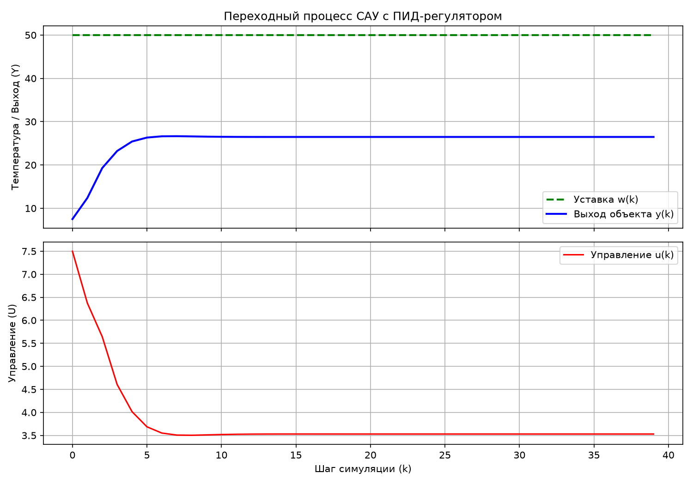
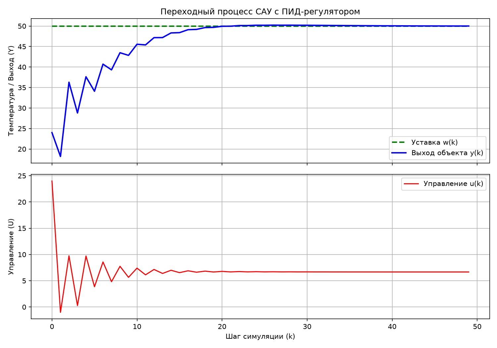
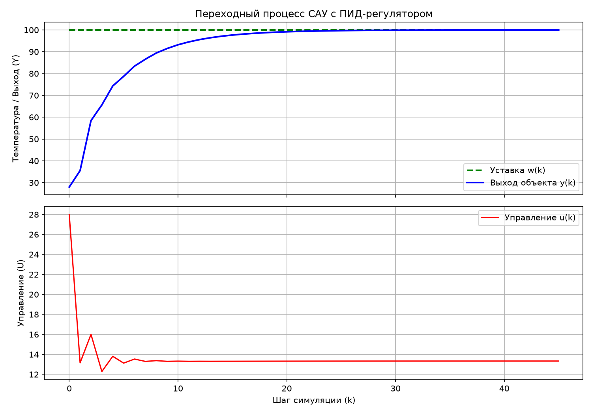
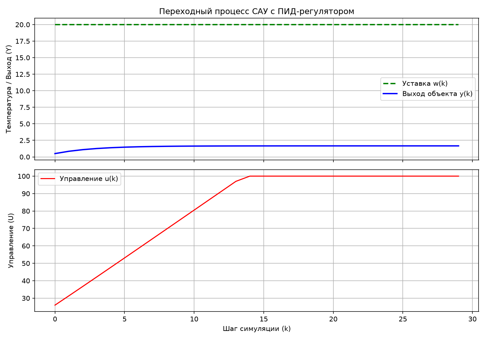

 Министерство образования Республики Беларусь

Учреждение образования

“Брестский Государственный технический университет”

Кафедра ИИТ

       

Лабораторная работа №3

По дисциплине “Общая теория интеллектуальных систем”

Тема: “Разработка системы автоматического управления на основе ПИД-регулятора”

     

Выполнил:

Студент 2 курса

Группы ИИ-30

Нущик М.С.

Проверил:

Дворанинович Д. А.

     

Брест 2026

---

## 1. Введение и цель работы

Целью данной лабораторной работы является проектирование и программная реализация дискретной системы автоматического управления (САУ) с обратной связью на основе пропорционально-интегрально-дифференциального (**ПИД**) регулятора для математических моделей объектов управления, разработанных в лабораторной работе №1.

В рамках выполнения работы решаются следующие задачи:
1. Изучить принципы построения замкнутых САУ с обратной связью и математический аппарат непрерывных и дискретных ПИД-регуляторов.
2. Реализовать класс дискретного ПИД-регулятора с поддержкой ограничения выходного сигнала и механизмом защиты от интегрального насыщения (**Anti-windup**).
3. Обеспечить модульную архитектуру программы с возможностью переключения между тремя объектами управления (`LineModel_1_10`, `NonlinearModel_2_5`, `Diff_3_10`).
4. Реализовать два режима проведения симуляции:
   * **Режим А** — моделирование в течение фиксированного числа шагов дискретизации $n$;
   * **Режим Б** — моделирование до достижения системой установившегося режима с заданной точностью $|e(k)| \le \varepsilon$.
5. Обеспечить строгий табличный вывод результатов симуляции в консоль, экспорт в формат `.csv` и автоматическую визуализацию переходных процессов средствами языка Python (`matplotlib`).
6. Покрыть исходный код модульными тестами с использованием фреймворка **Google Test** (25 тестов), задокументировать код в стиле **Doxygen** и настроить локальную автоматизацию сборки и тестирования (`run_all.bat`).
7. Провести инженерный анализ и пошаговую настройку коэффициентов $K_p, K_i, K_d$ при различных значениях заданной температуры (уставки).

---

## 2. Постановка задачи

Объектом управления (Plant) выступают математические модели, реализованные в лабораторной работе №1 (вариант 10 / 5):

1. **Линейная дискретная модель (`LineModel_1_10`):**
   $$y(k+1) = a_1 y(k) + b_1 u(k) + b_2 u(k-2)$$
   где $a_1 = 0.8, \; b_1 = 1.0, \; b_2 = 0.5$.

2. **Нелинейная дискретная модель (`NonlinearModel_2_5`):**
   $$y(k+1) = a \cdot y(k) + b \cdot \text{sign}(u(k)) \cdot \left(1 - e^{-|u(k)|}\right)$$
   где $a = 0.7, \; b = 0.5$.

3. **Дифференциальное уравнение 1-го порядка (`Diff_3_10`), интегрируемое методом Эйлера:**
   $$\frac{dy}{dt} = -a y + b + u \implies y(k+1) = y(k) + \Delta t \cdot (-a y(k) + b + u(k))$$
   где $a = 0.5, \; b = 0.2, \; \Delta t = 0.1$.

Требуется спроектировать цифровой регулятор, способный минимизировать ошибку регулирования $e(k) = w(k) - y(k)$ и удерживать выходную величину $y(k)$ на заданном уровне $w(k)$ при изменении уставки и параметров объекта.

---

## 3. Теоретическая часть

### 3.1. Закон регулирования непрерывного ПИД-регулятора
В замкнутой САУ с отрицательной обратной связью регулятор $G_R$ вырабатывает управляющее воздействие $u(t)$ на основании сигнала рассогласования (ошибки) $e(t) = w(t) - y(t)$. Идеализированное уравнение непрерывного ПИД-регулятора имеет вид:

$$u(t) = K \left[ e(t) + \frac{1}{T} \int_{0}^{t} e(\tau)\,d\tau + T_D \frac{de(t)}{dt} \right]$$

где:
* $K$ — коэффициент передачи (пропорционального усиления);
* $T$ — постоянная интегрирования;
* $T_D$ — постоянная дифференцирования.

Каждая из трёх составляющих выполняет строго определённую функцию:
* **Пропорциональная (П)** формирует воздействие, прямо пропорциональное текущей ошибке $e(t)$, обеспечивая быстрое реагирование системы на отклонение. Однако чистый П-регулятор ($T \to \infty, T_D = 0$) не способен полностью свести ошибку к нулю — в системе остаётся **статическая ошибка**.
* **Интегральная (И)** накапливает ошибку во времени $\int e(\tau)d\tau$. Она продолжает изменять управляющий сигнал до тех пор, пока ошибка не станет строго равной нулю, тем самым полностью устраняя статическую ошибку. Избыточное интегральное воздействие приводит к колебательности и перерегулированию.
* **Дифференциальная (Д)** реагирует на скорость изменения ошибки $\frac{de(t)}{dt}$, работая на упреждение. Она демпфирует колебания, уменьшает перерегулирование и повышает запас устойчивости, но чувствительна к резким скачкам уставки.

### 3.2. Переход к дискретной реализации и рекуррентная форма
При реализации регулятора на базе микропроцессорного устройства или ЭВМ непрерывные сигналы квантуются по времени с шагом $T_0 = \Delta t$. Заменяя интеграл конечной суммой по методу прямоугольников, а производную — первой разностью, получаем дискретное уравнение ПИД-регулятора:

$$u(k) = K \left[ e(k) + \frac{T_0}{T} \sum_{i=1}^{k} e(i-1) + \frac{T_D}{T_0} \big(e(k) - e(k-1)\big) \right]$$

Переходя к независимым коэффициентам настройки $K_p = K$, $K_i = \frac{K}{T}$, $K_d = K \cdot T_D$, выражение записывается в стандартной позиционной форме:

$$u(k) = K_p \cdot e(k) + K_i \sum_{i=0}^{k} e(i)\Delta t + K_d \frac{e(k) - e(k-1)}{\Delta t}$$

Для устранения необходимости хранить всю историю ошибок можно записать разность $\Delta u(k) = u(k) - u(k-1)$, что приводит к **рекуррентному (инкрементному) алгоритму**:

$$u(k) = u(k-1) + q_0 e(k) + q_1 e(k-1) + q_2 e(k-2)$$

где параметры $q_0, q_1, q_2$ выражаются через $K, T, T_D, T_0$:
$$q_0 = K \left(1 + \frac{T_D}{T_0}\right), \quad q_1 = -K \left(1 + 2\frac{T_D}{T_0} - \frac{T_0}{T}\right), \quad q_2 = K \frac{T_D}{T_0}$$

### 3.3. Защита от интегрального насыщения (Anti-windup)
В реальных технических системах мощность исполнительного механизма ограничена диапазоном $[u_{\min}, u_{\max}]$ (в работе принято $[-100, 100]$). Если при большой ошибке управляющий сигнал упирается в границу насыщения, продолжение накопления интегральной суммы вызывает эффект **интегрального насыщения (windup)**, приводящий к затяжному перерегулированию. В классе `PID` реализован механизм условного интегрирования (откат интегратора): при превышении порога $u_{\max}$ или $u_{\min}$ сигнал ограничивается, а текущее приращение $e(k)\Delta t$ вычитается из интегральной суммы.

---

## 4. Архитектура проекта и описание модулей

Проект организован по модульному принципу с разделением на исходный код (`src/`), модульные тесты (`test/`) и документацию (`doc/`):

| Файл / Каталог | Назначение и ключевые элементы |
| :--- | :--- |
| `src/PID.h`, `src/PID.cpp` | Класс `PID`: хранит коэффициенты `Kp`, `Ki`, `Kd`, шаг `dt`, ограничения `min_u`/`max_u`, накопленный интеграл `integral` и ошибки `prev_error`, `prev_error2`. Методы `compute()` и `reset()`. |
| `src/Simulation.h`, `src/Simulation.cpp` | Перечисление `PlantType` и класс `Simulation`. Реализует замкнутый контур управления для Режима А (`runFixedSteps`) и Режима Б (`runUntilSteadyState`), форматированный вывод таблицы и запись в `simulation_results.csv`. |
| `src/Models.cpp` | Реализация методов `step()`, `reset()` и `name()` для математических моделей `LineModel_1_10`, `NonlinearModel_2_5` и `Diff_3_10` из ЛР №1. |
| `src/main.cpp` | Консольный интерфейс пользователя для интерактивного выбора модели, настройки коэффициентов, задания уставки и запуска визуализации. |
| `test/test_pid_basic.cpp` | Набор базовых тестов `PIDBasic` (7 тестов): проверка изолированной работы П-, И-, Д-составляющих, Anti-windup, сброса `reset()`, нулевой и отрицательной ошибки. |
| `test/test_pid_math.cpp` | Набор математических тестов `PIDMath` (5 тестов): проверка комбинаций $K_p+K_i$, $K_p+K_d$, всех трёх коэффициентов, верхнего и нижнего пределов насыщения. |
| `test/test_pid_dynamic.cpp` | Набор динамических тестов `PIDDynamic` (13 тестов): ступенчатое, линейное (ramp) и синусоидальное изменение уставки, импульсное воздействие, работа с инерционным объектом, сброс после насыщения. |
| `plot.py` | Скрипт на Python (`matplotlib`) для чтения `simulation_results.csv` и автоматического сохранения двухпанельных графиков $y(k), w(k)$ и $u(k)$ в каталог `doc/images/`. |
| `Doxyfile` | Конфигурационный файл Doxygen для генерации HTML-документации по комментариям исходного кода в каталог `doc/html`. |
| `CMakeLists.txt` | Сценарий сборки основного приложения `task_03_pid` и тестового исполняемого файла `run_tests` с автоматическим подключением Google Test v1.14.0. |
| `run_all.bat` | Пакетный файл Windows для автоматизированной сборки, прогона всех модульных тестов и перегенерации документации Doxygen. |

---

## 5. Инженерный анализ и пошаговая настройка ПИД-регулятора

Настройка коэффициентов регулятора осуществлялась методом последовательного подбора на **Линейной модели 1.10** ($a_1 = 0.8, \; b_1 = 1.0, \; b_2 = 0.5, \; \Delta t = 0.1$).

### Этап 1. Исследование П-регулятора (выявление статической ошибки)
На первом шаге интегральная и дифференциальная составляющие обнулены ($K_i = 0, \; K_d = 0$), задан пропорциональный коэффициент $K_p = 0.15$ при уставке $w = 50$ (Режим А, $n = 40$ шагов).

* **Ход процесса:** на нулевом шаге при $y(0) = 0$ ошибка максимальна ($e(0) = 50$), что формирует управляющий импульс $u(0) = 0.15 \cdot 50 = 7.5$. К 20-му шагу система входит в установившийся режим, однако из-за отсутствия интегратора выходная величина замирает на значении **$y = 26.4706$**.
* **Вывод:** в системе присутствует неустранимая **статическая ошибка** $e_{\text{ст}} = 50 - 26.4706 = 23.5294$ ($47.06\%$ от уставки).

### Этап 2. Введение интегральной и дифференциальной составляющих
Для устранения статической ошибки введён интегральный коэффициент $K_i = 0.3$, а для компенсации инерционности и демпфирования добавлен дифференциальный коэффициент $K_d = 0.03$ при той же уставке $w = 50$ (Режим Б, допустимая погрешность $\varepsilon = 0.01$).

* **Ход процесса:** интегральная сумма плавно наращивает управляющее воздействие, выводя объект точно на заданную температуру $w = 50$. На 26-м шаге наблюдается небольшое перерегулирование до $y_{\max} = 50.2242$ (около $0.45\%$), после чего колебания затухают, и на 50-м шаге система достигает установившегося режима с точностью $|e| \le 0.01$ ($y(49) = 50.0060, \; e(49) = -0.0082$).
* **Вывод:** статическая ошибка полностью ликвидирована, но завышенное значение $K_d = 0.03$ вызывает заметную пульсацию управляющего сигнала $u(k)$ на начальных шагах.

### Этап 3. Тонкая коррекция $K_d$ и испытание при другой заданной температуре

Для сглаживания управляющего сигнала и устранения перерегулирования дифференциальный коэффициент уменьшен до $K_d = 0.01$ при $K_p = 0.15, \; K_i = 0.3$. Проверка выполнена при повышенной заданной температуре $w = 100$ (Режим Б, $\varepsilon = 0.01$).

* **Ход процесса:** переходный процесс носит строго монотонный (апериодический) характер без единого перерегулирования. Управляющее воздействие $u(k)$ после начального броска стабилизируется на уровне $u_{\text{уст}} = 13.3332$, удерживая объект в равновесии. Система достигает заданной точности за 46 шагов ($y(45) = 99.9928, \; e(45) = 0.0087$).

### Сводная таблица результатов настройки

| Этап | Конфигурация | $K_p$ | $K_i$ | $K_d$ | Уставка $w$ | Установившееся $y$ | Ошибка $e$ | Шагов до $\varepsilon=0.01$ | Характер процесса |
| :--- | :--- | :---: | :---: | :---: | :---: | :---: | :---: | :---: | :--- |
| 1 | П-регулятор | 0.15 | 0.00 | 0.00 | 50 | 26.4706 | 23.5294 | Не достигнуто | Статическая ошибка 47% |
| 2 | ПИД (черновой) | 0.15 | 0.30 | 0.03 | 50 | 50.0060 | -0.0082 | 50 | Лёгкое перерегулирование (0.45%) |
| 3 | ПИД (оптимальный) | 0.15 | 0.30 | 0.01 | 100 | 99.9928 | 0.0087 | 46 | Монотонный, без перерегулирования |

### Дополнительное исследование на нелинейном объекте (`NonlinearModel_2_5`)

Проведено тестирование работы системы на **Нелинейной модели 2.5** ($a = 0.7, \; b = 0.5$) при уставке $w = 20$ и коэффициентах $K_p = 1.0, \; K_i = 3.0, \; K_d = 0.0$. Вследствие экспоненциального насыщения нелинейной функции модели $1 - e^{-|u|} \le 1$ теоретический предел выходного сигнала данного объекта ограничен величиной $y_{\lim} = \frac{b}{1 - a} = \frac{0.5}{0.3} \approx 1.6667$. График подтверждает корректную работу механизма **Anti-windup**: при достижении $u = 100$ на 14-м шаге управляющий сигнал фиксируется на верхней границе, а выход объекта плавно выходит на свой физический предел $y = 1.6666$.

---

## 6. Модульное тестирование и верификация

Для подтверждения корректности алгоритмов разработано **25 модульных тестов** на базе фреймворка **Google Test**, разделённых на три логических набора:

1. **`PIDBasic` (`test/test_pid_basic.cpp`, 7 тестов):**
   * `Proportional`, `Integral`, `Derivative` — изолированная проверка каждой составляющей;
   * `AntiWindup` — проверка ограничения интегрального накопления после 100 шагов насыщения;
   * `Reset` — проверка полного обнуления внутреннего состояния регулятора;
   * `ZeroError`, `NegativeError` — проверка граничных и отрицательных рассогласований.
2. **`PIDMath` (`test/test_pid_math.cpp`, 5 тестов):**
   * `KpPlusKi`, `KpPlusKd`, `AllCoefficients` — сверка с ручными аналитическими расчётами при одновременной работе всех каналов ($1.0\cdot 10 + 0.1\cdot 10\cdot 0.1 + 0.01\cdot \frac{10}{0.1} = 11.1$);
   * `MaxLimit`, `MinLimit` — проверка отсечения управляющего сигнала по границам $[-10, 10]$.
3. **`PIDDynamic` (`test/test_pid_dynamic.cpp`, 13 тестов):**
   * `DecreasingError`, `InertialPlant` — сходимость на замкнутых инерционных моделях;
   * `ChangeSetpoint`, `RampSetpoint`, `SinusoidalSetpoint`, `Impulse` — отработка ступенчатого, линейно нарастающего, гармонического и импульсного задающих воздействий;
   * `HighKp`, `LowKp`, `KdSpike`, `HighKd`, `ZeroCoefficients`, `NegativeCoefficients`, `ResetAfterSaturation` — проверка устойчивости и корректности поведения на экстремальных параметрах.

Результат автоматического запуска тестов через `run_all.bat`:

    [==========] Running 25 tests from 3 test suites.
    [----------] Global test environment set-up.
    [----------] 7 tests from PIDBasic
    ...
    [----------] 5 tests from PIDMath
    ...
    [----------] 13 tests from PIDDynamic
    ...
    [----------] Global test environment tear-down
    [==========] 25 tests from 3 test suites ran.
    [  PASSED  ] 25 tests.

---

## 7. Документирование кода и локальная автоматизация

1. **Документация Doxygen:** все заголовочные файлы и файлы реализации (`PID.h`, `PID.cpp`, `Simulation.h`, `Simulation.cpp`, `main.cpp`) снабжены структурированными комментариями (`@file`, `@brief`, `@details`, `@class`, `@param`, `@return`). С помощью конфигурации `Doxyfile` сгенерирован полный комплект HTML-документации в каталог `doc/html`, подготовленный для публикации через **GitHub Pages**.
2. **Локальная автоматизация (`run_all.bat`):** реализован командный сценарий Windows, выполняющий полный цикл проверки проекта одной командой из корня `task_03`:
   * конфигурацию и сборку проекта средствами `CMake` и `MinGW Makefiles`;
   * запуск всех 25 модульных тестов (`run_tests.exe`) с контролем кода возврата;
   * генерацию актуальной HTML-документации (`doxygen Doxyfile`).

---

## 8. Вывод

В ходе выполнения лабораторной работы №3 была разработана, протестирована и задокументирована дискретная система автоматического управления с ПИД-регулятором для математических моделей объектов из ЛР №1. Программа поддерживает переключение между линейной, нелинейной и дифференциальной моделями, работу в двух режимах симуляции (по числу шагов и по достижению установившейся точности $\varepsilon$), защиту от интегрального насыщения (Anti-windup), табличный вывод и автоматическую визуализацию переходных процессов средствами Python.

В результате инженерного анализа и последовательной настройки определены оптимальные параметры ПИД-регулятора ($K_p = 0.15, \; K_i = 0.3, \; K_d = 0.01$), обеспечивающие апериодический выход системы на заданную температуру без перерегулирования и с нулевой статической ошибкой. Работоспособность всех модулей подтверждена 25 успешными тестами Google Test, а исходный код задокументирован с помощью Doxygen.
