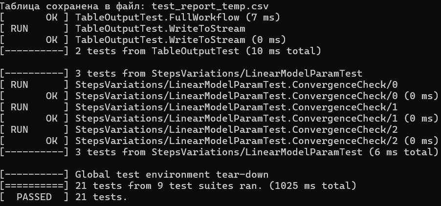
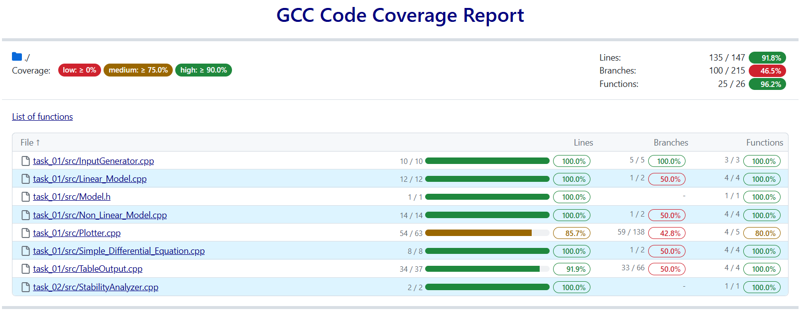

<p align="center"> Министерство образования Республики Беларусь</p>
<p align="center">Учреждение образования</p>
<p align="center">“Брестский Государственный технический университет”</p>
<p align="center">Кафедра ИИТ</p>
<br><br><br><br><br><br><br>
<p align="center">Лабораторная работа №2</p>
<p align="center">По дисциплине “Общая теория интеллектуальных систем”</p>
<p align="center">Тема: “Модульное тестирование и анализ устойчивости”</p>
<br><br><br><br><br>
<p align="right">Выполнил:</p>
<p align="right">Студент 2 курса</p>
<p align="right">Группы ИИ-30</p>
<p align="right">Самута А. Л.</p>
<p align="right">Проверил:</p>
<p align="right">Дворанинович Д. А.</p>
<br><br><br><br><br>
<p align="center">Брест 2026</p>

---

## 1. Цель работы

Освоить технологию модульного (юнит-) тестирования программ на C++ с применением фреймворка Google Test: научиться проверять правильность отдельных единиц кода, строить параметризованные тесты, работать с граничными случаями, измерять тестовое покрытие и трактовать его результаты. Дополнительно — закрепить навыки ООП (наследование, виртуальные методы, выделение модулей) на примере программы лабораторной работы №1, а также реализовать модуль анализа устойчивости систем.

## 2. Постановка задачи

Объект тестирования — программа ЛР1, включающая три математические модели (линейная, нелинейная и дифференциальная), генератор входных воздействий и модуль вывода. 

В рамках ЛР2 необходимо:
1. Разработать модуль анализа устойчивости для линейной дискретной модели.
2. Реализовать логическую проверку: если введенные коэффициенты приводят к расходящемуся процессу, программа должна выводить предупреждение до начала симуляции.
3. Покрыть программу модульными тестами с помощью Google Test.
4. Проверить правильность вычислений моделей на основе ручного расчета.
5. Проверить граничные значения нелинейностей и физические инварианты (состояние покоя, метод Эйлера).
6. Применить параметризованные тесты (TEST_P).
7. Использовать подмену входных сигналов для тестирования различных режимов управления (ступень, импульс, гармоника).
8. Настроить локальную автоматизацию сборки и запуска через run_tests.bat и измерить покрытие кода (gcovr).

## 3. Доработка программы по сравнению с ЛР1

Чтобы программу можно было удобно тестировать и не нарушать архитектуру ЛР1, код был разделен на независимые модули в папке task_02:

| Изменение | Файл | Зачем |
|---|---|---|
| Модуль анализа устойчивости | `src/StabilityAnalyzer.h/.cpp` | Вычисляет корень характеристического уравнения z - a = 0. Проверяет условие \|a\| < 1 и возвращает вердикт об устойчивости системы. |
| Изоляция тестов | `CMakeLists.txt` | Сборка тестов исключает `main.cpp` из ЛР1 во избежание конфликта функции `main()` с фреймворком Google Test. |

Логика самих моделей (`Linear_Model`, `Non_Linear_Model`, `Simple_Differential_Equation`) и меню `main.cpp` из ЛР1 не изменялись — тесты пишутся поверх готового кода.

## 4. Структура тестового проекта

Рабочая папка в репозитории: `trunk/ii03019/task_02/src/`.

| Файл | Содержимое |
|---|---|
| `src/StabilityAnalyzer.*` | Модуль аналитической проверки устойчивости |
| `src/main.cpp` | Модифицированный `main` из ЛР1 с добавлением проверки устойчивости |
| `src/test_models.cpp` | Тесты правильности выдаваемых значений и параметризованные тесты |
| `src/test_stability.cpp` | Тесты анализатора устойчивости (включая граничные значения) |
| `src/test_invariants.cpp` | Тесты инвариантов (нулевой вход) и граничных значений (Эйлер) |
| `src/test_input.cpp` | Тесты генератора входных сигналов (ступень, импульс, гармоника) |
| `src/test_TableOutput.cpp` | Тесты сохранения результатов в файл |
| `src/test_plotter.cpp` | Тесты формирования скриптов Gnuplot (без вызова внешних программ) |
| `src/test_getters.cpp` | Тесты методов получения текущего состояния (`GetY`, `GetLastU`) |
| `CMakeLists.txt` | Скачивание Google Test (FetchContent), сборка тестов |
| `run_tests.bat` | Автоматическая сборка, запуск `ctest` и генерация `coverage.html` через gcovr |

## 5. Тестовые сценарии

### 5.1. Правильность значений (ручной пересчет)
В тесте `LinearModelTest.ManualCalculation` проверяется линейная модель. Заданы параметры: `a=0.5, b1=1, b2=0, b3=0`, на вход подается ступенчатый сигнал `u=2`. 
Ручной расчет:
* Шаг 1: `y = 0.5*0 + 1.0*2 = 2.0`
* Шаг 2: `y = 0.5*2 + 1.0*2 = 3.0`
* Шаг 3: `y = 0.5*3 + 1.0*2 = 3.5`
Значения в тесте `EXPECT_DOUBLE_EQ` полностью совпадают с расчетом.

### 5.2. Тестирование модуля анализа устойчивости
Характеристическое уравнение: `z - a = 0`. Корень `z = a`. Система устойчива при `|a| < 1`.
Проверены следующие случаи:
* Устойчивые: `a = 0.5, a = -0.8, a = 0.0` (возвращает `true`).
* **Граничные (\|z\| = 1):** `a = 1.0, a = -1.0` (возвращает `false`, так как граница не является асимптотической устойчивостью).
* Неустойчивые: `a = 1.5, a = -2.0` (возвращает `false`).

### 5.3. Граничные значения (Метод Эйлера)
Для `Simple_Differential_Equation` проверяется шаг интегрирования. При `b=1.0`, `dt=0.1` и `u = pi/2`:
* `y0 = 0`
* `y1 = 0 + 0.1 * 1.0 * sin(pi/2) = 0.1`
* `y2 = 0.1 + 0.1 * 1.0 * 1.0 = 0.2`
Тест подтверждает корректность реализации схемы Эйлера.

### 5.4. Инварианты (Состояние покоя)
Для `Non_linear_Model` проверено физическое свойство: при нулевом входном сигнале `(u=0)` и нулевом начальном состоянии `(y=0)` система находится в покое. На протяжении 10 шагов значение `NextStep()` остается строго `0.0`.

### 5.5. Параметризованные тесты (`TEST_P`)
Для проверки сходимости алгоритмов при разных входных данных написан `LinearModelParamTest`. При коэффициенте `a=0.5` и постоянном входе `u=1.0` система стремится к установившемуся значению `1 / (1 - 0.5) = 2.0`. Тест параметризован значениями 10, 50 и 100 шагов, проверяя приближение к 2.0 с заданной точностью без дублирования кода.

### 5.6. Подмена входных сигналов (Вместо Google Mock)
Вместо использования полноценных мок-объектов, в проекте применен паттерн подмены состояния (State-based testing). В конструкторы моделей передается параметр `type`, который переключает `InputGenerator` между режимами:
* `type = 0`: Ступенчатое воздействие (const).
* `type = 1`: Импульсное воздействие.
* `type = 2`: Гармоническое воздействие `sin(t)`.
Тесты в `test_input.cpp` проверяют корректную обработку всех этих режимов, изолируя логику модели от внешней среды.

## 6. Результаты запуска

Запуск осуществляется скриптом `run_tests.bat`. Скрипт настраивает проект через CMake, компилирует его и запускает тесты. В результате выполнения консоль выводит успешный отчет Google Test.

```text
[----------] Global test environment tear-down.
[==========] 21 tests from 9 test suites ran. (1025 ms total)
...
[  PASSED  ] 21 tests.

100% tests passed, 0 tests failed out of 21
```



## 7. Тестовое покрытие

Измерение покрытия кода выполнено с помощью утилиты `gcovr` (сборка с флагами `--coverage -O0`). Интерактивный файл `main.cpp` был исключён из замера, так как он содержит интерфейс ввода-вывода, а не бизнес-логику.

Итоговые показатели по проекту:
- Покрытие строк (Line Coverage): 91.8% (135 / 147).
- Покрытие функций (Function Coverage): 96.2% (25 / 26).

Детализация по модулям

| Модуль / Класс | Покрытие строк (Line Coverage) | Покрытие функций (Func Coverage) | Статус |
|---|---|---|---|
| `InputGenerator.cpp` | 100.0% | 100.0% | OK |
| `Linear_Model.cpp` | 100.0% | 100.0% | OK |
| `Model.h` | 100.0% | 100.0% | OK |
| `Non_Linear_Model.cpp` | 100.0% | 100.0% | OK |
| `Plotter.cpp` | 85.7% | 80.0% | OK |
| `Simple_Differential_Equation.cpp` | 100.0% | 100.0% | OK |
| `TableOutput.cpp` | 91.9% | 100.0% | OK |
| `StabilityAnalyzer.cpp` | 100.0% | 100.0% | OK |
| **Итоговый результат** | **91.8%** | **96.2%** | **Success** |

*Примечание:* Файлы `Plotter.cpp` и `TableOutput.cpp` покрыты не на 100%, так как в них содержатся ветки системных ошибок (например, невозможности открыть файл для записи или вызовы внешней программы `gnuplot`). В соответствии с методологией юнит-тестирования, системные вызовы и работа с файловой системой не тестируются изолированно.



## 8. Соответствие требованиям задания

| Требование | Где выполнено |
|---|---|
| Использование Google Test | Тестовые файлы в папке `src` |
| Анализ устойчивости на Z-плоскости, вывод предупреждения | `StabilityAnalyzer`, тесты в `test_stability.cpp` |
| Модульные тесты в `task_02` | Соблюдена структура папок |
| Локальная автоматизация (`run_tests.bat`) | Скрипт собирает проект и запускает тесты |
| Отчет с процентом покрытия (`gcovr`) | Раздел 7 данного отчета |
| Параметризованные тесты (`TEST_P`) | `LinearModelParamTest` |
| Подмена входных сигналов | `InputGenerator` в тестах |

## 9. Выводы

В ходе лабораторной работы программа ЛР1 была успешно расширена модулем анализа устойчивости. С применением фреймворка Google Test написан 21 модульный тест, покрывающих расчеты моделей, граничные случаи и физические инварианты.

Параметризованные тесты (`TEST_P`) позволили проверить сходимость алгоритма при различных наборах данных. Для тестирования различных режимов управления (ступень, импульс, гармоника) применена подмена входных сигналов.

По результатам анализа утилитой gcovr достигнуто высокое покрытие кода тестируемых модулей: 91.8% строк и 96.2% функций, при этом все модули математической логики и анализа устойчивости покрыты на 100%. Цель работы достигнута.